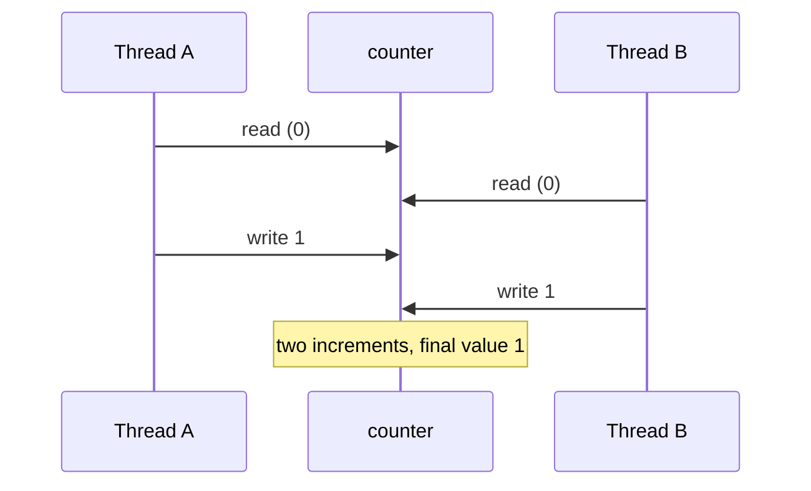

# Concurrency, parallelism and race conditions

After this you can say what concurrency and parallelism mean, explain how two threads can lose an update to a shared counter, and say why that bug appears only some of the time.

Before this: [Processes, threads and scheduling](../../02-operating-systems-and-linux/01-os-concepts/02-processes-threads-and-scheduling.md) and [References, mutability and copying](../02-thinking-like-a-programmer/02-references-mutability-and-copying.md).

## The idea

Two clerks update the same paper ledger. The ledger says 10 widgets. Both read "10", both sell one, and both write "9". Two widgets left the shelf but the ledger dropped by one. Neither clerk made a mistake alone. The mistake comes from the order in which their steps interleaved.

Threads in one process share memory, so they can make the same mistake with a variable.



In the diagram, thread B reads before thread A writes, so B's write overwrites A's. One increment is lost.

## Key terms

**Concurrency** means several tasks are in progress during the same period, with their steps interleaved. It is about structure: one core can run concurrent tasks by switching between them.

**Parallelism** means several tasks run at the same instant, on different cores. Parallelism needs concurrency, but concurrency does not need parallelism.

**Shared state** is data that more than one thread can read and change, such as a global variable or a list passed to several threads.

A **race condition** is a bug where the result depends on the timing of operations in different threads. A **data race** is the specific case of two threads accessing the same memory at once, with at least one writing.

A **critical section** is a piece of code that must not run in two threads at once, because it reads and then changes shared state.

## How it works

A statement like `counter += 1` looks like one step but is three: read the value, add one, write the result back. This is called **read-modify-write**. A thread can be paused between any two of those steps, and the operating system decides when (see scheduling in the earlier lesson). If another thread changes `counter` during the pause, the first thread writes an answer based on stale data.

The next program makes the pause explicit. Each of four threads adds 1 a hundred times. `time.sleep(0)` asks the scheduler to run another thread right now, which makes the interleaving happen every time.

```python
import threading
import time

counter = 0

def work():
    global counter
    for _ in range(100):
        value = counter        # read
        time.sleep(0)          # let another thread run
        counter = value + 1    # write

threads = [threading.Thread(target=work) for _ in range(4)]
for t in threads:
    t.start()
for t in threads:
    t.join()
print(counter, "expected 400")
```

Six runs on Python 3.14 gave six different answers, none of them 400:

```text
197 expected 400
234 expected 400
271 expected 400
299 expected 400
235 expected 400
282 expected 400
```

The numbers differ because the scheduler interleaves the threads differently each time. That is also why races are **intermittent**: the bug needs a specific interleaving, and the program is correct on every other one. A test can pass a thousand times and fail in production, and adding a `print` can hide the bug by changing the timing.

### The GIL

CPython has a **global interpreter lock** (GIL) that lets one thread run Python bytecode at a time. It protects the interpreter's own data, not yours. A thread can lose the GIL between the read and the write of `counter += 1`, so the race remains. The GIL only makes it rarer: with a plain `counter += 1` and four threads of a million increments each, three runs on Python 3.14 all printed `4000000`. That does not make the code safe, because the interpreter's switching rules are an implementation detail that can change.

As of 2026, a free-threaded build of CPython, with the GIL disabled, is available from version 3.13 on, and the official Windows and macOS installers can install it as an option ([Python docs](https://docs.python.org/3/howto/free-threading-python.html)). The default build still has the GIL. Check which you are running with `sys._is_gil_enabled()`. In a free-threaded build, threads run Python code in parallel, so races on shared data become more likely, not less.

## Worked examples

<div class="example" markdown>

### Example 1: lose updates, then find the critical section

1. Run the program above. Predict: the total is below 400.
2. Identify the critical section: the three lines from `value = counter` to `counter = value + 1`, because they read and then write shared state.
3. The fix is a lock around those lines, covered in the next lesson. Here is the preview, with the same sleep left in:

```python
lock = threading.Lock()

def work():
    global counter
    for _ in range(100):
        with lock:
            value = counter
            time.sleep(0)
            counter = value + 1
```

```text
400 expected 400
400 expected 400
400 expected 400
```

Check: three runs all print 400. With the lock, only one thread is inside the critical section at a time, so no read can happen between another thread's read and write.

</div>

## Common mistakes

<div class="warning" markdown>

Watch out: "It passed when I ran it, so it is thread-safe." A race needs a specific interleaving. Reason about which shared data is read and then written, not about test results.

Watch out: "The GIL makes my threaded code safe." The GIL protects the interpreter, not your read-modify-write sequences, and a free-threaded build has no GIL at all.

Watch out: confusing concurrency with speed. Concurrent code on one core does not run faster. Only parallelism uses more cores.

</div>

## Working with AI

<div class="ai" markdown>

Words to use: shared state, race condition, critical section, read-modify-write, interleaving, thread-safe.

Prompts to try:

- "Here is my threaded Python function. Which variables are shared between threads, and where is the read-modify-write?"
- "Write a test that makes this race fail every time by forcing a context switch between the read and the write."

What to check:

- AI often says a plain `counter += 1` is "atomic because of the GIL". Run it on a free-threaded build, or insert `time.sleep(0)`, to see that it is not.
- AI-written threaded code often shares a list or dict between threads with no protection. Ask what happens if two threads write at once.
- A "fixed" race that adds `time.sleep` to avoid collisions is still a race.

</div>

## Quiz

1\. What is the difference between concurrency and parallelism?

<details class="solution" markdown>
<summary>Answer</summary>

Concurrency is several tasks in progress with interleaved steps, possibly on one core. Parallelism is several tasks running at the same instant on different cores.

</details>

2\. Two threads each run `x += 1` on a shared `x` that starts at 0, with a pause between the read and the write. Which final values are possible?

<details class="solution" markdown>
<summary>Answer</summary>

1 or 2. If one thread finishes before the other reads, the result is 2. If both read 0 before either writes, both write 1.

</details>

3\. A colleague says a counter bug "only happens on the server". Give two reasons a race can appear in one place and not another.

<details class="solution" markdown>
<summary>Answer</summary>

Different core counts, load and scheduling change the interleaving. A different Python build (GIL or free-threaded) also changes how often the unlucky order happens.

</details>

4\. Which lines are the critical section?

```python
total = 0
def add(n):
    global total
    t = total
    t = t + n
    total = t
```

<details class="solution" markdown>
<summary>Answer</summary>

All three lines that touch `total`: reading it into `t`, adding, and writing it back. Another thread's change between the read and the write is lost.

</details>

## Lab

<div class="lab" markdown>

### Lab: measure the lost updates

Goal: see lost updates and how the count changes with the number of threads. Time: about 10 minutes. Runs in: any terminal with Python 3.

1. Save the race program above as `race.py` and run it five times. Note the totals.
2. Change the number of threads from 4 to 2, then to 8, and run each three times. The expected total is 100 times the thread count.
3. Delete the `time.sleep(0)` line, set the threads back to 4, and run it five times.
4. Add the lock from Example 1 and confirm the total is always 400.

Expected result: totals below the expected value that change on every run, a bigger shortfall with more threads (about 280 of 800 with 8 threads, and 160 to 200 of 200 with 2, in our runs), 400 on all five runs with the sleep removed, and exactly 400 with the lock.

<details class="solution" markdown>
<summary>Solution</summary>

More threads means more chances for a read to land between another thread's read and write, so the loss grows. With the sleep removed, the read and write are close together, so the pause rarely lands between them on current CPython. The program is still not safe: it is correct by luck of timing. Only the lock version is correct by design.

</details>

</div>

## Where this shows up

- [Locks, deadlocks and thread safety](02-locks-deadlocks-and-thread-safety.md) gives the tools to fix this.
- Databases face the same lost update between two transactions, and fix it with transactions and locks.
- [Garbage collection and reference counting](../04-memory-management/02-garbage-collection-and-reference-counting.md) is one reason CPython has a GIL: reference counts are shared state.
