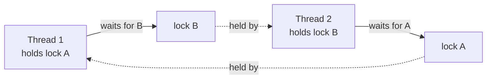

# Locks, deadlocks and thread safety

After this you can protect shared state with a lock, recognise and prevent a deadlock, and pass work between threads with a queue instead of shared variables.

Before this: [Concurrency, parallelism and race conditions](01-concurrency-parallelism-and-race-conditions.md).

## The idea

A single-occupancy washroom has a lock on the door. Whoever is inside has exclusive use, and others wait outside. A **lock** in a program works the same way: one thread holds it, and any other thread that asks for it waits. Wrapping a critical section in a lock removes the race from the last lesson.

Locks bring a new risk. If two people each hold one key and wait for the other's, nobody ever moves.



In the diagram, the waits form a cycle. Neither thread can continue, so the program hangs. This is a **deadlock**.

## Key terms

A **mutex** (mutual exclusion lock) lets only one thread hold it at a time. In Python it is `threading.Lock`. A thread calls `acquire()` to take it and `release()` to give it back.

A **semaphore** is a counter of permits. `threading.Semaphore(n)` lets up to $n$ threads hold a permit at once, and the next one waits. A mutex is a semaphore with one permit.

**Thread-safe** code gives correct results when called from several threads at once, without the caller adding locks.

A **deadlock** is a state where each thread in a group waits for a resource held by another thread in the group, so none can proceed.

A **queue** is a thread-safe first-in, first-out buffer. `queue.Queue` does its own locking inside `put` and `get`.

## How it works

### Locks

Use a lock as a context manager so that it is released even if the code inside raises an exception:

```python
lock = threading.Lock()

with lock:
    value = counter
    counter = value + 1
```

`with lock:` calls `acquire()` on entry and `release()` on exit. Calling `acquire()` by hand without a matching `release()` in a `finally` block is how locks get stuck held forever.

Keep the critical section small. Everything inside `with lock:` runs one thread at a time, so slow work there (a network call, a file read) cancels the benefit of having threads. Do the slow work outside the lock and take the lock only for the update of shared data.

### Semaphores

Use a semaphore to limit how many threads use a scarce resource, such as a connection pool of 2. With six threads and `Semaphore(2)`, no more than two are inside the block together.

```python
slots = threading.Semaphore(2)

def job():
    with slots:          # at most 2 threads inside at once
        ...
```

### Deadlock: four conditions

A deadlock needs all four of these at the same time (the Coffman conditions):

| Condition | Meaning |
|---|---|
| Mutual exclusion | A resource is held by one thread at a time. |
| Hold and wait | A thread holds one resource while waiting for another. |
| No preemption | A held resource cannot be taken away, only released by its holder. |
| Circular wait | A cycle of threads, each waiting for the next one's resource. |

Remove any one and a deadlock cannot happen. The practical fixes:

1. **Lock ordering.** Decide a global order (always `a` before `b`) and have every thread take locks in that order. This removes circular wait.
2. **Timeouts.** `lock.acquire(timeout=1)` returns `False` if the lock is not obtained in time, so the thread can back off, release what it holds and retry.
3. **Hold fewer locks.** Do not call unknown code, such as a callback, while holding a lock.

### Queues

Often the best fix is to not share state. Producer threads put work on a `queue.Queue`, and consumer threads take it off. Only the queue touches shared data, and it is already thread-safe. `Queue(maxsize=n)` makes `put` wait when the queue is full, which slows a fast producer down.

## Worked examples

<div class="example" markdown>

### Example 1: a deadlock that gives up

We build the diagram above. Thread `first` takes `a` then wants `b`. Thread `second` takes `b` then wants `a`. The sleeps make sure each holds its first lock before asking for the second. `first` waits at most one second and `second` at most three, so the program ends instead of hanging.

```python
import threading
import time

a = threading.Lock()
b = threading.Lock()

def first():
    with a:
        time.sleep(0.1)
        if not b.acquire(timeout=1):
            print("first: gave up waiting for b")
            return
        b.release()

def second():
    with b:
        time.sleep(0.1)
        if not a.acquire(timeout=3):
            print("second: gave up waiting for a")
            return
        a.release()

ts = [threading.Thread(target=first), threading.Thread(target=second)]
for t in ts: t.start()
for t in ts: t.join()
print("done")
```

```text
first: gave up waiting for b
done
```

Check: for one second each thread holds one lock and waits for the other, which is the cycle. Then `first` gives up and its `with a:` block lets go of `a`, so `second` gets `a` and finishes. The timeout broke the deadlock, but `first` did no work. To fix it properly with lock ordering, change `second` to take `a` first and then `b`. Then one thread gets both locks, finishes, and the other follows, and nothing is printed except `done`.

</div>

<div class="example" markdown>

### Example 2: producer and consumer

```python
import queue
import threading

q = queue.Queue(maxsize=2)
results = []

def producer():
    for n in range(5):
        q.put(n)
    q.put(None)              # sentinel: no more work

def consumer():
    while (item := q.get()) is not None:
        results.append(item * item)

ts = [threading.Thread(target=producer), threading.Thread(target=consumer)]
for t in ts: t.start()
for t in ts: t.join()
print(results)
```

```text
[0, 1, 4, 9, 16]
```

No lock appears in our code. Only the consumer touches `results`, and the queue hands items over safely. A sentinel value (`None`) tells the consumer to stop.

</div>

## Common mistakes

<div class="warning" markdown>

Watch out: locking different locks in different places. A lock protects data only if every access to that data uses the same lock object.

Watch out: calling `lock.acquire()` and then returning early or raising before `release()`. Use `with lock:`.

Watch out: taking a `threading.Lock` twice in one thread. It deadlocks against itself. Use `threading.RLock` if a function holding the lock must call another that takes it, or restructure the code.

</div>

## Working with AI

<div class="ai" markdown>

Words to use: mutex, semaphore, critical section, deadlock, lock ordering, timeout, thread-safe, producer and consumer.

Prompts to try:

- "List every lock this code takes and the order each function takes them. Is there a possible cycle?"
- "Replace the shared list and lock in this code with a queue.Queue producer and consumer."

What to check:

- AI often adds one big lock around everything. It is correct, but it can remove all the concurrency. Look for slow calls inside `with lock:`.
- AI-written code often updates shared data in one function without the lock that another function uses. Search for every read and write of the variable.
- "Thread-safe" in a library's docs usually covers single calls only. A check followed by an action, such as `if key not in d: d[key] = ...`, is still a race.

</div>

## Quiz

1\. Name the four conditions for a deadlock. Which one does lock ordering remove?

<details class="solution" markdown>
<summary>Answer</summary>

Mutual exclusion, hold and wait, no preemption and circular wait. Lock ordering removes circular wait.

</details>

2\. What does this print, and why does it not hang?

```python
import threading
lock = threading.Lock()
lock.acquire()
print(lock.acquire(timeout=0.2))
```

<details class="solution" markdown>
<summary>Answer</summary>

It prints `False` after about 0.2 seconds. The lock is already held, so the second `acquire` times out and returns `False` instead of waiting forever. Without the timeout it would hang.

</details>

3\. A web app uses 10 threads and one global lock around each whole request handler. It is correct but no faster than one thread. Why, and what would you change?

<details class="solution" markdown>
<summary>Answer</summary>

The lock lets one thread run the handler at a time, so the work is serial. Shrink the critical section to the lines that touch shared data, or stop sharing that data.

</details>

4\. A function checks `if key not in cache:` and then sets `cache[key] = compute()`. Each dict operation is thread-safe. Is the function?

<details class="solution" markdown>
<summary>Answer</summary>

No. Another thread can add the key between the check and the set, so the work runs twice or a value is overwritten. The check and the set together are a critical section and need one lock.

</details>

## Lab

<div class="lab" markdown>

### Lab: make a deadlock, then fix it

Goal: reproduce a deadlock and remove it with lock ordering. Time: about 15 minutes. Runs in: any terminal with Python 3.

1. Save Example 1 as `dead.py` and run it. Both threads time out.
2. Change `second` so it takes `a` first and then `b`. Run again.
3. Rewrite it with plain nested `with a:` and `with b:` in the same order in both functions, no timeout and no sleep. Add a global `total` that each thread increments while holding both locks, and print it at the end.
4. Run it ten times.

Expected result: step 1 prints two "gave up" lines. Step 2 prints only `done`. Step 4 prints `done 2` every time.

<details class="solution" markdown>
<summary>Solution</summary>

```python
import threading

a = threading.Lock()
b = threading.Lock()
total = 0

def worker():
    global total
    with a:              # same order in every thread
        with b:
            total += 1

ts = [threading.Thread(target=worker) for _ in range(2)]
for t in ts: t.start()
for t in ts: t.join()
print("done", total)
```

Prints `done 2` every time, because no thread holds `b` while waiting for `a`.

</details>

</div>

## Where this shows up

- [Threads, processes and asyncio](03-threads-processes-and-asyncio.md) shows when to avoid shared state altogether.
- Database transactions use the same ideas: row locks, deadlock detection and retry.
