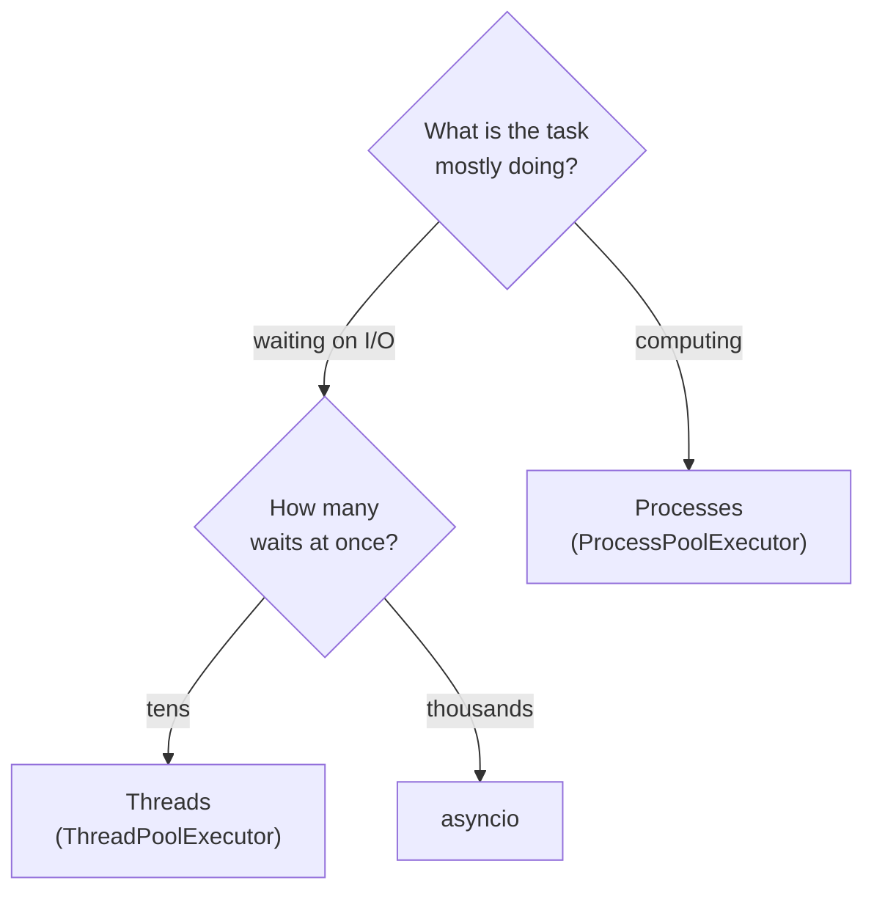
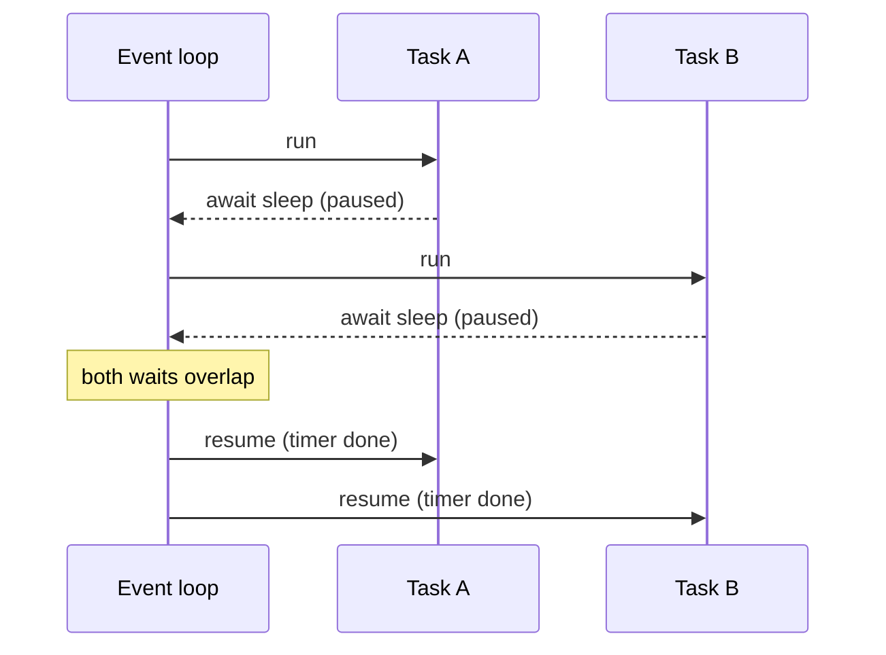

# Threads, processes and asyncio

After this you can tell whether a task is I/O-bound or CPU-bound, pick threads, processes or asyncio for it, and avoid the mistake that freezes an asyncio program.

Before this: [Locks, deadlocks and thread safety](02-locks-deadlocks-and-thread-safety.md).

## The idea

A cook at a restaurant starts the rice, and while it cooks, chops vegetables. The cook is never idle, but is also never doing two things at the same instant. A second cook doing the chopping would be real parallelism. Which helps depends on what the waiting is for. Waiting for rice to cook is waiting on something else, so one cook can overlap tasks. Chopping needs hands, so only more cooks make it faster.

Programs split the same way. A task is **I/O-bound** if it spends most of its time waiting for something outside the CPU: a network reply, a disk, a database. A task is **CPU-bound** if it spends most of its time computing.



In the diagram, the first question is what the task is waiting for, and the second is how many things you wait on at once.

## Key terms

A **thread** is a unit of execution inside a process. Threads share memory, so they need locks (last lesson). In CPython the GIL stops threads from running Python code in parallel, but a thread that is waiting on I/O releases it, so threads still overlap waits.

A **process** is a program with its own memory. Separate processes run in parallel on separate cores and do not share variables, so there are no data races between them. Data passes between them by copying (serialising) it.

**asyncio** is Python's library for running many tasks on a single thread by switching between them only at points the code marks.

A **coroutine** is a function defined with `async def`. Calling it returns a coroutine object that does nothing until it is run. `await` pauses the coroutine until the awaited thing finishes and lets other tasks run meanwhile.

The **event loop** is the scheduler that runs the tasks. It runs one task until that task hits an `await`, then picks another that is ready. This is called **cooperative multitasking**: each task has to give up control itself.

## How it works

**Threads** suit a modest number of I/O waits and code that uses blocking libraries. **Processes** suit CPU-bound work, because each process has its own interpreter and its own GIL. **asyncio** suits very many waits, such as thousands of open connections, because a coroutine costs far less than a thread. It needs libraries that support `await`.

`concurrent.futures` gives threads and processes the same interface. `ThreadPoolExecutor` and `ProcessPoolExecutor` take a function, run it on a pool of workers, and `map` returns results in input order. Switching between threads and processes means changing one class name.

In asyncio, `asyncio.run(main())` starts the loop. `asyncio.gather(a, b, c)` runs several awaitables at once and returns their results as a list in order.



In the diagram, each task runs only until its first `await`. The loop then switches to the other, so the two waits overlap on one thread.

## Worked examples

<div class="example" markdown>

### Example 1: three one-second waits

1. Define `fetch`, a coroutine that awaits `asyncio.sleep(1)`, standing in for a network call.
2. Run three of them with `asyncio.gather` and time the whole thing.

```python
import asyncio
import time

async def fetch(name):
    await asyncio.sleep(1)       # stands in for a network call
    return name

async def main():
    start = time.perf_counter()
    results = await asyncio.gather(fetch("a"), fetch("b"), fetch("c"))
    print(results, f"{time.perf_counter() - start:.1f}s")

asyncio.run(main())
```

```text
['a', 'b', 'c'] 1.0s
```

Check: sequentially this would take about 3 seconds. The time is about 1 second because the waits overlap (timings vary by machine, so expect "about").

Now the common mistake. Replace `await asyncio.sleep(1)` with `time.sleep(1)`:

```text
['a', 'b', 'c'] 3.0s
```

`time.sleep` blocks the whole thread. The loop cannot switch tasks while one is blocked, so the waits run one after another. The same happens with any blocking call inside a coroutine: `requests.get`, a slow database driver, a heavy loop. Use an `await`-able version, or move the blocking call to a thread with `await asyncio.to_thread(func, ...)`.

</div>

<div class="example" markdown>

### Example 2: pools for threads and processes

```python
import time
from concurrent.futures import ThreadPoolExecutor, ProcessPoolExecutor

def slow_io(n):
    time.sleep(0.5)
    return n * 2

def cpu(n):
    return sum(i * i for i in range(n))

if __name__ == "__main__":
    start = time.perf_counter()
    with ThreadPoolExecutor(max_workers=4) as pool:
        print(list(pool.map(slow_io, range(4))), f"{time.perf_counter() - start:.1f}s")

    sizes = [3_000_000] * 4
    start = time.perf_counter()
    [cpu(n) for n in sizes]
    serial = time.perf_counter() - start
    start = time.perf_counter()
    with ProcessPoolExecutor(max_workers=4) as pool:
        list(pool.map(cpu, sizes))
    par = time.perf_counter() - start
    print(f"serial {serial:.2f}s, processes {par:.2f}s")
```

```text
[0, 2, 4, 6] 0.5s
serial 1.14s, processes 0.62s
```

Four half-second waits take about 0.5 seconds on threads. The CPU-bound work is about twice as fast on four processes in our run (start-up and copying data cost something, so the gain is below 4 times, and the numbers vary by machine). With four threads on the default build, the same CPU work took 0.96 s against 1.05 s serial, which is no real gain. The `if __name__ == "__main__":` guard is needed on Windows and macOS, where each worker process re-imports the file.

</div>

## Common mistakes

<div class="warning" markdown>

Watch out: blocking the event loop with `time.sleep`, a synchronous HTTP call or a long computation inside `async def`. All other tasks freeze. Use the async version or `asyncio.to_thread`.

Watch out: forgetting `await`. `fetch("a")` alone only creates a coroutine object, and Python warns that it was never awaited.

Watch out: using threads for CPU-bound Python code on the default build. They add overhead and no speed. Use processes, or a free-threaded build after checking that your libraries support it.

</div>

## Working with AI

<div class="ai" markdown>

Words to use: I/O-bound, CPU-bound, event loop, coroutine, await, ThreadPoolExecutor, ProcessPoolExecutor.

Prompts to try:

- "This function downloads 200 URLs one after another with requests. Rewrite it with a ThreadPoolExecutor, and then with asyncio and httpx. Which would you pick and why?"
- "Find every blocking call inside the async functions in this file."

What to check:

- AI often marks a function `async def` but fills it with blocking calls. It runs, but it is not concurrent. Time it.
- Speed-up claims depend on the machine. Measure with your own data before trusting a number.
- Arguments sent to a `ProcessPoolExecutor` must be picklable (serialisable). Lambdas and open files fail.

</div>

## Quiz

1\. Is parsing 1000 large JSON files from disk I/O-bound or CPU-bound? How would you find out?

<details class="solution" markdown>
<summary>Answer</summary>

Usually CPU-bound once the files are in the cache, but reading them can be I/O-bound. Measure: if the CPU use is near 100 percent of one core, it is CPU-bound and processes help. If the CPU is mostly idle, it is I/O-bound.

</details>

2\. What does this print?

```python
import asyncio

async def hi():
    return "hi"

print(hi())
```

<details class="solution" markdown>
<summary>Answer</summary>

A line like `<coroutine object hi at 0x...>`, plus a "never awaited" warning. Calling a coroutine function does not run it. Use `asyncio.run(hi())` or `await hi()`.

</details>

3\. An async web handler calls `requests.get(url)` and the server handles one request at a time under load. Why, and what is the fix?

<details class="solution" markdown>
<summary>Answer</summary>

`requests.get` blocks the single event-loop thread, so no other request makes progress. Use an async HTTP client with `await`, or run the call with `asyncio.to_thread`.

</details>

4\. Why do processes avoid the race condition from the first lesson?

<details class="solution" markdown>
<summary>Answer</summary>

Each process has its own memory, so a variable in one process is a different variable from the same name in another. Data moves only by being copied between them.

</details>

## Lab

<div class="lab" markdown>

### Lab: time three approaches

Goal: measure sequential, thread-pool and asyncio versions of the same waiting task. Time: about 15 minutes. Runs in: any terminal with Python 3.

1. Write `wait(n)` that sleeps 0.5 seconds and returns `n`. Call it for 8 values in a plain loop and time it.
2. Run the same 8 calls with `ThreadPoolExecutor(max_workers=8)` and time it.
3. Write an async version with `asyncio.sleep(0.5)` and `asyncio.gather`, and time it.
4. Change the async version to use `time.sleep(0.5)` and time it again.

Expected result: about 4 seconds, about 0.5 seconds, about 0.5 seconds, then about 4 seconds again.

<details class="solution" markdown>
<summary>Solution</summary>

```python
import asyncio
import time
from concurrent.futures import ThreadPoolExecutor

def wait(n):
    time.sleep(0.5)
    return n

async def await_one(n):
    await asyncio.sleep(0.5)
    return n

async def run_async():
    return await asyncio.gather(*(await_one(n) for n in range(8)))

start = time.perf_counter()
[wait(n) for n in range(8)]
print("loop", round(time.perf_counter() - start, 1))

start = time.perf_counter()
with ThreadPoolExecutor(max_workers=8) as pool:
    list(pool.map(wait, range(8)))
print("threads", round(time.perf_counter() - start, 1))

start = time.perf_counter()
asyncio.run(run_async())
print("asyncio", round(time.perf_counter() - start, 1))
```

Step 4: swap `asyncio.sleep(0.5)` for `time.sleep(0.5)` inside `await_one`, and the async time returns to about 4 seconds.

</details>

</div>

## Where this shows up

- JavaScript runs on an event loop that works the same way, with `async` and `await` on promises. You will meet it in [Async JavaScript and the event loop](../../08-front-end/02-javascript-and-typescript/03-async-javascript-and-the-event-loop.md).
- Web servers choose between thread pools, process pools and an event loop for the same reasons.
