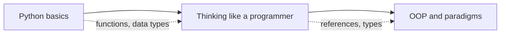

# Programming fundamentals

Python from the basics, the habits of thinking like a programmer, and object-oriented and functional ideas.

Before this folder: How computers work, and Operating systems and Linux for the terminal.

This folder teaches Python from values and control flow up to modules and virtual environments, then the habits that separate reading code from writing it: recursion, references and mutability, type systems, and debugging. The last chapter covers object-oriented and functional ideas, so words like "class", "interface" and "pure function" mean something precise.

An AI tool will write a lot of Python for you, but you are the one who reads it. Most of the bugs worth catching here are the ones the tool also makes: a mutable default argument, a shallow copy, an unhandled exception, a wrong type assumption.

It builds on [How computers work](../01-how-computers-work/index.md) and uses the terminal from [Operating systems and Linux](../02-operating-systems-and-linux/index.md). Almost everything after it needs it: [Developer tools and workflow](../04-developer-tools-and-workflow/index.md), [Discrete math for CS](../05-discrete-math-for-cs/index.md), [Data structures and algorithms](../06-data-structures-and-algorithms/index.md) and [Databases, SQL and Postgres](../10-databases-sql-and-postgres/index.md) all use Python code.

### How to use this folder

- If you already write Python, skim Python basics and read Thinking like a programmer closely.
- Run every snippet. Predicting the output before you run it is the point.
- Keep the Python basics cheat sheet open while you do the later labs.

<!-- lessons:start -->
## Lessons

### 1. [Python basics](01-python-basics/index.md)

1. [Values, types and variables](01-python-basics/01-values-types-and-variables.md)
2. [Control flow](01-python-basics/02-control-flow.md)
3. [Functions and scope](01-python-basics/03-functions-and-scope.md)
4. [Lists, dicts, sets and tuples](01-python-basics/04-lists-dicts-sets-and-tuples.md)
5. [Strings and formatting](01-python-basics/05-strings-and-formatting.md)
6. [Errors and exceptions](01-python-basics/06-errors-and-exceptions.md)
7. [Files and I/O](01-python-basics/07-files-and-io.md)
8. [Modules, packages, pip and venv](01-python-basics/08-modules-packages-pip-and-venv.md)

### 2. [Thinking like a programmer](02-thinking-like-a-programmer/index.md)

1. [Recursion](02-thinking-like-a-programmer/01-recursion.md)
2. [References, mutability and copying](02-thinking-like-a-programmer/02-references-mutability-and-copying.md)
3. [Type systems](02-thinking-like-a-programmer/03-type-systems.md)
4. [Reading code and debugging](02-thinking-like-a-programmer/04-reading-code-and-debugging.md)

### 3. [OOP and paradigms](03-oop-and-paradigms/index.md)

1. [Classes and objects](03-oop-and-paradigms/01-classes-and-objects.md)
2. [Encapsulation, inheritance and polymorphism](03-oop-and-paradigms/02-encapsulation-inheritance-and-polymorphism.md)
3. [Composition and interfaces](03-oop-and-paradigms/03-composition-and-interfaces.md)
4. [Functional programming ideas](03-oop-and-paradigms/04-functional-programming-ideas.md)

<!-- lessons:end -->
