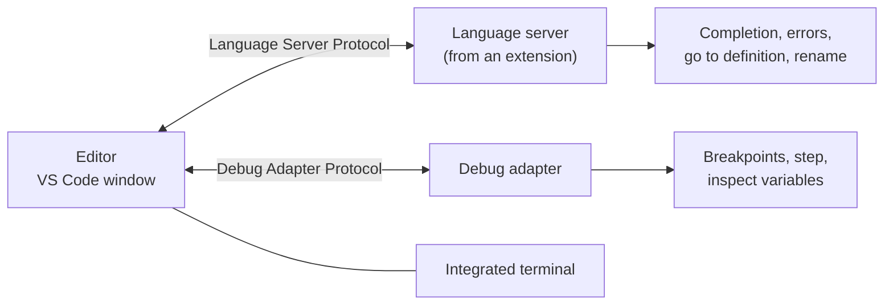
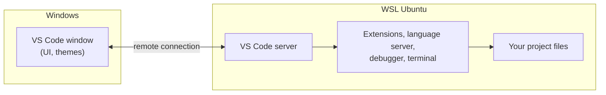

# VS Code and IDEs

After this you can say what an IDE adds over a text editor, set up VS Code with a `settings.json` and the WSL extension, and use go-to-definition, rename and the debugger instead of searching by hand.

Before this: [Setting up your machine](../../00-start-here/setting-up-your-machine.md) and [Reading code and debugging](../../03-programming-fundamentals/02-thinking-like-a-programmer/04-reading-code-and-debugging.md).

## The idea

You open a project with 200 files and need to change the name of a function used in 40 places. In a plain text editor you search and replace, and you also rename a variable that happens to share the name. In an IDE you press one key and the tool renames only the real uses of that function, because it understands the code.

An editor changes text. An **IDE** (integrated development environment) bundles an editor with tools that understand your language: completion, error checking, navigation, refactoring, a debugger and a terminal. VS Code sits in between: it is an editor, and extensions add the IDE parts one language at a time.



## Key terms

A **language server** is a separate program that analyses your code and answers the editor's questions ("where is this defined?", "what errors are here?"). The **Language Server Protocol** (LSP) is the standard way an editor talks to it, so one server works in many editors ([VS Code guide](https://code.visualstudio.com/api/language-extensions/language-server-extension-guide)).

A **debugger** runs your program under control: it pauses at a **breakpoint** (a line you marked) and lets you step line by line and read variables.

A **refactoring** changes the structure of code without changing what it does, such as renaming a symbol across files.

An **extension** is an add-on package that gives VS Code a language, a theme or a tool.

## How it works

VS Code itself is small. When you open a `.py` file and install the Python extension, the extension starts a language server in the background. Each time you type, the editor sends the text to the server, and the server replies with squiggles, completions and answers. Nothing is magic: a wrong answer means the server misread your project, usually because it picked the wrong Python interpreter or the wrong folder as the project root.

Settings live in JSON files, in layers. Run "Preferences: Open User Settings (JSON)" from the command palette to edit the user file (on Windows, `%APPDATA%\Code\User\settings.json`). A `.vscode/settings.json` inside a project holds workspace settings, which override your user settings for that project ([settings docs](https://code.visualstudio.com/docs/editor/settings)). Commit the workspace file only if the whole team wants those settings.

```json
{
    "editor.formatOnSave": true,
    "editor.tabSize": 4,
    "files.autoSave": "afterDelay",
    "files.insertFinalNewline": true,
    "files.trimTrailingWhitespace": true
}
```

On Windows you will often develop inside WSL. The **WSL** extension (`ms-vscode-remote.remote-wsl`) keeps the window on Windows but starts a small server inside Linux, so files, terminal, debugger and most extensions run in Ubuntu ([docs](https://code.visualstudio.com/docs/remote/wsl)). From a WSL terminal, `code .` opens the current folder this way. The same design powers the SSH and Dev Containers extensions.



JetBrains makes a family of paid-and-free IDEs (IntelliJ IDEA for Java, PyCharm for Python, WebStorm for JavaScript). They ship the analysis built in rather than through extensions, so they are heavier but deeper on refactoring. The concepts here carry over; only the key bindings change.

Keys worth knowing on Windows and Linux (macOS uses Cmd for Ctrl) ([navigation](https://code.visualstudio.com/docs/editor/editingevolved), [debugging](https://code.visualstudio.com/docs/debugtest/debugging)):

| Keys | Action |
|---|---|
| `Ctrl+Shift+P` | command palette: every command, by name |
| `Ctrl+P` | open a file by name |
| `F12` / `Shift+F12` | go to definition / find all references |
| `F2` | rename symbol |
| `Ctrl+.` | quick fix |
| `F9`, `F5` | toggle breakpoint, start or continue debugging |
| `F10`, `F11` | step over, step into |

## Worked examples

<div class="example" markdown>

### Example 1: find a crash with the debugger

The file `average.py` crashes on its last line.

```python
def average(values):
    total = 0
    for v in values:
        total += v
    return total / len(values)


scores = [72, 85, 90]
print(average(scores))
print(average([]))
```

```text
82.33333333333333
Traceback (most recent call last):
  File "average.py", line 10, in <module>
    print(average([]))
          ~~~~~~~^^^^
  File "average.py", line 5, in average
    return total / len(values)
           ~~~~~~^~~~~~~~~~~~
ZeroDivisionError: division by zero
```

1. Click left of line 5 (or press `F9`) to set a breakpoint on the `return`.
2. Press `F5` and choose the option that debugs the current Python file. The program pauses at the first call, with `values` showing `[72, 85, 90]` in the Variables panel.
3. Press `F5` again. It pauses at the second call: `values` is `[]` and `total` is 0.
4. The cause is visible without a print statement: `len(values)` is 0. The fix is to decide what an empty list should return and handle it before the division.

Check: add `if not values: return 0.0`, run again, and the second line prints `0.0`.

</div>

## Common mistakes

<div class="warning" markdown>

Watch out: installing the Python extension on the Windows side while your code runs in WSL. The language server then analyses a different Python than the one that runs your code. Open the folder through WSL and install the extension there (the Extensions view shows an Install button for WSL).

Watch out: trusting every squiggle or every "quick fix". A server with the wrong interpreter reports errors for packages you did install. Check the interpreter shown in the status bar first.

Watch out: installing many extensions. Each runs code with access to your files. Install extensions from known publishers and remove ones you do not use.

</div>

## Working with AI

<div class="ai" markdown>

Words to use: language server, workspace settings, launch configuration, breakpoint, step over and step into, remote extension, interpreter.

Prompts to try:

- "My VS Code (Windows, project in WSL Ubuntu) shows `Import "requests" could not be resolved` but `python -c 'import requests'` works in the WSL terminal. Which setting or interpreter selection should I check, in what order?"
- "Write a `.vscode/launch.json` for a Python file `app.py` that takes the argument `--debug`. Explain each field."

What to check:

- Setting names that do not exist. Search the name in the Settings UI; a real setting appears there.
- A `launch.json` that uses an outdated `"type"` value. Compare with the [debugging docs](https://code.visualstudio.com/docs/debugtest/debugging).
- Advice to edit user settings when the problem is the workspace (or the reverse). Check which file wins.

</div>

## Quiz

1\. Name three things an IDE gives you that a plain text editor does not.

<details class="solution" markdown>
<summary>Answer</summary>

Any three of: code-aware completion, error checking as you type, go to definition, safe rename across files, a debugger with breakpoints, an integrated terminal. They come from a language server and a debug adapter that understand the language.

</details>

2\. A project has `"editor.tabSize": 2` in `.vscode/settings.json` and `4` in your user settings. Which applies in that project?

<details class="solution" markdown>
<summary>Answer</summary>

2. Workspace settings override user settings.

</details>

3\. The debugger is paused on a line that calls `parse(line)`. You want to see inside `parse`. Which key, and which key if you do not?

<details class="solution" markdown>
<summary>Answer</summary>

`F11` (step into) to go inside `parse`. `F10` (step over) runs the call as one step and stops on the next line.

</details>

4\. You work in WSL but the Python extension reports missing modules you installed in WSL. What is the likely cause?

<details class="solution" markdown>
<summary>Answer</summary>

The window is not connected to WSL, or the extension is installed only on the Windows side, so it checks the wrong interpreter. Reopen with `code .` from the WSL terminal, install the extension in WSL and select the WSL interpreter.

</details>

## Lab

<div class="lab" markdown>

### Lab: set up VS Code for a WSL project

Goal: open a folder through WSL, add workspace settings and fix a crash with the debugger. Time: about 15 minutes. Runs in: WSL (Ubuntu) with VS Code on Windows.

1. In WSL, create the project and open it.

   ```bash
   mkdir -p ~/lab/vscode && cd ~/lab/vscode
   code .
   ```

   The window's bottom-left corner shows "WSL: Ubuntu".

2. Create `average.py` with the code from Example 1.
3. In the Extensions view install the Python extension in WSL.
4. Run "Preferences: Open Workspace Settings (JSON)" and paste the settings block from above.
5. Set the breakpoint and step through as in Example 1. Press `F12` on `average` in line 8 to jump to its definition, then `F2` on `values` to rename it to `numbers`.
6. Cleanup: close the window and run `rm -r ~/lab/vscode`.

Expected result: the Variables panel shows `values` as `[]` at the second pause, and after the rename both uses of the parameter in `average` changed.

<details class="solution" markdown>
<summary>Solution</summary>

The fix is a guard at the top of `average`: `if not values: return 0.0`. The rename changes `values` only inside `average`, which shows the tool scopes the rename by understanding the code.

</details>

</div>

## Where this shows up

- Every later lesson assumes this setup; the next one, [Git basics](02-git-basics.md), uses the terminal and source control view from the same window.
- Remote development over SSH, which builds on [SSH and keys](../../02-operating-systems-and-linux/02-linux-command-line/10-ssh-and-keys.md).
