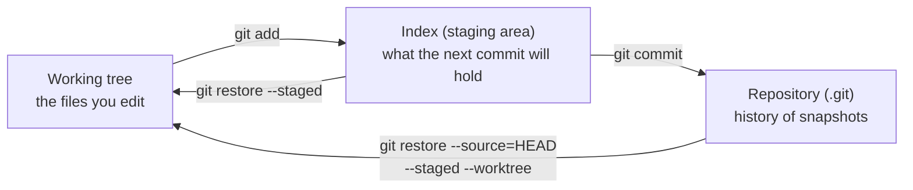

# Git basics

After this you can put a project under version control, save a snapshot with `git add` and `git commit`, read `status`, `diff` and `log`, undo an uncommitted edit, and write a commit message that a teammate can use.

Before this: [VS Code and IDEs](01-vs-code-and-ides.md) and the [shell basics](../../02-operating-systems-and-linux/02-linux-command-line/01-shell-and-terminal-basics.md).

## The idea

You change a function, the program breaks, and you cannot remember what the working version looked like. Copies named `app_final_v2_REAL.py` are one answer. **Git** is the other: a tool that records the state of your whole project at moments you choose, so you can compare, go back and combine work with other people.

Git does not store a list of edits. Each saved moment is a **snapshot** of every tracked file (Git reuses unchanged files so this stays small). Each snapshot points to the one before it, which forms the history. Git works in three places on your machine, and nearly every command moves changes between them.



## Key terms

A **repository** (repo) is a project folder plus its history, stored in a hidden `.git` folder inside it.

The **working tree** is the files as they are on disk now. The **index**, also called the staging area, is the draft of your next snapshot.

A **commit** is one snapshot plus a message, an author, a time and a pointer to its parent commit. It is named by a **hash**, a 40-character ID computed from its contents; the first 7 characters are enough in practice.

**HEAD** is the commit you are currently on. A file is **tracked** if Git knows about it, otherwise **untracked**.

## How it works

Tell Git who you are once per machine, and set the default branch name: these go in your commit records.

```bash
git config --global user.name "Sam Lee"
git config --global user.email "sam@example.com"
git config --global init.defaultBranch main
```

The daily loop is: edit, look, stage, commit. `git status` tells you which of the three places each change is in; `git diff` shows the lines changed in the working tree compared with the index; `git diff --staged` shows the index compared with the last commit ([git-diff](https://git-scm.com/docs/git-diff)).

| Command | What it does |
|---|---|
| `git init` | start a repository in this folder |
| `git status` | show changed, staged and untracked files |
| `git add <file>` | copy the current version of a file into the index |
| `git commit -m "msg"` | turn the index into a new commit |
| `git diff` / `git diff --staged` | unstaged changes / staged changes |
| `git log --oneline` | one line per commit, newest first |
| `git restore <file>` | throw away unstaged edits to a file |
| `git restore --staged <file>` | unstage a file, keeping the edit |

Files you never want tracked (caches, build output, secrets such as `.env`) go in a `.gitignore` file, one pattern per line ([gitignore](https://git-scm.com/docs/gitignore)). It only affects untracked files: if a secret was already committed, ignoring it later does not remove it from history.

A good commit holds one logical change and has a message in this shape: a subject line of about 50 characters in the imperative ("Add greet function", not "added stuff"), a blank line, then optional detail on why the change was made. The diff already shows what changed; the message says why.

## Worked examples

<div class="example" markdown>

### Example 1: first commits and an undo

We make a repo, commit twice, stage a change by mistake and undo it. Your hashes will differ.

1. Create the file and look at `status`. Git sees `app.py` but does not track it yet.

   ```bash
   git init -b main
   printf 'def greet(name):\n    return "Hello, " + name\n\nprint(greet("Ada"))\n' > app.py
   git status
   ```

   ```text
   On branch main

   No commits yet

   Untracked files:
     (use "git add <file>..." to include in what will be committed)
   	app.py

   nothing added to commit but untracked files present (use "git add" to track)
   ```

2. Stage and commit.

   ```bash
   git add app.py
   git commit -m "Add greet function"
   ```

   ```text
   [main (root-commit) 1828e9b] Add greet function
    1 file changed, 4 insertions(+)
    create mode 100644 app.py
   ```

3. Edit the greeting to `"Hello, dear "`, then run `git diff`. A `-` line is the old text and a `+` line is the new text.

   ```text
   diff --git a/app.py b/app.py
   index 11493bc..09c57eb 100644
   --- a/app.py
   +++ b/app.py
   @@ -1,4 +1,4 @@
    def greet(name):
   -    return "Hello, " + name
   +    return "Hello, dear " + name
   
    print(greet("Ada"))
   ```

4. Commit it with `git commit -am "Make greeting friendlier"` (`-a` stages changes to files that are already tracked). Then undo a change: edit the file back, run `git add app.py`, and note that `git diff` prints nothing while `git status -s` shows `M ` (staged). Run `git restore --staged app.py`, then `git restore app.py`.

   ```text
   git status -s after git add:        M  app.py
   git status -s after --staged:        M app.py
   git status after plain restore:      nothing to commit, working tree clean
   ```

5. Add `.gitignore` containing `__pycache__/` and `.env`. A `.env` file and a `__pycache__` folder that were listed as untracked disappear from `git status`, and then:

   ```bash
   git add .gitignore
   git commit -m "Ignore caches and .env"
   git log --oneline
   ```

   ```text
   ff7f1eb Ignore caches and .env
   ebcaa89 Make greeting friendlier
   1828e9b Add greet function
   ```

Check: `cat app.py` shows the "dear" version, because `git restore app.py` returned the file to the last commit.

</div>

<div class="example" markdown>

### Example 2: a commit really is a snapshot

`git cat-file -p HEAD` prints the commit record, and `HEAD^{tree}` prints the folder listing it points to.

```bash
git cat-file -p HEAD
git cat-file -p 'HEAD^{tree}'
```

```text
tree e5a48ded30352f6345bfe363c6a03736da8e480f
parent ebcaa8945094e7126b6bb81c154bef19b9527a55
author Sam Lee <sam@example.com> 1792950991 -0400
committer Sam Lee <sam@example.com> 1792950991 -0400

Ignore caches and .env
100644 blob c61f6af07f717d2e10c496e722bbe78a1d886866	.gitignore
100644 blob 09c57eb3a36a3dc7d50d4c9707de0682448ff0c1	app.py
```

The commit holds a `tree` (the whole project listing, including `app.py`, which this commit did not change) and a `parent`. The `app.py` blob has the same hash as in Example 1, step 3: unchanged content is reused, not copied.

</div>

## Common mistakes

<div class="warning" markdown>

Watch out: `git add .` stages everything, including files you did not mean to commit. Run `git status` before every commit, and read `git diff --staged`.

Watch out: `git restore <file>` discards edits permanently, because they were never committed. If you are unsure, commit first or use stash (next lesson).

Watch out: committing a secret and then deleting it in the next commit. It remains in history. Treat the secret as leaked and rotate it.

</div>

## Working with AI

<div class="ai" markdown>

Words to use: working tree, staging area (index), commit, HEAD, untracked, `.gitignore`, `git diff --staged`.

Prompts to try:

- "Here is my `git status` output: (paste). I want to commit only `app.py` and leave `notes.txt` out. Give the exact commands and what `git status` should show after each."
- "Write a commit message for this `git diff --staged` output: (paste). Subject under 50 characters, imperative, then a short body explaining why."

What to check:

- Commands that rewrite or discard work (`reset --hard`, `clean -fd`, `checkout .`) offered for a simple task. Ask what each one deletes before running it.
- Messages that describe what the diff already shows, or claim changes that are not in the diff. Read the message against `git diff --staged`.
- A `.gitignore` that lists secrets after they were committed. Check `git ls-files` for the file.

</div>

## Quiz

1\. What are the three places a change can live in Git, and which command moves a change from the first to the second?

<details class="solution" markdown>
<summary>Answer</summary>

Working tree, index (staging area), repository. `git add` moves a change from the working tree to the index; `git commit` moves it to the repository.

</details>

2\. After editing `app.py` and running `git add app.py`, `git diff` prints nothing. Why?

<details class="solution" markdown>
<summary>Answer</summary>

`git diff` compares the working tree with the index. They are now identical. `git diff --staged` shows the change.

</details>

3\. You added `.env` to `.gitignore`, but `git status` still lists `.env` as modified. What happened and what do you do?

<details class="solution" markdown>
<summary>Answer</summary>

`.env` was already tracked, and ignore rules only apply to untracked files. Run `git rm --cached .env` and commit, then rotate any secret in it, because earlier commits still contain it.

</details>

4\. Which commit message is better: "fix" or "Handle empty list in average"? Why?

<details class="solution" markdown>
<summary>Answer</summary>

The second. It is imperative, names the change and can be understood in `git log --oneline` without opening the diff.

</details>

## Lab

<div class="lab" markdown>

### Lab: your first repository

Goal: make three commits, an undo and a `.gitignore`. Time: about 15 minutes. Runs in: WSL (Ubuntu) or Git Bash.

1. Set up a folder and repo.

   ```bash
   mkdir -p ~/lab/git-basics && cd ~/lab/git-basics
   git init -b main
   ```

2. Create `app.py` as in Example 1, run `git status`, then `git add` and `git commit`.
3. Change the greeting, run `git diff`, then commit with `-am`.
4. Edit the file again, stage it, then unstage it with `git restore --staged app.py` and discard it with `git restore app.py`.
5. Create `.env` and a `__pycache__` folder, write `.gitignore` and confirm `git status` no longer lists them. Commit.
6. Cleanup: `cd ~ && rm -r ~/lab/git-basics`.

Expected result: `git log --oneline` lists three commits and `git status` says the working tree is clean.

<details class="solution" markdown>
<summary>Solution</summary>

The commands in Example 1 are the full solution. If `git commit` complains "Please tell me who you are", run the two `git config --global` commands from How it works.

</details>

</div>

## Where this shows up

- [Branches, merging and conflicts](03-branches-merging-and-conflicts.md) builds on the commit graph from this lesson.
- Every project in later chapters starts with `git init` and a `.gitignore`; secrets in history are covered in [secrets and dependency security](../../12-security/01-web-security/06-secrets-and-dependency-security.md).
