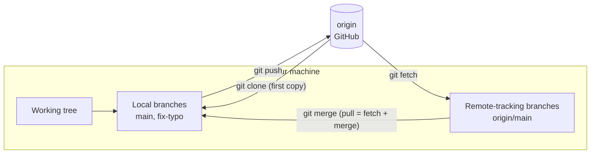
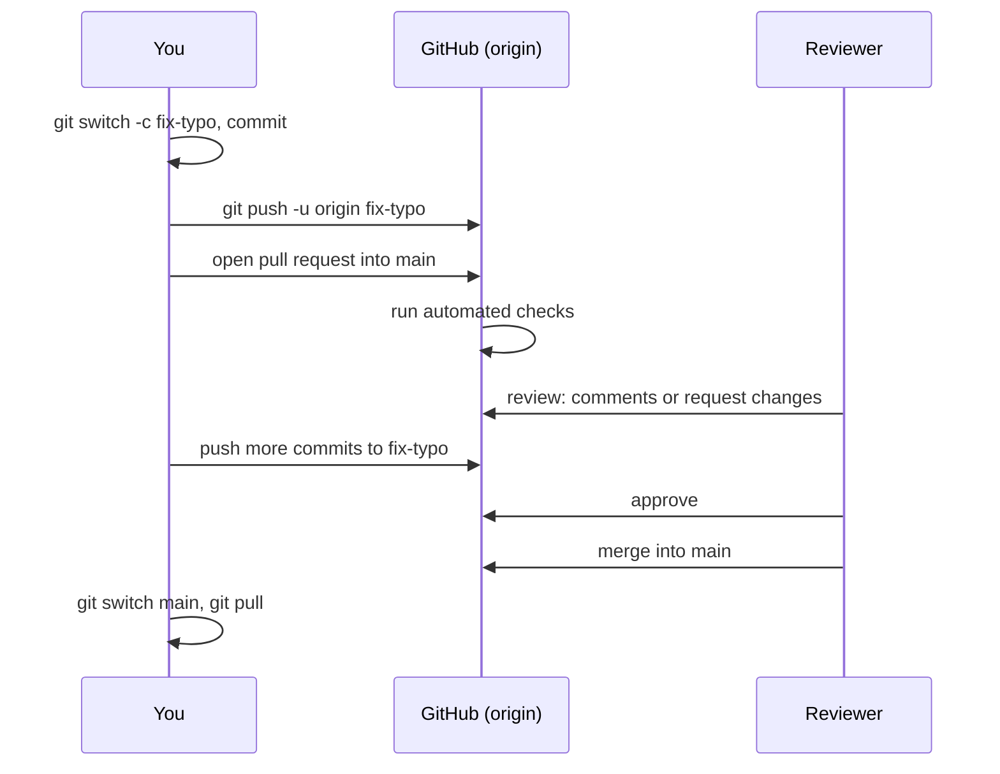

# GitHub, pull requests and code review

After this you can connect a local repository to a remote, use `clone`, `fetch`, `pull` and `push`, open and review a pull request, explain why `main` is usually protected, and choose between SSH and HTTPS for logging in.

Before this: [Branches, merging and conflicts](03-branches-merging-and-conflicts.md).

## The idea

Your repository so far lives on one laptop. To work with other people, or to keep a backup, you need a second copy in a shared place. Git is distributed: every clone holds the full history, and a **remote** is just another copy that your repository knows by name. GitHub hosts such copies and adds a web interface for discussing changes.



## Key terms

A **remote** is a named URL of another copy of the repository; the default name is `origin`. A **remote-tracking branch** such as `origin/main` is your local record of where `main` was on the remote at the last fetch.

**Clone** copies a remote repository, with history, to your machine. **Fetch** downloads new commits and updates `origin/main` without changing your files. **Pull** is fetch followed by a merge (or rebase) into your current branch. **Push** uploads your commits to a remote branch.

A **pull request** (PR) is a request on GitHub to merge one branch into another, with a page for discussion, review and automated checks. A **fork** is your own copy of someone else's repository on GitHub, used when you cannot push to the original.

## How it works

The cycle for a team repository follows GitHub's own description of its workflow ([GitHub flow](https://docs.github.com/en/get-started/using-github/github-flow)): branch, commit, push, open a pull request, respond to review, merge, delete the branch.



A reviewer can leave one of three review types: Comment (feedback without a verdict), Approve, or Request changes, which must be addressed before merging ([about reviews](https://docs.github.com/en/pull-requests/collaborating-with-pull-requests/reviewing-changes-in-pull-requests/about-pull-request-reviews)). Good review comments point at a line, say why, and suggest a fix. Good PRs are small, have a description of what and why, and link the issue.

Most teams protect `main` so that nobody pushes to it directly. In a classic branch protection rule, the options include "Require a pull request before merging", "Require approvals", "Require status checks to pass before merging" and "Allow force pushes", which is off by default; find them under the repository's Settings, then Branches ([docs](https://docs.github.com/en/repositories/configuring-branches-and-merges-in-your-repository/managing-protected-branches/managing-a-branch-protection-rule)). GitHub also offers rulesets for the same purpose. The PR page offers three merge buttons: merge commit, squash (all the branch's commits become one) and rebase (replay them one by one). Which one is allowed is a team decision.

If you cannot push to the repository, fork it, clone your fork, and add the original as a second remote, conventionally named `upstream`, to pull its updates. You then open the PR from your fork's branch into the original.

Logging in has two options. With HTTPS, Git asks for a username and a personal access token (not your account password), which a credential helper stores. With SSH, you create a key pair, keep the private key on your machine and add the public key to your GitHub account; later connections need no typing ([about SSH](https://docs.github.com/en/authentication/connecting-to-github-with-ssh/about-ssh)). The key pair is the same idea as in [SSH and keys](../../02-operating-systems-and-linux/02-linux-command-line/10-ssh-and-keys.md).

```bash
ssh-keygen -t ed25519 -C "sam@example.com"
```

```text
Generating public/private ed25519 key pair.
Your identification has been saved in ~/ssh/id_ed25519
Your public key has been saved in ~/ssh/id_ed25519.pub
```

Paste the contents of the `.pub` file into GitHub's SSH key settings. Never share the file without `.pub`.

The GitHub CLI, `gh`, does the web steps from the terminal ([manual](https://cli.github.com/manual/)):

| Command | What it does |
|---|---|
| `gh auth login` | log in and store a token |
| `gh repo clone owner/repo` | clone a repository |
| `gh repo fork --clone` | fork and clone |
| `gh pr create --fill` | open a PR using the commit text as title and body |
| `gh pr list`, `gh pr view` | list or read pull requests |
| `gh pr checkout 12` | fetch PR 12 and switch to it |
| `gh pr review`, `gh pr merge --squash` | review or merge from the terminal |

## Worked examples

<div class="example" markdown>

### Example 1: push, fetch, pull and a rejected push

To avoid needing an account, the "remote" here is a bare repository (`origin.git`, a repository with history and no working tree) on disk. Sam and Alex each clone it. Paths are shortened.

1. Sam commits and pushes. `-u` makes `origin/main` the default partner of `main`.

   ```bash
   git push -u origin main
   git branch -vv
   ```

   ```text
    * [new branch]      main -> main
   branch 'main' set up to track 'origin/main'.
   * main 0159499 [origin/main] Add README
   ```

2. Sam pushes another commit ("Add license"). In Alex's clone, `git fetch` downloads it but changes no files, and `status` shows Alex is behind.

   ```bash
   git fetch
   git status -sb
   git log --oneline main..origin/main
   git pull
   ```

   ```text
      0159499..a561da9  main       -> origin/main
   ## main...origin/main [behind 1]
   a561da9 Add license
   Updating 0159499..a561da9
   Fast-forward
    LICENSE | 1 +
    1 file changed, 1 insertion(+)
   ```

3. Now both edit `README.md`. Sam pushes first. Alex's push is refused because `origin/main` has a commit Alex lacks.

   ```text
    ! [rejected]        main -> main (fetch first)
   error: failed to push some refs to '~/lab/origin.git'
   hint: Updates were rejected because the remote contains work that you do not
   hint: have locally. This is usually caused by another repository pushing to
   hint: the same ref. If you want to integrate the remote changes, use
   hint: 'git pull' before pushing again.
   ```

4. Alex runs `git pull`, resolves a conflict if there is one (previous lesson), and pushes again.

Check: after the final push, `git log --oneline origin/main` in Sam's clone (after `git fetch`) shows Alex's commit.

</div>

## Common mistakes

<div class="warning" markdown>

Watch out: forcing a rejected push with `git push --force`. It overwrites the remote's commits. Pull first. If you rebased your own branch and must force, use `git push --force-with-lease`, which refuses if someone else pushed.

Watch out: committing straight to `main` and opening a PR from a branch that started long ago. Create a branch per change and update it from `main` often so the PR stays small.

Watch out: pasting a personal access token into a remote URL or a commit. Tokens in history count as leaked; revoke them and make a new one.

</div>

## Working with AI

<div class="ai" markdown>

Words to use: remote, origin and upstream, fetch versus pull, fast-forward, pull request, protected branch, squash merge, personal access token.

Prompts to try:

- "Review this diff as a code reviewer (paste). List correctness problems first, then style. For each, quote the line and say how to check it. Do not rewrite the whole file."
- "I forked `owner/repo`, cloned my fork, and my `main` is 14 commits behind the original. Give me the exact commands to add `upstream`, update `main` and push to my fork."

What to check:

- `--force` suggested to fix a rejected push. Ask for the reason it was rejected first.
- Review comments about code that is not in the diff, or flaws it invented. Open the line it cites.
- A PR description that claims tests were run. Look at the checks on the PR page.
- Settings names on GitHub that do not appear in the docs. Match them against the linked docs page; the UI changes.

</div>

## Quiz

1\. What is the difference between `git fetch` and `git pull`?

<details class="solution" markdown>
<summary>Answer</summary>

`fetch` downloads commits and updates `origin/main` only. `pull` is a fetch followed by a merge (or rebase) into your current branch, so it changes your files.

</details>

2\. `git push` prints "! [rejected] main -> main (fetch first)". Why, and what do you do?

<details class="solution" markdown>
<summary>Answer</summary>

The remote has commits you do not have. Run `git pull` (resolve any conflict), then push again. Do not force it.

</details>

3\. Your PR has all checks green and one reviewer chose "Request changes". Can it be merged on a repository that requires approvals?

<details class="solution" markdown>
<summary>Answer</summary>

No. The requested changes must be addressed (new commits pushed) and the reviewer must approve or dismiss the review before the rule is satisfied.

</details>

4\. You want to contribute to a project where you have no write access. What are the steps?

<details class="solution" markdown>
<summary>Answer</summary>

Fork it, clone your fork, create a branch, commit, push the branch to your fork and open a PR from it into the original repository.

</details>

## Lab

<div class="lab" markdown>

### Lab: two people, one remote

Goal: use a local bare repository as the remote and play both collaborators. Time: about 20 minutes. Runs in: WSL (Ubuntu) or Git Bash.

1. Create the remote and two clones.

   ```bash
   mkdir -p ~/lab/remote && cd ~/lab/remote
   git init --bare -b main origin.git
   git clone origin.git sam
   git clone origin.git alex
   ```

2. In `sam`, run `git config user.name Sam` and `git config user.email sam@example.com`, make `README.md`, commit and `git push -u origin main`. Do the same in `alex` (as Alex), then `git pull origin main`.
3. In `sam`, add `LICENSE`, commit and push. In `alex`, run `git fetch`, `git status -sb`, then `git pull`.
4. In both clones edit the first line of `README.md` differently and commit. Push from `sam`, then push from `alex` and read the rejection.
5. In `alex`, run `git pull`, resolve the conflict, commit and push.
6. Cleanup: `cd ~ && rm -r ~/lab/remote`.

Expected result: Alex's first push is rejected, the second succeeds, and `git log --oneline --graph` in `sam` after a `git pull` shows both edits joined by a merge commit.

<details class="solution" markdown>
<summary>Solution</summary>

The sequence matches Example 1. On Git 2.54 `git pull` merges and stops at the conflict. If your Git complains about divergent branches, run `git config pull.rebase false` (merge) and pull again. The conflict is resolved exactly as in the previous lesson.

</details>

</div>

## Where this shows up

- Automated checks on pull requests are the start of [CI/CD concepts](../../13-devops-and-cloud/02-ci-cd/01-ci-cd-concepts.md).
- Tokens and keys must stay out of repositories: see [secrets and dependency security](../../12-security/01-web-security/06-secrets-and-dependency-security.md).
