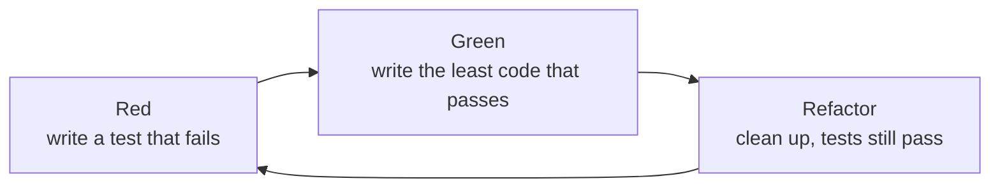

# Unit testing

After this you can write a small automated test in pytest (and read the Vitest equivalent), choose which cases to test, and use tests as the spec you give an AI agent.

Before this: [Errors and exceptions](../../03-programming-fundamentals/01-python-basics/06-errors-and-exceptions.md) and [Functions and scope](../../03-programming-fundamentals/01-python-basics/03-functions-and-scope.md).

## The idea

You change a discount function on Friday and check one price by hand. On Monday a customer with a 100% coupon is charged a negative amount. Checking by hand covers the cases you remember; a test file keeps every case you ever cared about and re-checks all of them in a second.

A test is a small program that calls your code with known input and compares the result with the answer you expect. When the code changes, you run the tests again, and a failure tells you which behaviour broke.

The usual loop in test-driven development (TDD) is shown below. You write the failing test first, so you know the test can fail, then write only enough code to pass it.



## Key terms

A **unit test** runs one small piece of code (a function or a class) in isolation and checks its result. It should finish in milliseconds and not touch the network, a database or the clock.

A **test case** is one scenario with one expected outcome. A **test suite** is all the test cases of a project.

The **arrange, act, assert** pattern (also "given, when, then") gives each test three parts: set up the input, call the code, check the result.

An **assertion** is a statement that must be true for the test to pass. A **fixture** is reusable setup code that a test receives by name. **Parametrizing** runs one test function over a table of inputs.

A **regression** is a behaviour that used to work and broke. A **regression test** is a test written to catch it, usually right after fixing the bug.

## How it works

pytest finds files named `test_*.py`, runs every function whose name starts with `test`, and reports each plain `assert` that fails, with the values on both sides. The function under test is in `pricing.py`:

```python
def apply_discount(price: float, percent: float) -> float:
    """Return price reduced by percent (0 to 100), rounded to cents."""
    if not 0 <= percent <= 100:
        raise ValueError("percent must be between 0 and 100")
    return round(price * (1 - percent / 100), 2)
```

The tests are in `test_pricing.py`. The first follows arrange, act, assert. The second runs the same check over a table of edge cases. The third checks that bad input raises the right error.

```python
import pytest

from pricing import apply_discount


def test_ten_percent_off():
    price, percent = 80.00, 10          # arrange
    result = apply_discount(price, percent)  # act
    assert result == 72.00              # assert


@pytest.mark.parametrize(
    "price, percent, expected",
    [(100, 0, 100), (100, 100, 0), (0, 50, 0), (19.99, 15, 16.99)],
)
def test_edges(price, percent, expected):
    assert apply_discount(price, percent) == expected


@pytest.mark.parametrize("percent", [-1, 100.5])
def test_rejects_bad_percent(percent):
    with pytest.raises(ValueError, match="between 0 and 100"):
        apply_discount(50, percent)
```

Run it with `pytest -v` from the project folder:

```text
test_pricing.py::test_ten_percent_off PASSED                             [ 33%]
test_pricing.py::test_edges[100-0-100] PASSED                            [ 44%]
test_pricing.py::test_edges[100-100-0] PASSED                            [ 55%]
test_pricing.py::test_edges[0-50-0] PASSED                               [ 66%]
test_pricing.py::test_edges[19.99-15-16.99] PASSED                       [ 77%]
test_pricing.py::test_rejects_bad_percent[-1] PASSED                     [ 88%]
test_pricing.py::test_rejects_bad_percent[100.5] PASSED                  [100%]
```

A fixture is a function marked `@pytest.fixture`. A test asks for it by writing its name as a parameter, and pytest builds a fresh value for each test, so one test cannot leak changes into another:

```python
import pytest


@pytest.fixture
def cart():
    return {"apples": 3, "bread": 1}


def test_fixture_is_fresh_each_test(cart):
    cart["milk"] = 1
    assert len(cart) == 3
```

The same ideas in JavaScript, with [Vitest](https://vitest.dev/) (Jest has the same `describe`, `it` and `expect` API):

```javascript
import { describe, expect, it } from "vitest";
import { applyDiscount } from "./pricing.js";

describe("applyDiscount", () => {
  it("takes ten percent off", () => {
    expect(applyDiscount(80, 10)).toBe(72);
  });

  it.each([
    [100, 0, 100],
    [100, 100, 0],
  ])("applyDiscount(%i, %i) is %i", (price, percent, expected) => {
    expect(applyDiscount(price, percent)).toBe(expected);
  });
});
```

```text
 Test Files  1 passed (1)
      Tests  4 passed (4)
```

### What to test

Test the behaviour a caller depends on, not how the code does it. Pick cases from three groups:

- Typical input, one or two cases.
- Edges: zero, one, empty, the largest and smallest allowed value, and each side of every boundary (here 0, 100, and just outside them).
- Errors: input that must be rejected, and the exact error raised.

## Worked examples

<div class="example" markdown>

### Example 1: red, then green

We want rounding to cents to round half a cent up, so a 50% discount on 0.25 gives 0.13. Following the loop, we write the test first.

1. Red: add this test and run `pytest`.
2. Read the failure. The code returns 0.12, because Python's `round` rounds exact halves to the nearest even digit (and 0.125 is exactly representable in binary).
3. Green: change the function to use `decimal.Decimal` with `ROUND_HALF_UP`, run again, and see all tests pass.
4. Refactor: tidy the code, run the tests again.

```python
from pricing import apply_discount


def test_rounds_half_cent_up():
    assert apply_discount(0.25, 50) == 0.13
```

```text
>       assert apply_discount(0.25, 50) == 0.13
E       assert 0.12 == 0.13
E        +  where 0.12 = apply_discount(0.25, 50)

FAILED test_red.py::test_rounds_half_cent_up - assert 0.12 == 0.13
1 failed in 0.08s
```

Check: the failing output names the exact input, the actual value and the expected value. Money should use `Decimal` or integer cents, not floats; the test found a spec question the code had hidden.

</div>

## Common mistakes

<div class="warning" markdown>

Watch out: a test that cannot fail. If you only run the code and never assert (or assert something always true), it passes whatever the code does. Break the code on purpose once and confirm the test goes red.

Watch out: testing the implementation. A test that checks which helper was called breaks when you refactor, even though the behaviour is right. Assert on results.

Watch out: tests that depend on each other or on order. Each test should arrange its own data, which is what fixtures are for.

</div>

## Working with AI

<div class="ai" markdown>

Words to use: unit test, arrange act assert, edge case, fixture, parametrize, regression test, red-green-refactor.

Prompts to try:

- "Write pytest tests for `apply_discount` in `pricing.py` (Python 3.14, pytest 9). Cover 0%, 100%, rounding to cents, and negative or over-100 percent. Use `parametrize`. Do not change `pricing.py`."
- "Here is a failing pytest output [paste]. Explain which side of the assert is the actual value, and say whether the test or the code is wrong."

What to check:

- Tests written from the code, not from the requirement. An agent that reads the implementation may copy its bug into the expected values. Compute the expected values yourself.
- Weak assertions, such as `assert result is not None`. Break the code on purpose and see whether a test fails.
- Tests an agent edited to make them pass. When a test fails after an AI change, read the diff of the test file before trusting a green run.

Tests matter more with AI-written code because they are the one spec the agent can run. A sentence like "handle discounts correctly" is ambiguous; a failing test is not. Give the agent the tests first, let it iterate until they pass, and you review a smaller question: are these the right tests?

</div>

## Quiz

1\. What do the three parts of arrange, act, assert do?

<details class="solution" markdown>
<summary>Answer</summary>

Arrange sets up the input and any objects needed. Act calls the code under test once. Assert compares the result with the expected value.

</details>

2\. How many test cases does pytest report for `@pytest.mark.parametrize("n", [1, 2, 3])` on one function?

<details class="solution" markdown>
<summary>Answer</summary>

Three, one per value, each passing or failing on its own (as the seven lines in the output above show for the discount tests).

</details>

3\. A teammate fixes a bug and does not add a test. Two months later the bug returns. What should the fix have included?

<details class="solution" markdown>
<summary>Answer</summary>

A regression test that fails on the old code and passes on the fixed code. It stays in the suite and fails if anyone reintroduces the bug.

</details>

4\. You ask an AI agent to make a failing test pass, and it changes the expected value in the test. Is the work done?

<details class="solution" markdown>
<summary>Answer</summary>

No. The agent may have changed the spec to match the bug. Check whether the old expected value was correct; if it was, the code is wrong and the test change must be reverted.

</details>

## Lab

<div class="lab" markdown>

### Lab: test a function, break it, fix it

Goal: write a suite for a small function and prove that it catches a bug. Time: about 15 minutes. Runs in: any terminal with Python 3 and a virtual environment (see [Modules, packages, pip and venv](../../03-programming-fundamentals/01-python-basics/08-modules-packages-pip-and-venv.md)).

1. Run `pip install pytest`. Create `shipping.py` with `def shipping_cost(weight_kg)`. It returns 5 for up to and including 2 kg, 9 for more than 2 kg up to and including 10 kg, and raises `ValueError` for 0 kg or less and for more than 10 kg.
2. Write `test_shipping.py` with one `parametrize` table covering typical values and each boundary (0, 2, 2.01, 10, 10.01), and one test for the errors.
3. Run `pytest` and confirm all pass.
4. Change the `<=` in the 2 kg check to `<`. Run again and see which boundary case fails.
5. Revert the change and run once more.

Expected result: step 4 fails on exactly the 2 kg case (`assert 9 == 5`).

<details class="solution" markdown>
<summary>Solution</summary>

```python
import pytest


def shipping_cost(weight_kg: float) -> int:
    if weight_kg <= 0 or weight_kg > 10:
        raise ValueError("weight must be above 0 and at most 10 kg")
    return 5 if weight_kg <= 2 else 9


@pytest.mark.parametrize(
    "weight, expected",
    [(0.5, 5), (2, 5), (2.01, 9), (10, 9)],
)
def test_cost(weight, expected):
    assert shipping_cost(weight) == expected


@pytest.mark.parametrize("weight", [0, -1, 10.01])
def test_invalid_weight(weight):
    with pytest.raises(ValueError):
        shipping_cost(weight)
```

(Put the function in `shipping.py` and import it in the test file in the real lab.)

</details>

</div>

## Where this shows up

- [Integration tests, mocks and end-to-end tests](02-integration-tests-mocks-and-e2e.md) cover tests that involve more than one unit.
- The plan, build, test, review workflow<!-- link: ../../15-ai-and-llms/03-ai-assisted-development/02-plan-build-test-review-workflow.md --> uses tests as the loop an agent runs.
