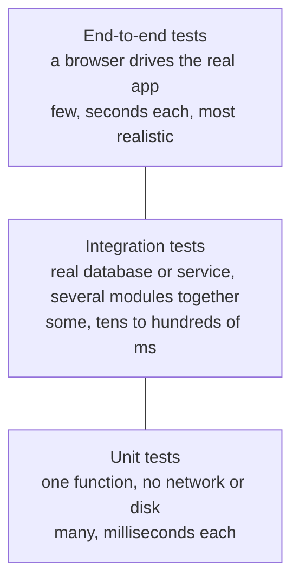
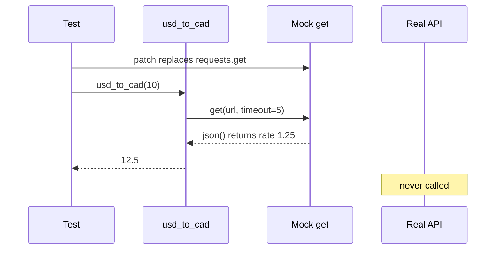

# Integration tests, mocks and end-to-end tests

After this you can choose between unit, integration and end-to-end tests, replace an HTTP call or the clock with a mock in a test, and read a coverage report without trusting it too much.

Before this: [Unit testing](01-unit-testing.md).

## The idea

Your function converts US dollars to Canadian dollars by calling an exchange-rate API. A unit test that calls the real API is slow, fails when the network is down, and gives a different answer every day. What you want to test is your arithmetic and your handling of a server error, not the other company's server.

So tests come in sizes. Small tests run one piece of code with its slow or unpredictable neighbours replaced by fakes. Bigger tests connect real parts to check that they work together. The biggest drive the whole running application like a user. Small tests are fast and pinpoint a bug; big tests are realistic but slow and fail for more reasons. The usual advice is many small tests, fewer medium ones and a handful of big ones.



## Key terms

An **integration test** checks that two or more real parts work together, such as your code and a real database.

An **end-to-end test** (e2e test) drives the whole application from the outside, the way a user would, for example with a real browser.

A **test double** is any stand-in for a real dependency during a test. The vocabulary:

| Double | What it does |
|---|---|
| Dummy | Fills a parameter and is never used |
| Stub | Returns canned answers |
| Fake | A working but simpler version, such as an in-memory database |
| Spy | The real thing, plus a record of how it was called |
| Mock | Returns canned answers and checks that it was called as expected |

Python's `unittest.mock.Mock` is used for stubs, spies and mocks alike, so the name "mock" is loose in practice.

A **flaky test** passes and fails on the same code. **Coverage** is the share of lines (or branches) your tests execute.

## How it works

Mocking swaps a name that your code looks up for a double, only while the test runs. `patch("rates.requests.get")` replaces the `get` that `rates.py` finds, so the code under test calls the double and never reaches the network.



The module under test is `rates.py`:

```python
from datetime import datetime

import requests


def usd_to_cad(amount: float) -> float:
    resp = requests.get("https://api.example.com/rate?from=USD&to=CAD", timeout=5)
    resp.raise_for_status()
    return round(amount * resp.json()["rate"], 2)


def greeting() -> str:
    return "Good morning" if datetime.now().hour < 12 else "Good afternoon"
```

The tests in `test_rates.py` cover the answer, the error path and the clock:

```python
from unittest.mock import Mock, patch

import pytest
import requests

import rates


@patch("rates.requests.get")
def test_usd_to_cad_uses_rate(mock_get):
    mock_get.return_value.json.return_value = {"rate": 1.25}
    assert rates.usd_to_cad(10) == 12.5
    mock_get.assert_called_once()


@patch("rates.requests.get")
def test_usd_to_cad_raises_on_server_error(mock_get):
    mock_get.return_value.raise_for_status.side_effect = requests.HTTPError("503")
    with pytest.raises(requests.HTTPError):
        rates.usd_to_cad(10)


@patch("rates.datetime")
def test_greeting_in_the_morning(mock_dt):
    mock_dt.now.return_value = Mock(hour=9)
    assert rates.greeting() == "Good morning"
```

```text
test_rates.py::test_usd_to_cad_uses_rate PASSED                          [ 33%]
test_rates.py::test_usd_to_cad_raises_on_server_error PASSED             [ 66%]
test_rates.py::test_greeting_in_the_morning PASSED                       [100%]
```

The rule for the `patch` target is to patch the name where it is looked up, here `rates.requests.get`, not where it is defined. Patching the wrong place is the most common reason a mock seems to do nothing.

An integration test uses the same style of code without the double: for example, it starts a real PostgreSQL database in a container, saves a row with your function, and reads it back. An e2e test uses a browser driver such as [Playwright](https://playwright.dev/). This one opens a page, types in a field and checks what appears:

```javascript
import { test, expect } from "@playwright/test";

test("adding a task shows it in the list", async ({ page }) => {
  await page.goto("http://localhost:3000/");
  await page.getByLabel("New task").fill("Buy milk");
  await page.getByRole("button", { name: "Add" }).click();
  await expect(page.getByRole("listitem")).toHaveText("Buy milk");
});
```

```text
Running 1 test using 1 worker

[1/1] todo.spec.js:5:5 › adding a task shows it in the list
  1 passed (1.1s)
```

The run above used a tiny local HTML page in place of `localhost:3000`. Playwright finds elements by label and role (what a user sees), and `expect` waits and retries until the text appears, which avoids the main cause of flaky browser tests.

## Worked examples

<div class="example" markdown>

### Example 1: 100% coverage that proves nothing

Coverage tools such as `pytest-cov` (which wraps `coverage.py`) report which lines ran. We test `classify` with two cases and look at the report.

```python
def classify(n: int) -> str:
    if n < 0:
        return "negative"
    if n == 0:
        return "zero"
    return "positive"
```

Run `pytest --cov=calc --cov-report=term-missing` with tests for -5 and 5:

```text
Name      Stmts   Miss  Cover   Missing
---------------------------------------
calc.py       6      1    83%   5
```

Line 5 (`return "zero"`) never ran, so the report points at the missing zero case. Now the reverse: a test that calls `total([1, 2, 3])` and asserts nothing reports `calc2.py  2  0  100%`.

Check: the first report found a real gap; the second is full coverage and no protection at all. Coverage shows what was not tested, not what was tested well.

</div>

## Common mistakes

<div class="warning" markdown>

Watch out: mocking so much that the test checks only the mock. If every dependency is a double and the assertion is `assert_called_once`, a wrong formula still passes. Assert on results, and add one integration test with the real parts.

Watch out: a mock that disagrees with reality. The real API may return `{"rates": {"CAD": 1.25}}` while your mock returns `{"rate": 1.25}`. Copy a real response into the test, and keep one e2e or integration check against the real service.

Watch out: fixing a flaky test by adding `sleep` or by re-running it. Find the cause: a real clock, shared data between tests, random values, or waiting for a fixed time instead of for a condition.

</div>

## Working with AI

<div class="ai" markdown>

Words to use: test pyramid, integration test, end-to-end test, mock, stub, fake, patch, flaky test, coverage.

Prompts to try:

- "Write a pytest test for `usd_to_cad` in `rates.py` that patches `requests.get` where `rates.py` looks it up. Include a test for `raise_for_status` raising `HTTPError`. Python 3.14, pytest 9."
- "This test passes on my machine and fails about 1 time in 10 in CI [paste test and failure]. List the possible sources of flakiness (clock, ordering, shared state, timing) and how I would tell which one it is."

What to check:

- A patch target that is wrong, so the real network is called. Turn off your Wi-Fi and run the test; a unit test should still pass.
- Mocks whose return shape was invented. Compare with the API's documentation or a recorded real response.
- A coverage number offered as proof of quality. Ask which assertions would fail if the code were wrong.
- Tests an agent changed to pass (see [Unit testing](01-unit-testing.md)). Read the diff of the test files first.

</div>

## Quiz

1\. Why are there more unit tests than e2e tests in a healthy suite?

<details class="solution" markdown>
<summary>Answer</summary>

Unit tests are fast, stable and point at one function, so many can run on each change. E2e tests are slow, need the whole app running, and fail for many reasons, so a few cover the critical paths.

</details>

2\. A test double that returns canned answers and also checks it was called with the right arguments is which kind?

<details class="solution" markdown>
<summary>Answer</summary>

A mock. If it only returned canned answers it would be a stub.

</details>

3\. You write `@patch("requests.get")` but `rates.py` does `from requests import get`, and the test still hits the network. Why?

<details class="solution" markdown>
<summary>Answer</summary>

`from requests import get` copies the name `get` into `rates`, so replacing `requests.get` does not change `rates.get`. Patch `rates.get`, the name where it is looked up.

</details>

4\. A suite reports 95% line coverage. Does that mean 95% of behaviours are verified?

<details class="solution" markdown>
<summary>Answer</summary>

No. Coverage counts executed lines. A test that runs a line without asserting on its result still counts, and missing cases (like an input never tried) may need no extra lines.

</details>

## Lab

<div class="lab" markdown>

### Lab: mock the network and the clock

Goal: test code that depends on a web API and the current time, with no network. Time: about 20 minutes. Runs in: any terminal with Python 3.

1. Run `pip install pytest requests`. Save the `rates.py` above.
2. Write `test_rates.py` with the three tests above and run `pytest`.
3. Add a fourth test: at hour 15 `greeting()` returns "Good afternoon".
4. Turn off your network connection and run again. All tests still pass.
5. Remove the `@patch` line from the first test, run again with the network off, and read the error.
6. Restore the line.

Expected result: step 5 fails with `requests.exceptions.ConnectionError` (the host `api.example.com` is a placeholder that does not resolve), which shows the mock was what kept the test off the network.

<details class="solution" markdown>
<summary>Solution</summary>

```python
@patch("rates.datetime")
def test_greeting_in_the_afternoon(mock_dt):
    mock_dt.now.return_value = Mock(hour=15)
    assert rates.greeting() == "Good afternoon"
```

</details>

</div>

## Where this shows up

- CI pipelines<!-- link: ../../13-devops-and-cloud/02-ci-cd/01-ci-cd-concepts.md --> run the unit tests on every push and the slower tests before a release.
- Swapping a real dependency for a double is easy when code receives it as a parameter; see [Composition and interfaces](../../03-programming-fundamentals/03-oop-and-paradigms/03-composition-and-interfaces.md).
- [Linters, formatters and type checkers](03-linters-formatters-and-type-checkers.md) catch a different set of bugs without running the code.
