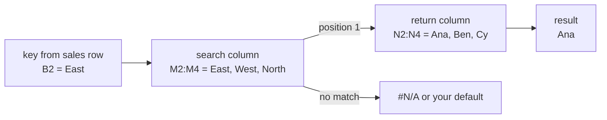

# Lookups, pivot tables and charts

After this you can pull a value from another table with XLOOKUP, build a pivot table from a flat table, and pick a chart that fits the question.

Before this: [Excel formulas and references](01-excel-formulas-and-references.md).

## The idea

The sales sheet has a `Region` column, but the region managers live in a separate small table. A **lookup** takes a key from one table (`East`), finds it in another, and returns a related value (`Ana`). That is the same job as a JOIN in SQL or a dictionary access in Python.

A **pivot table** answers a different question: how do the 8 rows add up when grouped by region and by product? You drag fields into rows, columns and values, and Excel does the grouping and summing.



## Key terms

A **lookup** finds a key in one column and returns the value in the same position of another column. An **exact match** requires the key to be identical; an **approximate match** returns the closest smaller key and needs sorted data.

A **dynamic array** formula returns several values that **spill** into the cells below or beside it. A **pivot table** is a summary table that groups a data table by chosen fields and aggregates a value field.

## How it works

Put the manager table in `M1:N4` (`Region`, `Manager`; East Ana, West Ben, North Cy). Three ways to fill `K2` with the manager of row 2:

```text
=XLOOKUP(B2, $M$2:$M$4, $N$2:$N$4, "not found")     -> Ana
=VLOOKUP(B2, $M$2:$N$4, 2, FALSE)                    -> Ana
=INDEX($N$2:$N$4, MATCH(B2, $M$2:$M$4, 0))           -> Ana
```

The dollar signs matter: the lookup table must not shift as you fill down. See [XLOOKUP](https://support.microsoft.com/en-us/office/xlookup-function-b7fd680e-6d10-43e6-84f9-88eae8bf5929), [VLOOKUP](https://support.microsoft.com/en-us/office/vlookup-function-0bbc8083-26fe-4963-8ab8-93a18ad188a1) and [MATCH](https://support.microsoft.com/en-us/excel/functions/match-function).

| | XLOOKUP | VLOOKUP | INDEX and MATCH |
|---|---|---|---|
| Match default | exact | approximate unless 4th argument is `FALSE` | you choose (`0` is exact) |
| Return column | any column, left or right | a number counted from the left (`2`) | any column |
| Breaks if you insert a column | no | yes, the number is wrong | no |
| Missing key | your default text | `#N/A` | `#N/A` |
| Available | Excel 2021, Microsoft 365 | all versions | all versions |

Use XLOOKUP when you have it. Read VLOOKUP because older workbooks are full of it, and remember the `FALSE`: leaving it out can return a wrong row without an error. Google Sheets has `XLOOKUP`, `VLOOKUP`, `INDEX` and `MATCH` with the same arguments.

Dynamic arrays ([UNIQUE](https://support.microsoft.com/en-us/excel/functions/unique-function), [FILTER](https://support.microsoft.com/en-us/office/filter-function-f4f7cb66-82eb-4767-8f7c-4877ad80c759), SORT; Excel 2021 and Microsoft 365) spill from the cell where you type them:

```text
=SORT(UNIQUE(C2:C9))          -> Gadget, Gizmo, Widget (3 cells)
=FILTER(A2:F9, B2:B9="West")  -> the 3 West rows, 6 columns each
```

A **pivot table** starts from a flat table with one header row and no blank rows or merged cells. In Excel: click inside the data, then Insert, PivotTable ([Microsoft's steps](https://support.microsoft.com/en-us/office/create-a-pivottable-to-analyze-worksheet-data-a9a84538-bfe9-40a9-a8e9-f99134456576)).

1. Drag `Region` to Rows.
2. Drag `Product` to Columns.
3. Drag `Total` to Values. Excel proposes Sum; change it to Count or Average when needed.
4. Drag `Region` to Filters to slice by another field.

The layout and the result:

```text
Fields:   Rows = Region    Columns = Product    Values = Sum of Total

Sum of Total |  Gadget   Gizmo   Widget | Grand Total
-------------+---------------------------+------------
East         |   30.0      -     37.5    |    67.5
North        |   60.0      -     30.0    |    90.0
West         |   40.0     50.0   20.0    |   110.0
-------------+---------------------------+------------
Grand Total  |  130.0     50.0   87.5    |   267.5
```

A pivot table is a snapshot: after you edit the source data, right-click it and choose Refresh.

Choosing a chart starts with the question:

| Question | Chart |
|---|---|
| How do categories compare? (revenue by region) | bar or column |
| How does something change over time? | line |
| How is a whole divided? (only a few parts) | stacked bar; a pie only for 2 or 3 parts |
| How do two numbers relate? | scatter |
| How are values spread? | histogram |

Start the value axis of a bar chart at 0. A truncated axis makes a small difference look large.

## Worked examples

<div class="example" markdown>

### Example 1: manager lookup and a missing key

1. In `K2` enter the XLOOKUP formula above and fill down. The managers are Ana, Ben, Ana, Ben, Ana, Cy, Ben, Cy.
2. In a spare cell enter `=XLOOKUP("South", $M$2:$M$4, $N$2:$N$4, "not found")`. It shows `not found`. With `=VLOOKUP("South",$M$2:$N$4,2,FALSE)` it shows `#N/A`.
3. Check the results with a Python dict, which does the same exact-match lookup:

```python
managers = {"East": "Ana", "West": "Ben", "North": "Cy"}
regions = ["East", "West", "East", "West", "East", "North", "West", "North"]
print([managers[r] for r in regions])
print(managers.get("South", "not found"))
```

```text
['Ana', 'Ben', 'Ana', 'Ben', 'Ana', 'Cy', 'Ben', 'Cy']
not found
```

`managers["South"]` would raise `KeyError`, just as the VLOOKUP gives `#N/A`.

</div>

<div class="example" markdown>

### Example 2: checking the pivot table

Group the same rows in Python and compare with the Grand Total column.

```python
from collections import defaultdict
sales = [("East","Widget",25.0),("West","Gadget",40.0),("East","Gadget",30.0),
         ("West","Widget",20.0),("East","Widget",12.5),("North","Gadget",60.0),
         ("West","Gizmo",50.0),("North","Widget",30.0)]
by_region = defaultdict(float)
for region, product, total in sales:
    by_region[region] += total
print(dict(by_region), sum(by_region.values()))
```

```text
{'East': 67.5, 'West': 110.0, 'North': 90.0} 267.5
```

</div>

## Common mistakes

<div class="warning" markdown>

Watch out: a lookup key that looks equal but isn't, such as `"East "` with a trailing space or a number `101` against the text `"101"`. The result is `#N/A`. Wrap the key in `TRIM`, or fix the types.

Watch out: a pivot table over a range that misses new rows. Use an Excel table as the source so the pivot grows with the data.

Watch out: a spill range blocked by a value in the way gives `#SPILL!`. Clear the cells under the formula.

</div>

## Working with AI

<div class="ai" markdown>

Words to use: exact match, XLOOKUP, INDEX and MATCH, spill, pivot table, rows, columns, values, refresh.

Prompts to try:

- "Excel 2019 has no XLOOKUP. Convert `=XLOOKUP(B2,$M$2:$M$4,$N$2:$N$4,"not found")` to INDEX and MATCH with the same missing-key behaviour."
- "I have a table with Date, Region, Product and Total. Tell me which fields go in Rows, Columns and Values for a pivot of monthly revenue by region."

What to check:

- A VLOOKUP without the fourth argument `FALSE`.
- Functions your Excel version lacks (`FILTER`, `UNIQUE`, `XLOOKUP`).
- Missing `$` on the lookup range, which shifts when filled down.

</div>

## Quiz

1\. Why is `=VLOOKUP(B2,$M$2:$N$4,2)` risky?

<details class="solution" markdown>
<summary>Answer</summary>

Without `FALSE` it uses approximate matching, which assumes sorted data and can return the wrong row with no error.

</details>

2\. What does `=INDEX($N$2:$N$4, MATCH("West",$M$2:$M$4,0))` return?

<details class="solution" markdown>
<summary>Answer</summary>

`MATCH` returns 2, the position of West; `INDEX` returns the second manager, Ben.

</details>

3\. Your pivot table shows old numbers after you corrected a cell in the source. What do you do?

<details class="solution" markdown>
<summary>Answer</summary>

Refresh the pivot table (right-click, Refresh). It does not update live.

</details>

4\. You want to show monthly revenue over a year. Which chart?

<details class="solution" markdown>
<summary>Answer</summary>

A line chart, because the x-axis is time.

</details>

## Lab

<div class="lab" markdown>

### Lab: managers and a pivot

Goal: add the lookup column and reproduce the pivot table. Time: about 15 minutes. Runs in: Excel or Google Sheets.

1. Type the manager table in `M1:N4`.
2. In `K2:K9` look up each row's manager with XLOOKUP.
3. Build a pivot table with Region in Rows, Product in Columns and Sum of Total in Values.
4. Add a column chart of Sum of Total by region.

Expected result: grand total 267.5, West 110.0, and managers Ana, Ben, Ana, Ben, Ana, Cy, Ben, Cy.

<details class="solution" markdown>
<summary>Solution</summary>

`K2` is `=XLOOKUP(B2,$M$2:$M$4,$N$2:$N$4,"not found")`. The pivot matches the table in How it works.

</details>

</div>

## Where this shows up

- The same grouping in SQL is in the next lesson, [Spreadsheets, CSV and SQL](03-spreadsheets-csv-and-sql.md).
- JOINs: [Joins](../../10-databases-sql-and-postgres/02-querying/04-joins.md).
