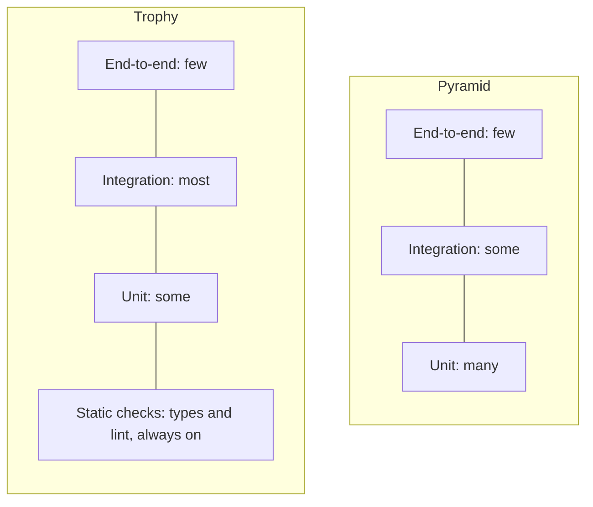
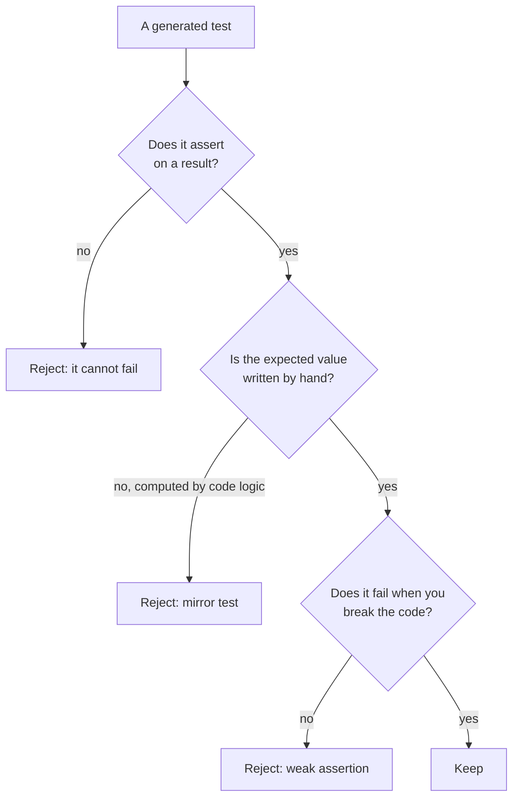

# TDD and test strategy

After this you can run a red-green-refactor cycle in pytest, decide what is worth testing and how many tests of each size to write, read a branch-coverage report, and spot the two usual ways AI-written tests fail.

Before this: [Unit testing](../03-code-quality/01-unit-testing.md) and [Integration tests, mocks and end-to-end tests](../03-code-quality/02-integration-tests-mocks-and-e2e.md).

## The idea

Every test costs something twice: once to write, and again each time it fails, breaks on a refactor or slows CI. A suite of 3,000 tests that nobody trusts is worse than 300 that everyone does. So the question is "which tests earn their cost?"

Two pictures of a good mix are in common use. The pyramid puts the most tests at the bottom, where they are fast and pinpoint a bug. The trophy (Kent C. Dodds's name for it) argues that integration tests give the best confidence per test, because they check that real parts work together, and that linters and type checkers should do the cheap work at the base. Neither is a standard; both weigh speed and precision against realism.



## Key terms

The **test pyramid** is the guideline of many unit tests, fewer integration tests and a handful of end-to-end tests. The **testing trophy** keeps the end-to-end tests few but makes integration tests the largest layer and adds static checks as a base.

**Line coverage** is the share of lines that ran during the tests. **Branch coverage** is the share of decision outcomes that ran: for each `if`, both the true and the false side.

A **mirror test** is a test whose expected value is computed with the same logic as the code, so it passes whatever that logic is. A **quarantined test** is a flaky test moved out of the blocking suite, with an owner and a deadline to fix it.

## How it works

### What is worth testing

Test behaviour that a caller or a user depends on, the edge cases where code tends to break (empty input, zero, each side of a limit, Unicode, large values), and every bug you fix, so it cannot return. Skip tests of the language, of third-party libraries and of private helpers that a public test already exercises.

### Coverage is a guide, not a goal

Coverage tells you which code no test ran. It cannot tell you whether the tests that did run check anything. Line coverage is also too generous: a one-line `if` counts as covered when only its true side ran. Turn on branch coverage with `--cov-branch` (or `branch = true` under `[tool.coverage.run]` in `pyproject.toml`).

```python
def fee(amount: int, is_member: bool) -> int:
    rate = 3
    if is_member:
        rate = 1
    return amount * rate
```

With one test, `assert fee(10, True) == 10`, `pytest --cov=fees --cov-report=term-missing` says:

```text
Name      Stmts   Miss  Cover   Missing
fees.py       5      0   100%
```

Adding `--cov-branch` to the same run says:

```text
Name      Stmts   Miss Branch BrPart  Cover   Missing
fees.py       5      0      2      1    86%   3->5
```

The `3->5` means that line 3 (`if is_member`) never jumped to line 5, so the non-member path was never run. Use the report to find untested paths, and do not make 100% a rule: people then write tests that run lines and assert nothing.

### Flaky tests

A flaky test passes and fails on the same code. Typical causes are shared state between tests, the real clock, unseeded randomness, unordered collections, threads and the network. The test below depends on the iteration order of a set of strings, which Python randomizes per process. In Git Bash or WSL, `PYTHONHASHSEED` fixes that randomization so you can reproduce the failure.

```python
def test_first_tag():
    tags = {"red", "green", "blue"}
    assert list(tags)[0] == "red"
```

```text
PYTHONHASHSEED=1  ->  1 passed
PYTHONHASHSEED=2  ->  1 failed
PYTHONHASHSEED=3  ->  1 failed
PYTHONHASHSEED=4  ->  1 passed
```

Reproduce first, then fix the cause (here, `sorted(tags)[0]` or an assertion that does not depend on order). If you cannot fix it today, quarantine it. Re-running until green hides a real bug, and a suite that is red for no reason teaches people to ignore red.

### Reviewing AI-generated tests

An AI can write fifty tests in a minute, so your job shifts to reviewing them. Walk each test through the diagram.



Here `final_price` has a bug (`/ 10` where `/ 100` was meant), and three generated tests check it:

```python
def test_runs():
    assert final_price(80, 10) is not None            # asserts almost nothing


def test_mirror():
    assert final_price(80, 10) == round(80 * (1 - 10 / 10), 2)   # copies the bug


def test_known_answer():
    assert final_price(80, 10) == 72.0                # worked out by hand
```

```text
FAILED test_pricing.py::test_known_answer - assert 0.0 == 72.0
1 failed, 2 passed in 0.32s
```

Only the test with a hand-computed answer caught the bug.

## Worked examples

<div class="example" markdown>

### Example 1: building a duration parser with TDD

We want `parse_duration("1h30m")` to return 5400 seconds. We work in small cycles, and run pytest after every edit.

1. Red: write `assert parse_duration("5m") == 300` and give `duration.py` a stub that returns `0`. The failure is `assert 0 == 300`. A test that fails for the right reason (a wrong value, not a typo) is the point of this step.
2. Green: write the least code that passes, `return int(text[:-1]) * 60`. It is not a real parser, and that is fine for now.
3. Red again: add a table with `45s`, `2h`, `1h30m` and `1h2m3s`, and a second table of bad input (`""`, `abc`, `5`, `5x`, `m5`) that must raise `ValueError`. Five tests fail.
4. Green: replace the code with a regular expression that reads every number-and-unit pair and rejects text it did not fully consume.
5. Refactor: move the unit sizes into a `UNITS` dictionary and run the tests again.

```python
import re

UNITS = {"h": 3600, "m": 60, "s": 1}
PATTERN = re.compile(r"(\d+)([hms])")


def parse_duration(text: str) -> int:
    """Return the number of seconds in text such as '1h30m'."""
    parts = PATTERN.findall(text)
    if not parts or "".join(n + u for n, u in parts) != text:
        raise ValueError(f"not a duration: {text!r}")
    return sum(int(n) * UNITS[u] for n, u in parts)
```

```text
..........                                                               [100%]
10 passed in 0.24s
```

Check: at step 3 only `5x` failed with "DID NOT RAISE". The other bad inputs already raised `ValueError`, but by accident, because `int()` failed on the stub's slice of the text. They passed for the wrong reason. Passing `match="not a duration"` to `pytest.raises` would have made them fail too, so use `match` when the message matters.

</div>

## Common mistakes

<div class="warning" markdown>

Watch out: writing all the tests after the code. You then test what the code does, not what it should do, and you never see a test fail. At least write the test for a bug before you fix it, and watch it go red.

Watch out: chasing a coverage number. Deleting a test to remove a flaky failure or adding assertion-free tests to reach 90% both improve the number and make the suite worse.

Watch out: asserting how the code works instead of what it returns. Such tests break on every refactor, and people then stop refactoring.

</div>

## Working with AI

<div class="ai" markdown>

Words to use: red-green-refactor, test pyramid, testing trophy, branch coverage, flaky test, quarantine, mirror test, regression test.

Prompts to try:

- "Write pytest tests for `parse_duration` in `duration.py` (Python 3.14, pytest 9) before I write the implementation. Use hand-written expected values in a `parametrize` table. Do not import anything but `parse_duration`."
- "This test passes locally and fails in CI about once in ten runs [paste test and CI log]. Name the likely sources (shared state, clock, unseeded randomness, set or dict order, threads) and a command to reproduce each."

What to check:

- Tests with no assert, or `is not None`, `assert True`, or `len(result) > 0` as the only check. Break the code on purpose and confirm a test goes red.
- Expected values computed with the same formula as the code. Replace each with a number you worked out yourself.
- A "fixed" flaky test that now contains `sleep`, a retry decorator or `skip`. These hide the cause.
- A report of 95% coverage with no branch data. Rerun with `--cov-branch`.

</div>

## Quiz

1\. A team's pyramid has 400 unit tests and 2 end-to-end tests, but the bugs they ship are in how the database and the API fit together. Which layer of the pyramid or trophy are they short of?

<details class="solution" markdown>
<summary>Answer</summary>

Integration tests. Unit tests with the database mocked cannot see a mismatch between the query and the real schema. The trophy argues for making this layer the largest.

</details>

2\. For `fee(amount, is_member)` above, one test calls `fee(10, True)`. Which is higher, line coverage or branch coverage, and why?

<details class="solution" markdown>
<summary>Answer</summary>

Line coverage (100%) is higher than branch coverage (86%). Every line ran, but the false side of `if is_member` never did.

</details>

3\. A test passes on your laptop and fails in CI about one run in five. The test builds a list from a `set` and checks its first item. What is the cause, and what is the fix?

<details class="solution" markdown>
<summary>Answer</summary>

Set order for strings changes between Python processes (hash randomization). Sort the items before choosing the first, or assert something that does not depend on order.

</details>

4\. An AI agent writes `assert total(items) == sum(i.price * i.qty for i in items)` for your `total` function. What is wrong with it, and what do you replace it with?

<details class="solution" markdown>
<summary>Answer</summary>

It is a mirror test: it repeats the implementation's formula, so a wrong formula passes. Use a small list of items and an expected total you computed by hand.

</details>

## Lab

<div class="lab" markdown>

### Lab: a postal code validator, test first

Goal: build `is_postal_code` with the red-green-refactor loop. Time: about 15 minutes. Runs in: any terminal with Python 3 and `pytest` in a virtual environment.

Canadian postal codes look like `K1A 0B1`: letter, digit, letter, one space, digit, letter, digit. The letters D, F, I, O, Q and U are never used, and W and Z are never the first letter. Lower case is accepted.

1. Create `postal.py` with `def is_postal_code(text): return False`, and `test_postal.py` with one test that `is_postal_code("K1A 0B1")` is true. Run `pytest` and see it fail.
2. Write the least code that passes. Run again.
3. Add one test at a time, and watch each go red before you fix it: first letter `D`, no space (`K1A0B1`), too short (`K1A 0B`), lower case (`m5v 3l9`), an `I` in the third place.
4. Refactor: move the pattern into a named constant. Run the tests.
5. Break the code on purpose (remove the `.upper()`) and confirm exactly one test fails.

Expected result: ten passing tests at the end, and a single failure in step 5.

<details class="solution" markdown>
<summary>Solution</summary>

```python
import re

POSTAL = re.compile(r"[ABCEGHJKLMNPRSTVXY]\d[ABCEGHJ-NPRSTV-Z] \d[ABCEGHJ-NPRSTV-Z]\d")


def is_postal_code(text: str) -> bool:
    """True for a Canadian postal code such as 'K1A 0B1' (case does not matter)."""
    return POSTAL.fullmatch(text.upper()) is not None
```

```python
import pytest

from postal import is_postal_code


@pytest.mark.parametrize("text", ["K1A 0B1", "m5v 3l9"])
def test_accepts_valid(text):
    assert is_postal_code(text)


@pytest.mark.parametrize(
    "text", ["D1A 0B1", "K1A0B1", "K1A 0B", "K1A 0B11", "K1A  0B1", "", "11A 0B1", "K1A 0I1"]
)
def test_rejects_invalid(text):
    assert not is_postal_code(text)
```

```text
10 passed in 0.26s
```

</details>

</div>

## Where this shows up

- [Property-based testing, fuzzing and mutation testing](02-property-based-testing-fuzzing-and-mutation-testing.md) generates the edge cases for you and checks whether your tests can fail.
- [CI/CD concepts](../../13-devops-and-cloud/02-ci-cd/01-ci-cd-concepts.md) run the suite on every push, which is where flaky tests hurt most.
