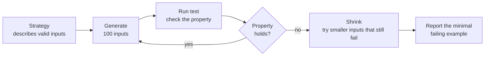
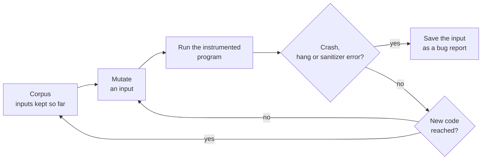

# Property-based testing, fuzzing and mutation testing

After this you can write a Hypothesis test that checks a rule over generated inputs, read a shrunk failing example, explain how a coverage-guided fuzzer finds crashes, and say what a mutation score tells you about your tests.

Before this: [Unit testing](../03-code-quality/01-unit-testing.md) and [TDD and test strategy](01-tdd-and-test-strategy.md).

## The idea

A function splits a restaurant bill between people. Your tests use totals like 100, 250 and 999 with three people, and they pass. Then a bill of 1 cent split two ways gives each person 0, and the cent vanishes. Example-based tests check the cases you thought of, and bugs live in the cases you did not.

Three techniques attack that problem. Property-based testing generates inputs and checks a rule you wrote. Fuzzing generates a huge number of inputs, guided by which code they reach, and watches for crashes. Mutation testing does the reverse: it changes your code and checks whether your tests notice.



## Key terms

A **property** is a statement that must hold for every valid input, such as "sorting never changes the length of a list". **Property-based testing** generates many inputs and checks the property on each; [Hypothesis](https://hypothesis.readthedocs.io/) is the Python library for it. A **strategy** describes how to generate one kind of input, such as `st.integers()`.

**Shrinking** is the search, after a failure, for a smaller input that still fails, so you read `total=1, people=2` and not a 40-element list. An **oracle** is any independent way to get the right answer, such as a slow obvious version of the function or a trusted library.

**Fuzzing** feeds a program a very large number of generated or mutated inputs and watches for crashes, hangs and sanitizer errors. A **coverage-guided fuzzer** keeps the inputs that reach new code (the **corpus**) and mutates those. A **fuzz harness** is the small function that hands one input to your code.

**Mutation testing** makes small changes (mutants) to your code, such as `<` to `<=` or `3` to `4`, and runs your tests on each. A mutant is **killed** if a test fails and **survives** if all tests pass. The **mutation score** is the share of mutants killed.

## How it works

### Writing properties with Hypothesis

`@given` takes strategies and calls your test with generated values. As of 2026 the current release is Hypothesis 6.170, which needs Python 3.11 or newer ([PyPI](https://pypi.org/project/hypothesis/)). By default it runs 100 generated cases per test ([settings reference](https://hypothesis.readthedocs.io/en/latest/reference/api.html)). Three kinds of property cover most uses:

```python
import json

from hypothesis import given, strategies as st


@given(st.lists(st.integers()))
def test_sorted_invariants(xs):                    # invariant: facts that stay true
    out = sorted(xs)
    assert len(out) == len(xs)
    assert all(a <= b for a, b in zip(out, out[1:]))


@given(st.dictionaries(st.text(), st.integers()))
def test_json_round_trip(d):                       # round trip: decode(encode(x)) == x
    assert json.loads(json.dumps(d)) == d


@given(st.lists(st.integers(), min_size=1))
def test_against_oracle(xs):                       # oracle: compare with a trusted answer
    assert slow_max(xs) == max(xs)
```

```text
props.py::test_sorted_invariants PASSED                                  [ 33%]
props.py::test_json_round_trip PASSED                                    [ 66%]
props.py::test_against_oracle PASSED                                     [100%]
```

Here `slow_max` is a hand-written loop, and the built-in `max` is the oracle.

Hypothesis remembers failures in a `.hypothesis` folder and replays them first on the next run. Do not rely on that for a regression test: pin the failing case with `@example(...)` so it runs on every machine. With `derandomize=True` every run uses the same cases; as of 2026 the docs say it is on by default in CI.

### Fuzzing

A coverage-guided fuzzer such as AFL++ or libFuzzer compiles your code with instrumentation that reports which branches ran, keeps any input that reached a new branch, and mutates those inputs (flip a bit, splice two inputs). It reaches deep code that purely random bytes would not.



AFL++ and libFuzzer are the standard engines for C, C++ and Rust. Atheris is a coverage-guided fuzzer for Python, based on libFuzzer; as of 2026 it supports Python 3.11 to 3.14 on Linux and macOS ([Atheris on GitHub](https://github.com/google/atheris)). [OSS-Fuzz](https://google.github.io/oss-fuzz/) is Google's free service that runs these engines continuously on open source projects and reports bugs privately. A Python fuzz harness for the parser from the previous lesson:

```python
import sys

import atheris

with atheris.instrument_imports():
    from duration import parse_duration


def test_one_input(data: bytes) -> None:
    text = data.decode("utf-8", errors="ignore")
    try:
        parse_duration(text)
    except ValueError:
        pass  # rejecting bad input is allowed, any other exception is a bug


atheris.Setup(sys.argv, test_one_input)
atheris.Fuzz()
```

Fuzzing needs no expected answer: the oracle is "it must not crash". That makes it strong for parsers of untrusted bytes (file formats, network messages) and weak for logic bugs, where a wrong answer looks normal. In Python the usual finds are uncaught exceptions and hangs, and in C extensions real memory bugs.

### Mutation testing

Mutation testing asks whether your tests would notice if a line were wrong. [mutmut](https://mutmut.readthedocs.io/) is a Python tool for it: `mutmut run` mutates the code and runs your tests on each mutant, and `mutmut browse` lets you inspect the survivors. It needs a system with `fork`, so on Windows you run it in WSL. A surviving mutant points at a missing or weak test. Some mutants change nothing observable, so 100% is not the aim, and the tool is slow, so run it on one module at a time.

## Worked examples

<div class="example" markdown>

### Example 1: Hypothesis finds the vanishing cent

`split_bill` must return one share per person, the shares must add up to the total, and no share may differ from another by more than one cent. Our first version divides evenly and forgets the remainder.

```python
def split_bill(total_cents: int, people: int) -> list[int]:
    """Split total_cents between people. Shares differ by at most 1 cent."""
    share = total_cents // people
    return [share] * people
```

1. Write the property: the number of shares is `people` and their sum is `total`. The two `integers` strategies set the valid ranges.
2. Run it. `derandomize=True` makes the run repeatable.

```python
from hypothesis import given, settings, strategies as st

from bill import split_bill


@settings(derandomize=True)
@given(st.integers(min_value=0, max_value=10_000), st.integers(min_value=1, max_value=20))
def test_split_keeps_every_cent(total, people):
    shares = split_bill(total, people)
    assert len(shares) == people
    assert sum(shares) == total
```

```text
E       assert 0 == 1
E        +  where 0 = sum([0, 0])
E       Failing test case: test_split_keeps_every_cent(
E           total=1,
E           people=2,
E       )
```

3. Read the example. In a verbose run the first failing case was `total=439, people=6`, and shrinking reduced it to `total=1, people=2`. The exact examples may differ on your machine and Hypothesis version.
4. Fix the code with `divmod`: the first `extra` people pay one cent more. Add the "differ by at most 1" assertion and pin the case with `@example(total=1, people=2)`.

```python
def split_bill(total_cents: int, people: int) -> list[int]:
    share, extra = divmod(total_cents, people)
    return [share + 1] * extra + [share] * (people - extra)
```

```text
test_bill.py::test_split_keeps_every_cent PASSED                         [100%]
```

Check: undo the fix and the test fails again with `total=1, people=2`. A property you have never seen fail may be too weak to fail at all.

</div>

<div class="example" markdown>

### Example 2: a surviving mutant behind 100% line coverage

Take `fee` from the previous lesson and its one test, `fee(10, True) == 10` (100% line coverage). Make a mutant by hand: change `rate = 3` to `rate = 4` and run the tests.

```text
1 passed in 0.35s
```

The mutant survived, because no test uses a non-member. Add `assert fee(10, False) == 30`:

```text
E       assert 40 == 30
E        +  where 40 = fee(10, False)
1 failed, 1 passed in 0.31s
```

Check: the mutant is killed. A mutation tool tries many such edits for you.

</div>

## Common mistakes

<div class="warning" markdown>

Watch out: a property that restates the code is a mirror test with random inputs. Use a different relationship: a round trip, an invariant or a simpler oracle.

Watch out: strategies that are too narrow, or `assume(...)` and `.filter(...)` that discard most inputs. Build valid inputs directly, and check `pytest --hypothesis-show-statistics`.

Watch out: reading "the fuzzer found nothing" as "the code is correct". A fuzzer reports only crashes and hangs, in the code its harness reaches.

</div>

## Working with AI

<div class="ai" markdown>

Words to use: property-based test, Hypothesis strategy, shrinking, round trip, invariant, oracle, fuzz harness, corpus, mutant, mutation score.

Prompts to try:

- "Write a Hypothesis test (Python 3.14, Hypothesis 6) for `chunks(items, size)` in `chunks.py`. Give me three properties: concatenating the chunks gives back `items`, no chunk is longer than `size`, no chunk is empty. Do not call `chunks` to compute an expected value."
- "Write an Atheris fuzz harness for `parse_config(data: bytes)` in `config.py`. It should treat `ValueError` as expected and let every other exception escape. Tell me how to run it on Linux."

What to check:

- A property that calls the function under test to compute the expectation. Replace it with a relationship that does not.
- Strategies that exclude awkward values: empty lists, 0, negatives, huge integers, non-ASCII text. Read the `@given` line.
- A harness that swallows every exception (`except Exception: pass`), which blinds the fuzzer.
- An invented API. Check each Hypothesis, Atheris or mutmut name in the official docs, and run the test.

</div>

## Quiz

1\. What is the difference between a property and an example test?

<details class="solution" markdown>
<summary>Answer</summary>

An example test checks one fixed input against one fixed output. A property is a rule that must hold for every valid input, and the tool generates the inputs.

</details>

2\. Hypothesis reports `total=1, people=2` although the first failing case it generated was `total=439, people=6`. What happened in between?

<details class="solution" markdown>
<summary>Answer</summary>

Shrinking: Hypothesis tried smaller and simpler inputs that still failed the property, and reported the smallest one.

</details>

3\. A fuzzer ran for a week against your Python function and found no crash. A colleague says the function is correct. What is missing from that argument?

<details class="solution" markdown>
<summary>Answer</summary>

The fuzzer only detects crashes, hangs and sanitizer errors. A function that returns a wrong answer without raising looks fine to it. Logic needs properties or example tests.

</details>

4\. A mutation tool reports that changing `>=` to `>` in your code survives. What does that tell you?

<details class="solution" markdown>
<summary>Answer</summary>

No test distinguishes the two operators, so the boundary is untested. Add a test with an input exactly on the boundary. (Rarely, the mutant is equivalent and changes nothing observable.)

</details>

## Lab

<div class="lab" markdown>

### Lab: find a bug in `chunks` with Hypothesis

Goal: write properties for a small function and let Hypothesis find the bug. Time: about 15 minutes. Runs in: any terminal with Python 3 and a virtual environment containing `pytest` and `hypothesis` (`pip install pytest hypothesis`).

`chunks(items, size)` should split a list into consecutive lists of length `size`, with a shorter last one.

1. Save this as `chunks.py`:

   ```python
   def chunks(items: list, size: int) -> list[list]:
       """Split items into consecutive lists of length size (the last may be shorter)."""
       return [items[i : i + size] for i in range(0, len(items) - size + 1, size)]
   ```

2. Write `test_chunks.py` with `@given(st.lists(st.integers()), st.integers(min_value=1, max_value=10))`. Assert that joining the chunks gives back `items`, and that every chunk has between 1 and `size` items.
3. Add `@settings(derandomize=True)` and run `pytest`. Read the failing example.
4. Explain the bug in one sentence, fix `chunks.py`, and run again.
5. Pin the case Hypothesis found with `@example(...)`.

Expected result: a failure that shrinks to a short list and a size larger than it (the exact example may differ on your machine), then a pass after the fix.

```text
E       assert [] == [0]
E       Failing test case: test_chunks_keep_everything(
E           items=[0],
E           size=2,
E       )
```

<details class="solution" markdown>
<summary>Solution</summary>

```python
from hypothesis import example, given, settings, strategies as st

from chunks import chunks


@settings(derandomize=True)
@example(items=[0], size=2)
@given(st.lists(st.integers()), st.integers(min_value=1, max_value=10))
def test_chunks_keep_everything(items, size):
    result = chunks(items, size)
    assert [x for part in result for x in part] == items
    assert all(1 <= len(part) <= size for part in result)
```

The bug is the `len(items) - size + 1` stop value of `range`: it stops before the last partial chunk, so a list shorter than `size` gives no chunks at all. The fix is `range(0, len(items), size)`. After it:

```text
1 passed in 0.51s
```

</details>

</div>

## Where this shows up

- [Linters, formatters and type checkers](../03-code-quality/03-linters-formatters-and-type-checkers.md) are the cheap static layer that these tests sit on top of.
- [Injection and input validation](../../12-security/01-web-security/03-injection-and-input-validation.md) covers code that reads untrusted input, which is where fuzzing finds most of its bugs.
