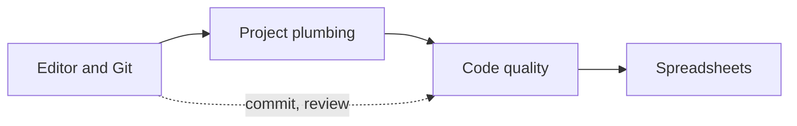

# Developer tools and workflow

Git, GitHub, dependencies, configuration, data formats, regular expressions, testing, code quality and spreadsheets.

Before this folder: Programming fundamentals.

This folder covers the tools around the code. You learn Git and GitHub (branches, merges, pull requests), then project plumbing: dependencies, configuration and secrets, JSON, YAML and CSV, and regular expressions. A code quality chapter covers testing, linters, formatters, type checkers and documentation. The last chapter is spreadsheets, since a lot of workplace data lives in them.

With AI tools, version control and tests are your safety net. An assistant can change ten files at once, and Git lets you see exactly what changed and undo it. Tests tell you whether the change still works, so the AI's confidence is not what you rely on.

It builds on [Programming fundamentals](../03-programming-fundamentals/index.md). Later folders reuse it constantly: [Front end](../08-front-end/index.md), [Back end](../09-back-end/index.md), [Security](../12-security/index.md) and [DevOps and cloud](../13-devops-and-cloud/index.md) all depend on Git, config and tests.

### How to use this folder

- Do the Git labs in a throwaway repository first. Some labs use WSL.
- Keep the Git cheat sheet open until the commands are habit.
- The spreadsheet chapter is independent. Read it any time you need it.

<!-- lessons:start -->
## Lessons

### 1. [Editor and Git](01-editor-and-git/index.md)

1. [VS Code and IDEs](01-editor-and-git/01-vs-code-and-ides.md)
2. [Git basics](01-editor-and-git/02-git-basics.md)
3. [Branches, merging and conflicts](01-editor-and-git/03-branches-merging-and-conflicts.md)
4. [GitHub, pull requests and code review](01-editor-and-git/04-github-pull-requests-and-code-review.md)

### 2. [Project plumbing](02-project-plumbing/index.md)

1. [Package managers and dependencies](02-project-plumbing/01-package-managers-and-dependencies.md)
2. [Config, environment variables and secrets](02-project-plumbing/02-config-env-vars-and-secrets.md)
3. [Data formats: JSON, YAML and CSV](02-project-plumbing/03-data-formats-json-yaml-csv.md)
4. [Regular expressions](02-project-plumbing/04-regular-expressions.md)

### 3. [Code quality](03-code-quality/index.md)

1. [Unit testing](03-code-quality/01-unit-testing.md)
2. [Integration tests, mocks and end-to-end tests](03-code-quality/02-integration-tests-mocks-and-e2e.md)
3. [Linters, formatters and type checkers](03-code-quality/03-linters-formatters-and-type-checkers.md)
4. [Documentation and readmes](03-code-quality/04-documentation-and-readmes.md)

### 4. [Spreadsheets](04-spreadsheets/index.md)

1. [Excel formulas and references](04-spreadsheets/01-excel-formulas-and-references.md)
2. [Lookups, pivot tables and charts](04-spreadsheets/02-lookups-pivot-tables-and-charts.md)
3. [Spreadsheets, CSV and SQL](04-spreadsheets/03-spreadsheets-csv-and-sql.md)

<!-- lessons:end -->
