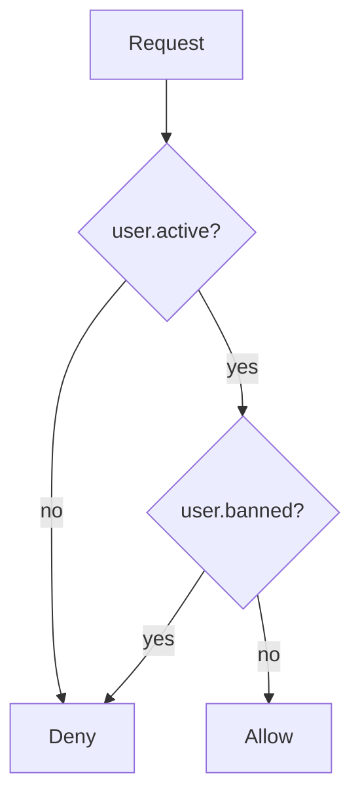
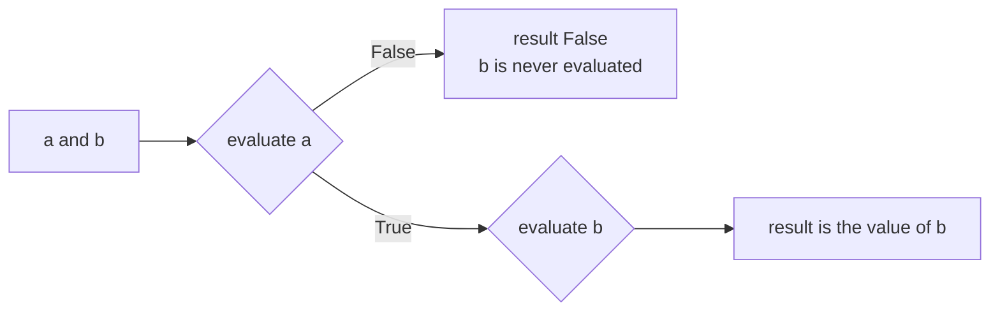

# Logic and truth tables

After this you can rewrite a boolean condition into a simpler or negated form and prove the two forms are equivalent by checking every input.

Before this: [control flow](../03-programming-fundamentals/01-python-basics/02-control-flow.md) and [boolean algebra and circuits](../01-how-computers-work/02-hardware/02-boolean-algebra-and-circuits.md).

## The idea

A code review comment says: "this `if not (user.active and not user.banned)` is hard to read." You want to rewrite it without changing what it does. The way to be sure is to treat the condition as a function of two true/false inputs. There are only four input combinations, so you can check all of them.

That is propositional logic: statements that are either true or false, joined by connectives, with a table that lists the result for every input. The diagram shows the rule behind the condition above as a decision path.



"Allow" is reached only when `active` is true and `banned` is false. Everything else is "Deny", which is the condition `not (active and not banned)` from the review comment.

## Key terms

A **proposition** is a statement that is true or false, such as `x > 4`. The **connectives** are $\lnot p$ (not), $p \land q$ (and), $p \lor q$ (or) and $p \to q$ (implies, also written "if p then q"). A **truth table** lists the value of a formula for every combination of inputs; $n$ inputs give $2^n$ rows.

Two formulas are **equivalent** if they have the same value on every row. A **tautology** is true on every row. **De Morgan's laws** say how a negation passes through and/or:

$$\lnot(p \land q) \equiv \lnot p \lor \lnot q \qquad \lnot(p \lor q) \equiv \lnot p \land \lnot q$$

In words: "not both" means "at least one is missing", and "not either" means "both are missing".

The **implication** $p \to q$ is false only when $p$ is true and $q$ is false, so it is equivalent to $\lnot p \lor q$. Its **contrapositive** $\lnot q \to \lnot p$ is equivalent to it; its **converse** $q \to p$ is not.

A **quantifier** says how many items satisfy a statement. "For every" is written $\forall$ and maps to Python's `all()`. "There exists" is written $\exists$ and maps to `any()`. Negating flips them: not every item passes means some item fails.

## How it works

To prove two conditions equivalent, build the truth table for both and compare each row. Here is $p \to q$ next to its contrapositive and its converse:

| $p$ | $q$ | $p \to q$ | $\lnot q \to \lnot p$ | $q \to p$ |
|---|---|---|---|---|
| F | F | T | T | T |
| F | T | T | T | F |
| T | F | F | F | T |
| T | T | T | T | T |

The third and fourth columns match in every row, so they are equivalent. The fifth differs in row 2, so the converse is a different statement. One row where two formulas disagree is a complete proof that they are not equivalent.

Programming languages evaluate `and` and `or` with **short-circuit evaluation**: the right side runs only if the left side does not already decide the result.



That is why `user is not None and user.name == "ana"` does not crash when `user` is `None`. The order of operands then matters for safety, not just for the truth table.

## Worked examples

<div class="example" markdown>

### Example 1: simplify a condition and prove it

We want to replace `not (active and not banned)` with something shorter.

1. Apply De Morgan to the outer `not`: $\lnot(a \land \lnot b) \equiv \lnot a \lor \lnot\lnot b$.
2. Two negations cancel: $\lnot\lnot b \equiv b$. The result is `(not active) or banned`.
3. A tempting wrong answer is `(not active) and banned`, which negates the terms but keeps `and`. The check below shows it fails.

<details class="code" markdown>
<summary>In code</summary>

```python
from itertools import product

def equivalent(f, g, n):
    return all(f(*v) == g(*v) for v in product([False, True], repeat=n))

old = lambda active, banned: not (active and not banned)
new = lambda active, banned: (not active) or banned
wrong = lambda active, banned: (not active) and banned

print(equivalent(old, new, 2))
print(equivalent(old, wrong, 2))
```

```text
True
False
```

</details>

Check: the first line is `True`, so the rewrite is safe. The second is `False`: with `active` false and `banned` false, `old` returns `True` but `wrong` returns `False`.

</div>

<div class="example" markdown>

### Example 2: a validation rule and its negation

The rule "if the user is on the free plan, the limit is at most 100" is $p \to q$. A violation is its negation, $p \land \lnot q$: free plan and a limit over 100. To find bad rows, filter for that, not for the rule itself. The same negation rule applies to `all()`:

```python
limits = [3, 8, 5]
print(not all(x > 4 for x in limits), any(not (x > 4) for x in limits))
print(all([]), any([]))
```

```text
True True
True False
```

Check: both forms of "not every limit is above 4" agree. On an empty list `all` is `True` and `any` is `False`, because there is no item that fails and no item that passes.

</div>

## Common mistakes

<div class="warning" markdown>

Watch out: negating `a and b` as `not a and not b`. De Morgan flips the connective too, so the correct form is `not a or not b`. When unsure, run the equivalence check from Example 1.

Watch out: reading "if p then q" as also meaning "if q then p". "If the code is correct, the tests pass" does not mean "if the tests pass, the code is correct".

Watch out: assuming SQL conditions have only two outcomes. With `NULL` a comparison can be unknown, so `NOT (x = 1)` does not select every row that `x = 1` skipped. See `NULL` and three-valued logic<!-- link: ../10-databases-sql-and-postgres/02-querying/02-null-and-three-valued-logic.md -->.

</div>

## Working with AI

<div class="ai" markdown>

Words to use: truth table, De Morgan's law, short-circuit evaluation, contrapositive, tautology, equivalent.

Prompts to try:

- "Rewrite this Python condition using De Morgan's laws so it has no `not` outside a parenthesis: `if not (a and (b or not c))`. Then give a Python snippet that checks all eight inputs for equivalence."
- "Here is my `if` chain with five branches. Is some branch unreachable because an earlier condition already covers it? Show the truth table for the inputs involved."

What to check:

- A rewrite that was never tested. Run the original and the rewrite on every input combination, as in Example 1.
- A negation that keeps `and` where it should become `or`.
- Changed evaluation order. If the original relied on short-circuiting to avoid an error (a `None` check first), confirm the rewrite keeps the check first.

</div>

## Quiz

1\. How many rows does a truth table have for a condition with 5 boolean inputs, and why does exhaustive checking stop being practical for large conditions?

<details class="solution" markdown>
<summary>Answer</summary>

$2^5 = 32$ rows. The count doubles with each input, so 30 inputs would need over a billion rows.

</details>

2\. What does this print?

```python
def f():
    print("f")
    return False

def g():
    print("g")
    return True

print(f() and g())
print(g() or f())
```

<details class="solution" markdown>
<summary>Answer</summary>

It prints `f`, `False`, then `g`, `True`. In `f() and g()` the left side is false, so `g()` never runs. In `g() or f()` the left side is true, so `f()` never runs.

</details>

3\. A teammate says: "If the code is correct, the tests pass. The tests pass, so the code is correct." What is wrong with this argument?

<details class="solution" markdown>
<summary>Answer</summary>

It treats the converse as if it were the original. "Correct implies tests pass" says nothing about what follows from passing tests, because tests can pass on incorrect code. Only the contrapositive, "tests fail implies the code is not correct", follows.

</details>

4\. Write the negation of "every request in the batch has a valid token" and the negation of "some user is an admin".

<details class="solution" markdown>
<summary>Answer</summary>

"Some request in the batch has no valid token" and "every user is not an admin". A quantifier flips between "every" and "some" when negated, and the condition inside is negated too.

</details>

## Lab

<div class="lab" markdown>

### Lab: check a refactor by truth table

Goal: write an equivalence checker and use it on three rewrites of a condition. Time: about 15 minutes. Runs in: any terminal with Python 3.

1. Save the checker from Example 1 as `logic.py`.
2. Define `original = lambda a, b, c: not (a and (b or not c))`.
3. Write three rewrites and predict which are equivalent to it: `(not a) or (not b and c)`, `(not a) or (not b) or c`, and `(not a or not b) and (not a or c)`.
4. Run `equivalent` on each rewrite with `n = 3` and compare with your predictions.
5. For a rewrite that fails, print the first input where it disagrees.

Expected result: the first and third rewrites are equivalent; the second disagrees with the original on at least one input.

<details class="solution" markdown>
<summary>Solution</summary>

```python
from itertools import product

def first_difference(f, g, n):
    for v in product([False, True], repeat=n):
        if f(*v) != g(*v):
            return v
    return None

original = lambda a, b, c: not (a and (b or not c))
r1 = lambda a, b, c: (not a) or (not b and c)
r2 = lambda a, b, c: (not a) or (not b) or c
r3 = lambda a, b, c: (not a or not b) and (not a or c)

for name, r in [("r1", r1), ("r2", r2), ("r3", r3)]:
    print(name, first_difference(original, r, 3))
```

```text
r1 None
r2 (True, False, False)
r3 None
```

`None` means no input disagrees. For `r2`, the input `a=True, b=False, c=False` gives `False` in the original and `True` in the rewrite.

</details>

</div>

## Where this shows up

- `NULL` and three-valued logic<!-- link: ../10-databases-sql-and-postgres/02-querying/02-null-and-three-valued-logic.md --> in SQL, where a third value breaks some of these laws.
- Circuits built from gates, in [boolean algebra and circuits](../01-how-computers-work/02-hardware/02-boolean-algebra-and-circuits.md).
- More depth (optional): [truth tables and logical equivalence](https://faiyaz-svg.github.io/MathFromTheGroundUp/04-proofs-and-logic/02-logic-and-sets/03-truth-tables-and-logical-equivalence/) in the sibling math book.
