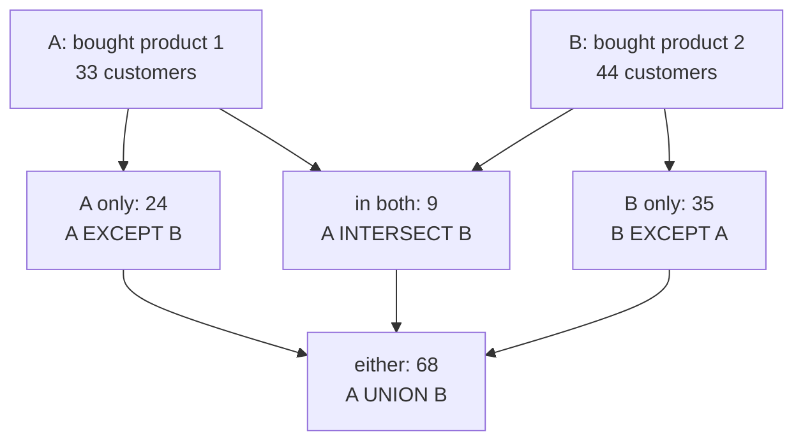
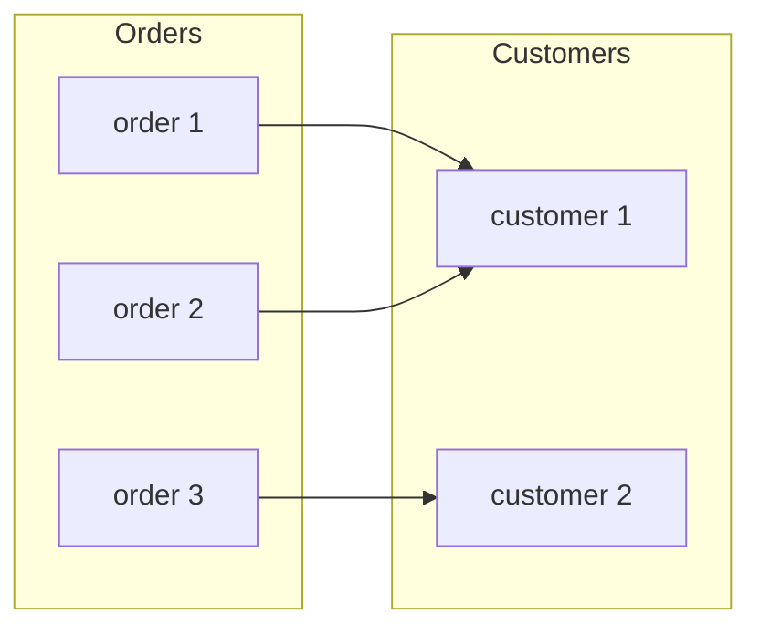

# Sets, functions and relations

After this you can express a data question as set operations, write it in Python or SQL, and say whether a mapping such as a hash function or a foreign key is one-to-one.

Before this: [logic and truth tables](01-logic-and-truth-tables.md) and [lists, dicts, sets and tuples](../03-programming-fundamentals/01-python-basics/04-lists-dicts-sets-and-tuples.md).

## The idea

Marketing asks: "Which customers bought the mouse and also the cable, and which bought only one?" Each product gives a group of customers with no duplicates and no order. The question is about how two groups overlap.

A set is that kind of group, and its operations answer overlap questions. A function connects one set to another, as when each order points at its customer. A relation is the general version: any collection of pairs, as when an order contains several products and a product appears in many orders. Databases are built from these three ideas.

In the diagram, A is the set of customers who bought product 1 and B is the set who bought product 2 (counts from the shop sample database). Every operation is some combination of the three regions in the middle.



## Key terms

A **set** is a collection of distinct elements where order does not matter. Write $x \in A$ for "$x$ is an element of $A$" and $\lvert A \rvert$ for its **cardinality**, the number of elements. $A \subseteq B$ means every element of $A$ is in $B$.

The **union** $A \cup B$ has the elements in either set. The **intersection** $A \cap B$ has those in both. The **difference** $A \setminus B$ has those in $A$ but not in $B$. The **Cartesian product** $A \times B$ is the set of all pairs $(a, b)$ with $a$ from $A$ and $b$ from $B$.

A **function** $f : A \to B$ assigns to each element of the **domain** $A$ exactly one element of the **codomain** $B$. A function is **injective** (one-to-one) if different inputs always give different outputs, **surjective** (onto) if every element of $B$ is an output, and **bijective** if it is both. A bijection can be undone.

A **relation** from $A$ to $B$ is any subset of $A \times B$. A function is a relation in which each $a$ appears in exactly one pair.

## How it works

The same operations have different spellings in math, Python and SQL.

| Operation | Math | Python | SQL |
|---|---|---|---|
| Union | $A \cup B$ | `a \| b` | `UNION` |
| Intersection | $A \cap B$ | `a & b` | `INTERSECT` |
| Difference | $A \setminus B$ | `a - b` | `EXCEPT` |
| Membership | $x \in A$ | `x in a` | `x IN (...)` |
| Size | $\lvert A \rvert$ | `len(a)` | `count(*)` |

One counting rule connects them. Adding $\lvert A \rvert$ and $\lvert B \rvert$ counts the overlap twice, so subtract it once:

$$\lvert A \cup B \rvert = \lvert A \rvert + \lvert B \rvert - \lvert A \cap B \rvert$$

For the sets in the diagram this is $33 + 44 - 9 = 68$.

A function is a relation with one output per input, and the two cases look different in a database. In the diagram below (three sample orders), each order has exactly one customer, so `orders.customer_id` is a function from orders to customers. It is not injective: orders 1 and 2 share customer 1. Orders and products are a relation, stored as pairs in `order_items`, because an order has several products and a product appears in several orders.



A Python `dict` is a function with a finite domain: each key has one value. Assigning to an existing key replaces its value, which is how "one output per input" is enforced.

## Worked examples

<div class="example" markdown>

### Example 1: overlap of two customer groups

We want the customers who bought product 1 and product 2, and the size of each region.

1. Write one query per group, with `DISTINCT` so each customer appears once. A join through `orders` and `order_items` finds who bought a product.
2. Combine the two with `INTERSECT` to get the customers in both groups.
3. Count the regions with `UNION`, `EXCEPT` and the intersection, and compare with the formula.

<div class="sql-runner" data-db="shop" markdown>

```sql
WITH a AS (
  SELECT DISTINCT o.customer_id
  FROM orders o JOIN order_items i ON i.order_id = o.order_id
  WHERE i.product_id = 1),
b AS (
  SELECT DISTINCT o.customer_id
  FROM orders o JOIN order_items i ON i.order_id = o.order_id
  WHERE i.product_id = 2)
SELECT
  (SELECT count(*) FROM a) AS n_a,
  (SELECT count(*) FROM b) AS n_b,
  (SELECT count(*) FROM (SELECT * FROM a INTERSECT SELECT * FROM b) x) AS in_both,
  (SELECT count(*) FROM (SELECT * FROM a UNION SELECT * FROM b) x) AS either,
  (SELECT count(*) FROM (SELECT * FROM a EXCEPT SELECT * FROM b) x) AS a_only;
```

</div>

Check: the query returns 33, 44, 9, 68 and 24. The formula gives $33 + 44 - 9 = 68$, which matches `either`, and $33 - 9 = 24$ matches `a_only`.

</div>

<div class="example" markdown>

### Example 2: a mapping that is not one-to-one

We have a dict from usernames to bucket numbers (a tiny hash function) and want to invert it, from bucket to username.

```python
bucket = {"ana": 0, "ben": 1, "cy": 1, "dee": 2}
print(len(set(bucket.values())) == len(bucket))
inverse = {v: k for k, v in bucket.items()}
print(inverse)
print(sorted(set(bucket) | {"eli"}), sorted(set(bucket) & {"cy", "eli"}))
```

```text
False
{0: 'ana', 1: 'cy', 2: 'dee'}
['ana', 'ben', 'cy', 'dee', 'eli'] ['cy']
```

Check: the first line is `False`, because "ben" and "cy" both map to bucket 1, so the function is not injective. Inverting it silently dropped "ben". The last line is the set union and intersection from the table.

</div>

## Common mistakes

<div class="warning" markdown>

Watch out: `UNION` removes duplicate rows, while `UNION ALL` keeps them. In the shop example, `UNION ALL` of the two groups returns 77 rows (33 + 44) instead of 68. Use plain `UNION` when you want set behaviour.

Watch out: expecting an order from a set. Python does not promise one, so use `sorted(s)` when printing or testing. Also, `{}` is an empty dict; an empty set is `set()`.

Watch out: reading `A EXCEPT B` as symmetric. It keeps what is in A but not in B. For rows that are in exactly one of the two, use `a ^ b` in Python.

</div>

## Working with AI

<div class="ai" markdown>

Words to use: union, intersection, difference, cardinality, injective, domain and codomain, Cartesian product.

Prompts to try:

- "Write a PostgreSQL query that returns customers who ordered category 'Audio' but never category 'Cables', using EXCEPT. Then rewrite it with NOT EXISTS and tell me if the results can differ on duplicates."
- "My dict `user_to_team` maps user ids to team ids. I need team to users. Is the mapping injective, and what is the right structure for the inverse?"

What to check:

- `UNION` versus `UNION ALL`, and a missing `DISTINCT`. Compare `count(*)` with `count(DISTINCT customer_id)`.
- An inverted dict that drops keys when two keys share a value. Compare `len` before and after.
- Set operations on columns of different types or with `NULL`. `INTERSECT` treats `NULL` as equal to `NULL`, which `=` does not.

</div>

## Quiz

1\. A has 40 elements, B has 25, and 10 are in both. How many elements are in $A \cup B$, and how many are in exactly one of the two sets?

<details class="solution" markdown>
<summary>Answer</summary>

$40 + 25 - 10 = 55$ in the union. Exactly one: $55 - 10 = 45$, which is $(40 - 10) + (25 - 10)$.

</details>

2\. What does this print?

```python
a = {1, 2, 3, 4}
b = {3, 4, 5}
print(sorted(a - b), sorted(b - a), sorted(a ^ b))
```

<details class="solution" markdown>
<summary>Answer</summary>

`[1, 2] [5] [1, 2, 5]`. The symmetric difference `a ^ b` is the union of the two differences.

</details>

3\. A function maps each of 1,000 user ids to a 16-bit bucket number. Can it be injective, and what does your answer say about hash collisions?

<details class="solution" markdown>
<summary>Answer</summary>

Yes: there are $2^{16} = 65{,}536$ buckets, more than 1,000, so an injective function can exist. A real hash function does not guarantee it, and with more inputs than buckets an injective function is impossible, so collisions are certain.

</details>

4\. Is `orders.customer_id` a function from orders to customers? Is `order_items` a function from orders to products?

<details class="solution" markdown>
<summary>Answer</summary>

The first is a function: each order has exactly one customer. The second is a relation, not a function, because one order can have several products.

</details>

## Lab

<div class="lab" markdown>

### Lab: sets from a list of events

Goal: answer overlap questions with Python sets, then check the counting rule. Time: about 15 minutes. Runs in: any terminal with Python 3.

1. Save the data below as `sets_lab.py`. Each pair is `(user_id, event)`.
2. Build `viewed`, `carted` and `bought` as sets of user ids.
3. Print the users who viewed but never bought, and the users who carted and bought.
4. Check that $\lvert \text{viewed} \cup \text{carted} \rvert = \lvert \text{viewed} \rvert + \lvert \text{carted} \rvert - \lvert \text{viewed} \cap \text{carted} \rvert$ with an `assert`.

Expected result: the script prints two sorted lists and finishes without an assertion error.

<details class="solution" markdown>
<summary>Solution</summary>

```python
events = [(1, "view"), (2, "view"), (3, "view"), (3, "cart"), (4, "view"),
          (4, "cart"), (4, "buy"), (5, "cart"), (5, "buy"), (1, "view")]

def users(kind):
    return {u for u, e in events if e == kind}

viewed, carted, bought = users("view"), users("cart"), users("buy")
print(sorted(viewed - bought))
print(sorted(carted & bought))
assert len(viewed | carted) == len(viewed) + len(carted) - len(viewed & carted)
```

```text
[1, 2, 3]
[4, 5]
```

User 1 appears twice in `events`, but the set keeps one copy.

</details>

</div>

## Where this shows up

- Set operations in SQL, in set operations and CASE<!-- link: ../10-databases-sql-and-postgres/02-querying/08-set-operations-and-case.md --> and [joins](../10-databases-sql-and-postgres/02-querying/04-joins.md).
- Hash functions and collisions in hash tables<!-- link: ../05-data-structures-and-algorithms/02-data-structures/04-hash-tables.md -->.
- More depth (optional): [sets and set operations](https://faiyaz-svg.github.io/MathFromTheGroundUp/04-proofs-and-logic/02-logic-and-sets/06-sets-and-set-operations/) in the sibling math book.
