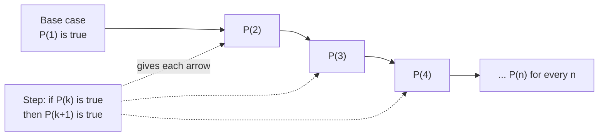
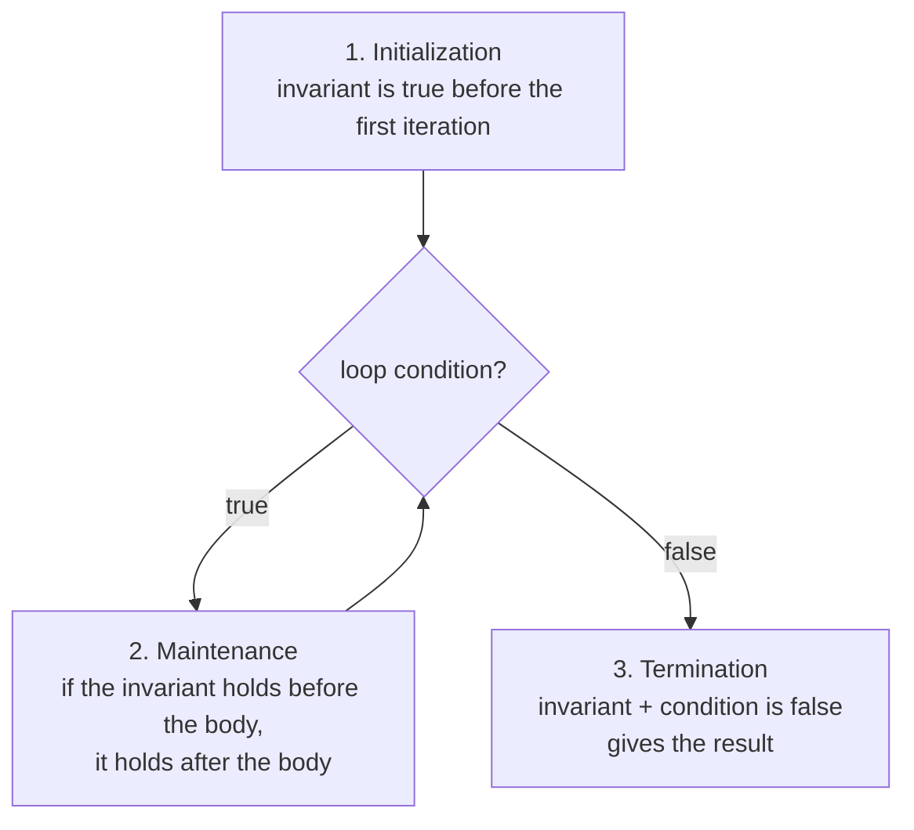

# Proof techniques and induction

After this you can explain why testing many cases does not prove a claim for all inputs, write a short induction proof, and state a loop invariant that shows a loop is correct.

Before this: [logic and truth tables](01-logic-and-truth-tables.md) and [recursion](../03-programming-fundamentals/02-thinking-like-a-programmer/01-recursion.md).

## The idea

The formula $n^2 + n + 41$ gives a prime for $n = 0, 1, 2, \dots, 39$. Forty passing cases looks like a pattern, and a test suite would call it green. At $n = 40$ the value is $1681 = 41 \times 41$, which is not prime. Tests show that a claim holds for the inputs you tried. A **proof** shows that it holds for every input, and for code a proof is worth having when the input space is too big to test, such as every list length.

Induction is the proof technique that matches loops and recursion. To show a claim for all $n$, you show it for the first case and show that each case passes to the next, like a row of dominoes.



## Key terms

A **proof** is a chain of steps, each justified by a definition or an earlier result, that ends in the claim. The common techniques are:

| Technique | Idea | Code analogue |
|---|---|---|
| Direct proof | Start from the assumptions, reach the claim | Reasoning through a function line by line |
| Counterexample | One input where the claim fails disproves "for all" | A failing test |
| Contrapositive | Prove "not q implies not p" instead of "p implies q" | Checking the failing case instead of the passing one |
| Contradiction | Assume the claim is false, derive an impossibility | Showing a state cannot occur |
| Induction | Base case plus a step from $k$ to $k+1$ | Recursion, loops |

In **mathematical induction** you prove a statement $P(n)$ in two parts. The **base case** shows $P(1)$ (or the smallest case). The **inductive step** assumes $P(k)$, called the **inductive hypothesis**, and proves $P(k+1)$.

A **loop invariant** is a condition that is true before the loop starts and stays true after every iteration. When the loop ends, the invariant together with the exit condition gives the result you wanted.

## How it works

A loop invariant is an induction in disguise. Initialization is the base case, maintenance is the inductive step, and termination uses the invariant at the end.



To use it, write the invariant as an `assert` at the top of the loop while you develop. The checks cost time, so remove them or turn them off for production. A failing assertion points at the iteration where the reasoning broke.

## Worked examples

<div class="example" markdown>

### Example 1: the sum of the first n numbers

We want to prove $1 + 2 + \dots + n = \dfrac{n(n+1)}{2}$ for every $n \ge 1$.

1. Base case, $n = 1$: the left side is $1$ and the right side is $\frac{1 \cdot 2}{2} = 1$.
2. Hypothesis: assume the formula holds for $n = k$.
3. Step: add $k + 1$ to both sides and simplify the right side.

$$\begin{aligned} 1 + \dots + k + (k+1) &= \frac{k(k+1)}{2} + (k+1) \\ &= \frac{k(k+1) + 2(k+1)}{2} = \frac{(k+1)(k+2)}{2} \end{aligned}$$

The last expression is the formula with $n = k + 1$, so the step is done. By induction the formula holds for every $n$.

<details class="code" markdown>
<summary>In code</summary>

```python
print(all(sum(range(1, n + 1)) == n * (n + 1) // 2 for n in range(1, 1001)))

def is_prime(m):
    return m > 1 and all(m % d for d in range(2, int(m**0.5) + 1))

print([n for n in range(60) if not is_prime(n * n + n + 41)][:3], 40 * 40 + 40 + 41)
```

```text
True
[40, 41, 44] 1681
```

</details>

Check: the formula holds for the first 1,000 values, but that is not the proof; the proof is the two steps above. The second line is the opening counterexample: the first failure is at $n = 40$.

</div>

<div class="example" markdown>

### Example 2: an invariant for a summing loop

Take `total(xs)`, which adds up a list. The invariant is: before iteration $i$, the variable `s` equals the sum of the first $i$ elements.

```python
def total(xs):
    s = 0
    for i, x in enumerate(xs):
        assert s == sum(xs[:i])
        s += x
    assert s == sum(xs)
    return s

print(total([4, 1, 7]))
```

```text
12
```

Initialization: at $i = 0$, `s` is 0 and the sum of no elements is 0. Maintenance: adding `x`, the element at index $i$, makes `s` the sum of the first $i + 1$ elements. Termination: after the last element, `s` is the sum of all of them. Check: the assertions pass and the result is 12.

</div>

## Common mistakes

<div class="warning" markdown>

Watch out: treating passing tests as a proof. Tests sample the inputs; the opening example passed 40 cases and was still false. Use tests to find counterexamples and a proof to cover all cases.

Watch out: skipping the base case, or proving a step that never starts. If the base case is missing, the chain has no first domino. In code, this is a recursive function with no stopping case.

Watch out: using the claim in its own proof. In the step you may assume $P(k)$ but must prove $P(k+1)$ without assuming it.

</div>

## Working with AI

<div class="ai" markdown>

Words to use: loop invariant, base case, inductive step, inductive hypothesis, counterexample, termination.

Prompts to try:

- "State a loop invariant for this binary search in Python, and show initialization, maintenance and termination. Then add an assert that checks the invariant on every iteration."
- "Here is my induction proof that the sum of the first n odd numbers is n squared. Check the base case and the inductive step line by line, and tell me where, if anywhere, it assumes what it should prove."

What to check:

- An invariant that is true but too weak to give the result at exit. Check that "invariant and exit condition" implies the postcondition.
- A proof that skips the base case or checks only small values. Verify each part separately.
- Off-by-one errors in the claimed range (does the loop include index $n$?). Run the assertion on tiny lists, including the empty list.

</div>

## Quiz

1\. A function passes 10,000 random tests. Does that prove it is correct for all inputs? What would?

<details class="solution" markdown>
<summary>Answer</summary>

No. Random tests sample the input space, and a bug can sit in a case they miss. A proof, such as a loop invariant argument or induction, covers every input.

</details>

2\. What does this print?

```python
def f(n):
    if n == 0:
        return 0
    return f(n - 1) + 2 * n - 1

print(f(1), f(2), f(3), f(10))
```

<details class="solution" markdown>
<summary>Answer</summary>

`1 4 9 100`. The function adds the first $n$ odd numbers, which equals $n^2$. Induction proves it: $(k-1)^2 + 2k - 1 = k^2$.

</details>

3\. In a binary search, someone writes `hi = mid - 1` where the window is the half-open range $[lo, hi)$. Which invariant breaks?

<details class="solution" markdown>
<summary>Answer</summary>

"If the target is in the list, it is in `xs[lo:hi]`." Setting `hi = mid - 1` drops index `mid - 1` from the window, so a target there is no longer in the window. For `xs = [1, 3, 5, 7, 9]` and target 3, the first step sets `hi = 1` and drops index 1.

</details>

4\. The claim "all swans are white" is false. How many observations does it take to disprove it, and how many to prove it by checking?

<details class="solution" markdown>
<summary>Answer</summary>

One black swan disproves it; that is a counterexample. Checking can only prove it if every swan is checked, so a proof must argue about all of them at once.

</details>

## Lab

<div class="lab" markdown>

### Lab: put an invariant in a binary search

Goal: write the invariant as an `assert`, then break the code and watch it fail. Time: about 15 minutes. Runs in: any terminal with Python 3.

1. Save the correct `bsearch` below as `invariant.py`. The window is the half-open range $[lo, hi)$ and the invariant says the target, if present, lies inside it.
2. Run it on `[1, 3, 5, 7, 9]` for every element and for a missing value, and confirm there are no errors.
3. Copy the function as `bad` and change `hi = mid` to `hi = mid - 1`.
4. Run `bad(xs, 3)` and read the traceback. Which line fails?

Expected result: the correct version prints the indexes and `-1`; the broken version raises `AssertionError` on the invariant line, one iteration after the window lost the target.

<details class="solution" markdown>
<summary>Solution</summary>

```python
def bsearch(xs, t):
    lo, hi = 0, len(xs)
    while lo < hi:
        assert t not in xs[:lo] and t not in xs[hi:]
        mid = (lo + hi) // 2
        if xs[mid] < t:
            lo = mid + 1
        elif xs[mid] > t:
            hi = mid
        else:
            return mid
    return -1

xs = [1, 3, 5, 7, 9]
print([bsearch(xs, t) for t in xs], bsearch(xs, 4))
```

```text
[0, 1, 2, 3, 4] -1
```

With `hi = mid - 1`, the first step on target 3 sets `hi = 1`, so `xs[hi:]` is `[3, 5, 7, 9]`, which contains 3, and the `assert` at the top of the next iteration fails. The assert is slow (it scans the list), so it belongs in development only.

</details>

</div>

## Where this shows up

- Reasoning about recursion in [recursion](../03-programming-fundamentals/02-thinking-like-a-programmer/01-recursion.md) and in [analysing recursive algorithms](../05-data-structures-and-algorithms/01-analysis/03-analysing-recursive-algorithms.md).
- [Binary search](../05-data-structures-and-algorithms/03-algorithms/01-binary-search.md), where the invariant is the whole difficulty.
- More depth (optional): [mathematical induction](https://faiyaz-svg.github.io/MathFromTheGroundUp/04-proofs-and-logic/05-induction/01-mathematical-induction/) in the sibling math book.
