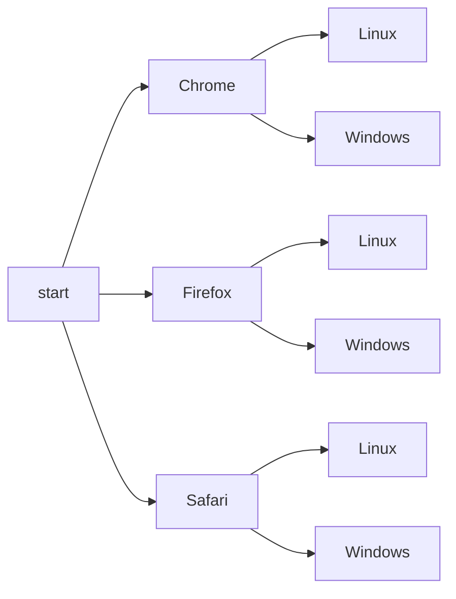
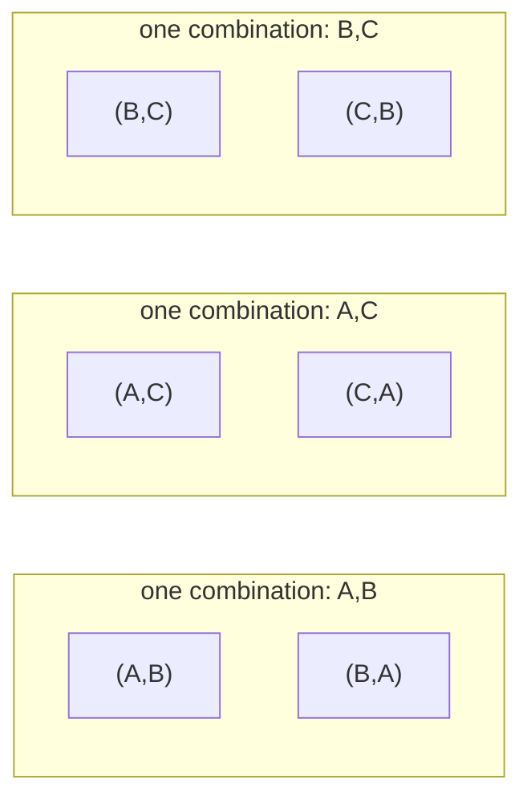

# Counting

After this you can count the size of a space of passwords, IDs or test configurations, and say when a brute-force search over it is feasible.

Before this: [sets, functions and relations](02-sets-functions-and-relations.md).

## The idea

A signup form requires passwords of 8 lowercase letters. How many are there? How many test configurations does a feature with three browsers, two operating systems and four locales need? How many bits does an ID need so that two users rarely get the same one? These are all counting questions, and the answers are products.

The core idea is to break a choice into steps and multiply the number of options at each step. The diagram counts configurations for two of the factors, three browsers and two operating systems. Each path from the root to a leaf is one configuration.



There are 3 choices, then 2 for each, so $3 \times 2 = 6$ leaves. Adding four locales multiplies the count again by 4, giving 24.

## Key terms

The **rule of product** says that if a task has $k$ steps with $n_1, n_2, \dots, n_k$ options, there are $n_1 \times n_2 \times \dots \times n_k$ outcomes. The **rule of sum** says that if a task can be done in one of several disjoint ways, the counts add.

An **arrangement with repetition** of length $k$ from $n$ symbols has $n^k$ possibilities. A **permutation** is an ordered selection without repetition, and its count is

$$P(n, k) = \frac{n!}{(n-k)!}$$

where $n! = n \times (n-1) \times \dots \times 1$ is the **factorial**. A **combination** is an unordered selection without repetition:

$$\binom{n}{k} = \frac{n!}{k!\,(n-k)!}$$

The **complement rule** counts what you want as everything minus what you do not want. The **pigeonhole principle** says that putting more than $n$ items into $n$ boxes forces some box to hold two.

## How it works

The first decision is whether order matters and whether repetition is allowed. Order matters for a password and not for a team of reviewers. Repetition is allowed when the same symbol can be used again.

| Order matters | Repetition | Count | Example |
|---|---|---|---|
| Yes | Yes | $n^k$ | 8-character password |
| Yes | No | $n!/(n-k)!$ | 1st, 2nd and 3rd place from 10 people |
| No | No | $\binom{n}{k}$ | 3 reviewers from 10 people |
| No | Yes | $\binom{n+k-1}{k}$ | 2 scoops from 3 flavours, repeats allowed |

A combination is a permutation with the order forgotten. In the diagram, choosing 2 of A, B, C gives 6 ordered pairs. Each unordered pair appears in two orders, so dividing by $2! = 2$ gives 3 combinations. In general $\binom{n}{k} = P(n, k) / k!$.



## Worked examples

<div class="example" markdown>

### Example 1: how big is a password space?

We want the number of passwords for three policies and the time to try all of them. Assume an attacker who has a stolen database of unsalted fast hashes and tests 10 billion guesses per second (a made-up round number for comparing sizes, not a measured rate).

1. Use the rule of product: each of the $k$ positions has $n$ options, so the space has $n^k$ passwords.
2. For 8 lowercase letters, $n = 26$ and $k = 8$, so $26^8$.
3. For 8 characters from letters and digits, $n = 62$, so $62^8$.
4. Divide each size by the guess rate to get the time to try them all.

<details class="code" markdown>
<summary>In code</summary>

```python
RATE = 10_000_000_000  # assumed guesses per second

def pretty(seconds):
    for unit, size in [("years", 31_536_000), ("days", 86_400), ("hours", 3_600), ("minutes", 60)]:
        if seconds >= size:
            return f"{seconds / size:,.1f} {unit}"
    return f"{seconds:,.1f} seconds"

for name, alphabet, length in [("8 lowercase", 26, 8), ("8 letters and digits", 62, 8), ("12 letters and digits", 62, 12)]:
    space = alphabet ** length
    print(f"{name:22} {space:>28,}  {pretty(space / RATE)}")
```

```text
8 lowercase                         208,827,064,576  20.9 seconds
8 letters and digits            218,340,105,584,896  6.1 hours
12 letters and digits  3,226,266,762,397,899,821,056  10,230.4 years
```

</details>

Check: the rows match $26^8$, $62^8$ and $62^{12}$ computed by hand with a calculator. Adding 4 characters multiplied the space by $62^4 \approx 14.8$ million, while widening the alphabet from 26 to 62 only multiplied it by about 1,000. Length grows the space exponentially, so it beats alphabet size.

</div>

<div class="example" markdown>

### Example 2: how many tests?

A feature has 10 on/off flags. Testing every combination needs $2^{10} = 1024$ runs. Each flag has two values, so each pair of flags has 4 value combinations, and there are $\binom{10}{2} = 45$ pairs of flags, so $45 \times 4 = 180$ pair-value combinations. If bugs usually come from one flag or from two flags interacting, a test generator can cover all 180 pair-value combinations with far fewer than 1024 full configurations. With 20 flags the full set is over a million runs ($2^{20} = 1{,}048{,}576$), while the pairs number only $\binom{20}{2} \times 4 = 760$.

Check: run `print(2**10, math.comb(10, 2) * 4)` and expect `1024 180`.

</div>

## Common mistakes

<div class="warning" markdown>

Watch out: using $n^k$ when items cannot repeat, or $P(n, k)$ when they can. Ask two questions first: does order matter, and can I reuse an item? Check with `itertools` on a small case, such as `permutations("ABCD", 2)`, which gives $12 = 4 \times 3$.

Watch out: assuming an exponential or factorial space can be searched. $10!$ is 3,628,800, which is quick, but $20!$ is about $2.4 \times 10^{18}$. This is why trying every route in a delivery problem stops working at around 20 stops.

Watch out: counting an "at least one" condition directly. "At least one digit" is hard to count, but "all letters" is easy. Use the complement rule: total minus the ones with none.

</div>

## Working with AI

<div class="ai" markdown>

Words to use: rule of product, permutation, combination, with and without repetition, complement, pigeonhole principle.

Prompts to try:

- "How many 10-character passwords from 62 characters contain at least one digit? Show the complement-rule formula, then verify it by brute force for length 4 in Python."
- "I have 12 feature flags. Explain pairwise testing and how many pair-value combinations there are, and name a tool that generates the test set."

What to check:

- A formula for the wrong case. Ask whether order matters and whether repetition is allowed, then test the formula on a size small enough to enumerate.
- Large numbers pasted without a unit or a source. Recompute in Python, where integers do not overflow.
- A claim that a search is "fast" with no count. Compare the size of the space against a stated rate.

</div>

## Quiz

1\. A 4-digit PIN allows digits 0 to 9 and repeats. How many PINs are there, and what is the chance that one random guess opens the lock?

<details class="solution" markdown>
<summary>Answer</summary>

$10^4 = 10{,}000$ PINs. One random guess succeeds with chance $1/10{,}000$, which is 0.01%.

</details>

2\. What does this print?

```python
import math
print(math.perm(5, 2), math.comb(5, 2), math.comb(5, 2) * math.factorial(2))
```

<details class="solution" markdown>
<summary>Answer</summary>

`20 10 20`. There are 20 ordered pairs and 10 unordered pairs, and $10 \times 2! = 20$.

</details>

3\. A team has 8 engineers and needs to pick a reviewer and a backup reviewer, in different roles. A colleague computes $\binom{8}{2} = 28$. What is the right count?

<details class="solution" markdown>
<summary>Answer</summary>

The roles differ, so order matters: $8 \times 7 = 56$ (a permutation). $\binom{8}{2}$ would be right only if the two roles were the same.

</details>

4\. A system stores 300,000 users and assigns each a random 4-digit code. Must two users share a code?

<details class="solution" markdown>
<summary>Answer</summary>

Yes, by the pigeonhole principle: there are only 10,000 codes for 300,000 users. At least 30 users share a code, since $300{,}000 / 10{,}000 = 30$.

</details>

## Lab

<div class="lab" markdown>

### Lab: count a password policy two ways

Goal: count strings with at least one digit by brute force and by the complement rule. Time: about 15 minutes. Runs in: any terminal with Python 3.

1. Use the alphabet of 26 lowercase letters plus 10 digits (36 symbols).
2. Brute force: use `itertools.product` to enumerate every string of length 4 and count the ones with a digit.
3. Formula: compute $36^4 - 26^4$ and compare with step 2.
4. Use the formula for length 8, where brute force is too slow.

Expected result: both counts for length 4 match, and the length-8 count is about 2.6 trillion.

<details class="solution" markdown>
<summary>Solution</summary>

```python
import itertools

chars = "abcdefghijklmnopqrstuvwxyz0123456789"
brute = sum(1 for t in itertools.product(chars, repeat=4) if any(c.isdigit() for c in t))
print(brute, 36**4 - 26**4)
print(f"{36**8 - 26**8:,}")
```

```text
1222640 1222640
2,612,282,842,880
```

The complement of "at least one digit" is "all letters", which has $26^k$ strings out of $36^k$.

</details>

</div>

## Where this shows up

- Hash collisions and the birthday problem, in [discrete probability](05-discrete-probability.md).
- Why exhaustive search blows up, in Big O and runtime<!-- link: ../05-data-structures-and-algorithms/01-analysis/01-big-o-and-runtime.md --> and in backtracking<!-- link: ../05-data-structures-and-algorithms/04-leetcode-patterns/06-backtracking.md -->.
- More depth (optional): [counting rules](https://faiyaz-svg.github.io/MathFromTheGroundUp/06-cs-math/03-counting-and-discrete-probability/01-counting-rules/) in the sibling math book.
