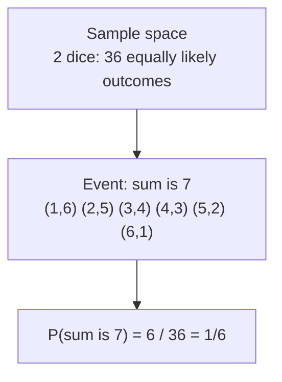
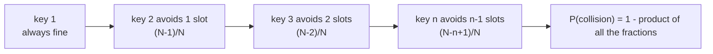
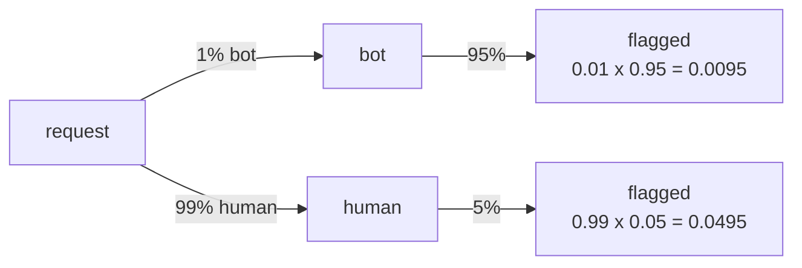

# Discrete probability

After this you can compute the chance of a hash collision or a combined failure, read a conditional probability correctly, and say whether a gap between two A/B groups could be noise.

Before this: [counting](04-counting.md).

## The idea

You hash 10,000 keys into a 32-bit space, which has about 4.3 billion slots. Is a collision likely? Most people guess no, since 10,000 is tiny next to 4.3 billion. The real chance is about 1.2%, which is small but not negligible, and it grows fast as the number of keys grows. In a room of 23 people there is already a better than even chance that two share a birthday.

Probability turns these guesses into numbers. List the possible outcomes, decide which ones count as the event you care about, and compare the sizes. When all outcomes are equally likely, the probability of an event is the number of outcomes in it divided by the number of outcomes in total.



## Key terms

The **sample space** $S$ is the set of all possible outcomes. An **event** $E$ is a subset of the sample space. With equally likely outcomes,

$$P(E) = \frac{\lvert E \rvert}{\lvert S \rvert}$$

The **complement** rule is $P(\text{not } E) = 1 - P(E)$. It is the main trick for "at least one" questions: compute the chance that none happens, then subtract from 1.

Two events are **independent** if one does not change the chance of the other, and then $P(A \cap B) = P(A)\,P(B)$. The **conditional probability** of $A$ given $B$ is

$$P(A \mid B) = \frac{P(A \cap B)}{P(B)}$$

A **random variable** is a number that depends on the outcome, such as the number of collisions. Its **expected value** is the average over many trials, $E[X] = \sum x \cdot P(X = x)$. **Linearity of expectation** says the expected value of a sum is the sum of the expected values, even when the parts are not independent.

## How it works

For a collision among $n$ keys hashed uniformly into $N$ slots, use the complement. The first key lands somewhere. The second must avoid 1 occupied slot, the third must avoid 2, and so on. If each key is placed independently, the chances multiply.



That product gives the exact answer, and it is easy to compute in a loop. For the 50% point, the formula $n \approx \sqrt{2 \ln 2 \cdot N} \approx 1.18\sqrt{N}$ works. For a 16-bit space that is about 300 keys, for 32 bits about 77,000, and for 64 bits about 5 billion. The square root is why 128-bit random IDs are safe in practice and 32-bit ones are not.

Linearity gives a quick estimate. There are $\binom{n}{2}$ pairs of keys, each colliding with chance $1/N$, so the expected number of colliding pairs is $\binom{n}{2}/N$. When that number is small, it is close to the probability of any collision.

## Worked examples

<div class="example" markdown>

### Example 1: collisions in a hash space

We want $P(\text{collision})$ for 23 values in 365 slots, and for 10,000 keys in a 32-bit space.

1. Write the product from the diagram: $\prod_{i=0}^{n-1} (N - i)/N$ is the chance of no collision.
2. Subtract it from 1.
3. Cross-check against the estimate $\binom{n}{2}/N$ for the large space, and against a simulation for the small one.

<details class="code" markdown>
<summary>In code</summary>

```python
import math
import random

def p_collision(n, N):
    p_none = 1.0
    for i in range(n):
        p_none *= (N - i) / N
    return 1 - p_none

def simulate(n, N, trials=100_000):
    hits = sum(len({random.randrange(N) for _ in range(n)}) < n for _ in range(trials))
    return hits / trials

random.seed(1)
print(f"{p_collision(23, 365):.4f}", f"{simulate(23, 365):.4f}")
print(f"{p_collision(10_000, 2**32):.5f}", f"{math.comb(10_000, 2) / 2**32:.5f}")
```

```text
0.5073 0.5071
0.01157 0.01164
```

</details>

Check: the formula and the simulation agree at about 0.507 for 23 people in 365 slots. For 10,000 keys in $2^{32}$ slots the exact chance is 1.157%, and the quick estimate $\binom{n}{2}/N$ gives 1.164%.

</div>

<div class="example" markdown>

### Example 2: a bot detector and the base rate

A detector flags 95% of bots and wrongly flags 5% of humans. Only 1% of requests are bots. If a request is flagged, how likely is it a bot?



Total flagged: $0.0095 + 0.0495 = 0.0590$. By the conditional probability formula,

$$P(\text{bot} \mid \text{flagged}) = \frac{0.0095}{0.0590} \approx 0.161$$

Check: in 10,000 requests, 100 are bots and 95 of those are flagged; of 9,900 humans, 495 are flagged. So 95 of the 590 flagged requests are bots, which is 16.1%. Most flags are false alarms even though the detector looks accurate, because bots are rare.

</div>

## Common mistakes

<div class="warning" markdown>

Watch out: multiplying probabilities that are not independent. A hundred services that are each up 99.9% of the time are all up with probability $0.999^{100} \approx 0.905$ only if their failures are independent. If they share a database or a network link, failures come together and the real figure differs.

Watch out: reading $P(A \mid B)$ as $P(B \mid A)$. "95% of bots are flagged" is not "95% of flagged requests are bots". Example 2 shows the second is 16.1%.

Watch out: expecting a streak to reverse. If each request fails independently with chance 1%, a failure just now does not make the next one less likely. The gambler's fallacy treats independent events as if they remembered.

</div>

## Working with AI

<div class="ai" markdown>

Words to use: sample space, independent events, conditional probability, base rate, birthday bound, expected value, linearity of expectation.

Prompts to try:

- "I hash 2 million records to a 48-bit ID. Give the exact collision probability with the product formula, the sqrt approximation, and a Python check. State your independence assumption."
- "My detector has 99% recall and a 2% false positive rate and bots are 0.5% of traffic. Compute P(bot | flagged) with a tree and verify with a count out of 1,000,000 requests."

What to check:

- An unstated assumption that events are independent or that outcomes are uniform. Real hashes, users and failures often are not.
- A conditional probability turned around. Check which event is the given.
- A floating-point product that underflows for large $n$. Python floats lose precision, so check the result with `math.log1p` or `math.comb`, or against a small simulation.

</div>

## Quiz

1\. Two fair dice are rolled. What is the chance that the sum is at least 11?

<details class="solution" markdown>
<summary>Answer</summary>

The outcomes are (5,6), (6,5) and (6,6), which is 3 of 36, so $1/12$ or about 8.3%.

</details>

2\. What does this print?

```python
p = 0.999
print(round(1 - p ** 100, 4))
```

<details class="solution" markdown>
<summary>Answer</summary>

`0.0952`. It is the chance that at least one of 100 independent components fails, using the complement rule.

</details>

3\. You use random 16-bit session tags. Roughly how many sessions before a duplicate becomes about 50% likely, and what do you change?

<details class="solution" markdown>
<summary>Answer</summary>

About $1.18\sqrt{65{,}536} \approx 300$ sessions. Use a larger random value, at least 128 bits, or a database constraint that rejects duplicates and retries.

</details>

4\. A test suite finds a bug with probability 0.9 when the bug exists and reports a false alarm 1% of the time when it does not. Is "the suite failed" proof the bug exists?

<details class="solution" markdown>
<summary>Answer</summary>

No. How likely the bug is given a failure depends on how common bugs are (the base rate). If only 1 change in 1,000 has such a bug, then 0.0009 of changes have a bug and fail, while $0.999 \times 0.01 = 0.00999$ have no bug and still fail, so about 8% of failures are real.

</details>

## Lab

<div class="lab" markdown>

### Lab: how big is a difference that is just noise?

Goal: simulate two A/B groups with the same true conversion rate and see how often chance alone produces a gap. Time: about 15 minutes. Runs in: any terminal with Python 3.

1. Save the script below as `noise.py`. Each run gives 1,000 users to group A and 1,000 to group B, both converting with probability 5%, and returns the difference in conversion rate.
2. Run it. The script prints the share of 2,000 runs where the groups differ by at least 1 percentage point, and the extremes.
3. Change `n` to 10,000 and run again. Predict whether the share goes up or down first.

Expected result: with 1,000 users per group, about a third of runs show a gap of 1 point or more although nothing differs.

<details class="solution" markdown>
<summary>Solution</summary>

```python
import random

random.seed(7)

def run(p=0.05, n=1000):
    a = sum(random.random() < p for _ in range(n))
    b = sum(random.random() < p for _ in range(n))
    return (b - a) / n

diffs = [run() for _ in range(2000)]
big = sum(1 for d in diffs if abs(d) >= 0.01) / len(diffs)
print(f"{big:.3f}", f"{max(diffs):.3f}", f"{min(diffs):.3f}")
```

```text
0.338 0.035 -0.029
```

A gap of 1 point on a 5% base rate looks like a 20% relative lift, yet it shows up by chance in 33.8% of runs. With larger groups the gap shrinks, because the spread of the difference falls with $\sqrt{n}$. A/B testing<!-- link: ../11-data-engineering-and-data-science/02-data-science-and-ml/03-ab-testing.md --> turns this into a rule for deciding when a gap is large enough to trust.

</details>

</div>

## Where this shows up

- Hash tables and how collisions are handled, in [hash tables](../05-data-structures-and-algorithms/02-data-structures/04-hash-tables.md), and hashes in security, in hashing and salts<!-- link: ../12-security/02-cryptography/01-hashing-and-salts.md -->.
- Reading experiment results, in statistics for data work<!-- link: ../11-data-engineering-and-data-science/02-data-science-and-ml/01-statistics-for-data-work.md -->.
- More depth (optional): [discrete probability](https://faiyaz-svg.github.io/MathFromTheGroundUp/06-cs-math/03-counting-and-discrete-probability/05-discrete-probability/) in the sibling math book.
