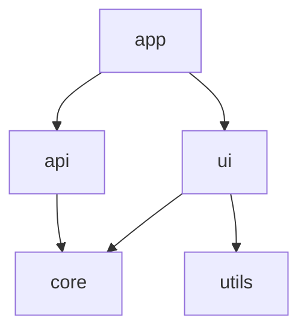
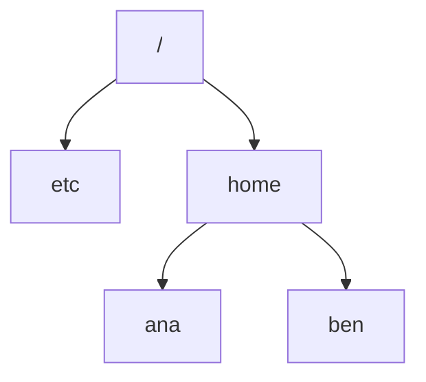

# Graphs and trees

After this you can model dependencies, networks and file systems as graphs, find a valid build order, and detect a cycle.

Before this: [sets, functions and relations](02-sets-functions-and-relations.md).

## The idea

A build tool must compile `core` before `api`, and `api` before `app`. A package manager must install a library's dependencies before the library. A deploy pipeline has stages that wait for earlier stages. All three are the same structure: things, and arrows saying "this needs that".

A graph is that structure. It has **vertices** (the things) and **edges** (the connections). The diagram shows a small project, with an arrow from each package to what it needs.



A valid build order lists the packages so that each one comes after everything it needs. Here `core` and `utils` have no dependencies and come first, then `api` and `ui`, then `app`. Whether such an order exists depends on one property: the graph must have no cycle.

## Key terms

A **graph** $G = (V, E)$ is a set of vertices $V$ and a set of edges $E$. In an **undirected** graph an edge is an unordered pair, such as a network cable between two machines. In a **directed** graph each edge has a direction, such as "depends on". The **degree** of a vertex is its number of edges.

A **path** is a sequence of vertices where each consecutive pair is joined by an edge. A **cycle** is a path that returns to its start. A graph is **connected** if there is a path between every pair of vertices.

A **DAG** (directed acyclic graph) is a directed graph with no directed cycle. A **topological order** of a DAG lists its vertices so that every edge points forward; one exists exactly when the graph is a DAG.

A **tree** is a connected graph with no cycle. A tree with $n$ vertices has exactly $n - 1$ edges. In a **rooted tree** one vertex is the **root**, every other vertex has one **parent**, and vertices with no children are **leaves**. The **depth** of a vertex is its distance from the root. A **spanning tree** of a connected graph is a tree that uses all its vertices and some of its edges.

An **adjacency list** stores, for each vertex, the list of its neighbours. It is the usual representation in code, because it uses space proportional to the number of vertices plus edges.

## How it works

File systems, HTML documents, org charts and the call tree of a recursive function are all rooted trees. The diagram shows a tiny file system with five vertices and four edges, matching $n - 1$.



Two facts follow from the definition. A tree has exactly one path between any two vertices, which is why a path like `/home/ana` identifies one directory. Adding one more edge to a tree creates exactly one cycle, which is what a symbolic link from `etc` to `ana` would do.

The questions you ask of a graph in code are usually:

1. Can I get from A to B? This is reachability, answered by walking the edges from A.
2. In what order can I process everything so that dependencies come first? This is a topological order.
3. Is there a cycle? A topological sort fails exactly when one exists.
4. Which nodes does a change affect? Reverse the edges and walk from the changed node.

Python has a topological sorter in the standard library, `graphlib.TopologicalSorter`. Pass it a dict from each node to the nodes it depends on.

## Worked examples

<div class="example" markdown>

### Example 1: a build order and a cycle

We want a build order for the project in the first diagram, then to see what happens if `core` is made to depend on `app`.

1. Write the graph as a dict from each package to its dependencies.
2. Ask `TopologicalSorter` for `static_order()`. It yields each node after its dependencies.
3. Add the edge `core` depends on `app`. Now `app` needs `api`, `api` needs `core` and `core` needs `app`, so there is a cycle. `CycleError` reports it.

<details class="code" markdown>
<summary>In code</summary>

```python
from graphlib import TopologicalSorter, CycleError

deps = {
    "app": ["api", "ui"],
    "api": ["core"],
    "ui": ["core", "utils"],
    "utils": [],
    "core": [],
}
print(list(TopologicalSorter(deps).static_order()))

deps["core"] = ["app"]
try:
    list(TopologicalSorter(deps).static_order())
except CycleError as e:
    print("cycle:", e.args[1])
```

```text
['core', 'utils', 'api', 'ui', 'app']
cycle: ['app', 'core', 'api', 'app']
```

</details>

Check: in the first line every package appears after its dependencies, and several orders are valid (`utils` could come later). The second line is the cycle `app`, `core`, `api`, back to `app`, listed as a path that ends where it starts.

</div>

<div class="example" markdown>

### Example 2: what does a change affect?

A change in `core` breaks everything that depends on it, directly or through other packages. Reverse the edges to get "who uses this", then walk from `core`. The `deps` dict from Example 1 is the input, with the cycle removed.

```python
def affected(deps, changed):
    users = {}
    for node, needs in deps.items():
        for d in needs:
            users.setdefault(d, []).append(node)
    seen, stack = set(), [changed]
    while stack:
        for u in users.get(stack.pop(), []):
            if u not in seen:
                seen.add(u)
                stack.append(u)
    return sorted(seen)

deps["core"] = []
print(affected(deps, "core"), affected(deps, "utils"))
```

```text
['api', 'app', 'ui'] ['app', 'ui']
```

Check: `utils` is used by `ui` only, and `app` uses `ui`, so a change in `utils` reaches `ui` and `app`. A change in `core` reaches three packages. This is how a build system knows what to rebuild or retest.

</div>

## Common mistakes

<div class="warning" markdown>

Watch out: confusing a tree with a binary tree. A tree is any connected graph with no cycle, and a node can have any number of children. A binary search tree is a special case with at most two children per node and an ordering rule.

Watch out: adding a link to a tree and still calling it a tree. One extra edge, such as a symbolic link or a circular import, makes a cycle. Code that walks the structure recursively then never ends unless it tracks the vertices it has seen.

Watch out: storing a sparse graph as a matrix. A matrix for 1,000 vertices has 1,000,000 cells even if each vertex has 3 edges, while an adjacency list has about 3,000 entries.

</div>

## Working with AI

<div class="ai" markdown>

Words to use: directed acyclic graph, topological order, cycle, adjacency list, reachability, spanning tree.

Prompts to try:

- "Here is my `package.json` dependency map as a Python dict. Use `graphlib.TopologicalSorter` to give me an install order and report the cycle if there is one."
- "My recursive directory walker never finishes on a folder with symbolic links. Explain why in terms of cycles in a graph and show a fix that tracks visited paths."

What to check:

- Edge direction. "A depends on B" can be drawn A to B or B to A, and the topological order reverses. Test on a three-node example.
- Missing nodes: a package that only appears as a dependency must still be a key, or the algorithm may skip it. `TopologicalSorter` adds such nodes by itself, but hand-written code often does not.
- A traversal with no visited set, which loops forever on a cycle.

</div>

## Quiz

1\. A connected graph has 8 vertices and 7 edges. Is it a tree? What if it has 8 edges?

<details class="solution" markdown>
<summary>Answer</summary>

Yes with 7: a connected graph on $n$ vertices with $n - 1$ edges has no cycle. With 8 edges it must contain a cycle, so it is not a tree.

</details>

2\. What does this print?

```python
from graphlib import TopologicalSorter
order = list(TopologicalSorter({"b": ["a"], "c": ["b"], "a": []}).static_order())
print(order)
```

<details class="solution" markdown>
<summary>Answer</summary>

`['a', 'b', 'c']`. Each node comes after the nodes it depends on, and here the chain forces a single order.

</details>

3\. A CI pipeline has stages `lint`, `test`, `build`, `deploy`. `test` needs `lint`, `build` needs `test`, `deploy` needs `build`, and someone adds "lint needs deploy". What happens, and how do you find the mistake?

<details class="solution" markdown>
<summary>Answer</summary>

There is a cycle: lint, deploy, build, test, lint. No stage can start first, so the pipeline cannot run. Run a topological sort on the stage graph, which reports the cycle.

</details>

4\. Two machines are connected through a network of 50 routers. Is the network a tree? Why do real networks usually have cycles?

<details class="solution" markdown>
<summary>Answer</summary>

Usually it is not. Redundant links make cycles on purpose, so that one cable failure leaves another path. A spanning tree, as used by protocols that avoid loops, picks a subset of links with no cycle.

</details>

## Lab

<div class="lab" markdown>

### Lab: build waves for parallel builds

Goal: group packages into waves that can build in parallel. Time: about 15 minutes. Runs in: any terminal with Python 3.9 or newer.

1. Save the dict below as `waves.py`.
2. Create a `TopologicalSorter` and call `prepare()`.
3. While `is_active()` is true, call `get_ready()` to get the packages whose dependencies are done, print them as one wave, and then call `done()` on them.
4. Predict the waves before you run the script.

Expected result: four waves; the packages in each wave do not depend on each other.

<details class="solution" markdown>
<summary>Solution</summary>

```python
from graphlib import TopologicalSorter

deps = {
    "app": ["api", "ui"],
    "api": ["core", "db"],
    "ui": ["core", "utils"],
    "db": ["core"],
    "utils": [],
    "core": [],
}
ts = TopologicalSorter(deps)
ts.prepare()
wave = 1
while ts.is_active():
    ready = sorted(ts.get_ready())
    print(wave, ready)
    ts.done(*ready)
    wave += 1
```

```text
1 ['core', 'utils']
2 ['db', 'ui']
3 ['api']
4 ['app']
```

The number of waves equals the length of the longest dependency chain (`core`, `db`, `api`, `app`), so more machines do not shorten the build below four waves.

</details>

</div>

## Where this shows up

- Graph representations and traversals, in graphs and representations<!-- link: ../05-data-structures-and-algorithms/02-data-structures/07-graphs-and-representations.md --> and BFS and DFS<!-- link: ../05-data-structures-and-algorithms/03-algorithms/03-bfs-and-dfs.md -->.
- Trees in code, in trees and binary search trees<!-- link: ../05-data-structures-and-algorithms/02-data-structures/05-trees-and-binary-search-trees.md -->, and file systems in [file systems](../02-operating-systems-and-linux/01-os-concepts/04-file-systems.md).
- More depth (optional): [paths, connectivity and trees](https://faiyaz-svg.github.io/MathFromTheGroundUp/06-cs-math/05-graphs/02-paths-connectivity-and-trees/) in the sibling math book.
