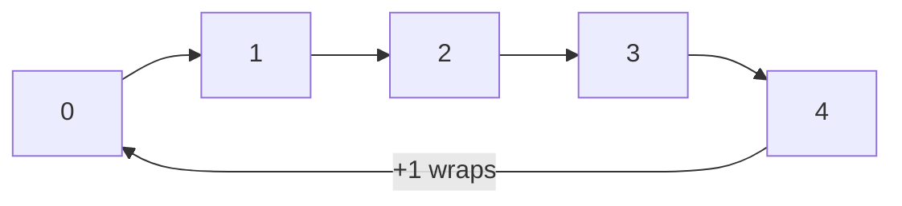
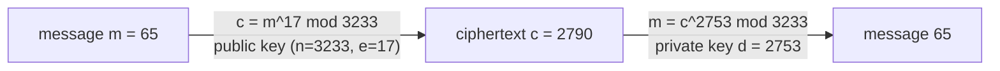

# Modular arithmetic

After this you can compute with remainders, use them for clocks, hash buckets and checksums, and read a toy RSA example.

Before this: [counting](04-counting.md) and [integers and two's complement](../01-how-computers-work/01-bits-and-data/03-integers-and-twos-complement.md).

## The idea

If today is Sunday, what day is it 100 days from now? You do not count 100 days. You divide by 7 and keep the remainder: 100 days is 14 whole weeks plus 2 days, so it is Tuesday. A clock does the same with 12, an array index does it with the array length, and a hash table does it with its number of buckets.

Modular arithmetic is arithmetic where numbers wrap around after reaching a fixed size, the **modulus**. In the diagram the modulus is 5, so counting up from 4 returns to 0.



On this ring, 7 lands on 2 (7 steps from 0 go around once and two more), and $-1$ lands on 4 (one step backwards from 0).

## Key terms

For integers $a$ and $n > 0$, **$a \bmod n$** is the remainder when $a$ is divided by $n$, a number from $0$ to $n - 1$. Two numbers are **congruent** modulo $n$, written $a \equiv b \pmod n$, if they have the same remainder, which means $n$ divides $a - b$. So $17 \equiv 2 \pmod 5$.

Sums, differences and products can be reduced at any point, because $(a + b) \bmod n = ((a \bmod n) + (b \bmod n)) \bmod n$, and the same holds for multiplication. Division is different: it needs a modular inverse. The **modular inverse** of $a$ modulo $n$ is a number $x$ with $a x \equiv 1 \pmod n$, and it exists exactly when $\gcd(a, n) = 1$ (the greatest common divisor is 1).

**Modular exponentiation** computes $b^e \bmod n$ without building the huge number $b^e$. A **checksum** is a small value computed from data, used to detect mistakes. A **hash function** maps data of any size to a fixed-size value; reducing it modulo the number of buckets gives a bucket index.

## How it works

Three uses in everyday code:

1. Hash buckets. A hash table with $m$ buckets stores a key in bucket `hash(key) % m`. When $m$ is a power of two, `h % m` equals `h & (m - 1)`, which is faster.
2. Checksums. The Luhn algorithm validates card numbers with sums modulo 10, so a typo is caught before a payment call.
3. Cryptography. RSA encrypts a number $m$ as $c = m^e \bmod n$ and decrypts as $m = c^d \bmod n$.

For RSA, pick two primes $p$ and $q$, and set $n = pq$. Pick $e$ with $\gcd(e, (p-1)(q-1)) = 1$, and let $d$ be the modular inverse of $e$ modulo $(p-1)(q-1)$. The pair $(n, e)$ is the public key and $d$ is the private key. The arithmetic below is the classic toy example. Real keys use primes of about 1,024 bits or more, and real systems add padding, so this is not a way to protect anything.



Python has built-in support. `pow(b, e, n)` does modular exponentiation, and `pow(a, -1, n)` (Python 3.8 and newer) returns the modular inverse or raises `ValueError` when it does not exist. The built-in `hash()` of a string changes between runs, so for a stable bucket use something like `zlib.crc32`.

```python
import zlib
for key in ["ana", "ben", "cy"]:
    print(key, zlib.crc32(key.encode()) % 8)
```

```text
ana 2
ben 1
cy 3
```

## Worked examples

<div class="example" markdown>

### Example 1: what day is 100 days from now?

We want the weekday 100 days after Sunday 25 October 2026.

1. Number the days from Monday = 0 to Sunday = 6. Sunday is 6.
2. Add 100 and reduce modulo 7: $(6 + 100) \bmod 7 = 106 \bmod 7 = 1$.
3. Day 1 is Tuesday.

<details class="code" markdown>
<summary>In code</summary>

```python
from datetime import date, timedelta

d = date(2026, 10, 25)
print(d.strftime("%A"), (d.weekday() + 100) % 7)
print((d + timedelta(days=100)).strftime("%A %Y-%m-%d"))
```

```text
Sunday 1
Tuesday 2027-02-02
```

</details>

Check: the second line shows the real calendar date, 2 February 2027, is a Tuesday, matching day 1.

</div>

<div class="example" markdown>

### Example 2: a Luhn checksum

The Luhn algorithm validates numbers such as payment card numbers. Working from the right, double every second digit (subtract 9 if the result exceeds 9), add all the digits, and the number is valid if the total is divisible by 10.

```python
def luhn_ok(num):
    total = 0
    for i, ch in enumerate(reversed(num)):
        d = int(ch)
        if i % 2 == 1:
            d *= 2
            if d > 9:
                d -= 9
        total += d
    return total % 10 == 0

print(luhn_ok("4242424242424242"), luhn_ok("4242424242424241"), luhn_ok("79927398713"))
```

```text
True False True
```

Check: changing the last digit of the valid test number breaks it. Trying every single-digit change on `79927398713` shows all 99 are caught. A checksum finds accidental typos, not tampering, because anyone can recompute it.

</div>

## Common mistakes

<div class="warning" markdown>

Watch out: negative numbers. In Python, `-7 % 5` is `3`, which matches the math definition. In JavaScript, C and Java, `-7 % 5` is `-2`, because `%` there is the remainder with the sign of the first operand. A hash that can be negative then gives a negative bucket index. Use `((a % n) + n) % n` in those languages.

Watch out: dividing modulo $n$. `a / b % n` is not the same as multiplying by an inverse, and for a modulus that is not prime some numbers have no inverse at all. Use `pow(b, -1, n)`.

Watch out: using textbook RSA for real. Without padding, the same message always gives the same ciphertext, and small messages can be recovered. Use a vetted library, which applies padding (OAEP) and handles key sizes.

</div>

## Working with AI

<div class="ai" markdown>

Words to use: modulus, congruent, modular inverse, modular exponentiation, checksum, bucket index, coprime.

Prompts to try:

- "Explain why `h % m` with `h` from a bad hash function clusters keys when `m` is a power of two, and show a Python experiment with 1,000 keys and 16 buckets."
- "Write Python `luhn_ok` and `luhn_check_digit` functions, with tests for the card number 4242424242424242 and for one-digit typos."

What to check:

- A `%` on a value that can be negative, in a language where the sign follows the dividend. Test with `-1`.
- Hand-rolled cryptography. Real code should call a library, and the AI should say which one.
- An inverse that does not exist. Check that the two numbers are coprime with `math.gcd`.

</div>

## Quiz

1\. What is $(17 \times 23) \bmod 10$? Can you get it without computing 391?

<details class="solution" markdown>
<summary>Answer</summary>

Yes, the answer is 1. Reduce first: $7 \times 3 = 21$, and $21 \bmod 10 = 1$. Reducing before multiplying is valid for modular products.

</details>

2\. What does this print?

```python
print(-7 % 5, 7 % -5, pow(3, 4, 5), pow(3, -1, 7))
```

<details class="solution" markdown>
<summary>Answer</summary>

`3 -3 1 5`. In Python the result of `%` takes the sign of the divisor, so `7 % -5` is `-3`. Next, $3^4 = 81$, and $81 \bmod 5 = 1$. The inverse of 3 modulo 7 is 5, because $3 \times 5 = 15 \equiv 1 \pmod 7$.

</details>

3\. A hash table has 10 buckets and keys are multiples of 10. What goes wrong?

<details class="solution" markdown>
<summary>Answer</summary>

Every key is a multiple of 10, so `key % 10` is always 0 and all keys land in bucket 0. The table degrades to a list. A good hash function mixes the bits first, and table sizes are often chosen to avoid sharing factors with common key patterns.

</details>

4\. Why is `pow(b, e, n)` preferred over `b ** e % n` when `e` is large?

<details class="solution" markdown>
<summary>Answer</summary>

`b ** e` builds an enormous integer before reducing it. `pow(b, e, n)` reduces after each multiplication, so numbers stay below $n^2$, and it needs only about $\log_2 e$ squarings instead of $e$ multiplications.

</details>

## Lab

<div class="lab" markdown>

### Lab: a toy RSA round trip

Goal: build the toy key from the page, encrypt and decrypt, and see why unpadded RSA is weak. Time: about 15 minutes. Runs in: any terminal with Python 3.8 or newer.

1. Set `p = 61`, `q = 53`, `e = 17`. Compute `n`, `phi = (p - 1) * (q - 1)` and `d = pow(e, -1, phi)`.
2. Encrypt the message 65 with `pow(m, e, n)` and decrypt with `pow(c, d, n)`.
3. Check that decrypting the encryption returns the message for every `m` from 0 to `n - 1`.
4. Encrypt 65 twice and compare the two ciphertexts.

Expected result: `n`, `d` and `c` are 3233, 2753 and 2790; the round trip works for all messages; both ciphertexts are equal.

<details class="solution" markdown>
<summary>Solution</summary>

```python
p, q, e = 61, 53, 17
n, phi = p * q, (p - 1) * (q - 1)
d = pow(e, -1, phi)
print(n, phi, d)

m = 65
c = pow(m, e, n)
print(c, pow(c, d, n))
print(all(pow(pow(x, e, n), d, n) == x for x in range(n)))
print(pow(m, e, n) == pow(m, e, n))
```

```text
3233 3120 2753
2790 65
True
True
```

The last line is `True` because encryption is a deterministic function: an attacker can encrypt guesses and compare. Padding adds randomness so equal messages give different ciphertexts. Factoring $n = 3233$ is instant here, but it is infeasible for a 2048-bit $n$, which is what the scheme relies on.

</details>

</div>

## Where this shows up

- Hash tables, in hash tables<!-- link: ../05-data-structures-and-algorithms/02-data-structures/04-hash-tables.md -->, and password hashing, in hashing and salts<!-- link: ../12-security/02-cryptography/01-hashing-and-salts.md -->.
- RSA at full size, in RSA step by step<!-- link: ../12-security/02-cryptography/04-rsa-step-by-step.md -->.
- More depth (optional): [divisibility and modular arithmetic](https://faiyaz-svg.github.io/MathFromTheGroundUp/06-cs-math/02-number-theory/01-divisibility-and-modular-arithmetic/) in the sibling math book.
