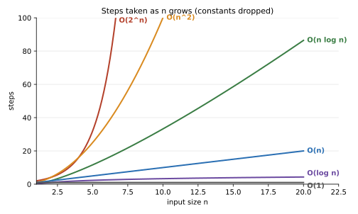
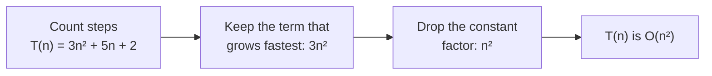

# Big O and runtime

After this you can read a function and say how its running time grows with the size of its input, and spot when an AI-written solution will be too slow.

Before this: [recursion](../../03-programming-fundamentals/02-thinking-like-a-programmer/01-recursion.md) and [memory hierarchy and latency numbers](../../01-how-computers-work/02-hardware/04-memory-hierarchy-and-latency-numbers.md).

## The idea

A function that checks a list for duplicates passes its tests on 100 items and finishes instantly. In production it gets 100,000 items and runs for minutes. Nothing is wrong with the code's logic. The cost of the work grows faster than the input does, and the tests never showed it.

We don't measure seconds, because seconds depend on the machine, the language and what else is running. We count steps as a function of the input size, and look at how that count grows when the input gets bigger. The plot shows the common shapes, and the shape matters far more than the details.



## Key terms

The **input size** $n$ is the number of items the function works on (list length, number of rows, number of characters). It keeps this meaning throughout the algorithms chapter.

A **step** is one basic operation: a comparison, an assignment, an arithmetic operation, an array index. We count steps, not seconds.

**Big O** is an upper bound on growth. Formally, $f(n)$ is $O(g(n))$ if there are constants $c > 0$ and $n_0$ such that $f(n) \le c \cdot g(n)$ for every $n \ge n_0$. In plain words: past some input size, $f$ never grows faster than a constant times $g$. So $3n^2 + 5n + 2$ is $O(n^2)$.

## How it works

To get the Big O of a piece of code, count steps as a function of $n$, keep the fastest-growing term, and drop its constant factor.



Constants and smaller terms are dropped because they stop mattering as $n$ grows: at $n = 1{,}000$, the $5n$ term is 5,000 steps next to 3,000,000 for the $3n^2$ term. The table shows steps for each class. At $10^9$ steps per second, a million items cost 20 ms with $n \log n$ and about 17 minutes with $n^2$. The exponential column explains why $O(2^n)$ is only usable for tiny inputs: $2^{100}$ steps would take about $4 \times 10^{13}$ years.

| Class | Name | Typical source | $n=10$ | $n=100$ | $n=1{,}000$ | $n=10^6$ |
|---|---|---|---|---|---|---|
| $O(1)$ | constant | index into a list | 1 | 1 | 1 | 1 |
| $O(\log n)$ | logarithmic | halve the problem each step | 3 | 7 | 10 | 20 |
| $O(n)$ | linear | one pass over the data | 10 | 100 | 1,000 | 1,000,000 |
| $O(n \log n)$ | linearithmic | good sorting | 33 | 664 | 9,966 | 19,931,569 |
| $O(n^2)$ | quadratic | loop inside a loop | 100 | 10,000 | 1,000,000 | $10^{12}$ |
| $O(2^n)$ | exponential | try every subset | 1,024 | $1.3 \times 10^{30}$ | $10^{301}$ | not computable |

Here $\log n$ means $\log_2 n$. The base only changes a constant factor, so Big O ignores it.

Big O is one of three bounds. **Omega**, written $\Omega(g(n))$, is the matching lower bound: growth is at least a constant times $g$. **Theta**, written $\Theta(g(n))$, means both bounds hold, so growth is exactly of the shape $g$. People often say "Big O" in interviews when they mean Theta. Separately, **best case**, **worst case** and **average case** say which inputs you analyze; unless told otherwise, a stated Big O means the worst case. The input that decides the case (already sorted, key missing, all keys equal) is what you name when you answer.

To read the cost off code, use the shape of the loops:

| Code shape | Steps |
|---|---|
| One loop over $n$ items | $n$, so $O(n)$ |
| A loop whose variable doubles or halves each pass | $\log n$, so $O(\log n)$ |
| A loop inside a loop, both over $n$ | $n \cdot n$, so $O(n^2)$ |
| Inner loop runs $i$ times for each $i$ from 0 to $n$ | $n(n-1)/2$, so $O(n^2)$ |
| Two loops one after the other | $n + n$, so $O(n)$: add, keep the largest |
| A loop that calls something costing $m$ | $n \cdot m$ |

Library calls count too. In Python, `x in items` on a list is $O(n)$, on a set it is $O(1)$ on average, and `items.insert(0, x)` is $O(n)$ because every element shifts ([time complexity table](https://wiki.python.org/moin/TimeComplexity)). A one-line loop that calls them can be quadratic.

<details class="code" markdown>
<summary>In code</summary>

```python
def halvings(n):
    steps = 0
    while n > 1:
        n //= 2
        steps += 1
    return steps

for n in [1_000, 1_000_000]:
    print(n, halvings(n))
```

```text
1000 9
1000000 19
```

</details>

Big O hides the constant and ignores where the data lives. Two $O(n)$ loops can differ by several times: in the [memory hierarchy lesson](../../01-how-computers-work/02-hardware/04-memory-hierarchy-and-latency-numbers.md), summing a list took 0.194 s in order and 1.294 s in shuffled order, both $O(n)$. A "worse" algorithm can win on small inputs, which is why Python's built-in sort uses insertion sort on short runs. Big O predicts what happens as $n$ grows; for a fixed small $n$, measure.

## Worked examples

<div class="example" markdown>

### Example 1: counting the steps of a duplicate check

We want the running time of this function, counting each comparison as one step.

```python
def has_duplicate(items):
    for i in range(len(items)):
        for j in range(i + 1, len(items)):
            if items[i] == items[j]:
                return True
    return False
```

1. The outer loop picks $i$. The inner loop compares it with every later item, so it runs $n-1$ times for $i = 0$, $n-2$ times for $i = 1$, and so on down to 0.
2. If no duplicate exists (the worst case), the total is $(n-1) + (n-2) + \dots + 0 = n(n-1)/2 = n^2/2 - n/2$.
3. Keep the fastest-growing term, $n^2/2$, and drop the constant $1/2$. The worst case is $O(n^2)$.
4. If the first two items are equal (the best case), the function returns after one comparison, which is $O(1)$.

Check by counting comparisons in code:

<details class="code" markdown>
<summary>In code</summary>

```python
def comparisons(n):
    steps = 0
    for i in range(n):
        for j in range(i + 1, n):
            steps += 1
    return steps

for n in [10, 100, 1000]:
    print(n, comparisons(n), n * (n - 1) // 2)
```

```text
10 45 45
100 4950 4950
1000 499500 499500
```

</details>

The two counts match. Multiplying $n$ by 10 multiplied the steps by about 100, which is the signature of $O(n^2)$. A version that keeps a set of items already seen is $O(n)$ on average, at the cost of extra memory; the next lesson covers that trade.

</div>

## Common mistakes

<div class="warning" markdown>

Watch out: adding the costs of nested loops. A loop inside a loop multiplies; two loops side by side add.

Watch out: reading $O(n)$ as "takes $n$ seconds" or $O(1)$ as "fast". $O(1)$ only says the cost doesn't grow with $n$; a call that always costs 200 ms is still $O(1)$.

Watch out: calling the answer $O(n^2 + n)$ or $O(3n)$. Write $O(n^2)$ and $O(n)$.

</div>

## Working with AI

<div class="ai" markdown>

Words to use: time complexity, worst case, input size $n$, nested loop, Theta, hidden constant.

Prompts to try:

- "Here is a Python function (pasted). State its worst-case time complexity in terms of the length of `items`, and name the input that triggers the worst case."
- "This endpoint is $O(n^2)$ in the number of orders and has 200,000 orders. Rewrite the inner lookup so the whole function is $O(n)$ on average, and say what extra memory it uses."

What to check:

- A complexity stated without saying what $n$ is. If a function takes a list and a string, ask for the answer in terms of both lengths.
- A claimed $O(n)$ that hides a library call costing $O(n)$ inside the loop, such as `in` on a list or `insert(0, x)`.
- Worst case and average case mixed together. Hash lookups are $O(1)$ on average and $O(n)$ in the worst case.
- A prediction of speed from Big O alone. Time the code at two input sizes, as in the lab.

</div>

## Quiz

1\. Simplify $T(n) = 4n^3 + 100n^2 + 7$ to Big O, and say which part of the expression you dropped and why.

<details class="solution" markdown>
<summary>Answer</summary>

$O(n^3)$. The $100n^2$ and 7 terms grow more slowly, and the constant factor 4 doesn't change the shape. Past some $n$, the $4n^3$ term dominates.

</details>

2\. What is the time complexity of this function, in terms of $n$?

```python
def mystery(n):
    count = 0
    i = 1
    while i < n:
        for _ in range(n):
            count += 1
        i *= 2
    return count
```

<details class="solution" markdown>
<summary>Answer</summary>

$O(n \log n)$. The `while` loop doubles `i`, so it runs about $\log_2 n$ times. Each pass runs the inner loop $n$ times, so the total is $n \log n$ (the loops multiply).

</details>

3\. A teammate says a function is $O(n)$ because "it has one loop". The loop body is `if x in seen_list: ...` where `seen_list` is a list that grows as the loop runs. What is the real complexity, and what is the fix?

<details class="solution" markdown>
<summary>Answer</summary>

$O(n^2)$ in the worst case: the `in` check scans a list that reaches length $n$, so it costs up to $n$ steps per pass. Replace `seen_list` with a set, which makes each check $O(1)$ on average and the loop $O(n)$.

</details>

4\. Binary search takes about 20 steps on a sorted list of one million items. Roughly how many steps does it take on one billion items?

<details class="solution" markdown>
<summary>Answer</summary>

About 30. It is $O(\log n)$ and $\log_2 10^9 \approx 29.9$. A thousand times more data added only 10 steps.

</details>

## Lab

<div class="lab" markdown>

### Lab: fit the growth of three functions

Goal: time code at growing input sizes and recover the exponent in time $\approx n^k$. Time: about 15 minutes. Runs in: any terminal with Python 3.10 or later.

1. Save the script below as `growth.py`. For each function it doubles $n$ five times, takes the best of 3 timings, and fits a line to $\log(\text{time})$ against $\log(n)$. The slope is the exponent $k$.
2. Run `python growth.py` (or `python3`). Write down the three exponents. Your times will differ from the expected result.
3. Predict first, then check: change `has_duplicate` to return after the first comparison by making the first two items equal. What exponent do you expect? (Hint: the best case is not the worst case.)
4. Explain why `sorted` can show an exponent above 1 even though it is $O(n \log n)$, using the hidden-constant paragraph above.
5. Cleanup: delete `growth.py` if you do not need it.

```python
import math
import random
import statistics
import time


def has_duplicate(items):
    for i in range(len(items)):
        for j in range(i + 1, len(items)):
            if items[i] == items[j]:
                return True
    return False


def best_time(f, data, repeats=3):
    best = float("inf")
    for _ in range(repeats):
        start = time.perf_counter()
        f(data)
        best = min(best, time.perf_counter() - start)
    return best


def fit_exponent(f, make_data, sizes):
    times = [best_time(f, make_data(n)) for n in sizes]
    slope = statistics.linear_regression(
        [math.log(n) for n in sizes], [math.log(t) for t in times]
    ).slope
    return times, slope


random.seed(1)
cases = [
    ("sum", sum, lambda n: list(range(n)), [250_000 * 2**k for k in range(5)]),
    ("sorted", sorted, lambda n: random.sample(range(n * 10), n), [100_000 * 2**k for k in range(5)]),
    ("has_duplicate", has_duplicate, lambda n: list(range(n)), [250 * 2**k for k in range(5)]),
]
for name, f, make, sizes in cases:
    times, slope = fit_exponent(f, make, sizes)
    print(f"{name:14} n={sizes[0]:>9,} to {sizes[-1]:>9,}   largest {times[-1]:.4f} s   exponent {slope:.2f}")
```

Expected result: an exponent near 1 for `sum`, a little above 1 for `sorted`, and near 2 for `has_duplicate`. This output is from the author's Windows 11 PC (Python 3.14).

```text
sum            n=  250,000 to 4,000,000   largest 0.0147 s   exponent 1.02
sorted         n=  100,000 to 1,600,000   largest 0.7314 s   exponent 1.34
has_duplicate  n=      250 to     4,000   largest 0.4350 s   exponent 2.06
```

<details class="solution" markdown>
<summary>Solution</summary>

Step 3: with the first two items equal, `has_duplicate` stops after one comparison at every $n$, so the time is flat and the exponent is near 0. The time is under a microsecond, so timer noise dominates and the fitted exponent can come out slightly negative (it was $-0.24$ on the author's PC).

Step 4: an $n \log n$ curve, fitted as a power of $n$, gives an exponent slightly above 1, because $\log n$ grows slowly (over this range the extra is about 0.07). The rest of the excess is the constant: sorting random data moves memory in unpredictable ways, and as $n$ grows the data no longer fits in cache, so each step gets more expensive. The measured exponent mixes the algorithm's growth with the machine's behaviour, which is why Big O is a prediction about shape and not a stopwatch.

</details>

</div>

## Where this shows up

- Choosing what to store a collection in, in arrays and dynamic arrays<!-- link: ../02-data-structures/01-arrays-and-dynamic-arrays.md --> and hash tables<!-- link: ../02-data-structures/04-hash-tables.md -->.
- Coding-interview questions, which end with "what is the time and space complexity?". [Space and amortized analysis](02-space-and-amortized-analysis.md) is the next lesson.
