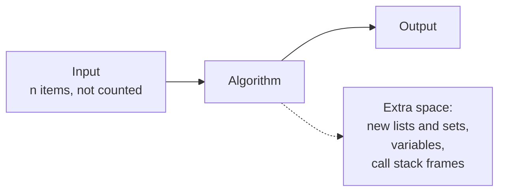
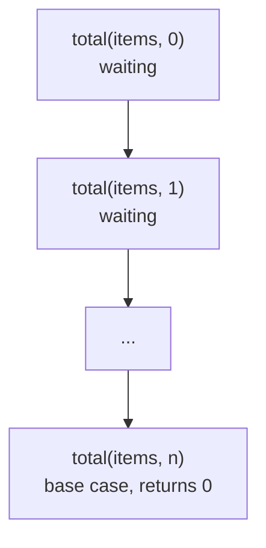

# Space and amortized analysis

After this you can state how much extra memory a function uses (including the call stack), explain why `list.append` is $O(1)$ on average although some appends are slow, and judge a trade of memory for speed.

Before this: [Big O and runtime](01-big-o-and-runtime.md).

## The idea

The duplicate check from the last lesson took $O(n^2)$ time and almost no memory. A version that remembers each item in a set takes $O(n)$ time but needs memory for $n$ items. Time is not the only resource: memory runs out too, and a program that needs 40 GB for a 40 MB input can be killed by the operating system.

A second question comes from operations whose cost varies. Appending to a Python list usually takes about 30 ns, but now and then the list must grow and copy every element. Quoting the worst single append ($O(n)$) would be misleading, and so would ignoring it. The honest number is the cost per operation over a long run of them.



## Key terms

**Space complexity** is how the memory an algorithm needs grows with $n$. Usually we mean **auxiliary space**: the extra memory beyond the input itself. It follows the same Big O rules as time.

The **call stack** is the region of memory that holds one **stack frame** (the arguments and local variables) for each function call that has started and not yet returned. A recursive call adds a frame, so the depth of the recursion is memory.

A **dynamic array** is an array that grows when full. Its **size** is how many items it holds, and its **capacity** is how many it has room for. Python's `list` is one.

The **amortized cost** of an operation is the total cost of a sequence of $n$ operations divided by $n$, for the worst possible sequence. Amortized $O(1)$ means any $n$ operations cost $O(n)$ in total, even if one of them costs $O(n)$ alone. This is a guarantee, not the average over random inputs.

## How it works

For space, count what the code creates, not what it receives. A few variables are $O(1)$. A new list or set holding up to $n$ items is $O(n)$. A slice such as `items[1:]` creates a copy. Recursion adds one frame per level of depth, even when the function creates no lists.



In the diagram, a recursive sum over $n$ items has $n + 1$ frames alive at once at the bottom of the chain, so it uses $O(n)$ space. Python caps the depth (1,000 by default, from `sys.getrecursionlimit()`; see the [sys docs](https://docs.python.org/3/library/sys.html#sys.getrecursionlimit)) and raises `RecursionError` beyond it. A loop doing the same work uses $O(1)$.

For amortized cost, the dynamic array is the standard case. When an append finds the array full, it allocates a new array of double the capacity and copies every item across. In the text diagram, a resize costs more each time, but the resizes get twice as far apart.

```text
append #:   1   2   3   4   5   6   7   8   9  ...
capacity:   1   2   4   4   8   8   8   8  16
copies:     0   1   2   0   4   0   0   0   8
```

To append $n$ items, the copies are $1 + 2 + 4 + \dots$ up to a power of two below $n$, which is less than $2n$. Add the $n$ writes and the total is under $3n$, so each append costs at most 3 steps on average: amortized $O(1)$. If the array instead grew by a fixed amount (say 10 slots), the copies would total about $n^2/20$, and each append would be $O(n)$ amortized. What matters is growing by a constant factor.

CPython does not double. As of 2026, `list.append` over-allocates by about one eighth of the new size plus a few slots, rounded to a multiple of 4, so capacities go 4, 8, 16, 24, 32, 40, 52, 64, 76 (see the comment in [`listobject.c`](https://github.com/python/cpython/blob/main/Objects/listobject.c)). A smaller factor wastes less memory and copies more often, but any constant factor gives amortized $O(1)$.

Memory and time often trade against each other. The table shows the duplicate check.

| Approach | Time | Extra space |
|---|---|---|
| Compare every pair | $O(n^2)$ | $O(1)$ |
| Remember items in a set | $O(n)$ average | $O(n)$ |

Caches, lookup tables, database indexes and [memoization](03-analysing-recursive-algorithms.md) all spend memory to save time.

## Worked examples

<div class="example" markdown>

### Example 1: counting the copies of a doubling array

We want the number of element copies when appending $n$ items to a dynamic array that doubles, and the same count for growing by 10.

1. Write the array with `capacity`, `size` and a `copies` counter. When `size == capacity`, double the capacity and copy `size` items into a new list.
2. Append $n$ items for three values of $n$ and print the copies per append.
3. Compare with a version that adds 10 slots each time.

<details class="code" markdown>
<summary>In code</summary>

```python
class DynamicArray:
    def __init__(self):
        self.capacity = 1
        self.size = 0
        self.slots = [None] * self.capacity
        self.copies = 0

    def append(self, value):
        if self.size == self.capacity:
            self.capacity *= 2
            new_slots = [None] * self.capacity
            for i in range(self.size):
                new_slots[i] = self.slots[i]
                self.copies += 1
            self.slots = new_slots
        self.slots[self.size] = value
        self.size += 1

def copies_fixed(n, step=10):
    capacity, copies = step, 0
    for size in range(n):
        if size == capacity:
            copies += size
            capacity += step
    return copies

for n in [1_000, 1_000_000]:
    a = DynamicArray()
    for i in range(n):
        a.append(i)
    print(f"doubling  n={n:>9,}  copies per append {a.copies / n:.2f}")
for n in [1_000, 10_000, 100_000]:
    print(f"plus 10   n={n:>9,}  copies per append {copies_fixed(n) / n:.1f}")
```

```text
doubling  n=    1,000  copies per append 1.02
doubling  n=1,000,000  copies per append 1.05
plus 10   n=    1,000  copies per append 49.5
plus 10   n=   10,000  copies per append 499.5
plus 10   n=  100,000  copies per append 4999.5
```

</details>

Check: with doubling, copies per append stay near 1, so the bound of 2 holds. With a fixed step they grow in proportion to $n$ (about $n/20$), which is $O(n)$ per append and $O(n^2)$ overall.

</div>

## Common mistakes

<div class="warning" markdown>

Watch out: confusing amortized with average case. Average case assumes typical or random inputs and can be broken by a bad input. An amortized bound holds for every sequence of operations.

Watch out: forgetting the call stack. A recursive function that builds no lists is still $O(\text{depth})$ in space. Recursing on `items[1:]` is worse: each call copies the rest of the list, so time and space both become $O(n^2)$. Pass an index instead.

</div>

## Working with AI

<div class="ai" markdown>

Words to use: auxiliary space, call stack, amortized $O(1)$, in place, dynamic array, time-space trade-off.

Prompts to try:

- "What is the time and auxiliary space complexity of this function (pasted)? Count the recursion stack and any slices or copies separately."
- "Rewrite this function to use $O(1)$ extra space. State what changes in time complexity, and whether it modifies its input."

What to check:

- A claim of $O(1)$ space that ignores recursion depth, or a slice or `sorted()` call that makes a copy.
- "Amortized" used for an average over random data. Ask for the sequence of operations the bound covers.
- An in-place rewrite that silently changes the caller's list. Run it on a list you keep a copy of and compare.
- A list comprehension inside `sum()`, `any()` or `max()` where a generator expression would avoid building the whole list.

</div>

## Quiz

1\. A single `append` to a full dynamic array costs $O(n)$. Why is `append` still called amortized $O(1)$?

<details class="solution" markdown>
<summary>Answer</summary>

The expensive appends are rare, because capacity grows by a constant factor each time. The copies over $n$ appends total less than $2n$, so $n$ appends cost $O(n)$ in total, which is $O(1)$ each on average over the sequence.

</details>

2\. A dynamic array starts with capacity 1 and doubles when full. How many element copies happen while appending 8 items?

<details class="solution" markdown>
<summary>Answer</summary>

7. Appends 2, 3 and 5 trigger resizes that copy 1, 2 and 4 items: $1 + 2 + 4 = 7$.

</details>

3\. A teammate's recursive sum is `return items[0] + total(items[1:])` with an empty-list base case. What are its time and space complexity, and how do you fix it?

<details class="solution" markdown>
<summary>Answer</summary>

Time $O(n^2)$ and space $O(n^2)$: each call copies a slice of the remaining items, and all the slices are alive together on the stack. It also fails with `RecursionError` near 1,000 items. Use a loop, or the built-in `sum`, which is $O(n)$ time and $O(1)$ space.

</details>

4\. Compare the space used by `sum([x * x for x in range(n)])` and `sum(x * x for x in range(n))`.

<details class="solution" markdown>
<summary>Answer</summary>

The first builds a list of $n$ items first, so it uses $O(n)$ space. The second is a generator that produces one value at a time, so it uses $O(1)$. Both take $O(n)$ time.

</details>

## Lab

<div class="lab" markdown>

### Lab: watch a list grow, and measure what an append costs

Goal: see the resizes of a Python list, check that `append` stays flat while `insert(0, x)` does not, and measure the memory difference between a list and a generator. Time: about 15 minutes. Runs in: any terminal with Python 3.

1. Save the script below as `space.py` and run it. Write down the four times for each of `append` and `insert(0)`.
2. Compare the first and last rows. How many times did each column grow when $n$ grew 8 times? Predict first: flat, 8 times, or 64 times?
3. Look at the line of reallocation points. Compare it with the capacities listed above in this lesson.
4. Change `n = 1_000_000` to `n = 2_000_000` and run again. Predict first: what happens to each peak?
5. Cleanup: delete `space.py` if you do not need it.

```python
import sys
import time
import tracemalloc


def build_append(n):
    items = []
    for i in range(n):
        items.append(i)


def build_insert_front(n):
    items = []
    for i in range(n):
        items.insert(0, i)


def best_time(f, n, repeats=5):
    best = float("inf")
    for _ in range(repeats):
        start = time.perf_counter()
        f(n)
        best = min(best, time.perf_counter() - start)
    return best


def peak_bytes(f):
    tracemalloc.start()
    f()
    _, peak = tracemalloc.get_traced_memory()
    tracemalloc.stop()
    return peak


print("time per call")
for n in [25_000, 50_000, 100_000, 200_000]:
    per_append = best_time(build_append, n) / n
    per_insert = best_time(build_insert_front, n) / n
    print(f"n={n:>8,}  append {per_append * 1e9:6.0f} ns   insert(0) {per_insert * 1e9:8.0f} ns")

items, last, jumps = [], None, []
for i in range(60):
    items.append(i)
    size = sys.getsizeof(items)
    if size != last:
        jumps.append(len(items))
        last = size
print("the list reallocated when its length reached:", jumps)

n = 1_000_000
print("peak memory, list comprehension:", f"{peak_bytes(lambda: sum([x * x for x in range(n)])):,} bytes")
print("peak memory, generator:         ", f"{peak_bytes(lambda: sum(x * x for x in range(n))):,} bytes")
```

Expected result: `append` stays within about 2 times of its first value, `insert(0)` grows with $n$, and the list is far bigger than the generator. This output is from the author's Windows 11 PC (Python 3.14); your numbers will differ.

```text
time per call
n=  25,000  append     29 ns   insert(0)     2892 ns
n=  50,000  append     33 ns   insert(0)     5807 ns
n= 100,000  append     37 ns   insert(0)    11892 ns
n= 200,000  append     67 ns   insert(0)    43535 ns
the list reallocated when its length reached: [1, 5, 9, 17, 25, 33, 41, 53]
peak memory, list comprehension: 40,445,128 bytes
peak memory, generator:          480 bytes
```

<details class="solution" markdown>
<summary>Solution</summary>

Step 2: `append` grew about 2.3 times, which is roughly flat given timer noise and the list outgrowing the CPU cache at the end. `insert(0)` grew about 15 times, between 8 times and 64 times: each call shifts $O(n)$ items, so total time per call grows with $n$, and the largest $n$ also pays for cache misses. The per-call cost of `insert(0)` is $O(n)$, not amortized $O(1)$, because it never gets cheaper.

Step 3: the first reallocation points (1, 5, 9, 17, 25, 33, 41, 53) are the lengths at which the old capacity (0, 4, 8, 16, 24, 32, 40, 52) was exceeded, which matches the growth pattern in the CPython source. The capacity of a list is not visible directly, but `sys.getsizeof` changes exactly when it grows.

Step 4: the list's peak grows in proportion to $n$ (about 80 MB at 2,000,000 items, from 40 MB). The generator stays at a few hundred bytes for any $n$, because it never holds more than one value.

</details>

</div>

## Where this shows up

- Dynamic arrays are built in arrays and dynamic arrays<!-- link: ../02-data-structures/01-arrays-and-dynamic-arrays.md -->, and hash tables resize by the same doubling argument.
- Memory and a recursion limit are what interviewers mean by "what is the space complexity?". Memoization and dynamic programming trade space for time, as in [analysing recursive algorithms](03-analysing-recursive-algorithms.md).
