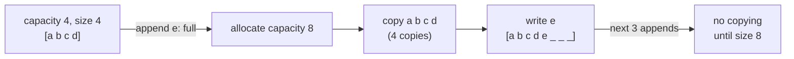

# Arrays and dynamic arrays

After this you can say what an array stores in memory, why indexing is fast and inserting in the middle is slow, and what `append` costs.

Before this: [Big O and runtime](../01-analysis/01-big-o-and-runtime.md) and the [memory hierarchy](../../01-how-computers-work/02-hardware/04-memory-hierarchy-and-latency-numbers.md).

## The idea

A spreadsheet column is the picture to keep in mind: rows numbered from 0, every row the same height, and each row sits directly under the one before it. To find row 5000 you do not scroll past the first 4999. You compute where it is.

An array works the same way. It stores its elements in one unbroken block of memory, so the address of element $i$ is the start address plus $i$ times the size of one element. One multiplication and one addition give the address, whatever $i$ is.

```text
index:      0      1      2      3      4
address:  1000   1008   1016   1024   1032      (8 bytes per slot)
         +------+------+------+------+------+
         |  12  |  7   |  30  |  5   |  18  |
         +------+------+------+------+------+
address of element 3 = 1000 + 3 * 8 = 1024
```

## Key terms

An **array** is a fixed-size sequence of equal-sized slots stored contiguously in memory. **Contiguous** means with no gaps between slots.

An **index** is an element's position, counted from 0.

A **dynamic array** is an array that grows when it fills up: it allocates a bigger block, copies the elements over and frees the old block. Its **capacity** is the number of slots allocated, and its **size** is the number in use.

**Amortized** cost is the average cost per operation over a long sequence of operations, even if a few single operations are expensive. See [space and amortized analysis](../01-analysis/02-space-and-amortized-analysis.md).

## How it works

Reading or writing `a[i]` is one address computation, so it takes $O(1)$ time. Inserting or deleting in the middle is different: the slots after the change must each shift by one place to keep the block gap-free. That moves up to $n$ elements, so it takes $O(n)$.

Appending at the end is cheap while there is spare capacity. When the block is full, the array allocates a new block of larger capacity and copies every element across, which costs $O(n)$ once. If each growth multiplies the capacity by a constant factor (doubling in the textbook version), the copies are rare enough that the average cost of an append is still $O(1)$.



Doubling from 1 to $n$ copies $1 + 2 + 4 + \dots + n/2 < n$ elements in total, which is under one copy per append. The lab counts them.

CPython's `list` is a dynamic array of pointers to objects. It does not double: it grows by about one eighth plus a small constant, which keeps the amortized $O(1)$ bound. The snippet prints each size at which the list reallocated; the sizes are in bytes and come from Python 3.14, so other versions may differ.

```python
import sys
lst = []
last = sys.getsizeof(lst)
print(0, last)
for i in range(1, 41):
    lst.append(i)
    size = sys.getsizeof(lst)
    if size != last:
        print(len(lst), size)
        last = size
```

```text
0 56
1 88
5 120
9 184
17 248
25 312
33 376
```

The size jumps only at 1, 5, 9, 17, 25 and 33 elements, so most appends touch no allocator at all.

| Operation | Cost | Why |
|---|---|---|
| Read or write `a[i]` | $O(1)$ | address arithmetic |
| Append at the end | $O(1)$ amortized | occasional copy when full |
| Insert or delete at index $i$ | $O(n)$ | shifts the elements after $i$ |
| Search an unsorted array | $O(n)$ | check each slot |
| Search a sorted array | $O(\log n)$ | binary search<!-- link: ../03-algorithms/01-binary-search.md --> |

Python's `list` is the dynamic array; `array.array` stores raw numbers of one type, and NumPy arrays do the same for numerical work. In JavaScript, `Array` plays the same role (`push`, `pop`, `a[i]`), and typed arrays such as `Int32Array` are fixed-size.

Contiguous storage helps in a second way. A scan reads neighbouring slots, so each 64-byte cache line brings several elements at once, as described in the memory hierarchy lesson. That makes arrays faster in practice than structures with the same Big O that scatter their elements.

## Worked examples

<div class="example" markdown>

### Example 1: append against insert at the front

We want to see the gap between $O(1)$ and $O(n)$ with a measurement.

1. Time 100,000 calls of `a.append(0)` on an empty list. Each call writes one slot, and an occasional one reallocates.
2. Time 100,000 calls of `a.insert(0, 0)`. Each call shifts every existing element one place right, so call number $k$ moves $k$ elements.
3. The total shifting is about $n^2 / 2 = 5 \times 10^9$ element moves, against $10^5$ writes for the append run.

<details class="code" markdown>
<summary>In code</summary>

```python
import timeit
n = 100_000
append = timeit.timeit("a.append(0)", setup="a = []", number=n)
front = timeit.timeit("a.insert(0, 0)", setup="a = []", number=n)
print(f"append:    {append:.3f} s")
print(f"insert(0): {front:.3f} s")
```

```text
append:    0.003 s
insert(0): 1.218 s
```

</details>

Check: the ratio is about 400 times, and it grows as $n$ grows. Your numbers will differ, but `insert(0)` should be hundreds of times slower. If you need to add at the front often, use a [`collections.deque`](03-stacks-and-queues.md).

</div>

## Common mistakes

<div class="warning" markdown>

Watch out: calling `list.insert(0, x)` or `list.pop(0)` inside a loop. Each call is $O(n)$, so the loop is $O(n^2)$. Append and pop at the end, or switch to a deque.

Watch out: assuming `append` is always cheap. The average is $O(1)$, but one append in a latency-sensitive path can trigger a full copy. Reserve space up front when you know the size, for example `[0] * n`.

</div>

## Working with AI

<div class="ai" markdown>

Words to use: contiguous, capacity, amortized $O(1)$, shift, index out of range, cache line.

Prompts to try:

- "This Python loop calls `result.insert(0, item)` for each of 200,000 items. State its Big O and rewrite it so it is $O(n)$ overall."
- "Explain why `list.append` is amortized $O(1)$ in CPython, and what the growth factor is. Say which parts come from the source code and which are your assumptions."

What to check:

- Code that treats a Python `list` as a linked list or claims `insert(0, x)` is $O(1)$. Time it with `timeit`, as in Example 1.
- Off-by-one errors at the ends: `range(n)` against `range(n + 1)`, and `a[-1]` on an empty list raising `IndexError`.
- A claim that the growth factor is exactly 2 for Python lists. It is not; the amortized bound holds for any constant factor above 1.

</div>

## Quiz

1\. Why is reading `a[i]` $O(1)$ for an array but not for a linked list?

<details class="solution" markdown>
<summary>Answer</summary>

An array's elements are contiguous and equal-sized, so the address is computed directly as start plus $i$ times the slot size. A linked list must follow pointers from the head, one step per element.

</details>

2\. A dynamic array with capacity 8 holds 8 items and doubles on growth. How many elements are copied when the 9th item is appended, and what is the capacity afterwards?

<details class="solution" markdown>
<summary>Answer</summary>

All 8 existing elements are copied into a new block, and the capacity becomes 16. The 9th item is then written into slot 8.

</details>

3\. A teammate removes duplicates with `for x in data: if data.count(x) > 1: data.remove(x)`. Why is this slow on a million items?

<details class="solution" markdown>
<summary>Answer</summary>

`count` scans the whole list and `remove` scans and then shifts, so each iteration is $O(n)$ and the loop is $O(n^2)$. A `set` or `dict` does the same job in $O(n)$.

</details>

4\. Why does an amortized $O(1)$ append not guarantee that every append is fast?

<details class="solution" markdown>
<summary>Answer</summary>

Amortized cost is an average over many operations. The append that fills the array copies every element and takes $O(n)$; the many appends between growths cost $O(1)$ and pull the average down.

</details>

## Lab

<div class="lab" markdown>

### Lab: build a dynamic array

Goal: implement a growable array on top of a fixed-size block and count the copies. Time: about 15 minutes. Runs in: any terminal with Python 3.

1. Create `dynarray.py` with a `DynamicArray` class holding `capacity`, `size`, a `slots` list of that length, and a `copies` counter.
2. Write `append(value)`. When `size == capacity`, call `_grow()`, which allocates twice the capacity, copies each element (adding 1 to `copies` per element) and replaces `slots`.
3. Write `__getitem__(i)` that raises `IndexError` when `i` is outside `0 <= i < size`.
4. Append 1000 values, then print `size`, `capacity`, `copies`, the last element, and `copies / size`.
5. Predict `capacity` and `copies` before you run it, then try reading index 1000.

Expected result: the capacity is the smallest power of 2 that is at least 1000, and `copies` is under twice `size`.

```text
1000 1024 1023
998001
1.023
IndexError 1000
```

<details class="solution" markdown>
<summary>Solution</summary>

```python
class DynamicArray:
    def __init__(self):
        self.capacity = 1
        self.size = 0
        self.slots = [None] * self.capacity
        self.copies = 0          # elements moved during growth

    def append(self, value):
        if self.size == self.capacity:
            self._grow()
        self.slots[self.size] = value
        self.size += 1

    def _grow(self):
        bigger = [None] * (2 * self.capacity)
        for i in range(self.size):
            bigger[i] = self.slots[i]
            self.copies += 1
        self.slots = bigger
        self.capacity *= 2

    def __getitem__(self, i):
        if not 0 <= i < self.size:
            raise IndexError(i)
        return self.slots[i]

arr = DynamicArray()
for i in range(1000):
    arr.append(i * i)
print(arr.size, arr.capacity, arr.copies)
print(arr[999])
print(arr.copies / arr.size)
try:
    arr[1000]
except IndexError as e:
    print("IndexError", e)
```

The growths happen at sizes 1, 2, 4, ..., 512, copying $1 + 2 + \dots + 512 = 1023$ elements, which is under one copy per append.

</details>

</div>

## Where this shows up

- [Linked lists](02-linked-lists.md) trade the fast index for cheap insertion, and every other structure in this chapter is built from arrays, pointers or both.
- Binary search<!-- link: ../03-algorithms/01-binary-search.md --> and sorting<!-- link: ../03-algorithms/02-sorting.md --> work on arrays because of the $O(1)$ index.
