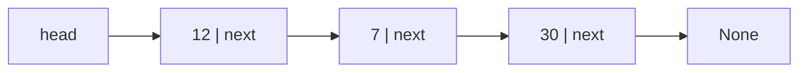
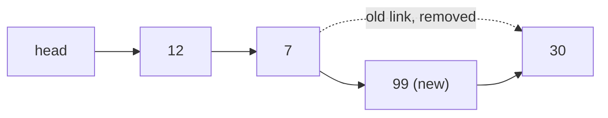

# Linked lists

After this you can draw a linked list, say which operations are cheap and which are not, and explain why arrays usually win anyway.

Before this: [arrays and dynamic arrays](01-arrays-and-dynamic-arrays.md) and [references and mutability](../../03-programming-fundamentals/02-thinking-like-a-programmer/02-references-mutability-and-copying.md).

## The idea

Think of a scavenger hunt. Each clue card tells you where to find the next one, and nobody keeps a master list of where every card is. To reach clue 7 you must collect clues 1 to 6 first. But adding a new clue between 3 and 4 only means rewriting the end of card 3 to point to the new card, and the new card to point to the old 4.

A linked list stores its elements this way: each one lives in its own small object, called a node, anywhere in memory, and holds the address of the next node.



## Key terms

A **node** is an object holding a value and a **pointer** (a reference) to another node. A **singly linked list** is a chain of nodes where each node points to the next; the **head** is the first node, and the last node points to `None`.

In a **doubly linked list** each node also points to the previous node, so you can walk backwards and remove a node you already hold in $O(1)$.

## How it works

Reaching the $i$-th node means following $i$ pointers from the head, so indexing and searching are $O(n)$. There is no address arithmetic, because the nodes are not side by side.

Inserting after a node you already hold takes two pointer updates and no shifting, so it is $O(1)$. Inserting at the head is the same. In the diagram, adding 99 after 7 changes two arrows:



The cost is where you start. If you only hold the head, inserting "after the 5000th node" still costs 5000 steps to get there. The $O(1)$ applies once you have the node.

| Operation | Singly linked list | Dynamic array |
|---|---|---|
| Access by index | $O(n)$ | $O(1)$ |
| Insert or delete at the head | $O(1)$ | $O(n)$ |
| Insert or delete at the tail | $O(1)$ with a tail pointer to add, $O(n)$ to delete | $O(1)$ amortized |
| Insert or delete after a node you hold | $O(1)$ | $O(n)$ |
| Search | $O(n)$ | $O(n)$ |

On paper the list wins at the head, but in practice arrays are usually faster. Nodes are scattered across memory, so walking a list tends to miss the cache on every step, and each node carries a pointer's worth of extra memory. See the [memory hierarchy](../../01-how-computers-work/02-hardware/04-memory-hierarchy-and-latency-numbers.md). Lists earn their place when you need constant-time splicing around a node you already hold, as in an LRU cache or the internals of a queue.

Python has no built-in linked list. `collections.deque` is closest: a doubly linked list of fixed-size blocks, so both ends are $O(1)$, but indexing into the middle is $O(n)$. The timings below read the middle element 100,000 times from a list and a deque of 100,000 items.

```python
import timeit
t_list = timeit.timeit("a[n // 2]", setup="n = 100_000; a = list(range(n))", number=100_000)
t_mid = timeit.timeit("d[n // 2]", setup="from collections import deque; n = 100_000; d = deque(range(n))", number=100_000)
print(f"list[middle]  {t_list:.4f} s")
print(f"deque[middle] {t_mid:.4f} s")
```

```text
list[middle]  0.0028 s
deque[middle] 0.2308 s
```

JavaScript has no built-in linked list either; `Array` is used instead, and you write a `Node` class when you need one.

## Worked examples

<div class="example" markdown>

### Example 1: reversing a list by rewiring pointers

We want to reverse `a -> b -> c` in place, without creating new nodes.

1. Keep two variables: `prev`, the part already reversed (starts as `None`), and `node`, the next node to process (starts at `a`).
2. Save `node.next` in `nxt`, because the next step overwrites it. Forgetting this loses the rest of the list.
3. Point `node.next` back at `prev`.
4. Move forward: `prev = node`, then `node = nxt`. Repeat until `node` is `None`. The answer is `prev`.

<details class="code" markdown>
<summary>In code</summary>

```python
class Node:
    def __init__(self, value, next=None):
        self.value, self.next = value, next

a = Node("a"); b = Node("b"); c = Node("c")
a.next = b; b.next = c
prev, node = None, a
while node:
    nxt = node.next
    node.next = prev
    prev, node = node, nxt
    print("prev =", prev.value, "node =", node.value if node else None)
```

```text
prev = a node = b
prev = b node = c
prev = c node = None
```

</details>

Check: after the loop `prev` is `c`, and following `next` from `c` gives `c -> b -> a`. The loop visits each node once, so it is $O(n)$ time and $O(1)$ extra space.

</div>

## Common mistakes

<div class="warning" markdown>

Watch out: losing the rest of the list by overwriting `node.next` before saving it. Always keep the old pointer in a variable first.

Watch out: forgetting the empty list and the one-node list. Code that does `self.head.next` crashes with `AttributeError` when `head` is `None`. Test those two cases first.

Watch out: reading "$O(1)$ insert" as "$O(1)$ insert at position $i$". Finding position $i$ is the $O(n)$ part.

</div>

## Working with AI

<div class="ai" markdown>

Words to use: node, pointer, head, tail, singly linked, doubly linked, in-place reversal.

Prompts to try:

- "Write a Python singly linked list with `push_front`, `find` and an in-place `reverse`. Add tests for the empty list and a one-node list."
- "When would a linked list beat a Python list in practice, given cache effects? Give a concrete use case and say what I should measure."

What to check:

- A claim that a linked list is "faster for insertion" with no mention of the cost of finding the position. Ask where the node comes from.
- Reversal code that never saves `next`, or never returns the new head. Trace it on a three-node list on paper.
- Code that treats `None` like a node. Run it on an empty list.

</div>

## Quiz

1\. Why is inserting at the head $O(1)$ for a linked list but $O(n)$ for an array?

<details class="solution" markdown>
<summary>Answer</summary>

For a list, the new node points to the old head and becomes the head: two assignments. For an array, every existing element must shift right by one slot to make room.

</details>

2\. A list is `1 -> 2 -> 3 -> None`. After `push_front(0)`, what does following `next` from `head` give, and how many existing nodes were changed?

<details class="solution" markdown>
<summary>Answer</summary>

`0 -> 1 -> 2 -> 3`. No existing node changes; only the `head` variable moves to the new node.

</details>

3\. Someone suggests a linked list to store 10 million numbers that are mostly read in order. What would you say?

<details class="solution" markdown>
<summary>Answer</summary>

Use an array. Scanning an array reads neighbouring memory, while a list follows pointers to scattered nodes and misses the cache. A list also spends extra memory on a pointer, and a Python node is a whole object, many times the size of the number.

</details>

4\. A doubly linked list lets you delete a node in $O(1)$ if you hold the node. A singly linked list does not. Why?

<details class="solution" markdown>
<summary>Answer</summary>

To remove a node you must change the `next` of the node before it. A doubly linked node knows its previous node. A singly linked node does not, so you would walk from the head to find it, which is $O(n)$.

</details>

## Lab

<div class="lab" markdown>

### Lab: a singly linked list

Goal: implement `push_front`, `find` and `reverse`, and check them against a Python list. Time: about 15 minutes. Runs in: any terminal with Python 3.

1. Write a `Node` class (`value`, `next`) and a `LinkedList` class with a `head` that starts as `None`.
2. Write `push_front(value)`, `find(value)` (return the node or `None`) and `to_list()` (collect values by walking the nodes).
3. Write `reverse()` using the four steps from Example 1.
4. Push 3, 2, 1, print `to_list()`, look up 2 and 9, reverse, and print again.

Expected result:

```text
[1, 2, 3]
2 None
[3, 2, 1]
```

<details class="solution" markdown>
<summary>Solution</summary>

```python
class Node:
    def __init__(self, value, next=None):
        self.value = value
        self.next = next

class LinkedList:
    def __init__(self):
        self.head = None

    def push_front(self, value):          # O(1)
        self.head = Node(value, self.head)

    def find(self, value):                # O(n)
        node = self.head
        while node is not None:
            if node.value == value:
                return node
            node = node.next
        return None

    def reverse(self):                    # O(n), in place
        prev, node = None, self.head
        while node is not None:
            nxt = node.next
            node.next = prev
            prev, node = node, nxt
        self.head = prev

    def to_list(self):
        out, node = [], self.head
        while node is not None:
            out.append(node.value)
            node = node.next
        return out

ll = LinkedList()
for v in [3, 2, 1]:
    ll.push_front(v)
print(ll.to_list())
print(ll.find(2).value, ll.find(9))
ll.reverse()
print(ll.to_list())
```

</details>

</div>

## Where this shows up

- [Queues and deques](03-stacks-and-queues.md) use linked blocks so both ends are cheap, and [hash tables](04-hash-tables.md) use short lists to hold keys that collide.
- [Trees](05-trees-and-binary-search-trees.md) and [graphs](07-graphs-and-representations.md) are linked structures with more than one pointer per node.
