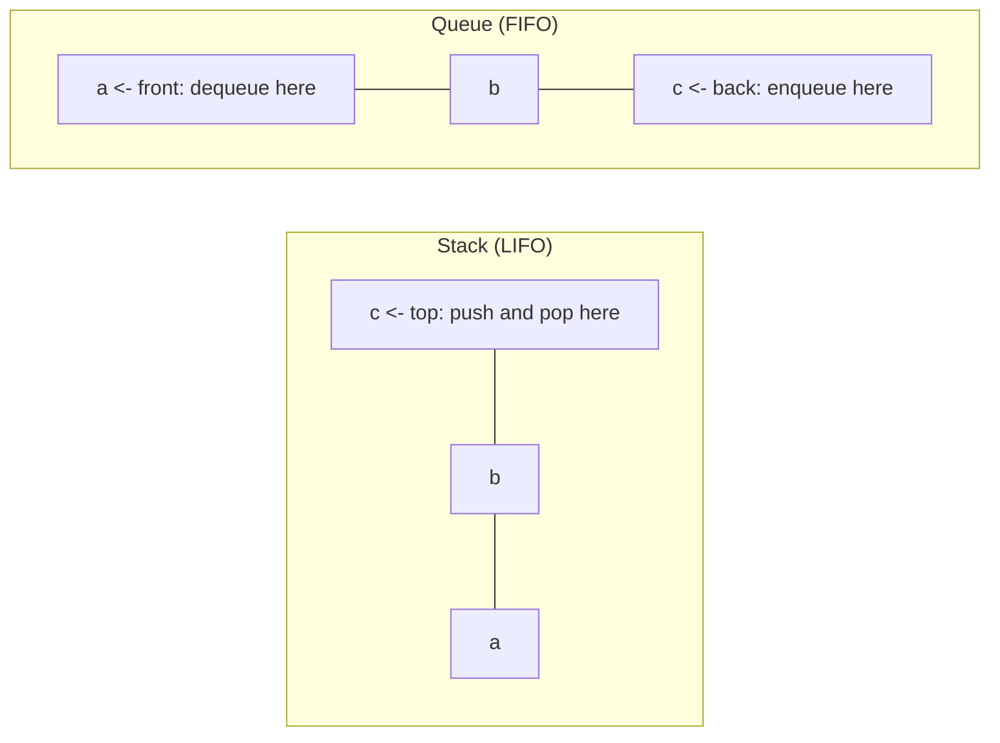

# Stacks and queues

After this you can pick a stack or a queue for a problem, use `list` and `collections.deque` correctly in Python, and spot when a bracket-matching or undo problem is really a stack.

Before this: [arrays and dynamic arrays](01-arrays-and-dynamic-arrays.md) and [linked lists](02-linked-lists.md).

## The idea

A stack of plates in a cafeteria: you add a plate on top and take a plate from the top, so the last plate put on is the first one taken. A line at a coffee shop works the other way: the person who arrived first is served first.

These two behaviours are the whole difference. A **stack** removes the most recently added item (last in, first out, **LIFO**). A **queue** removes the oldest item (first in, first out, **FIFO**). Neither lets you reach into the middle; that restriction is the point, because it keeps every operation $O(1)$.



## Key terms

A **stack** supports **push** (add to the top), **pop** (remove and return the top) and **peek** (read the top without removing it).

A **queue** supports **enqueue** (add at the back), **dequeue** (remove and return the front) and peek at the front.

A **deque** (double-ended queue, said "deck") supports adding and removing at both ends. It can act as a stack, a queue or both.

A **priority queue** removes the item with the highest priority, not the oldest. It needs a different structure: see [heaps and priority queues](06-heaps-and-priority-queues.md).

## How it works

A stack fits a Python `list`: `append` pushes, `pop()` pops and `stack[-1]` peeks, all $O(1)$ amortized, because the end of a dynamic array is cheap.

A queue does not fit a `list`. `pop(0)` removes the front but shifts every other element, which is $O(n)$. Use `collections.deque`, where `append` and `popleft` are both $O(1)$.

```python
from collections import deque

stack = []
stack.append("a"); stack.append("b"); stack.append("c")
print(stack.pop(), stack[-1], stack)

queue = deque()
queue.append("a"); queue.append("b"); queue.append("c")
print(queue.popleft(), queue[0], queue)
```

```text
c b ['a', 'b']
a b deque(['b', 'c'])
```

| Structure | Add | Remove | Peek | Python |
|---|---|---|---|---|
| Stack | push, $O(1)$ | pop, $O(1)$ | top, $O(1)$ | `list`: `append`, `pop`, `[-1]` |
| Queue | enqueue, $O(1)$ | dequeue, $O(1)$ | front, $O(1)$ | `deque`: `append`, `popleft`, `[0]` |
| Deque | both ends, $O(1)$ | both ends, $O(1)$ | both ends, $O(1)$ | `deque`: `appendleft`, `pop` |

In JavaScript, an `Array` works as a stack with `push` and `pop`. It has no built-in deque. `shift()` takes the front element, but on a large array it can be slow, so for big queues keep a head index or use a library.

You already use a stack without writing one. When a function calls another, the computer stacks a frame holding the caller's local variables and return address, and pops it on return; a [recursion](../../03-programming-fundamentals/02-thinking-like-a-programmer/01-recursion.md) that goes too deep raises a stack overflow (`RecursionError` in Python). A stack is also what you reach for in undo history, the back button, expression evaluation and matching brackets. A queue models work waiting for its turn: print jobs, tasks in a worker pool, and breadth-first search<!-- link: ../03-algorithms/03-bfs-and-dfs.md -->.

## Worked examples

<div class="example" markdown>

### Example 1: checking brackets with a stack

We want to decide whether `f(a[1], {2})` has matched brackets, and reject `(]`, `((` and `)(`.

1. Walk the characters left to right. On an opener `(`, `[` or `{`, push it.
2. On a closer, the most recent unmatched opener must be its partner. Pop the stack and compare. If the stack is empty (nothing to match) or the popped character is the wrong type, the text is unbalanced.
3. Ignore all other characters.
4. At the end the stack must be empty. Leftover openers, as in `((`, are unmatched.

The stack is the right tool because the opener to match is always the latest one still open, which is the top.

<details class="code" markdown>
<summary>In code</summary>

```python
PAIRS = {")": "(", "]": "[", "}": "{"}

def balanced(text):
    stack = []
    for ch in text:
        if ch in "([{":
            stack.append(ch)
        elif ch in PAIRS:
            if not stack or stack.pop() != PAIRS[ch]:
                return False
    return not stack

for s in ["f(a[1], {2})", "(]", "((", ")(", ""]:
    print(repr(s), balanced(s))
```

```text
'f(a[1], {2})' True
'(]' False
'((' False
')(' False
'' True
```

</details>

Check: each failing input breaks a different rule. `(]` has a wrong partner, `((` leaves openers on the stack, and `)(` finds an empty stack at the first closer. The loop touches each character once, so it is $O(n)$.

</div>

## Common mistakes

<div class="warning" markdown>

Watch out: using a `list` as a queue with `pop(0)`. Popping 100,000 items this way took 0.588 s on the author's machine, against 0.003 s for `deque.popleft()`. The gap grows with the length of the queue.

Watch out: calling `pop()` on an empty stack or `popleft()` on an empty deque. Both raise `IndexError`. Check `if stack:` first.

Watch out: indexing into the middle of a `deque`. It is $O(n)$, so if you need random access, use a `list`.

</div>

## Working with AI

<div class="ai" markdown>

Words to use: LIFO, FIFO, push, pop, deque, call stack, stack overflow.

Prompts to try:

- "Write a Python function that checks whether a string of `()[]{}` is balanced, using a stack. List the edge cases it must handle and show a test for each."
- "I use a Python list as a queue with `pop(0)`. Rewrite it with `collections.deque` and give the Big O before and after."

What to check:

- Queue code using `list.pop(0)` or `list.insert(0, x)`. It works, but it is $O(n)$ per call. Time it on a large input.
- A bracket checker that forgets the empty stack when a closer arrives first, or never checks the stack is empty at the end. Run the five inputs from Example 1.
- A claim that the call stack is "the same" as a data structure you create. It is the same idea, but it lives in memory managed by the runtime and has a fixed limit.

</div>

## Quiz

1\. You push 1, 2, 3 onto a stack, pop once, push 4, then pop twice. What comes out, in order?

<details class="solution" markdown>
<summary>Answer</summary>

3, 4, 2. The first pop returns 3, leaving 1, 2. After pushing 4 the stack is 1, 2, 4, so the next two pops return 4 and 2.

</details>

2\. Why is `deque.popleft()` $O(1)$ but `list.pop(0)` $O(n)$?

<details class="solution" markdown>
<summary>Answer</summary>

A deque is built from linked blocks, so removing the front changes only a pointer and an index. A list is one contiguous array, so removing slot 0 shifts all the others left by one.

</details>

3\. A browser's back button and forward button: which structure(s) would you use?

<details class="solution" markdown>
<summary>Answer</summary>

Two stacks. Visiting a page pushes the current page onto the back stack. Pressing back pops from the back stack and pushes the current page onto the forward stack. Visiting a new page clears the forward stack.

</details>

4\. Predict the result of `balanced("([)]")` with the function from Example 1.

<details class="solution" markdown>
<summary>Answer</summary>

`False`. The stack holds `(`, `[`. The closer `)` pops `[`, which is not its partner `(`, so the function returns `False`. Counting brackets alone would wrongly accept this string.

</details>

## Lab

<div class="lab" markdown>

### Lab: a bracket checker and a queue timing

Goal: write the bracket checker and measure the cost of the wrong queue. Time: about 15 minutes. Runs in: any terminal with Python 3.

1. Write `balanced(text)` using a list as a stack, as in Example 1.
2. Test it on `"f(a[1], {2})"`, `"(]"`, `"(("`, `")("` and `""`. Predict each result before running.
3. Add the case `"([)]"`, and say which rule it breaks.
4. Time 100,000 `pop(0)` calls on a list of 100,000 items and 100,000 `popleft()` calls on a deque of the same size, with `timeit`.

Expected result: the five results match Example 1, `"([)]"` gives `False`, and the list timing is far larger than the deque timing. The output below is from the author's Windows 11 PC with Python 3.14.

```text
list.pop(0):    0.588 s
deque.popleft(): 0.003 s
```

<details class="solution" markdown>
<summary>Solution</summary>

The `balanced` function is the one in Example 1. `"([)]"` breaks the "latest opener first" rule: `)` arrives while `[` is on top. The timing code:

```python
import timeit
n = 100_000
slow = timeit.timeit("q.pop(0)", setup=f"q = list(range({n}))", number=n)
fast = timeit.timeit("q.popleft()", setup=f"from collections import deque; q = deque(range({n}))", number=n)
print(f"list.pop(0):    {slow:.3f} s")
print(f"deque.popleft(): {fast:.3f} s")
```

</details>

</div>

## Where this shows up

- Breadth-first search uses a queue and depth-first search uses a stack, in BFS and DFS<!-- link: ../03-algorithms/03-bfs-and-dfs.md -->. The stacks and monotonic stacks<!-- link: ../04-leetcode-patterns/04-stacks-and-monotonic-stacks.md --> pattern solves many interview problems.
- Message queues in system design<!-- link: ../../14-software-and-system-design/02-system-design/06-queues-and-event-driven-design.md --> are FIFO queues between services.
