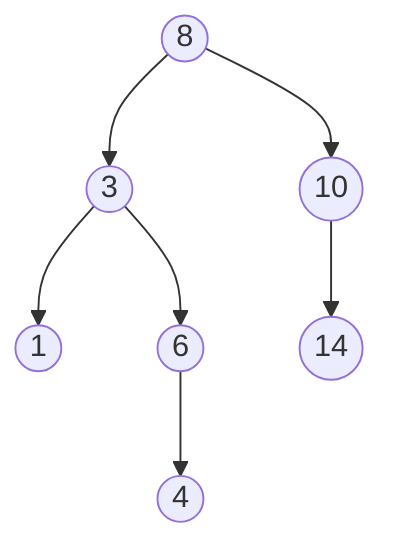
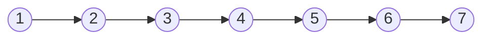

# Trees and binary search trees

After this you can read a tree diagram, search and insert in a binary search tree, explain why an in-order walk gives sorted output, and say what balance has to do with speed.

Before this: [linked lists](02-linked-lists.md), [recursion](../../03-programming-fundamentals/02-thinking-like-a-programmer/01-recursion.md) and [graphs and trees](../../04-discrete-math-for-cs/06-graphs-and-trees.md).

## The idea

A file system is a tree: a root folder contains folders and files, and each folder contains more of the same. So is an HTML page, and so is a company's reporting chart. Each item has one parent (except the root) and any number of children.

A binary search tree adds one rule to a tree where each node has at most two children: everything in a node's left subtree is smaller than the node, and everything in its right subtree is larger. That rule lets you throw away half of the remaining tree at each step of a search, like guessing a number with "higher" and "lower" hints.



## Key terms

A **tree** is a set of nodes connected by parent-child links, with one **root** and no cycles. A **leaf** is a node with no children. The **height** of a tree is the number of nodes on the longest path from the root to a leaf; the tree above has height 4 (8, 3, 6, 4). The **depth** of a node is how many links it is from the root.

A **binary tree** gives each node at most two children, a **left** and a **right** child. A **binary search tree** (BST) is a binary tree where, for every node, all keys in the left subtree are smaller and all keys in the right subtree are larger.

A **traversal** visits every node once. An **in-order traversal** visits the left subtree, then the node, then the right subtree. A tree is **balanced** when its height is close to $\log_2 n$.

## How it works

To search for a key, start at the root. If the key equals the node's key, you are done. If it is smaller, go left; if larger, go right. If you fall off the tree, the key is absent. Insert follows the same path and attaches a new leaf where the search ended. Each step discards one subtree, so the cost is the height $h$ of the tree: $O(h)$.

In-order traversal of a BST visits keys in sorted order, because everything to the left is smaller and everything to the right is larger. For the tree above it visits 1, 3, 4, 6, 8, 10, 14.

How tall is the tree? That depends on insertion order, and it decides the speed. Inserted in the order 8, 3, 10, 1, 6, 14, 4, the 7 keys form a tree of height 4. Inserted in the order 1, 2, 3, 4, 5, 6, 7, every key is larger than the last, so each one goes to the right of the previous and the tree is a chain of height 7, which behaves like a linked list.



| Operation | Balanced BST, height about $\log_2 n$ | Degenerate BST, height $n$ |
|---|---|---|
| Search | $O(\log n)$ | $O(n)$ |
| Insert | $O(\log n)$ | $O(n)$ |
| Delete | $O(\log n)$ | $O(n)$ |
| Minimum or maximum | $O(\log n)$ | $O(n)$ |
| In-order traversal | $O(n)$ | $O(n)$ |

A **self-balancing** tree, such as an AVL tree or a red-black tree, rotates nodes during insert and delete to keep the height near $\log_2 n$. You will rarely write one. You need to know that the guarantee depends on balance, and that production libraries do the balancing for you.

Database indexes use a wider relative, the B-tree, which puts hundreds of keys in a node so that a lookup reads only three or four disk pages. See [indexes](../../10-databases-sql-and-postgres/04-postgres-in-depth/01-indexes.md).

Python has no balanced tree in the standard library. For sorted data, keep a sorted `list` and use the `bisect` module, which finds a position in $O(\log n)$, though inserting into the list is still $O(n)$. The third-party `sortedcontainers` package offers a sorted list, set and dict. JavaScript has no built-in sorted structure either.

```python
import bisect
data = [1, 3, 4, 6, 8, 10, 14]
i = bisect.bisect_left(data, 7)
print(i, data[i - 1], data[i])   # position for 7, its neighbours
bisect.insort(data, 7)
print(data)
```

```text
4 6 8
[1, 3, 4, 6, 7, 8, 10, 14]
```

The first line is the position where 7 belongs and the two values it falls between. `insort` does the insert and returns nothing, so the second line shows the list afterwards.

## Worked examples

<div class="example" markdown>

### Example 1: inserting and searching

We want to build the tree from the diagram by inserting 8, 3, 10, 1, 6, 14, 4 in order.

1. 8 becomes the root, because the tree is empty.
2. 3 is less than 8, so it goes left. 10 is greater than 8, so it goes right.
3. 1 goes left of 8, then left of 3. 6 goes left of 8, then right of 3.
4. 14 goes right of 8, then right of 10. 4 goes left of 8, right of 3, then left of 6.
5. To search for 7: 7 is less than 8 (go left), greater than 3 (go right), greater than 6 (go right), and the right child of 6 is empty, so 7 is absent after visiting three nodes.

<details class="code" markdown>
<summary>In code</summary>

```python
class TreeNode:
    def __init__(self, key):
        self.key = key
        self.left = None
        self.right = None

def insert(node, key):
    if node is None:
        return TreeNode(key)
    if key < node.key:
        node.left = insert(node.left, key)
    elif key > node.key:
        node.right = insert(node.right, key)
    return node                         # equal key: already present

def search(node, key):
    while node is not None:
        if key == node.key:
            return True
        node = node.left if key < node.key else node.right
    return False

def in_order(node):
    if node is not None:
        yield from in_order(node.left)
        yield node.key
        yield from in_order(node.right)

def height(node):
    if node is None:
        return 0
    return 1 + max(height(node.left), height(node.right))

root = None
for k in [8, 3, 10, 1, 6, 14, 4]:
    root = insert(root, k)
print(list(in_order(root)), height(root))
print(search(root, 6), search(root, 7))

chain = None
for k in range(1, 8):
    chain = insert(chain, k)
print(list(in_order(chain)), height(chain))
```

```text
[1, 3, 4, 6, 8, 10, 14] 4
True False
[1, 2, 3, 4, 5, 6, 7] 7
```

</details>

Check: the in-order output is sorted for both trees, and the heights are 4 and 7, as predicted. The same keys give two different shapes. With 1,000 sorted keys the chain would be 1,000 deep, and the recursive `insert` would exceed Python's recursion limit.

</div>

## Common mistakes

<div class="warning" markdown>

Watch out: checking a BST by comparing each node only to its direct children. Every node in the root's left subtree must be smaller than the root, not just smaller than its own parent. Check each node against a (low, high) range that narrows as you go down.

Watch out: assuming "tree" means $O(\log n)$. That holds only when the tree is balanced. Say "balanced BST" or name the library structure.

Watch out: forgetting duplicates. This code ignores an equal key; a database might store both. Decide the rule first.

</div>

## Working with AI

<div class="ai" markdown>

Words to use: root, leaf, height, subtree, in-order traversal, balanced, self-balancing, BST invariant.

Prompts to try:

- "Write a Python BST with `insert`, `search` and an iterative in-order traversal. State the Big O of each in terms of the height, and show what happens if I insert 1 to 1,000 in sorted order."
- "I need a sorted collection in Python with fast insert and range queries. Compare a sorted list with `bisect`, `sortedcontainers` and a hand-written BST."

What to check:

- A claim of $O(\log n)$ for an unbalanced BST. Insert sorted keys and print the height.
- A validity check that only compares a node with its children. Test it on a tree where a left-subtree node is larger than the root.
- Recursion on a tree that may be a long chain. Python's default limit is about 1,000 frames, so deep recursion raises `RecursionError`.

</div>

## Quiz

1\. What invariant makes a binary search tree searchable?

<details class="solution" markdown>
<summary>Answer</summary>

For every node, all keys in its left subtree are smaller and all keys in its right subtree are larger. A comparison at a node therefore rules out one whole subtree.

</details>

2\. Insert 5, 2, 8, 1 into an empty BST. What is the in-order traversal, and what is the height?

<details class="solution" markdown>
<summary>Answer</summary>

In-order gives 1, 2, 5, 8. The root 5 has children 2 and 8, and 1 is the left child of 2, so the longest path is 5, 2, 1 and the height is 3.

</details>

3\. A BST built from user IDs that arrive already sorted is slow. Why, and what are two fixes?

<details class="solution" markdown>
<summary>Answer</summary>

Each new key is larger than all earlier ones, so the tree becomes a chain of height $n$ and operations cost $O(n)$. Use a self-balancing tree (or a library that has one), or shuffle the keys before inserting.

</details>

4\. Why does in-order traversal of a BST return the keys in sorted order?

<details class="solution" markdown>
<summary>Answer</summary>

It visits everything smaller than a node (the left subtree) first, then the node, then everything larger (the right subtree), and the same holds inside each subtree.

</details>

## Lab

<div class="lab" markdown>

### Lab: a BST that you can see

Goal: implement insert, search and in-order traversal, and compare a balanced and a degenerate tree. Time: about 20 minutes. Runs in: any terminal with Python 3.

1. Write a `TreeNode` class (`key`, `left`, `right`) and a recursive `insert(node, key)` that returns the root of the subtree.
2. Write `search(node, key)` with a loop, `in_order(node)` as a generator, and `height(node)`.
3. Insert 8, 3, 10, 1, 6, 14, 4. Print the sorted keys, the height, and the results of searching for 6 and 7.
4. Insert 1 to 7 in order into a new tree and print its keys and height. Explain the difference.

Expected result:

```text
[1, 3, 4, 6, 8, 10, 14] 4
True False
[1, 2, 3, 4, 5, 6, 7] 7
```

<details class="solution" markdown>
<summary>Solution</summary>

The code is the "In code" block in Example 1. The difference in height comes from insertion order: the first order spreads keys on both sides of each node, and the second always goes right.

</details>

</div>

## Where this shows up

- [Heaps](06-heaps-and-priority-queues.md) are also trees, stored in an array. [Tree and graph problems](../04-leetcode-patterns/05-tree-and-graph-problems.md) covers traversals in interview questions.
- Database indexes (B-trees) and file systems are trees on disk.
