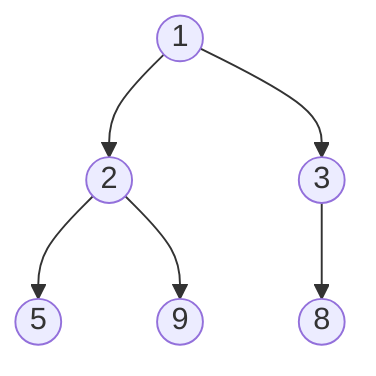

# Heaps and priority queues

After this you can explain how a binary heap stores a tree in an array, name the cost of each heap operation, and use `heapq` for a priority queue and for top-k problems.

Before this: [arrays and dynamic arrays](01-arrays-and-dynamic-arrays.md) and [trees and binary search trees](05-trees-and-binary-search-trees.md).

## The idea

A hospital emergency room does not treat patients in arrival order. It treats the most urgent patient next, and new arrivals can jump the line. You need a structure that always hands back the most urgent item, quickly, while items keep arriving.

A sorted list does this, but each insert costs $O(n)$. Scanning for the minimum each time costs $O(n)$ too. A heap gives up the fully sorted order and keeps only what you need: the smallest item is always at the top, and both inserting and removing it cost $O(\log n)$.



## Key terms

A **priority queue** is an abstract structure that supports adding an item and removing the item with the highest priority. A **heap** is a common way to implement one.

A **binary heap** is a complete binary tree (every level full except possibly the last, which fills from the left) that satisfies the **heap property**. In a **min-heap**, every node is less than or equal to its children, so the minimum is at the root. In a **max-heap**, every node is greater than or equal to its children.

**Sift up** and **sift down** are the repair steps: a node moves up or down the tree, swapping with a neighbour, until the heap property holds again.

## How it works

Because a heap is a complete tree, it fits in a plain array with no pointers. The root is at index 0, and the node at index $i$ has children at $2i + 1$ and $2i + 2$ and its parent at $(i - 1) // 2$. The tree above is stored like this:

```text
index:   0   1   2   3   4   5
array: [ 1,  2,  3,  5,  9,  8 ]

node 1 (value 2): children at 3 and 4 (values 5 and 9), parent at 0
node 2 (value 3): child at 5 (value 8), parent at 0
```

Push adds the new item at the end of the array, the next free spot in the last level, then sifts it up: while it is smaller than its parent, swap them. The path is at most the tree's height, about $\log_2 n$ steps.

Pop removes the root, moves the last item of the array into the root, then sifts it down: swap with the smaller child until neither child is smaller. This is again at most $\log_2 n$ steps.

| Operation | Cost |
|---|---|
| Peek at the minimum | $O(1)$ |
| Push | $O(\log n)$ |
| Pop the minimum | $O(\log n)$ |
| Build a heap from $n$ items (`heapify`) | $O(n)$ |
| Search for an arbitrary value | $O(n)$ |

A heap does not keep the array sorted. Only the parent-child relation is ordered, so a heap cannot find an arbitrary value quickly. Popping everything gives sorted order in $O(n \log n)$, which is heapsort.

Python's `heapq` module works on an ordinary `list` and implements a min-heap. It has no max-heap; negate the numbers, or push tuples with a negated priority. Tuples compare element by element, so `(priority, item)` pairs sort by priority first.

```python
import heapq
h = []
for x in [5, 2, 8, 1, 9, 3]:
    heapq.heappush(h, x)
print(h)                       # the array layout, not sorted
print(h[0], heapq.heappop(h), h[0])
print([heapq.heappop(h) for _ in range(len(h))])
```

```text
[1, 2, 3, 5, 9, 8]
1 1 2
[2, 3, 5, 8, 9]
```

The printed array is the same one as in the diagram. JavaScript has no built-in heap; use a library or write a small class.

## Worked examples

<div class="example" markdown>

### Example 1: the k largest items

We want the 5 largest values out of 100,000 numbers without sorting all of them.

1. Keep a min-heap holding the 5 largest values seen so far. The root is the smallest of those 5.
2. For each new number: if the heap has fewer than 5 items, push it. Otherwise, if the number is bigger than the root, replace the root with it (`heapq.heapreplace` pops and pushes in one step). If not, skip it.
3. After the last number, the heap holds the 5 largest. Sort those 5 for display.
4. Each number costs at most $O(\log k)$, so the total is $O(n \log k)$, with only $k$ items in memory.

<details class="code" markdown>
<summary>In code</summary>

```python
import heapq
import random

def top_k(items, k):
    heap = []                              # min-heap holding the k largest so far
    for x in items:
        if len(heap) < k:
            heapq.heappush(heap, x)
        elif x > heap[0]:                  # beats the smallest of the k
            heapq.heapreplace(heap, x)     # pop smallest, push x
    return sorted(heap, reverse=True)

random.seed(7)
data = [random.randint(1, 1_000_000) for _ in range(100_000)]
print(top_k(data, 5))
print(sorted(data, reverse=True)[:5])
print(top_k(data, 5) == heapq.nlargest(5, data))
```

```text
[999992, 999992, 999990, 999984, 999983]
[999992, 999992, 999990, 999984, 999983]
True
```

</details>

Check: the heap answer matches the full sort and `heapq.nlargest`. Sorting everything costs $O(n \log n)$; for $k = 5$ and $n = 100{,}000$ the heap does about $n \log_2 5$ comparisons and never stores more than 5 numbers. In practice, just call `heapq.nlargest(k, data)`.

</div>

## Common mistakes

<div class="warning" markdown>

Watch out: expecting `heapq` to give a max-heap, or printing the list and expecting it sorted. The list has the heap property only. Pop in a loop to get sorted order.

Watch out: pushing items that cannot be compared. Two equal priorities make Python compare the items next, and if those are dicts or custom objects it raises `TypeError`. Add a unique counter: `(priority, counter, item)`.

Watch out: mutating an item's priority while it sits in the heap. The heap does not notice, and the order silently breaks. Push a new entry instead and skip stale ones when you pop.

</div>

## Working with AI

<div class="ai" markdown>

Words to use: min-heap, heap property, priority queue, sift up, sift down, `heapify`, top-k.

Prompts to try:

- "Using `heapq`, give me the 10 largest values from a stream of 50 million numbers in Python, using $O(k)$ memory. Show the Big O and explain why a size-$k$ min-heap and not a max-heap."
- "I need a priority queue of tasks with equal priorities in Python. Show the tuple form that avoids comparing the task objects."

What to check:

- A max-heap implemented with `heapq` that forgets to negate on both push and pop. Test with small known numbers.
- Top-k code that uses a max-heap of size $n$ (heapify everything). That is $O(n)$ memory, not $O(k)$.
- A claim that `heapq.heappush` or `heappop` is $O(1)$. Both are $O(\log n)$; only the peek `h[0]` is $O(1)$.

</div>

## Quiz

1\. Where is the minimum of a min-heap, and how long does it take to read it?

<details class="solution" markdown>
<summary>Answer</summary>

At the root, index 0 of the array. Reading it is $O(1)$.

</details>

2\. In an array-based heap, which indexes are the children and parent of index 4?

<details class="solution" markdown>
<summary>Answer</summary>

Children are at $2 \cdot 4 + 1 = 9$ and $2 \cdot 4 + 2 = 10$. The parent is at $(4 - 1) // 2 = 1$.

</details>

3\. You need the 3 smallest of 10 million values, and memory is tight. What do you do?

<details class="solution" markdown>
<summary>Answer</summary>

Keep a max-heap of size 3 (in Python, a `heapq` with negated values), replacing its largest item whenever a smaller value arrives. It uses $O(k)$ memory and $O(n \log k)$ time. `heapq.nsmallest(3, values)` does this for you.

</details>

4\. Why is `heapq.heapify(list)` $O(n)$ and not $O(n \log n)$?

<details class="solution" markdown>
<summary>Answer</summary>

Heapify sifts down starting from the lowest non-leaf node. Half the nodes are leaves and need no work, and a quarter move at most one level, so the total sums to a constant times $n$. Calling `heappush` $n$ times would be $O(n \log n)$.

</details>

## Lab

<div class="lab" markdown>

### Lab: top-k with a heap

Goal: write `top_k` with a size-$k$ min-heap and check it against sorting. Time: about 15 minutes. Runs in: any terminal with Python 3.

1. Generate 100,000 random integers from 1 to 1,000,000 with `random.seed(7)`.
2. Write `top_k(items, k)` as in Example 1: push until the heap has $k$ items, then use `heapq.heapreplace` only when an item beats `heap[0]`.
3. Print `top_k(data, 5)`, the same five found with `sorted`, and whether the result equals `heapq.nlargest(5, data)`.
4. Change the code to find the 5 smallest. Which two lines change?

Expected result:

```text
[999992, 999992, 999990, 999984, 999983]
[999992, 999992, 999990, 999984, 999983]
True
```

<details class="solution" markdown>
<summary>Solution</summary>

The code is in Example 1. For the 5 smallest, keep a max-heap by storing negated values: push `-x`, compare with `-heap[0]`, and negate on the way out. Or call `heapq.nsmallest(5, data)`.

</details>

</div>

## Where this shows up

- Dijkstra's [shortest paths](../03-algorithms/04-shortest-paths.md) uses a priority queue, and the heaps, intervals and top-k<!-- link: ../04-leetcode-patterns/08-heaps-intervals-and-top-k.md --> pattern uses `heapq` constantly.
- Task schedulers, event simulations and "merge $k$ sorted lists" use a heap.
