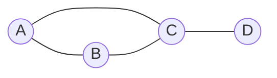

# Graphs and representations

After this you can model a problem as a graph, choose between an adjacency list and an adjacency matrix, and count degrees from either.

Before this: [hash tables](04-hash-tables.md), [linked lists](02-linked-lists.md) and [graphs and trees](../../04-discrete-math-for-cs/06-graphs-and-trees.md).

## The idea

A social network, a road map, a set of package dependencies and the links between web pages all have the same shape: things, and connections between pairs of things. A graph is that shape with the details removed.

A tree is a graph with strict rules. A general graph lets any node connect to any other, so there is no root, nodes can have many connections, and you can walk in a circle. The question this lesson answers is how to store one in memory so that the operations you need are fast.



## Key terms

A **graph** is a set of **vertices** (nodes) and a set of **edges**, each joining two vertices. In an **undirected** graph an edge works both ways, as with a friendship. In a **directed** graph (digraph) an edge has a direction, as with "follows". A **weighted** graph attaches a number to each edge, such as a distance.

Two vertices are **adjacent** if an edge joins them. The **degree** of a vertex is the number of edges at it. In a directed graph, the **out-degree** counts edges leaving it and the **in-degree** counts edges entering it. A **path** is a sequence of vertices where each consecutive pair is joined by an edge; a **cycle** is a path that returns to its start.

Below, $V$ is the number of vertices and $E$ is the number of edges.

## How it works

There are two standard layouts. An **adjacency list** keeps, for each vertex, the list of its neighbours. An **adjacency matrix** is a $V \times V$ grid where cell $(u, v)$ is 1 if there is an edge from $u$ to $v$, and 0 otherwise (or holds the weight).

For the graph above:

```text
Adjacency list        Adjacency matrix (row = from, column = to)
A: [B, C]                 A  B  C  D
B: [A, C]             A   0  1  1  0
C: [A, B, D]          B   1  0  1  0
D: [C]                C   1  1  0  1
                      D   0  0  1  0
```

Which one you choose follows from how many edges the graph has. A graph with few edges relative to $V^2$ is **sparse**; one with close to $V^2$ is **dense**. Most real graphs are sparse: a person has hundreds of friends, not millions.

| | Adjacency list | Adjacency matrix |
|---|---|---|
| Memory | $O(V + E)$ | $O(V^2)$ |
| Is there an edge $u \to v$? | $O(\deg u)$ | $O(1)$ |
| List the neighbours of $u$ | $O(\deg u)$ | $O(V)$ |
| Visit every edge | $O(V + E)$ | $O(V^2)$ |
| Best for | sparse graphs, traversals | dense graphs, fast edge checks |

For an undirected graph, the sum of all degrees is $2E$, since each edge adds one to the degree at both ends. For a directed graph, the sum of out-degrees and the sum of in-degrees both equal $E$. Both facts make good sanity checks.

In Python an adjacency list is a `dict` mapping each vertex to a `list` (or `set`) of neighbours, and `collections.defaultdict(list)` makes building it short. In JavaScript the same idea is a `Map` from vertex to an array. An adjacency matrix is a list of lists, or a NumPy array for numerical work.

```python
from collections import defaultdict

edges = [("A", "B"), ("A", "C"), ("B", "C"), ("C", "D")]

adj = defaultdict(list)                 # undirected: store both directions
for u, v in edges:
    adj[u].append(v)
    adj[v].append(u)

print(dict(adj))
print("neighbours of C:", adj["C"])
print("edge A-D?", "D" in adj["A"])
```

```text
{'A': ['B', 'C'], 'B': ['A', 'C'], 'C': ['A', 'B', 'D'], 'D': ['C']}
neighbours of C: ['A', 'B', 'D']
edge A-D? False
```

The traversals that make graphs useful, [BFS and DFS](../03-algorithms/03-bfs-and-dfs.md), run on the adjacency list in $O(V + E)$.

## Worked examples

<div class="example" markdown>

### Example 1: a follow graph with degree counts

We want out-degree and in-degree for each user in a directed graph where `("ana", "ben")` means ana follows ben.

1. Store `out_adj[a]` as a list of the users `a` follows. Its length is the out-degree.
2. Keep a separate counter `in_degree[b]`, increased each time someone follows `b`. Reading it is $O(1)$, while finding followers from `out_adj` alone would need a scan of every list.
3. Add 0 for the follower too, so users nobody follows still appear in `in_degree`.
4. Check the degree sums against the edge count: both sums should equal $E$.

<details class="code" markdown>
<summary>In code</summary>

```python
from collections import defaultdict

follows = [("ana", "ben"), ("ana", "cy"), ("ben", "cy"),
           ("cy", "ana"), ("dee", "cy")]          # directed: who follows whom

out_adj = defaultdict(list)
in_degree = defaultdict(int)
for a, b in follows:
    out_adj[a].append(b)
    in_degree[b] += 1
    in_degree[a] += 0                              # make sure every user appears

for user in sorted(in_degree):
    print(f"{user}: out={len(out_adj[user])} in={in_degree[user]}")

total_out = sum(len(v) for v in out_adj.values())
print(total_out == sum(in_degree.values()) == len(follows))
```

```text
ana: out=2 in=1
ben: out=1 in=1
cy: out=1 in=3
dee: out=1 in=0
True
```

</details>

Check: `cy` has in-degree 3 because ana, ben and dee follow cy, and the final `True` confirms that both sums equal the 5 edges.

</div>

## Common mistakes

<div class="warning" markdown>

Watch out: reading `adj[x]` on a `defaultdict` for a vertex that is not in the graph. It silently creates an empty entry, so a later "is this vertex present?" check gives the wrong answer. Use `x in adj` or `adj.get(x, [])`.

Watch out: storing an undirected edge in only one direction. Then `A` lists `B` but `B` does not list `A`, and traversals miss edges. Add both.

Watch out: using a matrix for a large sparse graph. A graph with a million users needs $10^{12}$ cells, which will not fit in memory, but its list needs only about $V + E$ entries.

</div>

## Working with AI

<div class="ai" markdown>

Words to use: vertex, edge, directed, weighted, adjacency list, adjacency matrix, degree, sparse, dense.

Prompts to try:

- "I have 2 million users and about 100 million follow relationships. Compare an adjacency list and an adjacency matrix in memory and in the time to list one user's followees. Show the arithmetic."
- "Write a Python function that builds an adjacency list from an edge list for a directed weighted graph, and a function that returns each vertex's in-degree and out-degree. Include isolated vertices."

What to check:

- Code that drops isolated vertices because they appear in no edge. Ask whether the vertex list is given separately.
- A `defaultdict` read that adds keys, or an undirected graph stored one-way. Test with a small graph and print `dict(adj)`.
- Memory or time claims that ignore sparsity. Redo the arithmetic with $V$ and $E$.

</div>

## Quiz

1\. A graph has 6 vertices and 7 undirected edges. What is the sum of the degrees?

<details class="solution" markdown>
<summary>Answer</summary>

14, which is $2E$. Each edge contributes 1 to the degree of each of its two endpoints.

</details>

2\. Which representation would you pick for a graph with 50,000 vertices and 200,000 edges, and why?

<details class="solution" markdown>
<summary>Answer</summary>

An adjacency list. It needs about $V + E = 250{,}000$ entries (twice as many list items for undirected edges), while a matrix needs $50{,}000^2 = 2.5 \times 10^9$ cells.

</details>

3\. You need to check "is there an edge between u and v" a billion times on a graph with 500 vertices. Which representation is better?

<details class="solution" markdown>
<summary>Answer</summary>

An adjacency matrix. It answers in $O(1)$, and 500 vertices need only $250{,}000$ cells. If the neighbour lists were stored as sets, the list representation would also answer in $O(1)$ on average.

</details>

4\. In Example 1, why does the code add `in_degree[a] += 0`?

<details class="solution" markdown>
<summary>Answer</summary>

It guarantees that every user appears in `in_degree`, even one that nobody follows. Without it, `dee` would be missing from the printed loop.

</details>

## Lab

<div class="lab" markdown>

### Lab: build both representations

Goal: build an adjacency list and a matrix from one edge list, and check that they agree. Time: about 15 minutes. Runs in: any terminal with Python 3.

1. Start with `edges = [("A", "B"), ("A", "C"), ("B", "C"), ("C", "D")]`, an undirected graph.
2. Build `adj` as a `defaultdict(list)` with both directions of each edge. Print `dict(adj)`.
3. Build a matrix. Make `nodes = sorted(adj)`, a dict from name to index, and a $V \times V$ list of zeros, then set both cells for each edge. Print each row.
4. Compute each vertex's degree from the list and from the matrix (row sum). Check they agree and that the sum is $2E$.

Expected result:

```text
{'A': ['B', 'C'], 'B': ['A', 'C'], 'C': ['A', 'B', 'D'], 'D': ['C']}
A [0, 1, 1, 0]
B [1, 0, 1, 0]
C [1, 1, 0, 1]
D [0, 0, 1, 0]
True True
```

<details class="solution" markdown>
<summary>Solution</summary>

```python
from collections import defaultdict

edges = [("A", "B"), ("A", "C"), ("B", "C"), ("C", "D")]

adj = defaultdict(list)
for u, v in edges:
    adj[u].append(v)
    adj[v].append(u)
print(dict(adj))

nodes = sorted(adj)
index = {name: i for i, name in enumerate(nodes)}
matrix = [[0] * len(nodes) for _ in nodes]
for u, v in edges:
    matrix[index[u]][index[v]] = matrix[index[v]][index[u]] = 1
for name, row in zip(nodes, matrix):
    print(name, row)

list_degrees = {n: len(adj[n]) for n in nodes}
matrix_degrees = {n: sum(matrix[index[n]]) for n in nodes}
print(list_degrees == matrix_degrees, sum(list_degrees.values()) == 2 * len(edges))
```

The last line checks that the degrees from the list and the matrix agree, and that their sum is $2E$.

</details>

</div>

## Where this shows up

- [BFS and DFS](../03-algorithms/03-bfs-and-dfs.md), [shortest paths](../03-algorithms/04-shortest-paths.md) and the tree and graph problems<!-- link: ../04-leetcode-patterns/05-tree-and-graph-problems.md --> pattern all start from an adjacency list.
- Dependency resolution in package managers and build tools is a directed graph with no cycles.
