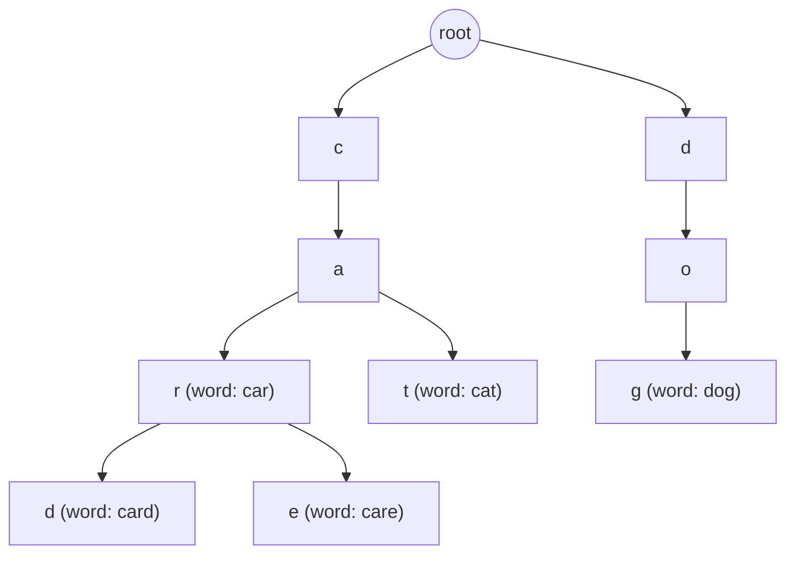
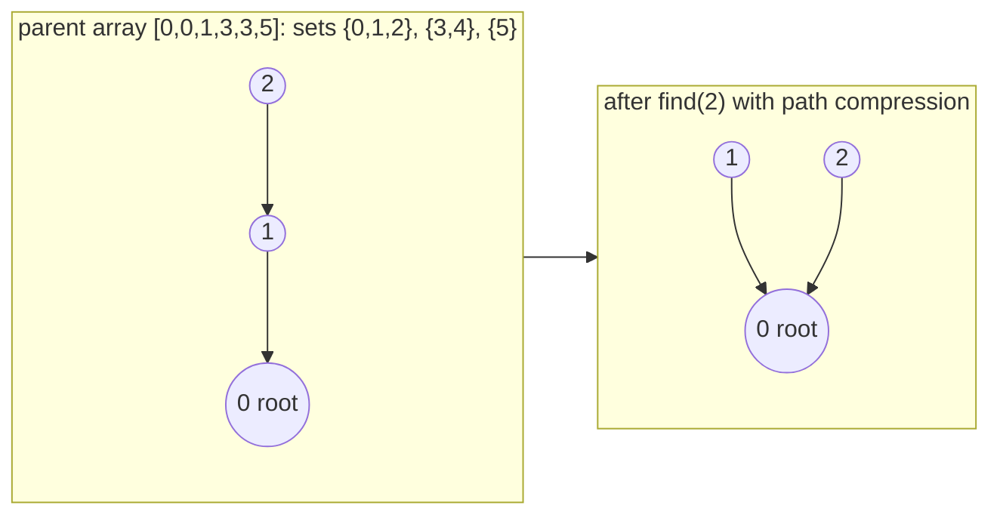

# Tries and union find

After this you can recognise the two problems these structures solve, prefix search and "are these two items connected?", and read a short implementation of each.

Before this: [trees and binary search trees](05-trees-and-binary-search-trees.md), [hash tables](04-hash-tables.md) and [graphs and representations](07-graphs-and-representations.md).

## The idea

Two small problems come up often and neither fits the earlier structures well. An autocomplete box has to list every word that starts with "car". A network of computers is wired up cable by cable, and after each cable you want to know whether two machines are now connected.

A hash table can answer "is this exact word present?" but not "which words start with car?". A graph traversal can answer "are these two connected?" but it re-walks the graph for every question. A **trie** and a **union-find** structure are built for these two jobs.



## Key terms

A **trie** (said "try", also called a prefix tree) is a tree where each edge is labelled with a character and each path from the root spells a prefix. Nodes that end a stored word are marked. Words that share a prefix share the path for it.

**Union find** (also called a **disjoint-set union**) keeps a collection of non-overlapping sets and supports two operations: **find**, which returns a label for the set containing an item, and **union**, which merges two sets. Two items are in the same set exactly when their finds are equal.

**Path compression** makes every node visited by `find` point straight at the root, so later finds are shorter. **Union by size** attaches the smaller tree under the larger.

## How it works

A trie stores one node per character. Inserting a word walks down from the root, creating missing nodes, and marks the last node. A prefix search walks down the prefix and then collects every marked node below. Both cost $O(L)$ for a word or prefix of length $L$, which does not depend on how many words are stored. The price is memory: one node per distinct prefix, which can be much larger than the words themselves.

Union find represents each set as a tree in which every node points to its parent and the root points to itself; the root is the set's label. `find(x)` follows parents up to the root. `union(a, b)` finds both roots and makes one the parent of the other. With path compression and union by size, the cost per operation is nearly constant, known as inverse Ackermann time $O(\alpha(n))$ and below 5 for any input that fits in a computer.



| Structure | Operation | Cost |
|---|---|---|
| Trie | insert, exact search, prefix test | $O(L)$ |
| Trie | list all words with a prefix | $O(L + \text{size of the output})$ |
| Union find | find, union | amortized $O(\alpha(n))$, practically constant |
| Union find | build for $n$ items | $O(n)$ |

Python has neither in the standard library. A trie is usually a nested `dict`, and union find is a `parent` list. JavaScript is the same: a nested `Map` or object, and an array. For production autocomplete you would use a search engine or a database index; the trie is the idea behind them.

## Worked examples

<div class="example" markdown>

### Example 1: connected components with union find

We want to count how many separate groups there are among 6 machines (numbered 0 to 5) after cables join 0-1, 1-2 and 3-4.

1. Start with 6 sets, each machine alone and its own root.
2. `union(0, 1)` and `union(1, 2)` merge them into one set, `{0, 1, 2}`. `union(3, 4)` makes `{3, 4}`. Machine 5 stays alone.
3. `find(2) == find(0)` is true, so 0 and 2 are connected. `find(3) == find(0)` is false.
4. `union(0, 2)` returns `False`: they are already in the same set, so this cable would form a loop. Cycle detection in Kruskal's algorithm works like this.
5. Count the distinct roots: three sets.

<details class="code" markdown>
<summary>In code</summary>

```python
class UnionFind:
    def __init__(self, n):
        self.parent = list(range(n))        # each element starts as its own root
        self.size = [1] * n

    def find(self, x):
        root = x
        while self.parent[root] != root:
            root = self.parent[root]
        while self.parent[x] != root:       # path compression
            nxt = self.parent[x]
            self.parent[x] = root
            x = nxt
        return root

    def union(self, a, b):
        ra, rb = self.find(a), self.find(b)
        if ra == rb:
            return False                    # already in the same set
        if self.size[ra] < self.size[rb]:
            ra, rb = rb, ra
        self.parent[rb] = ra                # attach smaller tree under larger
        self.size[ra] += self.size[rb]
        return True

uf = UnionFind(6)
for a, b in [(0, 1), (1, 2), (3, 4)]:
    uf.union(a, b)
print(uf.find(2) == uf.find(0), uf.find(3) == uf.find(0))
print(uf.union(0, 2))
print(len({uf.find(i) for i in range(6)}))
```

```text
True False
False
3
```

</details>

Check: the output matches steps 3 to 5. `find` follows at most a few parent links, and path compression shortens the chain it walks, as in the second diagram.

</div>

<div class="example" markdown>

### Example 2: prefix search with a trie

We store `car`, `card`, `care`, `cat` and `dog`, then ask for words starting with `car`.

1. Insert each word by walking down from the root through a nested `dict`, one key per character, and add a `$` key to the last node to mark "a word ends here".
2. Walk the prefix `car`. If any character is missing, no word has this prefix.
3. From that node, collect every path that reaches a `$` marker. Sorting the keys makes the output alphabetical.

<details class="code" markdown>
<summary>In code</summary>

```python
class Trie:
    def __init__(self):
        self.root = {}                      # each node: dict of char -> child node
        self.END = "$"                      # marks "a word ends here"

    def insert(self, word):
        node = self.root
        for ch in word:
            node = node.setdefault(ch, {})
        node[self.END] = True

    def _walk(self, prefix):
        node = self.root
        for ch in prefix:
            if ch not in node:
                return None
            node = node[ch]
        return node

    def contains(self, word):
        node = self._walk(word)
        return node is not None and self.END in node

    def with_prefix(self, prefix):
        node = self._walk(prefix)
        found = []
        def collect(node, path):
            for ch, child in sorted(node.items()):
                if ch == self.END:
                    found.append(path)
                else:
                    collect(child, path + ch)
        if node is not None:
            collect(node, prefix)
        return found

t = Trie()
for w in ["car", "card", "care", "cat", "dog"]:
    t.insert(w)
print(t.contains("car"), t.contains("ca"))
print(t.with_prefix("car"))
print(t.with_prefix("x"))
```

```text
True False
['car', 'card', 'care']
[]
```

</details>

Check: `ca` is a prefix but not a stored word, so `contains` is false, while `with_prefix("car")` returns the word `car` itself and its extensions.

</div>

## Common mistakes

<div class="warning" markdown>

Watch out: forgetting the end marker in a trie. Without it, `contains("ca")` would be true whenever `car` is stored, because a path exists.

Watch out: calling `find` only once per element and then reading `parent[x]` directly. Before the final compression, `parent[x]` may be an intermediate node, not the root. Compare `find(a)` with `find(b)`.

Watch out: reaching for a trie when a sorted list and `bisect` would do. The trie costs far more memory per word.

</div>

## Working with AI

<div class="ai" markdown>

Words to use: trie, prefix tree, end-of-word marker, disjoint set, find, union, path compression, union by size.

Prompts to try:

- "Write a Python trie with `insert`, `contains` and `with_prefix`. Say how much memory it uses for 100,000 English words compared with a sorted list and `bisect`."
- "Count the connected components of an undirected graph given as an edge list, using union find with path compression and union by size. Give the time complexity and explain the alpha(n) term in one sentence."

What to check:

- A trie that treats every prefix as a word, or a union find that compares `parent[a] == parent[b]` instead of the roots. Run the five test words and the connected/not-connected pairs above.
- A claim that union find is exactly $O(1)$. It is amortized $O(\alpha(n))$, practically constant but not literally.
- Recursive `find` or recursive trie collection on huge input. Python's recursion limit is about 1,000 frames.

</div>

## Quiz

1\. Which problem is a trie better at than a hash set: exact membership, or listing all words with a given prefix?

<details class="solution" markdown>
<summary>Answer</summary>

Listing words by prefix. A hash set answers exact membership in $O(1)$ on average but would have to scan every word to find those with a given prefix.

</details>

2\. After `union(0, 1)` and `union(2, 3)`, how many sets are there among items 0 to 4, and what does `union(1, 0)` return?

<details class="solution" markdown>
<summary>Answer</summary>

Three sets: `{0, 1}`, `{2, 3}` and `{4}`. `union(1, 0)` returns `False` with the code in Example 1, because 0 and 1 are already in the same set.

</details>

3\. A feature needs to tell whether adding a friendship will join two groups that were separate. Which structure, and what do you check?

<details class="solution" markdown>
<summary>Answer</summary>

Union find. Compare `find(a)` and `find(b)`; if they differ, the groups are separate and `union(a, b)` merges them.

</details>

4\. What does path compression change in the tree, and why does it help?

<details class="solution" markdown>
<summary>Answer</summary>

After a `find`, every node on the walked path points directly at the root. The next find from any of them takes one step, so repeated finds stay near constant time.

</details>

## Lab

<div class="lab" markdown>

### Lab: autocomplete and connected components

Goal: run both structures from this lesson and extend each by one function. Time: about 20 minutes. Runs in: any terminal with Python 3.

1. Copy the `Trie` class from Example 2. Insert `car`, `card`, `care`, `cat`, `dog` and check the three results shown there.
2. Add `count_with_prefix(prefix)` that returns how many stored words start with the prefix, without building the list of words.
3. Copy `UnionFind` from Example 1. For `UnionFind(8)` and the cables 0-1, 2-3, 1-3, 5-6, print the number of sets.
4. Predict that number before you run it, then check it.

Expected result: the first three lines match Example 2, `count_with_prefix("car")` is 3, and the union-find code prints 4 sets: `{0,1,2,3}`, `{4}`, `{5,6}` and `{7}`.

<details class="solution" markdown>
<summary>Solution</summary>

One way to count without collecting words is a recursive helper on the node found by `_walk`:

```python
def count_with_prefix(self, prefix):
    node = self._walk(prefix)
    if node is None:
        return 0
    def count(node):
        return sum(1 if ch == self.END else count(child)
                   for ch, child in node.items())
    return count(node)
```

For the union find, the cables merge 0, 1, 2 and 3 into one set, 5 and 6 into another, and leave 4 and 7 alone: 4 sets.

</details>

</div>

## Where this shows up

- Union find is used in Kruskal's minimum spanning tree algorithm and in connected-component problems in the [tree and graph problems](../04-leetcode-patterns/05-tree-and-graph-problems.md) pattern.
- Tries sit behind autocomplete, spell checkers and IP routing tables.
