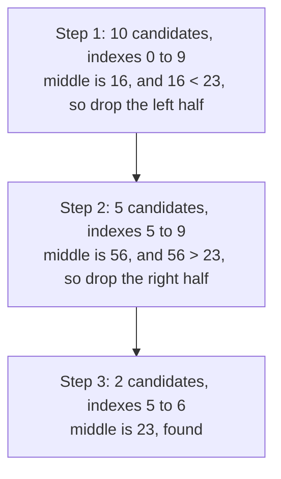

# Binary search

After this you can find a value in a sorted array in about $\log_2 n$ steps, write the loop without an off-by-one error, and recognize problems where you can binary search the answer instead of a list.

Before this: [Big O and runtime](../01-analysis/01-big-o-and-runtime.md) and [arrays and dynamic arrays](../02-data-structures/01-arrays-and-dynamic-arrays.md).

## The idea

Guess a number from 1 to 1,000,000 while a friend answers "higher" or "lower". Guessing 1, 2, 3 and so on takes up to a million tries. Guessing the middle each time takes at most 20, because every answer rules out half of what is left.

That works whenever the items are in order, so one comparison tells you which side the target is on. The diagram shows the idea on ten numbers: each step keeps half of the range.



## Key terms

**Binary search** finds a target in a sorted sequence by comparing it with the middle item and discarding the half that cannot contain it. It takes $O(\log n)$ comparisons, where $n$ is the number of items.

A **search range** is the part of the array still possible, kept as two indexes, `lo` and `hi`. An **invariant** is a statement that stays true on every pass of the loop; here it is "if the target is present, it is inside the range".

A **predicate** is a function that returns true or false. **Binary search on the answer** applies the same halving to a range of possible answers, using a predicate that is false up to some point and true after it.

## How it works

1. Set `lo` to the first index and `hi` to the last.
2. While the range is not empty (`lo <= hi`), look at `mid`, the index halfway between them.
3. If `a[mid]` equals the target, return `mid`. If it is smaller, the target is to the right, so set `lo = mid + 1`. Otherwise set `hi = mid - 1`.
4. If the range becomes empty, the target is absent.

```python
def binary_search(a, target):
    lo, hi = 0, len(a) - 1
    while lo <= hi:
        mid = (lo + hi) // 2
        if a[mid] == target:
            return mid
        if a[mid] < target:
            lo = mid + 1
        else:
            hi = mid - 1
    return -1
```

The `+ 1` and `- 1` matter: `mid` has already been checked, so it must leave the range. Writing `lo = mid` can loop forever when the range has two items.

Python ships this in the `bisect` module. `bisect_left(a, x)` returns the first index where `x` could be inserted and keep `a` sorted, and `bisect_right(a, x)` returns the last such index. It never says "not found"; you check `a[i] == x` yourself. Since Python 3.10 both take a `key` function ([docs](https://docs.python.org/3/library/bisect.html)). With duplicates, the two functions give the start and the end of the run of equal items.

## Worked examples

<div class="example" markdown>

### Example 1: tracing the search

We search `[2, 5, 8, 12, 16, 23, 38, 56, 72, 91]` for 23, then for 40. The code prints `lo`, `hi` and `mid` at the top of each pass.

```text
index      0   1   2   3   4   5   6   7   8   9
value      2   5   8  12  16  23  38  56  72  91
step 1     2   5   8  12  16  23  38  56  72  91
                           ^
step 2     .   .   .   .   .  23  38  56  72  91
                                       ^
step 3     .   .   .   .   .  23  38   .   .   .
                               ^
```

Each row shows the range still alive, and `^` marks `mid`. Step 1 looks at index 4 (16, too small), step 2 at index 7 (56, too big), step 3 at index 5 (23, found). The search for 40 takes a fourth pass at index 6 (38, too small), which leaves `lo = 7` and `hi = 6`, an empty range, so it returns `-1`.

<details class="code" markdown>
<summary>In code</summary>

```python
nums = [2, 5, 8, 12, 16, 23, 38, 56, 72, 91]
print(binary_search(nums, 23))
print(binary_search(nums, 40))
```

```text
5
-1
```

</details>

Check: 10 items need at most $\lceil \log_2 10 \rceil = 4$ looks, and the search for 40 used exactly 4.

</div>

<div class="example" markdown>

### Example 2: binary search on the answer

Koko has piles of bananas `[3, 6, 7, 11]` and 8 hours. Each hour she picks one pile and eats up to `k` bananas from it. What is the smallest `k` that finishes in time? No list holds the answers, but the predicate "`k` is fast enough" is false for small `k` and true from some point on. So we binary search the range 1 to 11 for the first true.

```python
def first_true(lo, hi, ok):
    hi += 1                      # search the half-open range [lo, hi)
    while lo < hi:
        mid = (lo + hi) // 2
        if ok(mid):
            hi = mid             # mid works; a smaller k might too
        else:
            lo = mid + 1
    return lo

piles, hours = [3, 6, 7, 11], 8
print(first_true(1, max(piles), lambda k: sum(-(-p // k) for p in piles) <= hours))
```

```text
4
```

`-(-p // k)` is a ceiling division: the hours one pile takes. With `k = 4` the piles take 1 + 2 + 2 + 3 = 8 hours, and with `k = 3` they take 1 + 2 + 3 + 4 = 10. This "first true" shape returns to you in the LeetCode patterns chapter<!-- link: ../04-leetcode-patterns/01-how-to-approach-a-problem.md -->.

</div>

## Common mistakes

<div class="warning" markdown>

Watch out: running it on unsorted data. `binary_search([5, 1, 4, 2, 3], 1)` returns `-1` even though 1 is in the list, because the first comparison throws away the half that holds it. Nothing raises an error, so check that the input is sorted.

Watch out: mixing loop styles. `while lo <= hi` goes with `hi = len(a) - 1` and `hi = mid - 1`. `while lo < hi` goes with `hi = len(a)` and `hi = mid`. Pick one style per function and do not swap half of it.

Watch out: assuming `mid = (lo + hi) // 2` is safe everywhere. In Python integers do not overflow. In Java, C or C++ with 32-bit `int`, `lo + hi` can; use `lo + (hi - lo) // 2`.

</div>

## Working with AI

<div class="ai" markdown>

Words to use: sorted precondition, search range, invariant, `bisect_left`, half-open interval, predicate, off-by-one.

Prompts to try:

- "Write Python binary search that returns the index of the first occurrence of `x` in a sorted list with duplicates, using `bisect_left`. State the loop invariant and show a test with an empty list and a one-element list."
- "Here is my binary search. It hangs on `[1, 2]` with target 2. Trace `lo`, `hi` and `mid` by hand and name the line that is wrong."

What to check:

- A `while lo < hi` loop paired with `hi = mid - 1`, or `while lo <= hi` paired with `hi = len(a)`. Run it on an empty list, a one-element list, and a target below and above every item.
- A claim that the code works on unsorted input, or no mention that the list must be sorted first.
- Missing the "not found" check after `bisect_left`: the result can be `len(a)` or point at a different value.

</div>

## Quiz

1\. Roughly how many comparisons does binary search need for 1,000,000 sorted items, and for 2,000,000?

<details class="solution" markdown>
<summary>Answer</summary>

About 20 for a million ($\log_2 10^6 \approx 19.9$), and 21 for two million. Doubling the input adds one step.

</details>

2\. What does this print?

```python
from bisect import bisect_left, bisect_right
d = [1, 3, 3, 3, 7]
print(bisect_left(d, 3), bisect_right(d, 3), bisect_left(d, 4))
```

<details class="solution" markdown>
<summary>Answer</summary>

`1 4 4`. The 3s occupy indexes 1 to 3, so `bisect_left` gives the start (1) and `bisect_right` gives one past the end (4). The value 4 would be inserted at index 4. So `bisect_right(d, 3) - bisect_left(d, 3)` counts the 3s.

</details>

3\. A teammate's search loops forever on `[1, 2]` with target 2. The loop is `while lo <= hi:` and the update is `lo = mid`. What is wrong?

<details class="solution" markdown>
<summary>Answer</summary>

With `lo = 0` and `hi = 1`, `mid` is 0 and `a[0] < 2`, so `lo = mid` leaves `lo` at 0 and the range never shrinks. Use `lo = mid + 1`, since `mid` has been checked and must leave the range.

</details>

4\. You have a function `is_slow(build_number)` that is false for every build before a regression and true for every build after it, and you have 1,000 builds. How many builds do you need to test to find the first bad one?

<details class="solution" markdown>
<summary>Answer</summary>

At most 10, because $\lceil \log_2 1000 \rceil = 10$. This is binary search on the answer, and it is how `git bisect` finds the commit that broke something.

</details>

## Lab

<div class="lab" markdown>

### Lab: test your own lower bound

Goal: write the half-open binary search and check it against `bisect_left` on thousands of random inputs. Time: about 15 minutes. Runs in: any terminal with Python 3.

1. Save the code below as `lower_bound.py`. `lower_bound(a, x)` should return the first index `i` with `a[i] >= x`, or `len(a)` if there is none.
2. Fill in the loop using the half-open style: `lo, hi = 0, len(a)`, `while lo < hi`, and either `lo = mid + 1` or `hi = mid`.
3. Run the file. It compares your function with `bisect_left` on 10,000 random sorted lists, including empty ones and lists with duplicates.
4. Break it on purpose: change `hi = mid` to `hi = mid - 1` and read the failing input the assertion prints.

```python
import random
from bisect import bisect_left

def lower_bound(a, x):
    pass  # your loop here

random.seed(1)
for _ in range(10_000):
    a = sorted(random.choices(range(20), k=random.randint(0, 12)))
    x = random.randint(-1, 21)
    assert lower_bound(a, x) == bisect_left(a, x), (a, x)
print("ok")
```

Expected result:

```text
ok
```

<details class="solution" markdown>
<summary>Solution</summary>

```python
def lower_bound(a, x):
    lo, hi = 0, len(a)
    while lo < hi:
        mid = (lo + hi) // 2
        if a[mid] < x:
            lo = mid + 1
        else:
            hi = mid
    return lo
```

`hi` is one past the last candidate, so `len(a)` is a valid answer ("every item is smaller than `x`"). Step 4 fails because `hi = mid - 1` throws away `mid`, which may be exactly the first item that is at least `x`.

</details>

</div>

## Where this shows up

- Sorted columns, database indexes and `git bisect` all rely on this halving. A B-tree index is a binary-search idea with wider nodes (see [trees and binary search trees](../02-data-structures/05-trees-and-binary-search-trees.md)).
- Next, [sorting](02-sorting.md) puts items in the order binary search needs.
