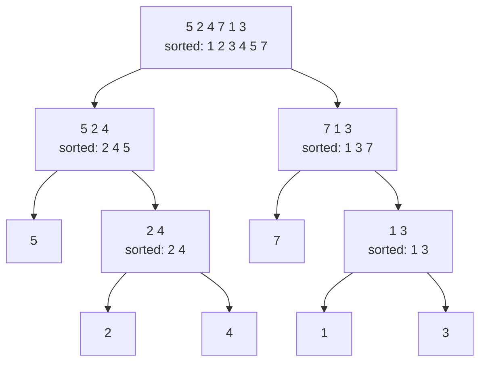

# Sorting

After this you can say how insertion, merge and quick sort work and what they cost, explain what a stable sort is, and use Python's `sorted` with `key=` instead of writing your own.

Before this: [Binary search](01-binary-search.md) and [Big O and runtime](../01-analysis/01-big-o-and-runtime.md).

## The idea

Sorting a hand of cards shows the two basic strategies. You can pick up cards one at a time and slide each into its place among the cards already held. Or you can split the deck in two, sort each pile, and then merge the two sorted piles by repeatedly taking the smaller top card.

The first is insertion sort and the second is merge sort. The diagram shows merge sort on six numbers: split until each piece has one item, then merge back up, with each merge producing a sorted list.



The tree has about $\log_2 n$ levels, and merging all the pieces on one level costs about $n$ steps. That is where merge sort's $O(n \log n)$ comes from.

## Key terms

A **comparison sort** orders items using only "is $a$ less than $b$" questions. No comparison sort can do better than about $n \log_2 n$ comparisons in the worst case, so $O(n \log n)$ is the target.

A sort is **stable** if items with equal keys keep their original relative order. A sort is **in place** if it uses only a small amount of extra memory.

**Timsort** is the algorithm behind Python's `sorted()` and `list.sort()`. It finds runs of items that are already in order and merges them, so it is fast on partly sorted data ([Python docs](https://docs.python.org/3/howto/sorting.html)).

A **key function** takes one item and returns the value to sort by.

## How it works

Insertion sort keeps the left part sorted. For each new item, it shifts larger items one place right and drops the item into the gap. That is $O(n^2)$ in the worst case, but about $n$ steps when the input is already sorted, so it is good for tiny or nearly sorted lists.

Merge sort splits the list in half, sorts both halves recursively, and merges them. It takes $O(n \log n)$ time in every case and $O(n)$ extra space. Its merge step takes from the left half when the two items are equal, which makes it stable.

Quick sort picks a pivot, puts smaller items on one side and larger on the other, and recurses on each side. It averages $O(n \log n)$. A consistently bad pivot, such as the first item of already sorted data, makes it $O(n^2)$, so implementations pick the pivot at random or by sampling.

```python
def merge_sort(a):
    if len(a) <= 1:
        return a
    mid = len(a) // 2
    left, right = merge_sort(a[:mid]), merge_sort(a[mid:])
    out, i, j = [], 0, 0
    while i < len(left) and j < len(right):
        if left[i] <= right[j]:      # <= keeps equal items in original order
            out.append(left[i]); i += 1
        else:
            out.append(right[j]); j += 1
    return out + left[i:] + right[j:]

print(merge_sort([5, 2, 4, 7, 1, 3]))
```

```text
[1, 2, 3, 4, 5, 7]
```

## Worked examples

<div class="example" markdown>

### Example 1: the same job done four ways

We sort 5,000 random integers with insertion sort, merge sort, a quick sort that picks a random pivot, and `sorted`, then repeat on data that is already sorted. All four agree on the answer; the times differ. The functions are the ones from this page, plus a short quick sort:

```python
import random

def quick_sort(a):
    if len(a) <= 1:
        return a
    pivot = random.choice(a)
    return (quick_sort([x for x in a if x < pivot])
            + [x for x in a if x == pivot]
            + quick_sort([x for x in a if x > pivot]))
```

```text
insertion  random   400.56 ms   already sorted     0.41 ms
merge      random     8.26 ms   already sorted     5.36 ms
quick      random     7.57 ms   already sorted     7.12 ms
sorted     random     0.39 ms   already sorted     0.02 ms
```

These times are from the author's Windows 11 PC with Python 3.14; yours will differ, so compare the ratios. Insertion sort is 50 times slower than merge sort on random data, but fastest of the hand-written ones on sorted data. Python's `sorted` beats all three because it is written in C and uses Timsort. On sorted data it did 4,999 comparisons for 5,000 items, which is $n - 1$, the minimum: it noticed the whole list was one run.

Check: the code asserts that all four functions return the same list as `sorted(data)` before timing.

</div>

<div class="example" markdown>

### Example 2: stability and `key=`

`sorted(items, key=f)` calls `f` once per item and sorts by the results. Because Python's sort is stable ([guaranteed](https://docs.python.org/3/howto/sorting.html)), equal keys keep their original order.

```python
words = ["banana", "apple", "Cherry", "Apple"]
print(sorted(words))
print(sorted(words, key=str.lower))
print(sorted(words, key=len, reverse=True))

rows = [("Ana", 90), ("Ben", 85), ("Cy", 90), ("Di", 85)]
print(sorted(rows, key=lambda r: -r[1]))
```

```text
['Apple', 'Cherry', 'apple', 'banana']
['apple', 'Apple', 'banana', 'Cherry']
['banana', 'Cherry', 'apple', 'Apple']
[('Ana', 90), ('Cy', 90), ('Ben', 85), ('Di', 85)]
```

Plain `sorted` puts every capital letter before every lowercase one. With `key=str.lower`, "apple" and "Apple" tie, so they stay in input order. Sorting by score keeps Ana before Cy and Ben before Di, because the names were in that order before the sort. This is how you sort by two fields: sort by the less important one first, then by the more important one, or use a tuple key such as `(-score, name)`.

</div>

## Common mistakes

<div class="warning" markdown>

Watch out: `x = my_list.sort()` sets `x` to `None`. `list.sort()` sorts in place and returns nothing; `sorted(my_list)` returns a new list.

Watch out: writing your own sort for production code. The built-in one is stable, tested, written in C and adaptive. Hand-written sorts belong in learning and interviews.

Watch out: assuming `n log n` always wins. For 20 items insertion sort is fine, which is why library sorts switch to it for small pieces.

</div>

## Working with AI

<div class="ai" markdown>

Words to use: stable, in place, comparison sort, pivot, key function, Timsort, worst case versus average case.

Prompts to try:

- "I have a list of dicts with `name` and `score`. Sort by score descending and break ties by name ascending, using `sorted` and one `key` function. Explain why no second pass is needed."
- "Here is my quick sort. Give an input where it takes $O(n^2)$ time, and say how the pivot choice should change."

What to check:

- A hand-written sort offered where `sorted(..., key=...)` does the job. Ask for the built-in version first.
- A claim of "O(n log n)" for quick sort with no mention of the worst case, or "stable" for an in-place quick sort. Test stability with a list of tied keys, as in Example 2.
- A `cmp=` argument: Python 3 removed it, so the code should use `key=` or `functools.cmp_to_key`.

</div>

## Quiz

1\. Why is insertion sort fast on an almost sorted list but slow on a reversed one?

<details class="solution" markdown>
<summary>Answer</summary>

Each new item shifts left past only the larger items before it. On almost sorted data that is a few places, so the total is close to $n$. On reversed data every item shifts past all earlier items, about $n^2/2$ moves in total.

</details>

2\. What does this print?

```python
print(sorted([(2, "b"), (1, "z"), (2, "a")], key=lambda t: t[0]))
```

<details class="solution" markdown>
<summary>Answer</summary>

`[(1, 'z'), (2, 'b'), (2, 'a')]`. Both 2-tuples have key 2, and a stable sort keeps `(2, "b")` before `(2, "a")`, as in the input. The second letter is never looked at.

</details>

3\. A table is sorted by city. A user then sorts by last name, and people with the same last name come out in random city order. What property is missing, and how do you get the wanted result?

<details class="solution" markdown>
<summary>Answer</summary>

The second sort was not stable, so it did not preserve the city order. With a stable sort, sorting by last name after sorting by city keeps cities in order within each last name. Or sort once with the key `(last_name, city)`.

</details>

4\. Merge sort and quick sort are both $O(n \log n)$ on average. Name one difference that matters when choosing between them.

<details class="solution" markdown>
<summary>Answer</summary>

Merge sort is stable and has an $O(n \log n)$ worst case, but needs $O(n)$ extra space. A standard in-place quick sort needs little extra space, is not stable, and has an $O(n^2)$ worst case.

</details>

## Lab

<div class="lab" markdown>

### Lab: watch the growth rate

Goal: count comparisons for insertion sort, merge sort and `sorted` as $n$ doubles, and see $n^2$ against $n \log n$. Time: about 15 minutes. Runs in: any terminal with Python 3.

1. Save the script below as `count.py`. It wraps each number in a class that counts every comparison.
2. Run it. For each doubling of $n$, the printed ratio tells you how much the work grew.
3. Predict first: if the work is $n^2$, doubling $n$ multiplies it by about 4. If it is $n \log n$, the factor is a little over 2.
4. Add a fourth sort of your own (for example the `quick_sort` above, which needs `import random` and works on `Counted` objects) and see which row it joins.

```python
import random
from functools import total_ordering

@total_ordering
class Counted:
    count = 0
    def __init__(self, v):
        self.v = v
    def __eq__(self, other):
        Counted.count += 1
        return self.v == other.v
    def __lt__(self, other):
        Counted.count += 1
        return self.v < other.v

def insertion_sort(a):
    a = a[:]
    for i in range(1, len(a)):
        x, j = a[i], i - 1
        while j >= 0 and a[j] > x:
            a[j + 1] = a[j]
            j -= 1
        a[j + 1] = x
    return a

def merge_sort(a):
    if len(a) <= 1:
        return a
    mid = len(a) // 2
    left, right = merge_sort(a[:mid]), merge_sort(a[mid:])
    out, i, j = [], 0, 0
    while i < len(left) and j < len(right):
        if left[i] <= right[j]:
            out.append(left[i]); i += 1
        else:
            out.append(right[j]); j += 1
    return out + left[i:] + right[j:]

def comparisons(sort, n):
    random.seed(n)
    data = [Counted(random.random()) for _ in range(n)]
    Counted.count = 0
    sort(data)
    return Counted.count

prev = {}
for n in (1000, 2000, 4000):
    row = [n]
    for name, f in (("insertion", insertion_sort), ("merge", merge_sort), ("sorted", sorted)):
        c = comparisons(f, n)
        ratio = f"x{c / prev[name]:.2f}" if name in prev else "-"
        prev[name] = c
        row.append(f"{name} {c:>9,} ({ratio})")
    print(*row, sep="   ")
```

Expected result (counts for merge sort and `sorted` depend on how the class counts `<=`, so yours should be close, not identical):

```text
1000   insertion   505,958 (-)   merge    13,099 (-)   sorted     8,652 (-)
2000   insertion 1,995,923 (x3.94)   merge    29,249 (x2.23)   sorted    19,332 (x2.23)
4000   insertion 8,021,972 (x4.02)   merge    64,241 (x2.20)   sorted    42,683 (x2.21)
```

<details class="solution" markdown>
<summary>Solution</summary>

Insertion sort grows by about 4 each time $n$ doubles, which is quadratic. Merge sort and `sorted` grow by about 2.2, which is $n \log n$: doubling $n$ doubles the items and adds one more level to the tree. `sorted` uses about a third fewer comparisons than the plain merge sort here, because it sorts short pieces with binary insertion sort, which needs few comparisons.

</details>

</div>

## Where this shows up

- Sorting is the first step of many other algorithms: the greedy interval scheduler<!-- link: 05-greedy-algorithms.md --> sorts by finish time, and "sort, then two pointers" is a common pattern in two pointers and sliding window<!-- link: ../04-leetcode-patterns/02-two-pointers-and-sliding-window.md -->.
- Database `ORDER BY` and index builds are sorts, and large ones are merge sorts that spill to disk.
