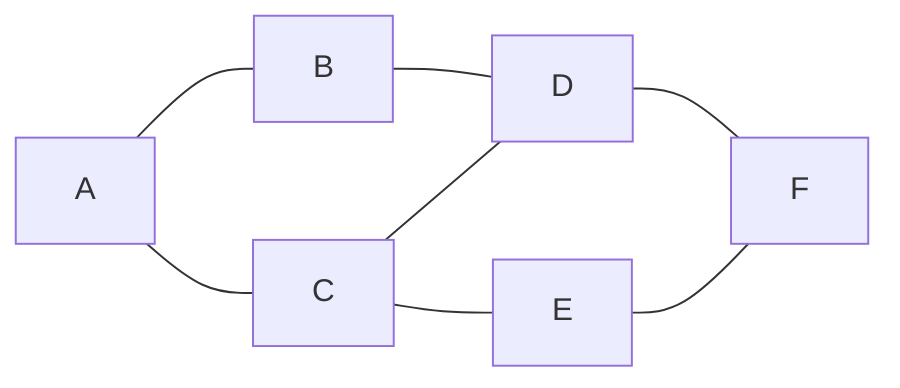
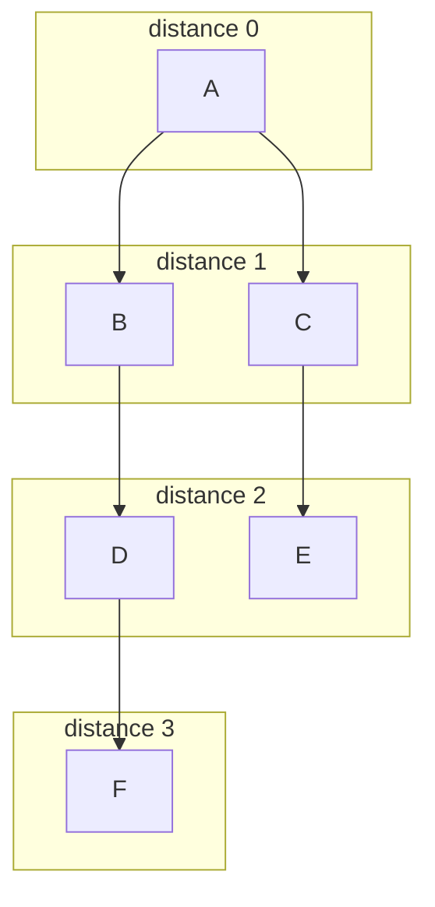

# BFS and DFS

After this you can visit every node of a graph or grid with breadth-first and depth-first search, say why one uses a queue and the other a stack, and use BFS to find the fewest steps between two points.

Before this: [graphs and representations](../02-data-structures/07-graphs-and-representations.md) and [stacks and queues](../02-data-structures/03-stacks-and-queues.md).

## The idea

You are looking for a friend in a building with many rooms. You can check every room on this floor, then every room one floor away from the entrance, and so on, outward. Or you can pick a door, follow its corridor as far as it goes, and only come back to try the next door when you hit a dead end.

The first is **breadth-first search** and the second is **depth-first search**. Both visit every node reachable from the start, and both cost $O(V + E)$ for $V$ nodes and $E$ edges. They differ in order, and the order decides what each is good for. The graph below is the example for this lesson.



## Key terms

A **graph** is a set of nodes joined by edges. A **neighbour** of a node is a node it shares an edge with. A **path** is a sequence of nodes where each consecutive pair is an edge; its length is the number of edges.

**Breadth-first search (BFS)** visits nodes in order of distance from the start: all nodes 1 edge away, then 2 edges away, and so on. It uses a **queue**, first in first out.

**Depth-first search (DFS)** follows one path as deep as it can, then backs up. It uses a **stack**, last in first out, either one you build or the call stack of a recursive function.

A **visited set** records the nodes already reached. Without it, a graph with a cycle sends the search around forever.

## How it works

Both searches share one loop: take a node from the **frontier** (the nodes found but not yet processed), mark each unseen neighbour as seen, and add it to the frontier. The only difference is which end of the frontier you take from.

1. Put the start node in the frontier and in the visited set.
2. Remove one node from the frontier. For BFS take the oldest (`popleft()` on a `deque`); for DFS take the newest (`pop()` on a list).
3. For each neighbour not in the visited set, add it to the visited set and to the frontier.
4. Repeat until the frontier is empty.

The diagram shows BFS from `A` as layers: everything in one box is the same number of edges from `A`.



Because BFS finishes each layer before the next, the first time it reaches a node is by a shortest path. That holds only when every edge counts the same, as in an unweighted graph. Storing each node's `parent` lets you walk back from the goal to rebuild the path.

```python
from collections import deque

def bfs(graph, start):
    dist = {start: 0}
    parent = {start: None}
    queue = deque([start])
    while queue:
        node = queue.popleft()
        for nxt in graph[node]:
            if nxt not in dist:          # mark visited when queued
                dist[nxt] = dist[node] + 1
                parent[nxt] = node
                queue.append(nxt)
    return dist, parent
```

The `dist` dictionary doubles as the visited set. A recursive DFS needs only the visited set and a call to itself:

```python
def dfs(graph, start):
    seen, order = set(), []
    def visit(node):
        seen.add(node)
        order.append(node)
        for nxt in graph[node]:
            if nxt not in seen:
                visit(nxt)
    visit(start)
    return order
```

## Worked examples

<div class="example" markdown>

### Example 1: the same graph, two orders

We store the graph from The idea as a dict of neighbour lists and run both searches from `A`.

```python
graph = {
    "A": ["B", "C"], "B": ["A", "D"], "C": ["A", "D", "E"],
    "D": ["B", "C", "F"], "E": ["C", "F"], "F": ["D", "E"],
}
dist, parent = bfs(graph, "A")
print(dist)
print(dfs(graph, "A"))
```

```text
{'A': 0, 'B': 1, 'C': 1, 'D': 2, 'E': 2, 'F': 3}
['A', 'B', 'D', 'C', 'E', 'F']
```

BFS reports `F` at distance 3, matching the layers diagram, and following `parent` back from `F` gives `A, B, D, F`. DFS goes `A`, `B`, `D`, then `C`, which it reaches from `D`, then `E` and `F`. If we record the path DFS takes to `F`, it is `A, B, D, C, E, F`: 5 edges, not 3. DFS finds a path, not the shortest one.

Check: the BFS distances agree with counting edges by hand in the first diagram.

</div>

<div class="example" markdown>

### Example 2: shortest route through a maze

A grid is a graph: each open cell is a node, and each of its four neighbours is an edge. We count the steps from `S` to `E` in a grid where `#` is a wall. BFS spreads outward like water, so each cell gets its distance from `S`:

```text
 0  1 ## 7  8  9 10 11
 1 ## ## 6 ## ## ## 12
 2  3  4  5 ## 11 12 13
 3 ## ## ## ## 10 ## 14
 4  5  6  7  8  9 ## 15
```

The code is the same loop, with a `(row, column)` pair as the node and a bounds check in place of the neighbour list:

```python
def shortest_steps(grid):
    rows, cols = len(grid), len(grid[0])
    for r in range(rows):
        for c in range(cols):
            if grid[r][c] == "S": start = (r, c)
            if grid[r][c] == "E": goal = (r, c)
    dist = {start: 0}
    queue = deque([start])
    while queue:
        r, c = queue.popleft()
        if (r, c) == goal:
            return dist[(r, c)]
        for dr, dc in ((1, 0), (-1, 0), (0, 1), (0, -1)):
            nr, nc = r + dr, c + dc
            if (0 <= nr < rows and 0 <= nc < cols
                    and grid[nr][nc] != "#" and (nr, nc) not in dist):
                dist[(nr, nc)] = dist[(r, c)] + 1
                queue.append((nr, nc))
    return -1
```

On the maze above it returns `15`, the bottom-right number in the picture, and on `["S#E"]` (no route) it returns `-1`.

</div>

## Common mistakes

<div class="warning" markdown>

Watch out: marking a node visited when you take it out of the frontier instead of when you add it. The same node can then be queued many times, which wastes time and memory. Mark on the way in.

Watch out: using a plain `list` and `pop(0)` as the BFS queue. Removing from the front of a list is $O(n)$, so BFS becomes slow. Use `collections.deque`.

Watch out: recursive DFS on a long chain. Python's default recursion limit is 1,000 calls, and a 5,000-node path raises `RecursionError`. Use an explicit stack for big inputs.

</div>

## Working with AI

<div class="ai" markdown>

Words to use: frontier, visited set, queue, stack, adjacency list, shortest path in an unweighted graph, connected component.

Prompts to try:

- "Write BFS in Python on a 2D grid of `0` and `1` that returns the number of steps from the top left to the bottom right, or -1. Use `deque`, mark cells visited when queued, and stay within bounds."
- "Is DFS or BFS right for finding the number of separate islands in a grid? Give the Python for it and its time complexity in terms of rows and columns."

What to check:

- DFS used where the question asks for the fewest steps. Only BFS (on unweighted edges) gives that.
- A missing visited set, or one that is updated after the pop. Run it on a graph with a cycle such as the one above; a bug shows up as an endless loop or repeated nodes.
- Off-grid checks written after the lookup `grid[nr][nc]`: a negative index in Python wraps around instead of raising an error, so a wrong order gives wrong answers silently.

</div>

## Quiz

1\. What data structure does each search use for its frontier, and what does that change about the order?

<details class="solution" markdown>
<summary>Answer</summary>

BFS uses a queue and takes the oldest found node, so it moves outward one layer at a time. DFS uses a stack and takes the newest, so it follows one path down before trying others.

</details>

2\. What does this print, using the graph from Example 1?

```python
print(bfs(graph, "C")[0])
```

<details class="solution" markdown>
<summary>Answer</summary>

`{'C': 0, 'A': 1, 'D': 1, 'E': 1, 'B': 2, 'F': 2}`. From `C`, the neighbours `A`, `D` and `E` are 1 edge away; `B` is reached through `A` or `D` and `F` through `D` or `E`, both at distance 2.

</details>

3\. A teammate's BFS never finishes on a graph that has a cycle. What is the likely bug?

<details class="solution" markdown>
<summary>Answer</summary>

There is no visited set, or nodes are not recorded when they are added. The search keeps re-adding nodes around the cycle. Check `if nxt not in dist` (or the equivalent) before appending.

</details>

4\. A road network has travel times in minutes on every edge. Is BFS enough to find the quickest route? Why or why not?

<details class="solution" markdown>
<summary>Answer</summary>

No. BFS minimizes the number of edges, and a route with fewer edges can take longer. With weighted edges you need [Dijkstra's algorithm](04-shortest-paths.md).

</details>

## Lab

<div class="lab" markdown>

### Lab: count the islands

Goal: use DFS or BFS to count connected groups of `1` cells in a grid. Time: about 15 minutes. Runs in: any terminal with Python 3.

1. Save the code below as `islands.py`. A cell belongs to an island if it is `1`; cells touching up, down, left or right (not diagonally) are on the same island.
2. Write `count_islands(grid)`. Loop over every cell; when you find an unvisited `1`, add one to the count and run a search that marks all cells of that island visited.
3. Run the file and compare with the expected result.
4. Change your search from DFS to BFS (or the reverse) and confirm the count does not change.

```python
grid = [
    "11000",
    "11000",
    "00100",
    "00011",
]

def count_islands(grid):
    pass  # your code here

print(count_islands(grid))
```

Expected result:

```text
3
```

<details class="solution" markdown>
<summary>Solution</summary>

```python
def count_islands(grid):
    rows, cols = len(grid), len(grid[0])
    seen = set()
    count = 0
    for r in range(rows):
        for c in range(cols):
            if grid[r][c] == "1" and (r, c) not in seen:
                count += 1
                stack = [(r, c)]
                seen.add((r, c))
                while stack:
                    cr, cc = stack.pop()
                    for dr, dc in ((1, 0), (-1, 0), (0, 1), (0, -1)):
                        nr, nc = cr + dr, cc + dc
                        if (0 <= nr < rows and 0 <= nc < cols
                                and grid[nr][nc] == "1" and (nr, nc) not in seen):
                            seen.add((nr, nc))
                            stack.append((nr, nc))
    return count
```

The outer loops visit each cell once, and each island is searched once, so the total is $O(\text{rows} \times \text{cols})$. Swapping `stack.pop()` for a `deque` and `popleft()` gives BFS with the same count.

</details>

</div>

## Where this shows up

- Web crawlers, social "friends within 2 hops", and flood fill in image editors are BFS. Finding cycles, ordering tasks that depend on each other, and exploring all options in [backtracking](../04-leetcode-patterns/06-backtracking.md) are DFS.
- Next, [shortest paths](04-shortest-paths.md) handles edges that have different costs.
