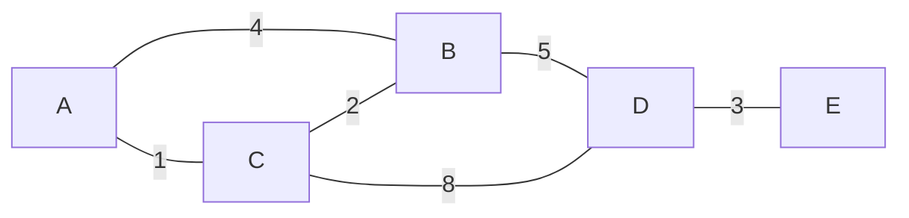

# Shortest paths

After this you can run Dijkstra's algorithm by hand and in Python with `heapq`, say why it fails with negative edge weights, and pick between Dijkstra, Bellman-Ford and A* for a routing problem.

Before this: [BFS and DFS](03-bfs-and-dfs.md) and [heaps and priority queues](../02-data-structures/06-heaps-and-priority-queues.md).

## The idea

A map app does not look for the route with the fewest turns. It looks for the quickest one, where each road segment has its own travel time. BFS cannot do this, because it counts edges as if they all cost the same. A 3-edge route of back streets can beat a 2-edge route that includes a slow ferry.

Dijkstra's algorithm fixes this with one change to BFS: the frontier is a priority queue ordered by total distance from the start, not a queue ordered by arrival. It always expands the closest node it has not finished. The graph below is the example for this lesson, with the cost on each edge.



Each edge works in both directions.

## Key terms

A **weighted graph** gives each edge a number, its weight (cost, time or distance). The **shortest path** between two nodes is the path with the smallest total weight, not necessarily the fewest edges.

A **priority queue** hands back the smallest item first. In Python it is a list managed by `heapq`, where `heappush` and `heappop` each cost $O(\log n)$.

To **relax** an edge $u \to v$ with weight $w$ means to check whether going through $u$ gives $v$ a shorter distance, and if so, to update it: if `dist[u] + w < dist[v]`, set `dist[v] = dist[u] + w`.

**Dijkstra's algorithm** finds the shortest distance from one start node to every other node, provided no edge weight is negative. With a heap it runs in $O((V + E) \log V)$.

## How it works

1. Set `dist[start] = 0` and every other distance to infinity. Push `(0, start)` onto the heap.
2. Pop the entry with the smallest distance. If its distance is larger than the best known for that node, it is stale; skip it.
3. Relax every edge leaving that node. Each improvement pushes a new `(distance, node)` entry.
4. Repeat until the heap is empty.

Why it works: when a node is popped, its distance is final. Any other route to it must pass through a node still in the heap, whose distance is at least as large, and adding a non-negative weight cannot make it smaller. That argument is exactly what a negative weight breaks.

```python
import heapq

def dijkstra(graph, start):
    dist = {node: float("inf") for node in graph}
    dist[start] = 0
    parent = {start: None}
    heap = [(0, start)]
    while heap:
        d, node = heapq.heappop(heap)
        if d > dist[node]:               # stale entry, a shorter one was already used
            continue
        for nxt, w in graph[node]:
            if d + w < dist[nxt]:        # relax the edge
                dist[nxt] = d + w
                parent[nxt] = node
                heapq.heappush(heap, (d + w, nxt))
    return dist, parent
```

Python's `heapq` cannot lower the priority of an item already in the heap, so the code pushes a second entry and skips the old one when it comes up (step 2). Ties in distance compare the node names, so node labels must be comparable.

## Worked examples

<div class="example" markdown>

### Example 1: Dijkstra from A

The graph is stored as a dict that lists every edge in both directions:

```python
graph = {
    "A": [("B", 4), ("C", 1)],
    "B": [("A", 4), ("C", 2), ("D", 5)],
    "C": [("A", 1), ("B", 2), ("D", 8)],
    "D": [("B", 5), ("C", 8), ("E", 3)],
    "E": [("D", 3)],
}
```

Each row of the table shows what happens when a node is popped, and the distances after relaxing its edges.

| Pop | A | B | C | D | E |
|---|---|---|---|---|---|
| start | 0 | inf | inf | inf | inf |
| A (0) | 0 | 4 | 1 | inf | inf |
| C (1) | 0 | 3 | 1 | 9 | inf |
| B (3) | 0 | 3 | 1 | 8 | inf |
| D (8) | 0 | 3 | 1 | 8 | 11 |
| E (11) | 0 | 3 | 1 | 8 | 11 |

Step by step: popping `A` sets `B` to 4 and `C` to 1. Popping `C` (the closest) improves `B` from 4 to 3 through `C`, and sets `D` to 9. Popping `B` improves `D` from 9 to 8. Popping `D` reaches `E` at 11. The parent links give the path `A, C, B, D, E` with total cost 11.

Check: the code returns the same last row, and `dijkstra(graph, "A")[0]` prints `{'A': 0, 'B': 3, 'C': 1, 'D': 8, 'E': 11}`. BFS would reach `D` in 2 edges (`A, B, D`, cost 9), which is not the cheapest.

</div>

<div class="example" markdown>

### Example 2: a negative edge breaks it

Take directed edges `S → A` (5), `S → B` (6) and `B → A` (-3). The real shortest distance to `A` is $6 - 3 = 3$, through `B`. The textbook version, which finishes a node when it is popped and never updates it afterwards, pops `A` first at distance 5 and locks it in. In code, that is the `dijkstra` above with a `done` set that skips nodes already finished and never relaxes into them:

```python
def dijkstra_final(graph, start):
    dist = {n: float("inf") for n in graph}
    dist[start] = 0
    done, heap = set(), [(0, start)]
    while heap:
        d, node = heapq.heappop(heap)
        if node in done:
            continue
        done.add(node)
        for nxt, w in graph[node]:
            if nxt not in done and d + w < dist[nxt]:
                dist[nxt] = d + w
                heapq.heappush(heap, (d + w, nxt))
    return dist

neg = {"S": [("A", 5), ("B", 6)], "A": [], "B": [("A", -3)]}
print(dijkstra_final(neg, "S"))
```

```text
{'S': 0, 'A': 5, 'B': 6}
```

The answer for `A` is 5, but it should be 3. The heap version above would recover here, because it relaxes any improvement, but it loses its running-time guarantee and loops forever if a cycle has negative total weight. **Bellman-Ford** handles negative edges: it relaxes every edge $V - 1$ times, takes $O(VE)$ time, and a further pass that still finds an improvement reveals a negative cycle. On `neg` it returns `{'S': 0, 'A': 3, 'B': 6}`.

</div>

## Beyond the basics

A* is Dijkstra with a guess. Instead of ordering the heap by distance so far, it orders by distance so far plus a heuristic: an estimate of the distance still to go, such as straight-line distance to the destination. If the estimate never exceeds the true remaining distance, A* still returns a shortest path, and it explores far fewer nodes because it heads toward the goal. Games and route planners use it.

Real maps and networks are bigger than these examples, so engines add precomputation on top of these ideas. In networks, OSPF is a link-state protocol: each router learns the whole topology and builds a tree of shortest paths with itself as the root ([RFC 2328, section 1.1](https://www.rfc-editor.org/rfc/rfc2328#section-1.1)), which is the job Dijkstra's algorithm does. Distance-vector protocols such as RIP exchange only distances with neighbours, an approach closer to Bellman-Ford.

## Common mistakes

<div class="warning" markdown>

Watch out: using Dijkstra when weights can be negative, such as a price difference or a refund edge. Use Bellman-Ford, or check that all weights are at least 0 before you start.

Watch out: using BFS on a weighted graph and calling the result "shortest". BFS minimizes edges, not total weight.

Watch out: leaving out the stale-entry check (`if d > dist[node]: continue`). The answer is still right, but the same node is processed many times and the loop does extra work.

</div>

## Working with AI

<div class="ai" markdown>

Words to use: relax, priority queue, `heapq`, stale entry, non-negative weights, negative cycle, heuristic, admissible.

Prompts to try:

- "Implement Dijkstra in Python with `heapq` for a graph given as `dict[str, list[tuple[str, int]]]`. Return both the distances and a way to rebuild the path, and say what happens for an unreachable node."
- "My graph has some negative edge weights. Which algorithm should I use, what does it cost, and how do I detect a negative cycle?"

What to check:

- Dijkstra offered for a graph with negative weights, with no warning. Ask what the weights are before accepting.
- A heap holding only distances, not `(distance, node)` pairs, or nodes that cannot be compared when distances tie.
- A* with a heuristic that overestimates (for example, using a speed that is too high in the time estimate). The path it returns may then not be the shortest.

</div>

## Quiz

1\. Why does BFS fail to find the cheapest route in a weighted graph?

<details class="solution" markdown>
<summary>Answer</summary>

It finds the route with the fewest edges and treats every edge as the same cost. A route with more edges can have a smaller total weight, as `A, C, B, D` (8) does against `A, B, D` (9).

</details>

2\. In Example 1, `dist["B"]` is 4 after `A` is popped and 3 after `C` is popped. Which line of the code makes that change?

<details class="solution" markdown>
<summary>Answer</summary>

`if d + w < dist[nxt]:` followed by `dist[nxt] = d + w`, the relaxation. At `C`, $1 + 2 = 3 < 4$, so `B` improves.

</details>

3\. Dijkstra on a graph with a negative edge returns a distance that is too large for one node. Explain the cause in one sentence.

<details class="solution" markdown>
<summary>Answer</summary>

The algorithm finishes a node when it pops it, assuming no later route can be shorter, but a negative edge reached later can make a route shorter after the node is already finished.

</details>

4\. You need the cheapest route in a road network from a depot to one customer, and you know each point's straight-line distance to the customer. Which algorithm fits?

<details class="solution" markdown>
<summary>Answer</summary>

A*, using the straight-line distance as the heuristic. It never overestimates the road distance, so the result is still the shortest path, and it explores fewer nodes than Dijkstra.

</details>

## Lab

<div class="lab" markdown>

### Lab: Dijkstra against Bellman-Ford

Goal: implement Bellman-Ford, check it against Dijkstra on non-negative weights, then add a negative cycle. Time: about 20 minutes. Runs in: any terminal with Python 3.

1. Save `dijkstra` from this page into `paths.py`, along with the graph from Example 1.
2. Write `bellman_ford(graph, start)`: set distances as in Dijkstra, then repeat `len(graph) - 1` times a loop that relaxes every edge. Afterwards, loop once more and `raise ValueError("negative cycle")` if any edge still improves.
3. Print `dijkstra(graph, "A")[0]` and `bellman_ford(graph, "A")` for the Example 1 graph. They should be equal.
4. Run it on `{"S": [("A", 1)], "A": [("B", -2)], "B": [("A", 1)]}`. The cycle `A, B, A` costs $-2 + 1 = -1$ each lap.

Expected result:

```text
{'A': 0, 'B': 3, 'C': 1, 'D': 8, 'E': 11}
{'A': 0, 'B': 3, 'C': 1, 'D': 8, 'E': 11}
negative cycle
```

<details class="solution" markdown>
<summary>Solution</summary>

```python
def bellman_ford(graph, start):
    dist = {n: float("inf") for n in graph}
    dist[start] = 0
    for _ in range(len(graph) - 1):
        for u in graph:
            for v, w in graph[u]:
                if dist[u] + w < dist[v]:
                    dist[v] = dist[u] + w
    for u in graph:
        for v, w in graph[u]:
            if dist[u] + w < dist[v]:
                raise ValueError("negative cycle")
    return dist
```

A shortest path without a cycle has at most $V - 1$ edges, so $V - 1$ rounds are enough. If a $V$-th round still improves something, a cycle with negative total weight exists, because each lap would lower the distance again.

</details>

</div>

## Where this shows up

- Navigation, network routing and game pathfinding all use this family. Dijkstra is also the model for [greedy algorithms](05-greedy-algorithms.md): always take the best available option and never revisit it.
- In the LeetCode patterns chapter, tree and graph problems<!-- link: ../04-leetcode-patterns/05-tree-and-graph-problems.md --> include "cheapest flight" and "network delay" problems that are Dijkstra or Bellman-Ford with a twist.
