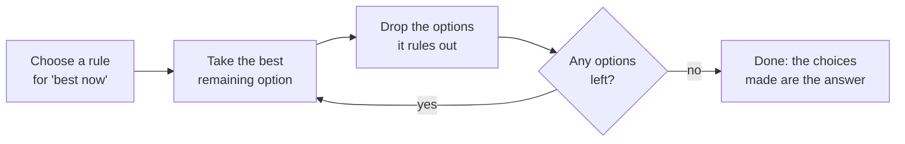

# Greedy algorithms

After this you can recognize a greedy algorithm, write the classic interval scheduler, spot a problem where greedy gives a wrong answer, and test or argue whether a greedy rule is correct.

Before this: [Sorting](02-sorting.md) and [Shortest paths](04-shortest-paths.md).

## The idea

You have one meeting room and a list of requests, each with a start and end time. You want to host as many meetings as possible. At each decision you could take the earliest start, the shortest meeting, or the one that ends first. Each rule sounds reasonable, and only one of them is always right.

A **greedy algorithm** builds an answer one step at a time, and at each step takes the choice that looks best right now, without looking ahead or undoing it later. Greedy is fast and short. The danger is that "looks best now" can lead to a worse total, so the work is in showing that a particular rule is safe.



## Key terms

The **greedy-choice property** says that some optimal solution starts with the greedy choice. When it holds at every step, greedy is correct.

An **exchange argument** proves it: take any optimal solution, swap its first choice for the greedy one, and show the result is still valid and no worse.

A **counterexample** is one small input where the rule gives a worse answer than the best one. A single counterexample is enough to reject a greedy rule.

## How it works

Interval scheduling uses the rule "earliest finish time first". Sort the meetings by end time. Take the first. Then walk down the list, taking each meeting that starts at or after the end of the last one taken.

```python
def schedule(intervals):
    chosen, last_end = [], float("-inf")
    for start, end in sorted(intervals, key=lambda iv: iv[1]):   # earliest finish first
        if start >= last_end:
            chosen.append((start, end))
            last_end = end
    return chosen
```

The rule works because the meeting that ends first leaves the most room for everything else. For the exchange argument, take any best schedule. Its first meeting ends no earlier than the greedy pick does, so replacing it with the greedy pick cannot cause an overlap and keeps the count the same. Repeat on the remaining time. The cost is the sort, $O(n \log n)$, plus one pass.

Many familiar algorithms are greedy. Dijkstra always finishes the nearest unfinished node. Huffman coding (used in compression) repeatedly merges the two least frequent symbols. A minimum spanning tree can be built by always adding the cheapest edge that creates no cycle.

## Worked examples

<div class="example" markdown>

### Example 1: scheduling meetings

Six requests, `a` to `f`, as `(start, end)` pairs: `a` (1, 4), `b` (3, 5), `c` (0, 6), `d` (5, 7), `e` (3, 9), `f` (8, 11). In the timeline, each row is one request, drawn from its start to its end:

```text
a     ########
b           =====
c  =================
d                 #####
e           =================
f                          ########
   0  1  2  3  4  5  6  7  8  9  10 11
```

Sorted by end time the order is `a`, `b`, `c`, `d`, `e`, `f`. Step by step: take `a` (ends at 4). Skip `b` (starts at 3, before 4) and `c` (starts at 0). Take `d` (starts at 5, after 4; ends at 7). Skip `e` (starts at 3). Take `f` (starts at 8, after 7). The rows marked `#` are the schedule: 3 meetings.

```python
meetings = [(1, 4), (3, 5), (0, 6), (5, 7), (3, 9), (8, 11)]
print(schedule(meetings))
```

```text
[(1, 4), (5, 7), (8, 11)]
```

Check: the rule "earliest start first" would take `c` (0, 6), then `f` (8, 11), which is only 2 meetings, so it is wrong. To check the winning rule, we compared `schedule` against a brute-force search over every subset on 2,000 random small inputs, and they always agreed.

</div>

<div class="example" markdown>

### Example 2: coin change where greedy fails

Make change by always taking the largest coin that fits. With coins `1, 3, 4` and amount 6, greedy takes `4 + 1 + 1`, which is 3 coins, but `3 + 3` is 2 coins. That is a counterexample.

```python
def greedy_coins(coins, amount):
    count = 0
    for c in sorted(coins, reverse=True):
        count += amount // c
        amount %= c
    return count if amount == 0 else None

print(greedy_coins([1, 3, 4], 6))
```

```text
3
```

The best answer is 2 (found by trying every amount, as in [dynamic programming](06-dynamic-programming.md)). Greedy is correct for some coin sets. We checked by comparing it with the optimal count for each amount:

| Coins | Amounts where greedy is not optimal |
|---|---|
| 1, 5, 10, 25 | none up to 99 |
| 5, 10, 25, 100, 200 (Canadian cash in cents, no penny) | none up to 1,000 |
| 1, 3, 4 | 6, 10, 14 |
| 1, 5, 12 | 15, 16, 20 |

A table up to a limit is evidence, not a proof; some coin sets are known to be safe, but you should not assume it for a new set.

</div>

## Common mistakes

<div class="warning" markdown>

Watch out: trusting a greedy rule because it passes the examples you tried. Try small cases with ties and with an item that is attractive but blocks several others, like meeting `c` above.

Watch out: picking the wrong greedy rule for a problem that is greedy. Interval scheduling fails with earliest start and with shortest duration; only earliest finish is correct.

Watch out: sorting by one field when ties matter. If two meetings end at the same time, either is safe here, but in other problems the tie-break changes the answer.

</div>

## Working with AI

<div class="ai" markdown>

Words to use: greedy-choice property, exchange argument, counterexample, optimal substructure, sort by finish time.

Prompts to try:

- "Give me a greedy algorithm for assigning the fewest meeting rooms to a list of `(start, end)` intervals, in Python. Explain which sort order it needs and why that order is safe."
- "Here is a greedy rule for my problem: [rule]. Find a counterexample with at most 5 items, or explain the exchange argument that shows it is correct."

What to check:

- A greedy answer to a problem where the choices interact, such as coin change with an arbitrary coin set, stated as "optimal" with no proof. Write a brute-force version and compare on small random inputs.
- A sort key that does not match the rule (sorting by start when the rule says finish).
- A "proof" that only describes what the algorithm does. A real argument says why no other first choice can do better.

</div>

## Quiz

1\. What makes an algorithm greedy?

<details class="solution" markdown>
<summary>Answer</summary>

It builds the answer in steps, takes the choice that looks best at that moment, and never reconsiders it.

</details>

2\. What does `greedy_coins([1, 5, 12], 15)` return, and what is the best answer?

<details class="solution" markdown>
<summary>Answer</summary>

Greedy takes `12 + 1 + 1 + 1`, which is 4 coins. The best is `5 + 5 + 5`, which is 3 coins.

</details>

3\. A teammate proposes scheduling the shortest meetings first. Give a counterexample.

<details class="solution" markdown>
<summary>Answer</summary>

Take `(1, 5)`, `(4, 7)` and `(6, 10)`. The shortest is `(4, 7)` (length 3), and it overlaps both others, so greedy picks 1 meeting. Picking `(1, 5)` and `(6, 10)` gives 2.

</details>

4\. You tested a greedy rule on 1,000 random inputs against brute force and found no failures. Is it proven correct?

<details class="solution" markdown>
<summary>Answer</summary>

No. It is strong evidence for the sizes tried. A proof, such as an exchange argument, covers all inputs. Random tests can miss rare cases, so also test the small edge cases by hand.

</details>

## Lab

<div class="lab" markdown>

### Lab: hunt for a counterexample

Goal: use brute force to show that a plausible greedy rule fails. Time: about 15 minutes. Runs in: any terminal with Python 3.

1. Save the code below as `greedy_test.py`. It has the coin-change greedy and an optimal version that tries every amount.
2. Run it with the coin set `[1, 5, 12]` and print every amount from 1 to 30 where the two answers differ.
3. Switch to `[1, 5, 10, 25]` and confirm the list is empty.
4. Invent a coin set of your own with at least three coins. Predict whether greedy fails, then check.

```python
def greedy_coins(coins, amount):
    count = 0
    for c in sorted(coins, reverse=True):
        count += amount // c
        amount %= c
    return count if amount == 0 else None

def best_coins(coins, amount):
    best = [0] + [float("inf")] * amount
    for a in range(1, amount + 1):
        for c in coins:
            if c <= a:
                best[a] = min(best[a], best[a - c] + 1)
    return best[amount]

coins = [1, 5, 12]
print([a for a in range(1, 31) if greedy_coins(coins, a) != best_coins(coins, a)])
```

Expected result:

```text
[15, 16, 20, 21, 27, 28]
```

<details class="solution" markdown>
<summary>Solution</summary>

This is the output of the script as written; changing `coins` to `[1, 5, 10, 25]` prints `[]`. In `best_coins`, `best[a]` is the fewest coins for amount `a`, built from smaller amounts, which is the idea behind dynamic programming. Amount 15 is the first failure: greedy uses 12 + 1 + 1 + 1 (4 coins), but 5 + 5 + 5 is 3.

</details>

</div>

## Where this shows up

- Heap-based scheduling, compression (Huffman) and spanning-tree algorithms are greedy. When greedy is not safe, the next lesson, [dynamic programming](06-dynamic-programming.md), is usually the fix.
- In the LeetCode patterns chapter, how to approach a problem<!-- link: ../04-leetcode-patterns/01-how-to-approach-a-problem.md --> includes testing a greedy idea against brute force before trusting it.
