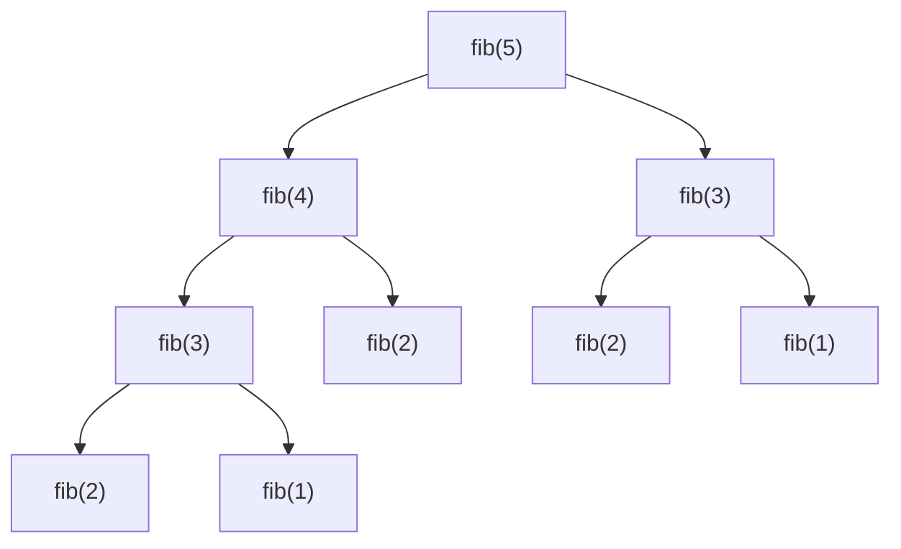

# Dynamic programming

After this you can tell when a recursive problem repeats the same work, fix it with memoization or a table, and write coin change, longest common subsequence and edit distance.

Before this: [recursion](../../03-programming-fundamentals/02-thinking-like-a-programmer/01-recursion.md), [greedy algorithms](05-greedy-algorithms.md) and [Big O and runtime](../01-analysis/01-big-o-and-runtime.md).

## The idea

The Fibonacci numbers start 0, 1 and each later one is the sum of the previous two. The direct recursive definition, `fib(n) = fib(n - 1) + fib(n - 2)`, is correct and slow: `fib(30)` makes 2,692,537 calls. The reason is in the call tree, where the same subproblems appear again and again.



In the diagram, `fib(3)` is computed twice and `fib(2)` three times (the calls below `fib(2)` are left out). The tree doubles roughly at each level. **Dynamic programming** (DP) removes the repeats: solve each distinct subproblem once, store the answer, and look it up when it is needed again.

## Key terms

**Overlapping subproblems** means the same smaller problems come up many times. **Optimal substructure** means the best answer to the whole problem is built from best answers to smaller pieces. DP applies when both are true.

A **state** is the set of numbers that identifies a subproblem, such as the amount left in coin change. The **recurrence** is the rule that gives a state's answer from smaller states. The **base case** is a state with a known answer.

**Memoization** is top-down DP: write the recursive function and cache its results. **Tabulation** is bottom-up DP: fill a table from the base cases up to the answer, in an order where each entry's inputs are already filled.

## How it works

1. Define the state: what do the arguments of the subproblem mean?
2. Write the recurrence: how does a state's answer come from smaller states?
3. Fix the base cases.
4. Pick an order: memoize the recursion, or fill a table so inputs come first.
5. Read the answer from the state you started with. The running time is the number of states times the work per state.

Both styles fix `fib`. Python's `functools.cache` stores results by argument:

```python
from functools import cache

@cache
def fib(n):
    return n if n < 2 else fib(n - 1) + fib(n - 2)

print(fib(30), fib(90))
```

```text
832040 2880067194370816120
```

With the cache, `fib(30)` runs the function body 31 times, once per value from 0 to 30, not 2.7 million times. The table version is a loop over `t[i] = t[i - 1] + t[i - 2]`, with no recursion and the same answers. Memoization is quicker to write; tabulation avoids Python's recursion limit.

## Worked examples

<div class="example" markdown>

### Example 1: fewest coins

For coins `1, 3, 4` and amount 6, greedy fails (the previous lesson). Let `best[a]` be the fewest coins that make amount `a`.

1. State: the amount `a`.
2. Recurrence: `best[a]` is the minimum over each coin `c` that fits of `best[a - c] + 1`.
3. Base case: `best[0] = 0`.
4. Order: increasing `a`, so `best[a - c]` is already filled.

| a | 0 | 1 | 2 | 3 | 4 | 5 | 6 |
|---|---|---|---|---|---|---|---|
| best[a] | 0 | 1 | 2 | 1 | 1 | 2 | 2 |

For `a = 6`: coin 1 gives `best[5] + 1 = 3`, coin 3 gives `best[3] + 1 = 2`, coin 4 gives `best[2] + 1 = 3`. The minimum is 2, from `3 + 3`.

```python
def min_coins(coins, amount):
    best = [0] + [float("inf")] * amount
    for a in range(1, amount + 1):
        for c in coins:
            if c <= a:
                best[a] = min(best[a], best[a - c] + 1)
    return best

print(min_coins([1, 3, 4], 6))
```

```text
[0, 1, 2, 1, 1, 2, 2]
```

Check: the printed list matches the table. An amount that cannot be made, such as 3 with coins `[5, 10]`, stays `inf`; treat that as "impossible". The work is 6 states times 3 coins; in general $O(\text{amount} \times \text{coins})$.

</div>

<div class="example" markdown>

### Example 2: longest common subsequence

A **subsequence** keeps the order of the letters but may skip some. The longest common subsequence (LCS) of `ABCD` and `ACBD` has length 3 (`ABD` or `ACD`). Let `t[i][j]` be the LCS length of the first `i` letters of one string and the first `j` of the other. If the two last letters match, take `t[i-1][j-1] + 1`; otherwise take the larger of `t[i-1][j]` and `t[i][j-1]`.

| | (empty) | A | C | B | D |
|---|---|---|---|---|---|
| (empty) | 0 | 0 | 0 | 0 | 0 |
| A | 0 | 1 | 1 | 1 | 1 |
| B | 0 | 1 | 1 | 2 | 2 |
| C | 0 | 1 | 2 | 2 | 2 |
| D | 0 | 1 | 2 | 2 | 3 |

The bottom-right cell is the answer, 3. The code fills the same table, with row 0 and column 0 as zeros:

```python
def lcs(a, b):
    t = [[0] * (len(b) + 1) for _ in range(len(a) + 1)]
    for i in range(1, len(a) + 1):
        for j in range(1, len(b) + 1):
            if a[i - 1] == b[j - 1]:
                t[i][j] = t[i - 1][j - 1] + 1
            else:
                t[i][j] = max(t[i - 1][j], t[i][j - 1])
    return t

print(lcs("ABCD", "ACBD")[-1][-1], lcs("AGGTAB", "GXTXAYB")[-1][-1])
```

```text
3 4
```

The cost is $O(mn)$ for strings of lengths $m$ and $n$. Diff tools solve a version of this problem on lines instead of letters: the lines in the common subsequence are unchanged, and the rest are additions and deletions. Git's default diff is [Myers' algorithm](https://git-scm.com/docs/git-diff), which finds a shortest such edit script by a faster method than the full table.

</div>

<div class="example" markdown>

### Example 3: edit distance

The **edit distance** (Levenshtein distance) between two strings is the fewest single-letter inserts, deletes and substitutions that turn one into the other. Spell checkers use it to rank suggestions: for `adress`, the word `address` is 1 edit away (insert a `d`), and `across` is 2.

The table has the same shape as LCS. The recurrence takes the cheapest of delete, insert, or match-or-substitute, with row 0 and column 0 holding `0, 1, 2, ...`:

```python
def edit_distance(a, b):
    t = [[0] * (len(b) + 1) for _ in range(len(a) + 1)]
    for i in range(len(a) + 1): t[i][0] = i
    for j in range(len(b) + 1): t[0][j] = j
    for i in range(1, len(a) + 1):
        for j in range(1, len(b) + 1):
            cost = 0 if a[i - 1] == b[j - 1] else 1
            t[i][j] = min(t[i - 1][j] + 1,         # delete
                          t[i][j - 1] + 1,         # insert
                          t[i - 1][j - 1] + cost)  # match or substitute
    return t[-1][-1]

print(edit_distance("kitten", "sitting"))
```

```text
3
```

The three edits are `k` to `s`, `e` to `i`, and an inserted `g`.

</div>

## Common mistakes

<div class="warning" markdown>

Watch out: memoizing with an argument that can change, such as a list. `@cache` needs hashable arguments, so pass indexes or tuples, not lists.

Watch out: deep memoized recursion. A call chain 5,000 deep raises `RecursionError` at Python's default limit of 1,000. Use the table version, or recurse on a smaller state.

Watch out: a wrong state. If the recurrence needs information the state lacks (for example, what you chose earlier), the answers are wrong or the table is too small. Add that information to the state.

</div>

## Working with AI

<div class="ai" markdown>

Words to use: overlapping subproblems, optimal substructure, state, recurrence, base case, memoization, tabulation, `functools.cache`.

Prompts to try:

- "For this problem, define the DP state, write the recurrence and the base cases in words, then give the Python for both a memoized and a tabulated version. Problem: [paste it]."
- "Here is my memoized solution. It is correct on small inputs but raises `RecursionError` for $n = 10^4$. Rewrite it bottom-up and keep the same recurrence."

What to check:

- A recurrence presented without base cases or without an iteration order. Fill the table by hand for a 3 by 3 case and compare.
- Off-by-one errors with the extra row and column of zeros (the table is `len(a) + 1` by `len(b) + 1`, but the strings are indexed from 0).
- A claimed complexity that ignores the states. Count states times work per state yourself.

</div>

## Quiz

1\. What two properties make a problem suitable for DP?

<details class="solution" markdown>
<summary>Answer</summary>

Overlapping subproblems (the same smaller problems repeat, so storing them saves work) and optimal substructure (the best whole answer is built from best answers to smaller pieces).

</details>

2\. What does this print?

```python
print(min_coins([1, 3, 4], 6)[5])
```

<details class="solution" markdown>
<summary>Answer</summary>

`2`. It is `best[5]` from the table: 5 is `4 + 1`.

</details>

3\. A memoized function runs fast for $n = 500$ but raises `RecursionError` for $n = 5000$. Why, and what are two fixes?

<details class="solution" markdown>
<summary>Answer</summary>

Each call waits for a deeper call, so the call stack gets 5,000 frames deep, past Python's default limit of 1,000. Fixes: rewrite as a bottom-up table with a loop, or raise the limit with `sys.setrecursionlimit` (riskier, since a very deep stack can crash the interpreter).

</details>

4\. What is the time complexity of the LCS table for strings of length 1,000 and 2,000?

<details class="solution" markdown>
<summary>Answer</summary>

One table cell per pair of positions, about $1000 \times 2000 = 2{,}000{,}000$ cells, each with constant work. That is $O(mn)$.

</details>

## Lab

<div class="lab" markdown>

### Lab: edit distance as a spell checker

Goal: use `edit_distance` to suggest corrections from a word list. Time: about 15 minutes. Runs in: any terminal with Python 3.

1. Save `edit_distance` from Example 3 into `spell.py`.
2. Add `words = ["address", "adverse", "dress", "adrenal", "across"]`.
3. Print each word with its distance from `"adress"`.
4. Print the suggestion with the smallest distance. Note that two words tie at 1: decide how you would break the tie (for example by word length or by frequency in a corpus).

Expected result:

```text
{'address': 1, 'adverse': 3, 'dress': 1, 'adrenal': 3, 'across': 2}
address
```

<details class="solution" markdown>
<summary>Solution</summary>

```python
words = ["address", "adverse", "dress", "adrenal", "across"]
print({w: edit_distance("adress", w) for w in words})
print(min(words, key=lambda w: edit_distance("adress", w)))
```

`min` returns the first of tied items, so `address` wins over `dress` only because it comes first in the list. A real spell checker ranks ties by how common each word is. Running the table against a full dictionary is slow, so real tools use an index of likely candidates first.

</details>

</div>

## Where this shows up

- Diff tools, spell checkers, DNA sequence alignment, and "fewest steps" or "number of ways" problems on arrays and strings are DP. Knapsack, climbing stairs and house robber appear in many interview lists.
- In the LeetCode patterns chapter, how to approach a problem<!-- link: ../04-leetcode-patterns/01-how-to-approach-a-problem.md --> includes how to spot a DP problem. The [chapter cheat sheet](index.md) compares all six algorithms.
