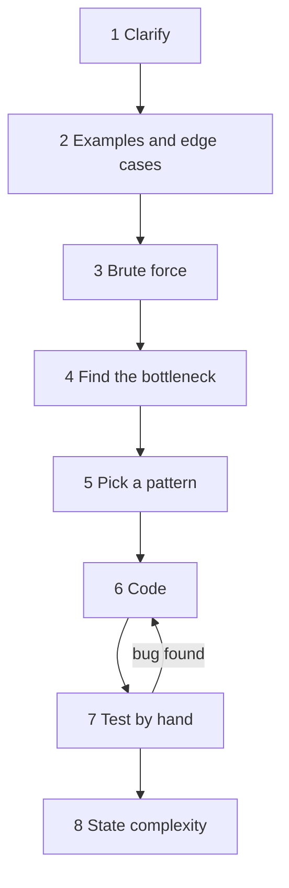

# How to approach a problem

After this you can work through an unfamiliar coding problem with a fixed eight-step method, and explain your thinking out loud the way an interviewer expects.

Before this: [Big O and runtime](../01-analysis/01-big-o-and-runtime.md) and [hash tables](../02-data-structures/04-hash-tables.md).

## The idea

A coding interview is a 30 to 45 minute conversation about a problem you have not seen. The interviewer also watches whether you ask good questions, find a working answer first, improve it for a reason, and catch your own bugs. A candidate who reaches the optimal answer silently often scores lower than one who reasons well out loud.

So the goal is a repeatable routine that works on any problem, including ones that match no pattern you know. The eight steps below are that routine. The rest of this chapter supplies the patterns for step 5.



## Key terms

**Brute force** is the most direct solution, usually trying every possibility. It is correct but often too slow, and it is your starting point and your test oracle.

The **bottleneck** is the part of the brute force that does repeated or wasted work. Removing it is the whole optimization.

An **edge case** is an input at the boundary of what is allowed: empty, one element, duplicates, negatives, the largest size.

A **pattern** is a known way of removing a certain kind of bottleneck, such as a hash map for repeated searches. A **template** is the code skeleton of a pattern.

## How it works

| Step | What you do | What you say |
|---|---|---|
| 1 Clarify | Ask about input type, size, duplicates, sorted or not, what to return when nothing matches | "Can the array be empty? Is there always exactly one answer?" |
| 2 Examples | Work a normal case, then an empty, a single and a tricky case by hand | "For `[3, 3]` with target 6, I expect `[0, 1]`." |
| 3 Brute force | State the simple solution and its cost, even if you will not code it | "Check every pair: $O(n^2)$ time, $O(1)$ space." |
| 4 Bottleneck | Find what the brute force repeats | "For each number I rescan the array for its partner." |
| 5 Pattern | Match the bottleneck to a pattern and say why | "A hash map makes that lookup $O(1)$." |
| 6 Code | Write clean code with good names; talk while you type | "I store value to index as I go." |
| 7 Test | Trace your code on your step 2 examples, not on new ones | "At `i = 1`, `seen` has `{2: 0}`..." |
| 8 Complexity | State time and space, and what the worst case is | "$O(n)$ time, $O(n)$ space for the map." |

The input size in the problem statement tells you which complexity to aim for. This is a rule of thumb, not a guarantee: a typical time limit allows roughly $10^7$ to $10^8$ basic operations.

| Input size $n$ | Complexity that usually fits |
|---|---|
| up to about 20 | $O(2^n)$, so backtracking or subsets |
| up to about 100 | $O(n^3)$ |
| up to a few thousand | $O(n^2)$ |
| around $10^5$ | $O(n \log n)$ |
| $10^6$ or more | $O(n)$ or $O(\log n)$ |

If you are stuck at step 5, go back to step 2 and solve a small example by hand. Notice what you did, not what the code should do; that action is usually the algorithm. If you still see nothing, say the brute force and code it. A working slow answer beats a silent pause.

## Worked examples

<div class="example" markdown>

### Example 1: Two Sum with the method

The problem is [1 Two Sum](https://leetcode.com/problems/two-sum/): given a list of integers and a target, return the indices of two numbers that add to the target.

1. Clarify: assume exactly one answer, and the same index cannot be used twice. Return the two indices in any order.
2. Examples: `[2, 7, 11, 15]` with target 9 gives `[0, 1]`. Edge cases: `[3, 3]` with 6 (duplicates), negatives, and zeros.
3. Brute force: two nested loops over all pairs, $O(n^2)$ time.
4. Bottleneck: for each number `x` we scan the rest of the array looking for `target - x`.
5. Pattern: a dictionary answers "have I seen this value?" in $O(1)$. Going left to right, the partner of the current number must be an earlier one, so we check before we store.

```text
nums = [2, 7, 11, 15], target = 9

brute force: for each x, scan the rest for 9 - x          O(n) per element
hash map:    for each x, ask "is 9 - x in seen?"          O(1) per element

  i=0  x=2  need 7  seen={}        no   -> seen={2: 0}
  i=1  x=7  need 2  seen={2: 0}    yes  -> return [0, 1]
```

6. Code, with the brute force kept for step 7:

```python
def two_sum_brute(nums, target):
    for i in range(len(nums)):
        for j in range(i + 1, len(nums)):
            if nums[i] + nums[j] == target:
                return [i, j]

def two_sum(nums, target):
    seen = {}                       # value -> index where we saw it
    for i, x in enumerate(nums):
        if target - x in seen:      # the partner appeared earlier
            return [seen[target - x], i]
        seen[x] = i
```

7. Test every example from step 2 against both versions:

```python
tests = [
    ([2, 7, 11, 15], 9, [0, 1]),
    ([3, 2, 4], 6, [1, 2]),
    ([3, 3], 6, [0, 1]),                 # duplicates
    ([-1, -2, -3, -4, -5], -8, [2, 4]),  # negatives
    ([0, 4, 3, 0], 0, [0, 3]),           # zeros
]
for nums, target, want in tests:
    assert two_sum_brute(nums, target) == want
    assert two_sum(nums, target) == want
print("all tests passed")
```

```text
all tests passed
```

8. Complexity: one pass with $O(1)$ average lookups gives $O(n)$ time and $O(n)$ space. For $n = 2000$ the brute force makes up to 1,999,000 pair checks; the map makes 2,000 lookups.

Check: the `[3, 3]` case passes because we look up the partner before storing the current number. Storing first would pair a number with itself on inputs such as `[3, 2]` with target 6.

</div>

## Common mistakes

<div class="warning" markdown>

Watch out: coding at once. Without steps 1 and 2 you solve a different problem from the one asked, and the interviewer cannot tell what you were thinking. Spend the first five minutes talking.

Watch out: testing only the example the problem gave you. Those cases pass by design. Run the empty input, one element, duplicates and the largest size.

Watch out: trying to recall the problem's solution instead of reasoning. If you recognize it, still explain the brute force and the bottleneck, or the interviewer cannot tell recall from understanding.

</div>

## Working with AI

<div class="ai" markdown>

Words to use: brute force, bottleneck, edge case, time complexity, space complexity, invariant, constraints.

Prompts to try:

- "Here is my brute force for this problem and its constraints ($n \le 10^5$). Do not give the solution. Ask me one question that points at the bottleneck."
- "Act as an interviewer. I will explain my approach to Two Sum in words. Interrupt with clarifying questions, and list edge cases I missed."

What to check:

- A solution with no stated complexity, or a wrong one. Count the loops, and remember hidden costs such as slicing or `in` on a list.
- Claimed "optimal" answers with no brute-force comparison. Write a brute force and compare the two on random small inputs.
- Edge cases ignored: run empty input and duplicates yourself.

</div>

## Quiz

1\. Why state the brute force before the optimal solution?

<details class="solution" markdown>
<summary>Answer</summary>

It shows you understand the problem, gives a correct fallback, exposes the bottleneck, and gives you a reference to test the fast version against.

</details>

2\. A problem has $n \le 10^5$. Is an $O(n^2)$ solution likely to pass?

<details class="solution" markdown>
<summary>Answer</summary>

No. $10^{10}$ operations is far above roughly $10^8$. Aim for $O(n \log n)$ or $O(n)$.

</details>

3\. This Two Sum returns the wrong answer for `[3, 2]` with target 6. Why?

```python
def two_sum(nums, target):
    seen = {}
    for i, x in enumerate(nums):
        seen[x] = i
        if target - x in seen:
            return [seen[target - x], i]
```

<details class="solution" markdown>
<summary>Answer</summary>

It stores `x` before checking, so 3 finds itself and returns `[0, 0]`. Check first, then store.

</details>

4\. You have no idea which pattern applies. What do you do?

<details class="solution" markdown>
<summary>Answer</summary>

Solve a small example by hand, notice what you did, and state the brute force. Code it if time is short. Say what you are doing throughout.

</details>

## Lab

<div class="lab" markdown>

### Lab: apply the method to Best Time to Buy and Sell Stock

Goal: solve [121 Best Time to Buy and Sell Stock](https://leetcode.com/problems/best-time-to-buy-and-sell-stock/) using all eight steps. Time: about 15 minutes. Runs in: any terminal with Python 3.

1. Statement: `prices[i]` is the price on day `i`. Choose one day to buy and a later day to sell. Return the largest profit, or 0 if none is possible.
2. Write the brute force over all (buy, sell) pairs and its complexity.
3. Name the bottleneck: for each sell day you recheck every earlier buy day. What single number do you need from the past?
4. Write the fast version and assert it on `[7, 1, 5, 3, 6, 4]` (5), `[7, 6, 4, 3, 1]` (0), `[5]` (0) and compare against the brute force on random lists.

<details class="solution" markdown>
<summary>Solution</summary>

```python
import random

def max_profit_brute(prices):
    return max([0] + [prices[j] - prices[i]
                      for i in range(len(prices)) for j in range(i + 1, len(prices))])

def max_profit(prices):
    lowest = float("inf")
    best = 0
    for p in prices:
        lowest = min(lowest, p)        # cheapest buy so far
        best = max(best, p - lowest)   # sell today
    return best

assert max_profit([7, 1, 5, 3, 6, 4]) == 5
assert max_profit([7, 6, 4, 3, 1]) == 0
assert max_profit([5]) == 0
for _ in range(300):
    a = [random.randint(1, 20) for _ in range(random.randint(1, 8))]
    assert max_profit(a) == max_profit_brute(a)
print("ok")
```

The brute force is $O(n^2)$. The fast version keeps only the lowest price so far: $O(n)$ time, $O(1)$ space.

</details>

</div>

## Where this shows up

- Every later lesson in this chapter fills in step 5: [two pointers and sliding window](02-two-pointers-and-sliding-window.md) is next.
- The same routine (clarify, small example, simplest version, then improve) applies when you give an AI a task or debug at work.
