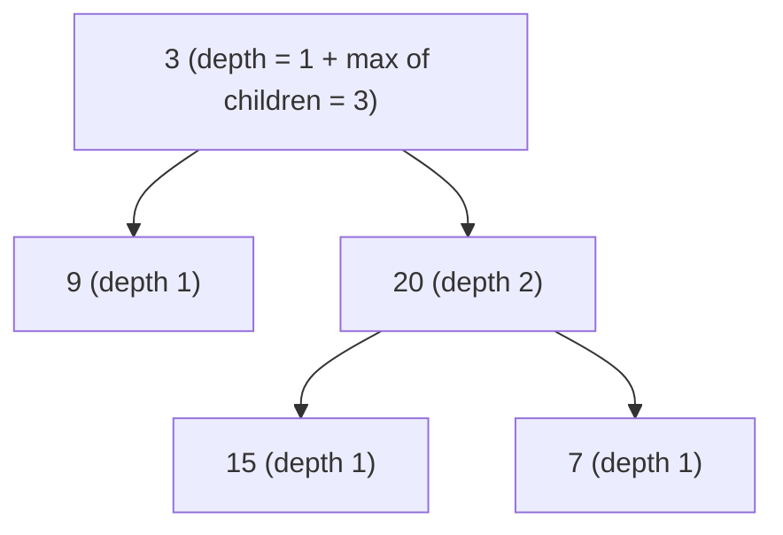
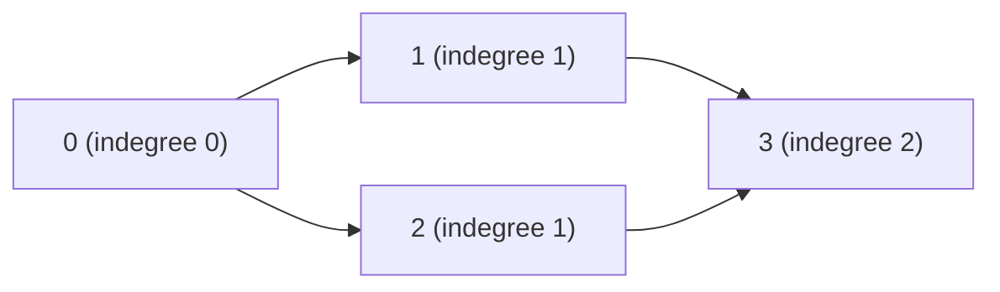

# Tree and graph problems

After this you can solve problems on trees, grids and dependency graphs by choosing between recursion on a tree, a visited-set search, and topological sort.

Before this: [BFS and DFS](../03-algorithms/03-bfs-and-dfs.md), [trees and binary search trees](../02-data-structures/05-trees-and-binary-search-trees.md) and [graphs and representations](../02-data-structures/07-graphs-and-representations.md).

## The idea

Three situations cover most of these problems. A binary tree: the answer for a node comes from the answers for its two children, so you write a short recursive function. A grid of cells where neighbours matter ("connected regions", "shortest path in a maze"): each cell is a node and a search with a visited set explores it. A list of "A must come before B" rules: a directed graph where you ask whether an order exists, answered by topological sort.

| Signal in the problem | Pattern |
|---|---|
| Binary tree, depth, height, path, "for every node" | Recursion: combine the children's answers |
| Level by level, "closest to the root" | BFS with a queue |
| Grid of 0/1, count or measure connected regions | DFS or BFS flood fill with a visited set |
| Fewest steps on an unweighted graph or grid | BFS |
| Prerequisites, "can all tasks finish", ordering | Topological sort (indegrees) or cycle detection |



In the diagram, a leaf has depth 1, and every other node's depth is 1 plus the larger of its children's depths. The answers travel up from the leaves.

## Key terms

A **binary tree** is a structure where each node has at most two children (`left` and `right`). A **leaf** has none. A **cycle** in a directed graph is a path that returns to its start.

A **visited set** records the nodes already explored so a search never repeats one. **Flood fill** is a search from one cell that visits every connected cell.

The **indegree** of a node is the number of edges pointing into it. **Topological sort** orders the nodes so every edge points forward; it exists exactly when the graph has no cycle.

## How it works

For trees, write a function whose job is stated in one sentence ("return the depth of the tree rooted here"), trust it for the children, and handle the empty tree as the base case.

```python
def solve(node):
    if node is None:
        return BASE
    left = solve(node.left)
    right = solve(node.right)
    return combine(node.val, left, right)
```

For grids, loop over every cell, start a search at each unvisited cell of interest, and mark everything it reaches.

```python
for r in range(rows):
    for c in range(cols):
        if interesting(r, c) and (r, c) not in seen:
            count += 1
            explore(r, c)        # marks the whole region as seen
```

For ordering, Kahn's algorithm repeatedly removes a node with indegree 0. If every node gets removed, an order exists; if some remain, they sit on a cycle.

## Worked examples

<div class="example" markdown>

### Example 1: 104 Maximum Depth of Binary Tree

[104 Maximum Depth of Binary Tree](https://leetcode.com/problems/maximum-depth-of-binary-tree/): return the number of nodes on the longest path from the root down to a leaf. The function's job is stated once: "return the depth of the tree rooted at `node`". The empty tree has depth 0, otherwise it is 1 plus the deeper child.

```python
class TreeNode:
    def __init__(self, val=0, left=None, right=None):
        self.val, self.left, self.right = val, left, right

def build(values):                            # level-order list, None = missing
    if not values:
        return None
    nodes = [TreeNode(v) if v is not None else None for v in values]
    kids = iter(nodes[1:])
    for node in nodes:
        if node:
            node.left = next(kids, None)
            node.right = next(kids, None)
    return nodes[0]

def max_depth(root):                          # LeetCode 104
    if root is None:
        return 0
    return 1 + max(max_depth(root.left), max_depth(root.right))

assert max_depth(build([3, 9, 20, None, None, 15, 7])) == 3
assert max_depth(build([1, None, 2])) == 2
assert max_depth(build([])) == 0
assert max_depth(build([1])) == 1
print(max_depth(build([3, 9, 20, None, None, 15, 7])))
```

```text
3
```

Time $O(n)$ since each node is visited once, space $O(h)$ for the call stack, where $h$ is the height ($n$ in the worst case of a chain). Check: the first assert is the tree in the diagram.

</div>

<div class="example" markdown>

### Example 2: 200 Number of Islands

[200 Number of Islands](https://leetcode.com/problems/number-of-islands/): a grid of `"1"` (land) and `"0"` (water); count the groups of land cells joined up, down, left or right. The grid is the graph, and each island is one connected component. We count a new island whenever the scan meets unvisited land, then flood the whole island so it is not counted again.

```text
grid          islands found by the scan

1 1 0 0 0     A A . . .
1 1 0 0 0     A A . . .
0 0 1 0 0     . . B . .
0 0 0 1 1     . . . C C
```

Land cells touch only up, down, left and right, so `B` and `C` are separate islands even though their cells are diagonal neighbours. The answer is 3.

```python
def num_islands(grid):                        # LeetCode 200
    rows, cols = len(grid), len(grid[0]) if grid else 0
    seen = set()
    count = 0
    for r in range(rows):
        for c in range(cols):
            if grid[r][c] == "1" and (r, c) not in seen:
                count += 1
                seen.add((r, c))
                stack = [(r, c)]              # iterative DFS: no recursion limit
                while stack:
                    cr, cc = stack.pop()
                    for dr, dc in ((1, 0), (-1, 0), (0, 1), (0, -1)):
                        nr, nc = cr + dr, cc + dc
                        if (0 <= nr < rows and 0 <= nc < cols
                                and grid[nr][nc] == "1" and (nr, nc) not in seen):
                            seen.add((nr, nc))
                            stack.append((nr, nc))
    return count

assert num_islands(["11000", "11000", "00100", "00011"]) == 3
assert num_islands(["11110", "11010", "11000", "00000"]) == 1
assert num_islands(["101", "010", "101"]) == 5      # diagonals do not join
assert num_islands(["0"]) == 0
assert num_islands([]) == 0
print(num_islands(["11000", "11000", "00100", "00011"]))
```

```text
3
```

Time $O(R \cdot C)$ for $R$ rows and $C$ columns, space $O(R \cdot C)$ for the visited set.

</div>

<div class="example" markdown>

### Example 3: 207 Course Schedule

[207 Course Schedule](https://leetcode.com/problems/course-schedule/): there are `n` courses; each pair `[a, b]` means you must take `b` before `a`. Can you finish all of them? That is "does this directed graph have a cycle?". Kahn's algorithm starts with the courses that have no prerequisites and keeps removing them.



Take 0 first; that lowers the indegree of 1 and 2 to 0; take them; then 3 reaches 0. An order exists: 0, 1, 2, 3. If we add the rule that 3 must come before 0, nothing starts with indegree 0 and no course can be taken.

```python
from collections import deque

def can_finish(num_courses, prerequisites):   # LeetCode 207
    graph = [[] for _ in range(num_courses)]
    indegree = [0] * num_courses
    for course, before in prerequisites:
        graph[before].append(course)
        indegree[course] += 1
    queue = deque(i for i in range(num_courses) if indegree[i] == 0)
    taken = 0
    while queue:
        node = queue.popleft()
        taken += 1
        for nxt in graph[node]:
            indegree[nxt] -= 1
            if indegree[nxt] == 0:
                queue.append(nxt)
    return taken == num_courses               # leftovers lie on a cycle

assert can_finish(2, [[1, 0]])
assert not can_finish(2, [[1, 0], [0, 1]])
assert can_finish(4, [[1, 0], [2, 0], [3, 1], [3, 2]])
assert not can_finish(4, [[1, 0], [2, 0], [3, 1], [3, 2], [0, 3]])
assert can_finish(3, [])
print("207 ok")
```

```text
207 ok
```

Time $O(V + E)$, space $O(V + E)$.

</div>

## Common mistakes

<div class="warning" markdown>

Watch out: forgetting the base case `None` in a tree function. The call on a missing child then crashes with `AttributeError: 'NoneType' object has no attribute 'left'`.

Watch out: marking a grid cell visited only when you pop it. The same cell can be added many times. Mark when you add it.

Watch out: recursion depth. Python's default limit is 1,000 calls, so a chain-shaped tree or a huge grid flood can raise `RecursionError`. Use an explicit stack or queue for large inputs.

</div>

## Working with AI

<div class="ai" markdown>

Words to use: base case, connected component, visited set, flood fill, topological sort, indegree, cycle detection.

Prompts to try:

- "Solve LeetCode 207 in Python with Kahn's algorithm. Explain why `taken == num_courses` means no cycle, and give one test with a cycle."
- "Rewrite my recursive island counter as an iterative DFS so it cannot hit the recursion limit."

What to check:

- A grid solution that modifies the input when the problem might need it again; ask or copy.
- Neighbour checks that allow diagonals, or that read `grid[nr][nc]` before checking bounds (a negative index wraps around silently in Python).
- Edge direction in the dependency graph: `[a, b]` means `b` first. Run a two-course example.

</div>

## Quiz

1\. Which pattern fits "the length of the shortest path from the top-left to the bottom-right cell of a maze"?

<details class="solution" markdown>
<summary>Answer</summary>

BFS on the grid, since every step costs the same.

</details>

2\. What does `max_depth(build([1, 2, 3, 4]))` return?

<details class="solution" markdown>
<summary>Answer</summary>

3. The list builds root 1 with children 2 and 3, and 4 is the left child of 2, so the longest path is 1, 2, 4.

</details>

3\. A Course Schedule solution says `can_finish(2, [[1, 0], [0, 1]])` is true. What bug is likely?

<details class="solution" markdown>
<summary>Answer</summary>

It does not compare `taken` with the number of courses, or it treats the visited set as proof. Both nodes keep indegree 1, so neither is taken, and the right answer is false.

</details>

4\. Why is the island count of `["101", "010", "101"]` equal to 5?

<details class="solution" markdown>
<summary>Answer</summary>

Cells connect only up, down, left and right. The five `1` cells touch only diagonally, so each is its own island.

</details>

## Lab

<div class="lab" markdown>

### Lab: Binary Tree Level Order Traversal

Goal: solve [102 Binary Tree Level Order Traversal](https://leetcode.com/problems/binary-tree-level-order-traversal/) with BFS. Time: about 15 minutes. Runs in: any terminal with Python 3.

1. Return the node values level by level as a list of lists, from the root down. Use the `TreeNode` and `build` from Example 1.
2. Hint: at the start of each round, the queue holds exactly one level, so take `len(queue)` items.
3. Assert on `[3, 9, 20, None, None, 15, 7]` (`[[3], [9, 20], [15, 7]]`) and the empty tree (`[]`).

<details class="solution" markdown>
<summary>Solution</summary>

```python
from collections import deque

def level_order(root):
    if root is None:
        return []
    result, queue = [], deque([root])
    while queue:
        level = []
        for _ in range(len(queue)):       # exactly one level
            node = queue.popleft()
            level.append(node.val)
            for child in (node.left, node.right):
                if child:
                    queue.append(child)
        result.append(level)
    return result

assert level_order(build([3, 9, 20, None, None, 15, 7])) == [[3], [9, 20], [15, 7]]
assert level_order(build([])) == []
print("ok")
```

Time $O(n)$, space $O(w)$ for the widest level $w$.

</details>

</div>

## Where this shows up

- File systems, the DOM and JSON are trees; build tools order tasks with topological sort; package managers detect dependency cycles.
- Next, [backtracking](06-backtracking.md) explores all choices with recursion and undoes each one.
