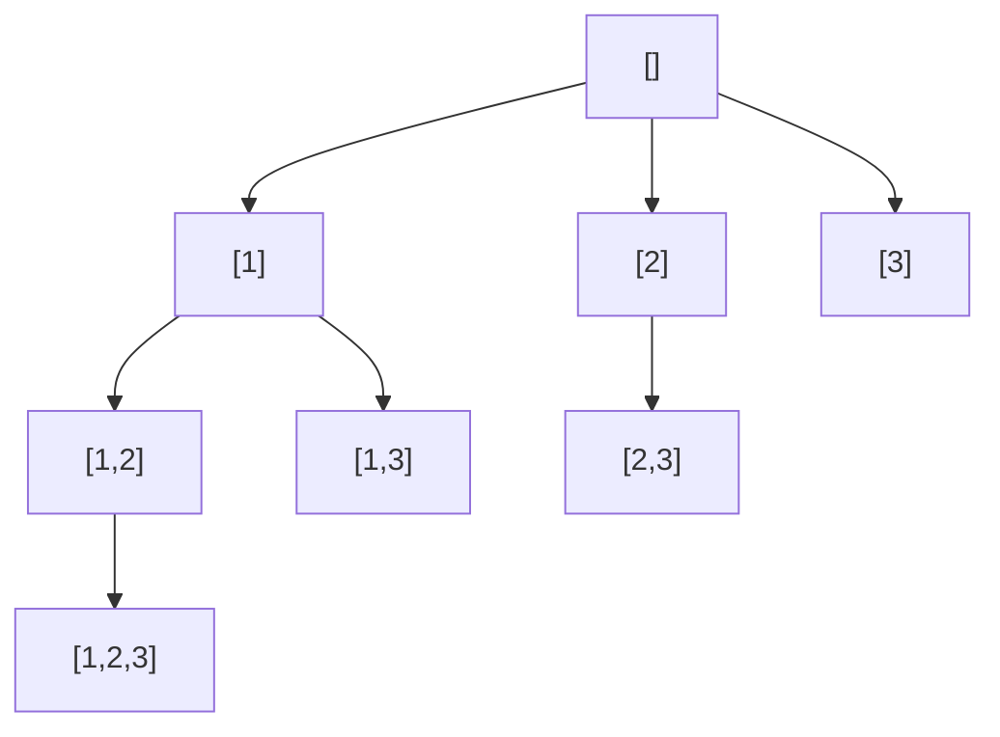

# Backtracking

After this you can generate all subsets, orderings or combinations of a small input by choosing, exploring and undoing, and prune branches that cannot work.

Before this: [Tree and graph problems](05-tree-and-graph-problems.md) and [analysing recursive algorithms](../01-analysis/03-analysing-recursive-algorithms.md).

## The idea

You are filling in a combination lock one digit at a time. At each position you try a digit; if it leads nowhere, you take it back and try the next. Backtracking is a depth-first search through the tree of all partial answers, building the answer one decision at a time and undoing each decision on the way back.

It is exponential by nature, so the signal is a small input: $n$ up to about 20, and a request to list or count all arrangements.

| Signal in the problem | Pattern |
|---|---|
| "Return all subsets / combinations / permutations" | Backtracking |
| $n \le 20$ and "all possible ways" | Backtracking |
| "Generate all valid ..." with a rule to check | Backtracking with pruning |
| Only "how many ways" or "best value", with overlapping parts | [Dynamic programming](07-dp-patterns.md) instead |



In the diagram, this is the recursion tree for subsets of `[1, 2, 3]`. Each node is one subset, and a child adds one later number. All 8 subsets appear as nodes, and the walk goes down a branch, then back up and across.

## Key terms

A **decision** is one choice that extends the partial answer (the `path`). **Backtracking** means undoing the last decision, with `path.pop()`, so the next sibling starts from a clean state.

**Pruning** is skipping a branch as soon as it cannot lead to a valid answer, such as a running total that already exceeds the target.

## How it works

Every backtracking solution fits one skeleton: record the answer if the path is complete, otherwise loop over the choices, make one, recurse, and undo it.

```python
def solve(nums):
    result, path = [], []
    def backtrack(start):
        result.append(path[:])            # or only when path is complete
        for i in range(start, len(nums)):
            path.append(nums[i])          # choose
            backtrack(i + 1)              # explore
            path.pop()                    # undo
    backtrack(0)
    return result
```

Two details matter. First, copy the path (`path[:]`) when you store it, because `path` keeps changing. Second, the loop variable `start` stops you from using earlier items again, which avoids duplicate combinations such as `[1, 2]` and `[2, 1]` when order does not matter. For permutations, order matters, so instead of `start` you track which items are already used.

## Worked examples

<div class="example" markdown>

### Example 1: 78 Subsets

[78 Subsets](https://leetcode.com/problems/subsets/): given distinct integers, return every subset. The skeleton above is this solution: every path is a subset, so we store it at every node.

```python
def subsets(nums):                            # LeetCode 78
    result, path = [], []
    def backtrack(start):
        result.append(path[:])
        for i in range(start, len(nums)):
            path.append(nums[i])
            backtrack(i + 1)
            path.pop()
    backtrack(0)
    return result

assert sorted(subsets([1, 2, 3])) == sorted(
    [[], [1], [2], [3], [1, 2], [1, 3], [2, 3], [1, 2, 3]])
assert subsets([]) == [[]]
assert len(subsets(list(range(10)))) == 2 ** 10
print(subsets([1, 2, 3]))
```

```text
[[], [1], [1, 2], [1, 2, 3], [1, 3], [2], [2, 3], [3]]
```

The output order follows the tree depth-first. There are $2^n$ subsets and each is copied in $O(n)$, so time is $O(n \cdot 2^n)$. Space is $O(n)$ for the recursion, not counting the output.

Check: the length assert confirms $2^{10}$ subsets for 10 distinct numbers, with no duplicates or omissions.

</div>

<div class="example" markdown>

### Example 2: 46 Permutations

[46 Permutations](https://leetcode.com/problems/permutations/): return every ordering of distinct integers. Here each position may take any unused number, so we track a `used` list instead of `start`. Only full-length paths are answers. The indentation below shows the recursion tree for `[1, 2, 3]`, one node per line:

```text
[]
  [1]
    [1, 2]
      [1, 2, 3]
    [1, 3]
      [1, 3, 2]
  [2]
    [2, 1]
      [2, 1, 3]
    [2, 3]
      [2, 3, 1]
  [3]
    [3, 1]
      [3, 1, 2]
    [3, 2]
      [3, 2, 1]
```

```python
def permutations(nums):                       # LeetCode 46
    result, path = [], []
    used = [False] * len(nums)
    def backtrack():
        if len(path) == len(nums):            # complete: record
            result.append(path[:])
            return
        for i, x in enumerate(nums):
            if used[i]:
                continue
            used[i] = True                    # choose
            path.append(x)
            backtrack()                       # explore
            path.pop()                        # undo
            used[i] = False
    backtrack()
    return result

assert permutations([1, 2, 3]) == [[1, 2, 3], [1, 3, 2], [2, 1, 3],
                                   [2, 3, 1], [3, 1, 2], [3, 2, 1]]
assert permutations([1]) == [[1]]
assert len(permutations([1, 2, 3, 4, 5])) == 120
print(len(permutations([1, 2, 3, 4, 5])))
```

```text
120
```

There are $n!$ permutations, so time is $O(n \cdot n!)$ and extra space is $O(n)$.

</div>

<div class="example" markdown>

### Example 3: 39 Combination Sum

[39 Combination Sum](https://leetcode.com/problems/combination-sum/): given distinct positive integers and a target, return every combination that sums to the target; each number may be used any number of times. Two changes from subsets: the recursion passes `i` (not `i + 1`) so a number can repeat, and we prune by stopping when a candidate exceeds the remaining amount (sorting makes `break` correct). For `[2, 3, 6]` and target 7:

```text
[] rem=7
  [2] rem=5
    [2, 2] rem=3
      [2, 2, 2] rem=1        dead end: every candidate is bigger than 1
      [2, 2, 3] rem=0        answer
    [2, 3] rem=2             dead end
  [3] rem=4
    [3, 3] rem=1             dead end
  [6] rem=1                  dead end
```

```python
def combination_sum(candidates, target):      # LeetCode 39
    candidates = sorted(candidates)
    result, path = [], []
    def backtrack(start, remaining):
        if remaining == 0:
            result.append(path[:])
            return
        for i in range(start, len(candidates)):
            if candidates[i] > remaining:     # prune: sorted, so the rest are too big
                break
            path.append(candidates[i])
            backtrack(i, remaining - candidates[i])   # i, not i + 1: reuse allowed
            path.pop()
    backtrack(0, target)
    return result

assert combination_sum([2, 3, 6, 7], 7) == [[2, 2, 3], [7]]
assert combination_sum([2, 3, 5], 8) == [[2, 2, 2, 2], [2, 3, 3], [3, 5]]
assert combination_sum([2], 1) == []
print(combination_sum([2, 3, 6], 7))
```

```text
[[2, 2, 3]]
```

The tree depth is at most `target / min(candidates)`, so the time is exponential; a common bound is $O(N^{T/M})$ for $N$ candidates, target $T$ and smallest candidate $M$. Space is $O(T/M)$ for the path.

</div>

## Common mistakes

<div class="warning" markdown>

Watch out: appending `path` instead of `path[:]`. Every stored answer is the same list object, and at the end they all show the final empty path.

Watch out: forgetting the undo (`pop`, or `used[i] = False`). The next branch then starts with stale choices and results are missing or wrong.

Watch out: using backtracking when the input is large. If $n$ is 1,000, a solution that lists every subset cannot finish. Re-read the constraints.

</div>

## Working with AI

<div class="ai" markdown>

Words to use: backtracking, decision, recursion tree, pruning, partial solution, choose, explore, undo.

Prompts to try:

- "Write LeetCode 39 in Python with backtracking. Sort the candidates and prune. Show the recursion tree for `[2, 3, 6]`, target 7."
- "Explain why my `permutations` returns a list of empty lists, and fix it." (Paste the code.)

What to check:

- Results that are all the same, or all empty: the missing `path[:]` copy.
- Duplicate or missing answers: print the count and compare with $2^n$, $n!$ or a known small case.
- Pruning that skips valid answers. Compare the pruned version with the unpruned one on small inputs.

</div>

## Quiz

1\. How many subsets does a set of 5 distinct numbers have, and how many permutations?

<details class="solution" markdown>
<summary>Answer</summary>

$2^5 = 32$ subsets and $5! = 120$ permutations.

</details>

2\. Why does the loop in Subsets start at `start` and not at 0?

<details class="solution" markdown>
<summary>Answer</summary>

Starting at 0 would let the path revisit earlier numbers, producing `[2, 1]` as well as `[1, 2]` and repeating numbers. `start` makes each subset appear once, in index order.

</details>

3\. What does this print, and why is it a bug?

```python
res, path = [], []
def go(i):
    if i == 2:
        res.append(path)
        return
    for x in (0, 1):
        path.append(x); go(i + 1); path.pop()
go(0)
print(res)
```

<details class="solution" markdown>
<summary>Answer</summary>

It prints `[[], [], [], []]`. The same list `path` was stored four times and is empty at the end. Store `path[:]`.

</details>

4\. In Combination Sum, what changes if each number may be used only once?

<details class="solution" markdown>
<summary>Answer</summary>

Recurse with `i + 1` instead of `i`. (If the input has duplicates, skip equal neighbours at the same level to avoid repeated answers.)

</details>

## Lab

<div class="lab" markdown>

### Lab: Generate Parentheses

Goal: solve [22 Generate Parentheses](https://leetcode.com/problems/generate-parentheses/) with pruning. Time: about 15 minutes. Runs in: any terminal with Python 3.

1. Return all well-formed strings of `n` pairs of round brackets.
2. Build the string one character at a time. You may add `(` while fewer than `n` are used, and `)` only while it would not close more than were opened.
3. Assert for `n = 3` that the result is `["((()))", "(()())", "(())()", "()(())", "()()()"]`, and that there are 14 results for `n = 4`.

<details class="solution" markdown>
<summary>Solution</summary>

```python
def generate_parentheses(n):
    result = []
    def backtrack(path, opened, closed):
        if len(path) == 2 * n:
            result.append("".join(path))
            return
        if opened < n:                        # can still open
            path.append("(")
            backtrack(path, opened + 1, closed)
            path.pop()
        if closed < opened:                   # prune: never close more than opened
            path.append(")")
            backtrack(path, opened, closed + 1)
            path.pop()
    backtrack([], 0, 0)
    return result

assert generate_parentheses(3) == ["((()))", "(()())", "(())()", "()(())", "()()()"]
assert len(generate_parentheses(4)) == 14
assert generate_parentheses(1) == ["()"]
print("ok")
```

The number of results is the Catalan number, about $4^n / n^{3/2}$, and pruning means every branch leads to an answer.

</details>

</div>

## Where this shows up

- Sudoku and N-queens solvers, regular expression engines and constraint solvers all backtrack.
- Next, [DP patterns](07-dp-patterns.md) handles problems where the same subproblems repeat and you only need a count or a best value.
