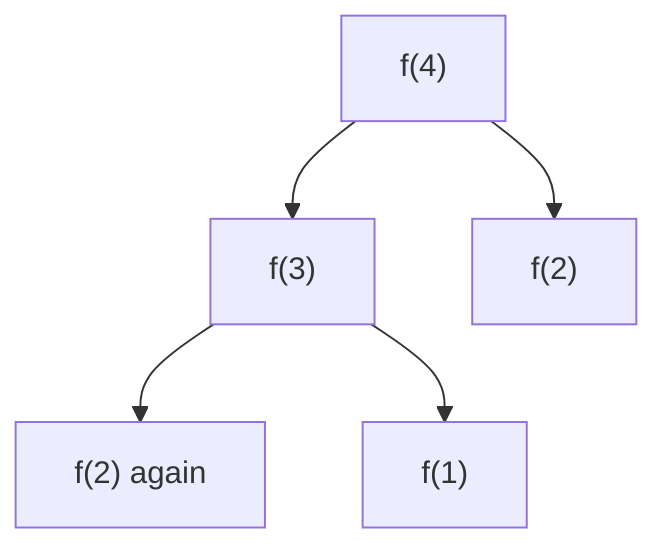

# DP patterns

After this you can tell when a problem is dynamic programming, write its state and recurrence, and solve the three most common shapes: a 1D count, a 1D best value, and a 2D table over two sequences.

Before this: [Dynamic programming](../03-algorithms/06-dynamic-programming.md) and [Backtracking](06-backtracking.md).

## The idea

A staircase has 4 steps and you climb 1 or 2 at a time. To count the ways to reach step 4, you notice that your last move came from step 3 or step 2, so ways(4) = ways(3) + ways(2). The same two smaller questions come up again and again, so a plain recursive solution wastes work. Dynamic programming (DP) answers each smaller question once, stores it, and builds up.



In the diagram, `f(2)` is computed twice. For larger inputs the repeats grow exponentially, and storing each answer removes them.

| Signal in the problem | Pattern |
|---|---|
| "Number of ways to ..." with small steps | 1D DP: ways(i) from earlier ways |
| "Minimum number of ... / maximum value" with choices | 1D DP: best(i) from best of smaller amounts |
| Two strings or two sequences, "longest common ...", "edit ..." | 2D DP: table indexed by position in each |
| Brute force recursion repeats the same arguments | Add memoization first |

## Key terms

The **state** is the smallest set of numbers that describes a subproblem, such as "the amount left". The **recurrence** is the rule that gets a state's answer from smaller states. The **base case** is a state whose answer is known directly.

**Memoization** (top-down) is recursion plus a cache of answers. **Tabulation** (bottom-up) fills a table from the smallest state upward.

## How it works

1. Write the brute-force recursion and the question it answers: "what is the answer for state $s$?".
2. Name the state: what changes between calls? (An index, an amount, a pair of indices.)
3. Write the recurrence and base cases.
4. Cache the results (top-down), or fill a table in an order where each cell's inputs are already filled (bottom-up).
5. Say the cost: number of states times work per state.

```python
from functools import lru_cache

@lru_cache(maxsize=None)
def f(n):                    # ways to climb n steps
    if n <= 2:
        return n
    return f(n - 1) + f(n - 2)
```

## Worked examples

<div class="example" markdown>

### Example 1: 70 Climbing Stairs

[70 Climbing Stairs](https://leetcode.com/problems/climbing-stairs/): the stairs have $n$ steps, and you climb 1 or 2 at a time; count the distinct ways to reach the top. State: the step number. Recurrence: `ways(n) = ways(n-1) + ways(n-2)`. Base: `ways(1) = 1`, `ways(2) = 2`. Each value needs only the previous two, so a bottom-up loop keeps two variables.

```python
def climb_stairs(n):                          # LeetCode 70
    if n <= 2:
        return n
    prev, cur = 1, 2                          # ways(1), ways(2)
    for _ in range(3, n + 1):
        prev, cur = cur, prev + cur
    return cur

assert [climb_stairs(i) for i in range(1, 8)] == [1, 2, 3, 5, 8, 13, 21]
assert climb_stairs(45) == 1836311903
print(climb_stairs(4), climb_stairs(45))
```

```text
5 1836311903
```

Time $O(n)$, space $O(1)$. Check: the values 1, 2, 3, 5, 8, 13, 21 are the Fibonacci numbers, as the recurrence predicts.

</div>

<div class="example" markdown>

### Example 2: 322 Coin Change

[322 Coin Change](https://leetcode.com/problems/coin-change/): given coin values (unlimited supply of each) and an amount, return the fewest coins that make the amount, or -1. Greedy (take the biggest coin) fails on coins `[1, 3, 4]` for 6, where 4+1+1 uses 3 coins and 3+3 uses 2.

State: the amount `a`. Recurrence: `dp[a] = 1 + min(dp[a - c])` over coins `c` that fit. Base: `dp[0] = 0`. For coins `[1, 2, 5]` and amount 11 the table fills left to right:

```text
amount   0  1  2  3  4  5  6  7  8  9  10  11
dp       0  1  1  2  2  1  2  2  3  3   2   3

dp[11] = 1 + min(dp[10], dp[9], dp[6]) = 1 + min(2, 3, 2) = 3      (5 + 5 + 1)
```

```python
def coin_change(coins, amount):               # LeetCode 322
    INF = float("inf")
    dp = [0] + [INF] * amount
    for a in range(1, amount + 1):
        for c in coins:
            if c <= a and dp[a - c] + 1 < dp[a]:
                dp[a] = dp[a - c] + 1
    return dp[amount] if dp[amount] != INF else -1

assert coin_change([1, 2, 5], 11) == 3
assert coin_change([2], 3) == -1
assert coin_change([1], 0) == 0
assert coin_change([1, 3, 4], 6) == 2          # greedy would say 3
print(coin_change([1, 2, 5], 11))
```

```text
3
```

Time $O(\text{amount} \times \text{coins})$, space $O(\text{amount})$.

</div>

<div class="example" markdown>

### Example 3: 1143 Longest Common Subsequence

[1143 Longest Common Subsequence](https://leetcode.com/problems/longest-common-subsequence/): return the length of the longest sequence of characters that appears, in order but not necessarily adjacent, in both strings. With two strings the state is two positions: `dp[i][j]` is the answer for the first `i` characters of `a` and the first `j` of `b`. If the last characters match, they extend the best of the shorter prefixes. If not, drop one character from either string.

```text
dp[i][j] = dp[i-1][j-1] + 1               if a[i-1] == b[j-1]
         = max(dp[i-1][j], dp[i][j-1])    otherwise

a = "abcde", b = "ace"          "" a c e
                     ""          0  0 0 0
                      a          0  1 1 1
                      b          0  1 1 1
                      c          0  1 2 2
                      d          0  1 2 2
                      e          0  1 2 3     answer: "ace", length 3
```

```python
def lcs(a, b):                                # LeetCode 1143
    dp = [[0] * (len(b) + 1) for _ in range(len(a) + 1)]
    for i in range(1, len(a) + 1):
        for j in range(1, len(b) + 1):
            if a[i - 1] == b[j - 1]:
                dp[i][j] = dp[i - 1][j - 1] + 1
            else:
                dp[i][j] = max(dp[i - 1][j], dp[i][j - 1])
    return dp[len(a)][len(b)]

assert lcs("abcde", "ace") == 3
assert lcs("abc", "abc") == 3
assert lcs("abc", "def") == 0
assert lcs("", "abc") == 0
print(lcs("abcde", "ace"))
```

```text
3
```

Time and space $O(|a| \cdot |b|)$. Each cell uses only the row above and the cell to the left, so keeping two rows cuts the space to $O(|b|)$.

</div>

## Common mistakes

<div class="warning" markdown>

Watch out: a greedy rule where DP is needed. Coin Change with `[1, 3, 4]` is the standard counter-example. Test greedy against a brute force before trusting it.

Watch out: wrong base cases. `dp[0]` for Coin Change is 0, not infinity, and the table row and column for the empty string in LCS must exist. Run the empty and amount-0 inputs.

Watch out: filling the table in the wrong order, so a cell reads a value that is still its initial 0. Each cell's inputs must be filled first.

</div>

## Working with AI

<div class="ai" markdown>

Words to use: state, recurrence, base case, memoization, tabulation, overlapping subproblems, optimal substructure.

Prompts to try:

- "For LeetCode 322, state the DP state, recurrence and base case in one line each. Then write the Python and explain why greedy fails on `[1, 3, 4]`."
- "Convert this memoized recursion to a bottom-up table and tell me the time and space cost."

What to check:

- A recurrence that is stated but does not match the code. Trace a tiny case by hand.
- `float("inf")` plus 1 mistakes, or returning infinity instead of -1.
- Mutable default arguments or unbounded caches used for many test cases; use a fresh cache per call.

</div>

## Quiz

1\. Which problem is a DP signal: "list every subset of $n$ items", or "the fewest coins that make an amount"?

<details class="solution" markdown>
<summary>Answer</summary>

The coin problem. It asks for a best value, and the same smaller amounts recur. Listing every subset must output all of them, so it is backtracking.

</details>

2\. What does `coin_change([2, 5], 3)` return, and what happens in `dp[3]`?

<details class="solution" markdown>
<summary>Answer</summary>

`-1`. Coin 2 gives `dp[1] + 1`, which is infinity, and coin 5 does not fit. So `dp[3]` stays infinity.

</details>

3\. A student fills `dp` for LCS but the answer is always 0. What is likely wrong?

<details class="solution" markdown>
<summary>Answer</summary>

The match case probably sets `dp[i][j] = 1` or compares `a[i]` with `b[j]` using the wrong offset instead of `dp[i-1][j-1] + 1` with `a[i-1]`, `b[j-1]`. Check by printing the table for `"abcde"` and `"ace"`.

</details>

4\. Why does recursion for Climbing Stairs without a cache take exponential time?

<details class="solution" markdown>
<summary>Answer</summary>

Each call makes two more, and the same arguments recur (the diagram shows `f(2)` twice). The number of calls roughly doubles per step.

</details>

## Lab

<div class="lab" markdown>

### Lab: House Robber

Goal: solve [198 House Robber](https://leetcode.com/problems/house-robber/) with a 1D recurrence. Time: about 15 minutes. Runs in: any terminal with Python 3.

1. Statement: `money[i]` is the cash in house `i`. You cannot rob two adjacent houses. Return the largest total.
2. State: `best(i)`, the most you can get from the first `i` houses. For house `i` you either skip it or rob it.
3. Write the recurrence and a loop with two variables.
4. Assert on `[1, 2, 3, 1]` (4), `[2, 7, 9, 3, 1]` (12) and `[5]` (5).

<details class="solution" markdown>
<summary>Solution</summary>

```python
def rob(money):
    skip, take = 0, 0                 # best so far without / with the previous house
    for m in money:
        skip, take = max(skip, take), skip + m
    return max(skip, take)

assert rob([1, 2, 3, 1]) == 4
assert rob([2, 7, 9, 3, 1]) == 12
assert rob([5]) == 5
assert rob([]) == 0
print("ok")
```

The recurrence is `best(i) = max(best(i-1), best(i-2) + money[i])`. Time $O(n)$, space $O(1)$.

</details>

</div>

## Where this shows up

- Spell checkers (edit distance), diff tools (longest common subsequence) and route planning use DP.
- Next, [heaps, intervals and top-k](08-heaps-intervals-and-top-k.md) closes the chapter with scheduling and "k best" problems.
