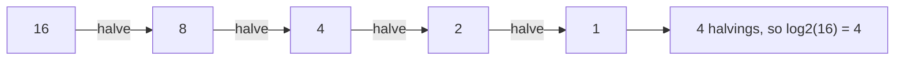
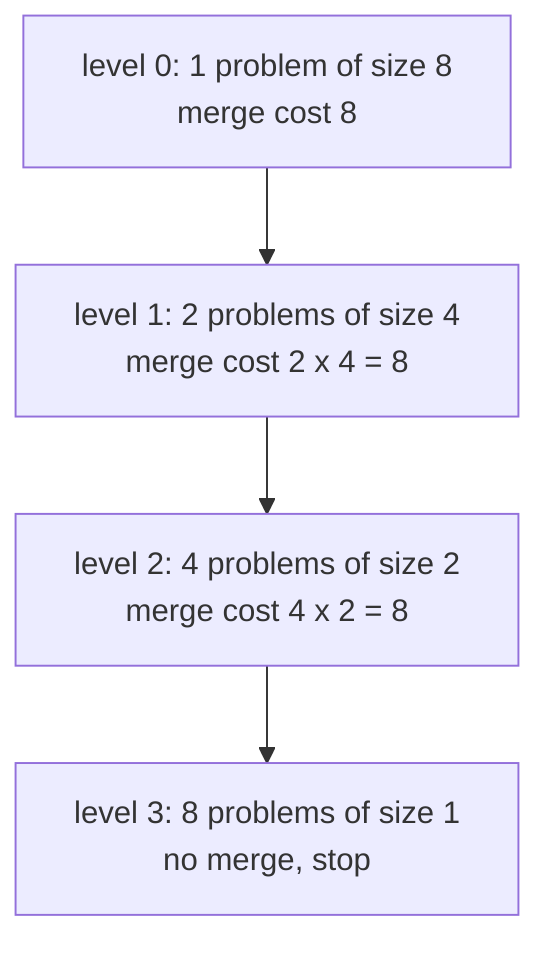

# Sums, logs and recurrences

After this you can turn a loop or a recursive function into a count of steps, use the standard sums and logarithms, and say why binary search needs about 30 steps for a billion items.

Before this: [proof techniques and induction](03-proof-techniques-and-induction.md) and [recursion](../03-programming-fundamentals/02-thinking-like-a-programmer/01-recursion.md).

## The idea

Two loops look similar. The first does a fixed amount of work for each of $n$ items. The second repeats the work for item $i$ once for each earlier item, so later items cost more. For $n = 1000$ the first does 1,000 steps and the second does 499,500. To predict this without running anything, you count steps: a loop turns into a sum, and a recursive function turns into a recurrence.

Logarithms enter whenever something is repeatedly halved. A list of 1,000,000 items can be halved only about 20 times before one item remains, which is why binary search is fast. The diagram halves 16 four times.



## Key terms

A **sum** $\sum_{i=1}^{n} f(i)$ adds $f(i)$ for $i$ from 1 to $n$. A **closed form** is a formula with no summation, such as $n(n+1)/2$.

The **logarithm** $\log_b x$ is the power you raise $b$ to in order to get $x$: $\log_2 8 = 3$ because $2^3 = 8$. In computing, $\log_2 n$ is the number of times you can halve $n$ until it reaches 1, and $\lfloor \log_2 n \rfloor + 1$ is the number of bits in $n$.

A **recurrence** defines the cost $T(n)$ of a problem of size $n$ in terms of the cost of smaller ones, plus a base case. For example $T(n) = T(n/2) + 1$ with $T(1) = 1$ describes binary search: one comparison, then a problem of half the size.

To solve a recurrence, you unroll it until you reach the base case, then add up the work done at each level.

## How it works

The standard sums are enough for most loops. For the first row, $\sum_{i=1}^{n} i = n(n+1)/2$ was proven by induction in the previous lesson.

| Sum | Closed form | Typical source |
|---|---|---|
| $1 + 2 + \dots + n$ | $n(n+1)/2$ | a loop over all pairs `j < i` |
| $1 + 2 + 4 + \dots + 2^k$ | $2^{k+1} - 1$ | doubling, the largest $k$-bit number |
| $1 + \tfrac12 + \tfrac13 + \dots + \tfrac1n$ | about $\ln n + 0.58$ | harmonic sums, some sieves |
| $c + c + \dots + c$ ($n$ times) | $cn$ | a plain loop |

Logarithms of different bases differ only by a constant factor: $\log_2 n = \log_{10} n / \log_{10} 2 \approx 3.32 \log_{10} n$. That is why Big O leaves the base out.

Recurrences are solved level by level. In the diagram, the recurrence $T(n) = 2T(n/2) + n$ is the shape of merge sort: split in two, solve each half, and spend $n$ steps merging. Every level of the recursion does $n$ work in total, and there are $\log_2 n$ levels of splitting, so the total is about $n \log_2 n$.



Here $n = 8$, three levels of merging at 8 each give $24 = 8 \log_2 8$.

| Recurrence | Total cost | Example |
|---|---|---|
| $T(n) = T(n/2) + 1$ | $\log_2 n$ | binary search |
| $T(n) = T(n/2) + n$ | about $2n$ | repeated halving with a scan each time |
| $T(n) = 2T(n/2) + n$ | $n \log_2 n$ | merge sort |
| $T(n) = T(n-1) + n$ | $n(n+1)/2$ | selection-style nested loops |
| $T(n) = 2T(n-1) + 1$ | $2^n - 1$ | trying every subset |

## Worked examples

<div class="example" markdown>

### Example 1: counting the steps of a nested loop

We want the number of times the inner statement runs in this loop.

```python
count = 0
for i in range(n):
    for j in range(i):
        count += 1
```

1. For `i = 0` the inner loop runs 0 times, for `i = 1` once, and so on up to `i = n - 1`, which runs $n - 1$ times.
2. The total is $0 + 1 + \dots + (n-1)$. This is the sum formula with $n - 1$ in place of $n$, so it equals $(n-1)n/2$.
3. This grows like $n^2$, so doubling $n$ about quadruples the time.

<details class="code" markdown>
<summary>In code</summary>

```python
def pairs(n):
    count = 0
    for i in range(n):
        for j in range(i):
            count += 1
    return count

for n in (10, 1000):
    print(n, pairs(n), n * (n - 1) // 2)
```

```text
10 45 45
1000 499500 499500
```

</details>

Check: the counted and formula values match. A common slip is to use $n(n+1)/2$ here; that is the sum up to $n$, but this loop stops at $n - 1$.

</div>

<div class="example" markdown>

### Example 2: how many steps does binary search need?

Binary search keeps a window of candidates and halves it each step. Unroll $T(n) = T(n/2) + 1$: after $k$ steps the window has size $n/2^k$, which reaches 1 when $2^k = n$, so $k = \log_2 n$. Counting the final check, the worst case is $\lfloor \log_2 n \rfloor + 1$ steps, which is the bit length of $n$.

```python
def steps(xs, t):
    lo, hi, count = 0, len(xs), 0
    while lo < hi:
        count += 1
        mid = (lo + hi) // 2
        if xs[mid] < t:
            lo = mid + 1
        elif xs[mid] > t:
            hi = mid
        else:
            break
    return count

for n in (7, 8, 1000, 100_000):
    xs = list(range(0, 2 * n, 2))
    print(n, max(steps(xs, t) for t in range(-1, 2 * n + 1)), n.bit_length())
print((10**9).bit_length())
```

```text
7 3 3
8 4 4
1000 10 10
100000 17 17
30
```

Check: the measured worst case equals `bit_length()` for each size, and a billion items need 30 steps.

</div>

## Common mistakes

<div class="warning" markdown>

Watch out: off-by-one in the bounds of a sum. `range(n)` covers $0$ to $n - 1$, so a loop over `range(n)` adds $n$ terms, and the inner loop in Example 1 stops one short. Test the formula on $n = 3$ before trusting it.

Watch out: treating $\log n$ as if it needs a base. In Big O it does not, but in an exact count it does. Binary search is $\log_2$ because it halves; a tree where every node has 100 children needs about $\log_{100} n$ levels.

Watch out: adding the cost of one level and forgetting the number of levels. For $T(n) = 2T(n/2) + n$, each level costs $n$, but there are about $\log_2 n$ of them. The total is not $n$.

</div>

## Working with AI

<div class="ai" markdown>

Words to use: closed form, recurrence, base case, unrolling, harmonic sum, geometric sum, recursion tree.

Prompts to try:

- "Write the recurrence for this recursive Python function, state the base case, and solve it by unrolling. Then count the calls for n = 1024 and compare."
- "I claim this nested loop runs about n squared over 2 times. Derive the exact count as a sum and check it with a counter for n = 5, 10 and 1000."

What to check:

- A derived formula that is not tested on a small $n$. Run a counter, as in Example 1.
- Confusing the cost of one call with the total. Ask for the cost per level and the number of levels.
- A claim of $O(\log n)$ when the loop also does an $O(n)$ operation inside, such as slicing a list. Count what the body costs.

</div>

## Quiz

1\. A loop runs `for i in range(1, n + 1)` and inside it `for j in range(i)`. For $n = 100$, how many times does the inner body run?

<details class="solution" markdown>
<summary>Answer</summary>

The inner loop runs $1 + 2 + \dots + 100 = 100 \cdot 101 / 2 = 5050$ times. The bounds are now 1 to $n$, so the formula uses $n(n+1)/2$.

</details>

2\. What does this print?

```python
def T(n):
    return 1 if n == 1 else T(n // 2) + 1

print(T(1024), T(1000))
```

<details class="solution" markdown>
<summary>Answer</summary>

`11 10`. Counting the base case, $T(n) = \lfloor \log_2 n \rfloor + 1$, which is 11 for 1024 and 10 for 1000.

</details>

3\. A service does a linear scan of a 1,000,000-item list for each of 1,000 requests. A teammate wants a sorted list and binary search. About how many steps per request before and after?

<details class="solution" markdown>
<summary>Answer</summary>

A scan costs up to 1,000,000 steps, and binary search about 20. That is 50,000 times fewer comparisons per lookup, but sorting costs about $n \log_2 n \approx 20{,}000{,}000$ steps once, which pays back after about 20 requests.

</details>

4\. Why do $\log_2 n$ and $\log_{10} n$ count as the same growth rate in Big O?

<details class="solution" markdown>
<summary>Answer</summary>

They differ by a constant factor, $\log_2 n = (\log_2 10) \cdot \log_{10} n \approx 3.32 \log_{10} n$, and Big O ignores constant factors.

</details>

## Lab

<div class="lab" markdown>

### Lab: check recurrences against code

Goal: compute recurrences directly and compare them with their closed forms. Time: about 15 minutes. Runs in: any terminal with Python 3.

1. Define `T(n) = 0 if n == 1 else 2 * T(n // 2) + n` and print `T(n)` next to `n * log2(n)` for `n = 2, 8, 1024`.
2. Define a naive `fib` that increments a global call counter, and print the number of calls for `fib(20)`.
3. Print the sum of the harmonic series up to $10^6$ next to $\ln(10^6) + 0.5772$.
4. Predict the call count for `fib(20)` before you run it. Is it closer to 20, 400 or 20,000?

Expected result: the first pairs are equal, the harmonic sum matches to about six digits, and `fib(20)` makes 21,891 calls.

<details class="solution" markdown>
<summary>Solution</summary>

```python
import math

def T(n):
    return 0 if n == 1 else 2 * T(n // 2) + n

print([(n, T(n), n * int(math.log2(n))) for n in (2, 8, 1024)])

calls = 0
def fib(n):
    global calls
    calls += 1
    return n if n < 2 else fib(n - 1) + fib(n - 2)

fib(20)
print(calls)
print(sum(1 / i for i in range(1, 10**6 + 1)), math.log(10**6) + 0.5772156649)
```

```text
[(2, 2, 2), (8, 24, 24), (1024, 10240, 10240)]
21891
14.392726722865724 14.392726222864274
```

The call count is close to 20,000 because $T(n) = T(n-1) + T(n-2) + 1$ grows exponentially, by a factor of about 1.6 per step. The count is a reason to remember results, as in [dynamic programming](../06-data-structures-and-algorithms/03-algorithms/06-dynamic-programming.md).

</details>

</div>

## Where this shows up

- Reading and writing Big O, in [Big O and runtime](../06-data-structures-and-algorithms/01-analysis/01-big-o-and-runtime.md) and [analysing recursive algorithms](../06-data-structures-and-algorithms/01-analysis/03-analysing-recursive-algorithms.md).
- [Binary search](../06-data-structures-and-algorithms/03-algorithms/01-binary-search.md) and the cost of sorting, in [sorting](../06-data-structures-and-algorithms/03-algorithms/02-sorting.md).
- More depth (optional): [recurrences](https://faiyaz-svg.github.io/MathFromTheGroundUp/06-cs-math/04-sums-recurrences-and-algorithms/02-recurrences/) in the sibling math book.
