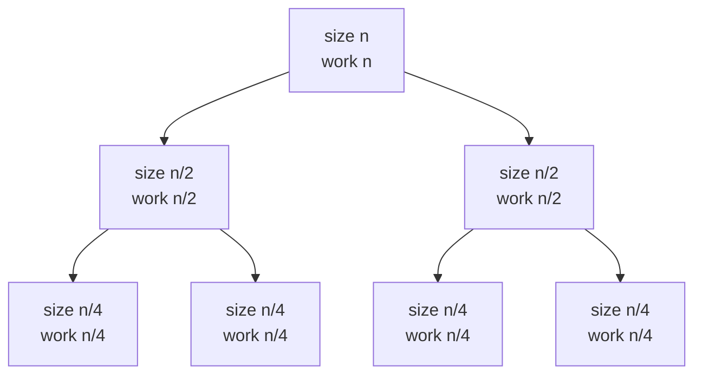
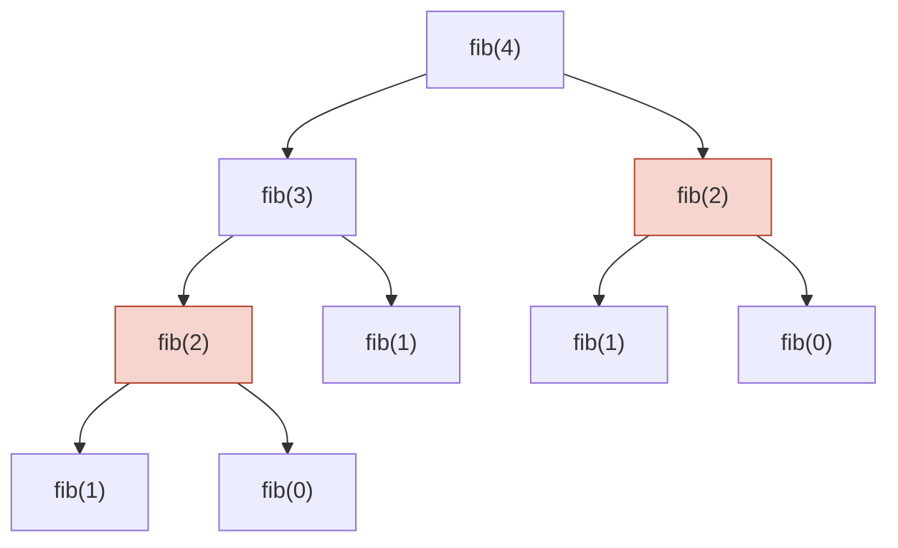

# Analysing recursive algorithms

After this you can write the recurrence for a recursive function, solve the common ones, and spot when memoization turns exponential time into linear.

Before this: [Space and amortized analysis](02-space-and-amortized-analysis.md) and [recursion](../../03-programming-fundamentals/02-thinking-like-a-programmer/01-recursion.md).

## The idea

A loop's cost is a sum you can read off the code. A recursive function's cost is defined in terms of itself: the time for input $n$ includes the time for a smaller input. Binary search checks one item, then searches half the list, so its cost $T(n)$ is $T(n/2)$ plus one step.

Some recursions stay cheap and some explode. The naive Fibonacci function makes 2,692,537 calls to compute `fib(30)`. With one change (remembering answers) it makes 31. To tell which kind you have, write the cost as an equation and solve it.



In the diagram (a recursion tree for merge sort), every level does a total of $n$ work, and halving $n$ gives $\log_2 n$ levels, so the total is about $n \log n$.

## Key terms

A **recurrence** is an equation that gives the cost $T(n)$ in terms of the cost on smaller inputs. For a function that makes $a$ recursive calls on inputs of size $n/b$ and does $f(n)$ other work, it is $T(n) = a\,T(n/b) + f(n)$. The **base case** gives $T$ for the smallest input, usually $O(1)$.

A **recursion tree** draws every call as a node, with its input size and its own work written on it. The total cost is the sum over all nodes.

**Overlapping subproblems** means the same call, with the same arguments, appears many times in the tree. **Memoization** stores each result the first time it is computed and returns the stored result on later calls.

## How it works

Write the recurrence in three questions: how many recursive calls, how much smaller is each input, and how much work happens outside the calls. Then solve it by looking it up, or by summing the tree.

| Recurrence | Example | Solution |
|---|---|---|
| $T(n) = T(n/2) + 1$ | binary search | $O(\log n)$ |
| $T(n) = T(n-1) + 1$ | recursive sum by index, factorial | $O(n)$ |
| $T(n) = 2T(n/2) + n$ | merge sort | $O(n \log n)$ |
| $T(n) = 2T(n/2) + 1$ | visiting every node of a balanced tree | $O(n)$ |
| $T(n) = T(n-1) + n$ | quicksort with the worst pivot | $O(n^2)$ |
| $T(n) = 2T(n-1) + 1$ | Towers of Hanoi | $O(2^n)$ |

When the input shrinks by subtracting, unroll the recurrence. $T(n) = T(n-1) + 1$ adds one step per level for $n$ levels. $T(n) = 2T(n-1) + 1$ doubles the number of calls at each level: $1 + 2 + 4 + \dots + 2^{n-1} = 2^n - 1$ calls.

When the input shrinks by dividing, use the master theorem, here in the form from Dasgupta, Papadimitriou and Vazirani's *Algorithms*. For $T(n) = a\,T(n/b) + \Theta(n^d)$ with $a \ge 1$, $b > 1$ and $d \ge 0$, compare $d$ with $\log_b a$:

| Case | Meaning | Result |
|---|---|---|
| $d < \log_b a$ | the many small calls at the bottom dominate | $\Theta(n^{\log_b a})$ |
| $d = \log_b a$ | every level costs the same | $\Theta(n^d \log n)$ |
| $d > \log_b a$ | the work at the top dominates | $\Theta(n^d)$ |

The theorem needs equal-size pieces and a subproblem size that divides: it does not cover $T(n-1)$ forms or uneven splits. Results for common cases:

| Recurrence | $a, b, d$ | $\log_b a$ vs $d$ | Result |
|---|---|---|---|
| $T(n/2) + 1$ | 1, 2, 0 | $0 = 0$ | $\Theta(\log n)$ |
| $2T(n/2) + n$ | 2, 2, 1 | $1 = 1$ | $\Theta(n \log n)$ |
| $2T(n/2) + 1$ | 2, 2, 0 | $1 > 0$ | $\Theta(n)$ |
| $T(n/2) + n$ | 1, 2, 1 | $0 < 1$ | $\Theta(n)$ |
| $4T(n/2) + n$ | 4, 2, 1 | $2 > 1$ | $\Theta(n^2)$ |
| $3T(n/2) + n$ (Karatsuba multiplication) | 3, 2, 1 | $1.585 > 1$ | $\Theta(n^{1.585})$ |

Memoization changes the count. A memoized function runs its body once per distinct set of arguments, so the cost is (number of distinct subproblems) times (work per subproblem). It helps only when subproblems repeat. Merge sort's subproblems are all different, so caching would only waste memory.



In the diagram, `fib(2)` appears twice (shaded), and each copy rebuilds the same subtree. With memoization the second `fib(2)` is looked up instead. For `fib(n)` this changes the cost from exponential to $O(n)$. In Python, `@functools.cache` does it. A memoized recursion still uses $O(n)$ stack, and the cache itself takes memory, which is the trade from the last lesson. Systematic use of this idea is [dynamic programming](../03-algorithms/06-dynamic-programming.md).

## Worked examples

<div class="example" markdown>

### Example 1: counting the calls of naive and memoized Fibonacci

We want the number of calls of `fib(n)` with and without memoization.

1. The naive function calls itself twice, on $n-1$ and $n-2$, with $O(1)$ work around the calls. The call count $C$ satisfies $C(n) = C(n-1) + C(n-2) + 1$, which grows like Fibonacci numbers: by a factor of about 1.618 (the golden ratio) per step. The cost is $O(\varphi^n)$, exponential.
2. The memoized function runs its body once for each of $0, 1, \dots, n$, which is $n + 1$ times.
3. Count both in code.

<details class="code" markdown>
<summary>In code</summary>

```python
from functools import cache

calls = 0

def fib(n):
    global calls
    calls += 1
    return n if n < 2 else fib(n - 1) + fib(n - 2)

@cache
def fib_memo(n):
    global calls
    calls += 1
    return n if n < 2 else fib_memo(n - 1) + fib_memo(n - 2)

for n in [10, 20, 30]:
    calls = 0
    fib(n)
    naive = calls
    fib_memo.cache_clear()
    calls = 0
    fib_memo(n)
    print(f"n={n}  naive calls {naive:>9,}  memoized body runs {calls}")
```

```text
n=10  naive calls       177  memoized body runs 11
n=20  naive calls    21,891  memoized body runs 21
n=30  naive calls 2,692,537  memoized body runs 31
```

</details>

Check: from `n=20` to `n=30`, the naive count grew by $2{,}692{,}537 / 21{,}891 \approx 123$, and $1.618^{10} \approx 123$. The memoized count is exactly $n + 1$. Adding 10 to $n$ multiplies the naive cost by 123 and adds 10 to the memoized cost.

</div>

<div class="example" markdown>

### Example 2: using the table

We want the cost of a function with $T(n) = 4T(n/2) + n$.

1. Read off $a = 4$, $b = 2$ and $d = 1$ (the extra work is $n^1$).
2. Compute $\log_2 4 = 2$, which is greater than $d = 1$, so the bottom of the tree dominates.
3. The result is $\Theta(n^{\log_2 4}) = \Theta(n^2)$.

Check: compute $T(2^k)$ from the recurrence with $T(1) = 1$ and divide by $n^2$. The ratio settles at a constant ($T(2^{20})/2^{40} \approx 2$), as $\Theta(n^2)$ predicts.

</div>

## Common mistakes

<div class="warning" markdown>

Watch out: forgetting the work outside the calls. Merge sort's merge step is $n$ work per level; leaving it out gives $T(n) = 2T(n/2)$, which solves to $O(n)$ and understates merge sort by a factor of $\log n$.

Watch out: using the master theorem on $T(n-1)$ forms or on uneven splits. It needs equal pieces of size $n/b$. Unroll the recurrence instead.

Watch out: adding `@cache` to everything. It helps only with overlapping subproblems, it needs hashable arguments (a list argument raises `TypeError`), and it keeps every result in memory.

</div>

## Working with AI

<div class="ai" markdown>

Words to use: recurrence, recursion tree, base case, master theorem, overlapping subproblems, memoization.

Prompts to try:

- "Write the recurrence for this recursive function (pasted), state $a$, $b$ and $d$, and solve it with the master theorem. Say if the theorem does not apply."
- "This recursive function takes minutes for `n = 45`. Find the repeated subproblems, add memoization with `functools.cache`, and give the new time and space complexity, including recursion depth."

What to check:

- A recurrence that leaves out the work done outside the recursive calls, or counts the calls wrongly. Draw the tree for $n = 4$ and count.
- A wrong $a$, $b$ or $d$ fed into the master theorem, or the theorem applied where the input shrinks by subtraction.
- A memoized function claimed to be $O(n)$ with no mention of the $O(n)$ stack depth and the Python recursion limit.
- Memoization added to a function with side effects, or with an unhashable argument. Run it on small inputs and compare with the original.

</div>

## Quiz

1\. Write the recurrence for merge sort and say what it solves to. Where does the $n$ come from?

<details class="solution" markdown>
<summary>Answer</summary>

$T(n) = 2T(n/2) + n$, which is $\Theta(n \log n)$. The two calls sort each half, and the $n$ is the merge step that combines them. Each tree level does $n$ work and there are $\log_2 n$ levels.

</details>

2\. How many calls does naive `fib(4)` make, counting the first call?

<details class="solution" markdown>
<summary>Answer</summary>

9. The tree in the diagram has `fib(4)`, `fib(3)`, two `fib(2)`, three `fib(1)` and two `fib(0)`.

</details>

3\. Solve $T(n) = 4T(n/2) + n^2$ with the master theorem.

<details class="solution" markdown>
<summary>Answer</summary>

$a = 4$, $b = 2$, $d = 2$, and $\log_2 4 = 2 = d$, so every level costs the same and $T(n) = \Theta(n^2 \log n)$.

</details>

4\. This function takes about 2.5 seconds for `n = 25`. What is its complexity, roughly how long will `n = 30` take, and what is the fix?

```python
def count(n):
    return 1 if n == 0 else count(n - 1) + count(n - 1)
```

<details class="solution" markdown>
<summary>Answer</summary>

$T(n) = 2T(n-1) + 1$, so $O(2^n)$. Five more steps of $n$ multiply the time by $2^5 = 32$, so `n = 30` takes about 80 seconds. Both calls compute the same value. Compute it once with `c = count(n - 1)` and return `c + c`, which makes it $T(n) = T(n-1) + 1$, or $O(n)$.

</details>

## Lab

<div class="lab" markdown>

### Lab: time Fibonacci and fit the growth

Goal: measure the cost of naive and memoized `fib` as $n$ grows, and compare the growth rate with the golden ratio. Time: about 15 minutes. Runs in: any terminal with Python 3.

1. Save the script below as `fibtime.py` and run it. For each `n` it times the naive and the memoized function, and prints the naive time's growth factor per step of $n$.
2. Check that the factor is near 1.6, and that the memoized column does not grow.
3. Predict the naive time for `n = 40` by multiplying the time at `n = 32` by $1.618^8$. Write it down.
4. Optional, about 20 seconds of waiting: time `fib(40)` once and compare it with your prediction.
5. Cleanup: delete `fibtime.py` if you do not need it.

```python
import time
from functools import cache


def fib(n):
    return n if n < 2 else fib(n - 1) + fib(n - 2)


@cache
def fib_memo(n):
    return n if n < 2 else fib_memo(n - 1) + fib_memo(n - 2)


def best_time(f, n, repeats=3):
    best = float("inf")
    for _ in range(repeats):
        fib_memo.cache_clear()
        start = time.perf_counter()
        f(n)
        best = min(best, time.perf_counter() - start)
    return best


previous = None
print("  n   naive (s)   factor per step   memoized (s)")
for n in range(22, 33, 2):
    naive = best_time(fib, n)
    memo = best_time(fib_memo, n)
    factor = "" if previous is None else f"{(naive / previous) ** 0.5:.2f}"
    print(f"{n:>3}  {naive:>9.4f}   {factor:>15}   {memo:>11.6f}")
    previous = naive
```

Expected result: the naive time is multiplied by about 1.6 for each step of $n$, and the memoized time stays in the microseconds. This output is from the author's Windows 11 PC (Python 3.14); your numbers will differ.

```text
  n   naive (s)   factor per step   memoized (s)
 22      0.0025                      0.000004
 24      0.0064              1.61      0.000005
 26      0.0168              1.62      0.000005
 28      0.0439              1.62      0.000005
 30      0.1073              1.56      0.000006
 32      0.2762              1.60      0.000006
```

<details class="solution" markdown>
<summary>Solution</summary>

The factor is the square root of the ratio between rows, because each row is two steps of $n$ apart. It sits near 1.618 because the call count follows Fibonacci numbers (Example 1). The prediction for `n = 40` is $0.276 \times 1.618^8 \approx 13$ s. On the author's PC a run took 19 s, so the prediction was within a factor of 1.5. A timing at one size carries noise, so the estimate is good for the shape (exponential), not for the exact seconds.

The memoized time is a few microseconds and nearly flat, because it does $n + 1$ cheap steps. The `cache_clear()` call inside the timing loop is what keeps the comparison fair: without it, every run after the first would only read the cache.

</details>

</div>

## Where this shows up

- [Binary search](../03-algorithms/01-binary-search.md) ($T(n/2) + 1$), [sorting](../03-algorithms/02-sorting.md) ($2T(n/2) + n$) and tree traversals<!-- link: ../02-data-structures/05-trees-and-binary-search-trees.md --> ($2T(n/2) + 1$).
- [Dynamic programming](../03-algorithms/06-dynamic-programming.md) and the interview patterns built on it<!-- link: ../04-leetcode-patterns/07-dp-patterns.md -->, which are memoization organized on purpose.
- [Sums, logs and recurrences](../../05-discrete-math-for-cs/08-sums-logs-and-recurrences.md) gives the maths behind the level sums used here.
