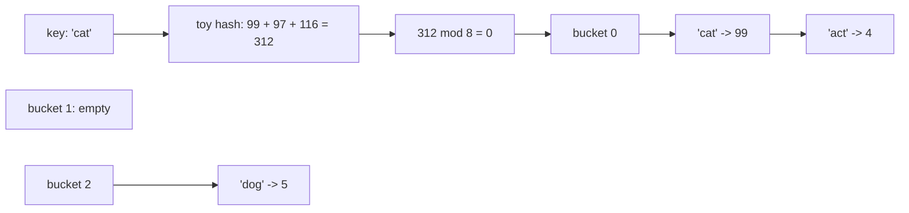

# Hash tables

After this you can explain how a dict or set finds a key in constant time on average, what a collision is, and why keys must be hashable.

Before this: [arrays and dynamic arrays](01-arrays-and-dynamic-arrays.md), [linked lists](02-linked-lists.md) and [lists, dicts, sets and tuples](../../03-programming-fundamentals/01-python-basics/04-lists-dicts-sets-and-tuples.md).

## The idea

A coat check hands you a numbered ticket, and your coat goes on the rack at that number. To get it back, you hand over the ticket and the attendant walks straight to the spot. Nobody searches the whole rack.

A hash table does this with arbitrary keys. A **hash function** turns the key into a number, and that number, reduced to a valid position, is the slot where the value lives. Looking up a key means computing its hash and going directly to the slot, so the cost does not grow with the number of items.



## Key terms

A **hash table** is a structure that maps keys to values using a hash function and an array of **buckets** (slots). A **hash function** maps a key to an integer, and equal keys must always give equal hashes.

A **collision** happens when two different keys land in the same bucket. In the diagram, `'cat'` and `'act'` collide, because they contain the same letters and this toy hash adds the letter codes.

**Chaining** handles collisions by keeping a short list in each bucket. **Open addressing** handles them by probing for another free slot in the array itself.

The **load factor** is the number of entries divided by the number of buckets. When it passes a threshold, the table **resizes**: it allocates more buckets and re-inserts every key.

A value is **hashable** if it has a hash that never changes during its lifetime. In Python, immutable values such as numbers, strings and tuples of hashable values are hashable; lists, dicts and sets are not.

## How it works

1. Compute `hash(key)` and take it modulo the number of buckets to get a bucket index.
2. Look in that bucket. With chaining, compare the key with each entry in the short list (using equality, since two keys may share a hash).
3. Return, overwrite or add the entry.
4. After an insert, if the load factor is over the limit, double the buckets and re-insert everything.

With a good hash function and a bounded load factor, each bucket holds a handful of entries, so lookup, insert and delete are $O(1)$ on average. The worst case is $O(n)$, when many keys land in one bucket. That is rare with a good hash, but it is why the guarantee says "on average".

| Operation | Average | Worst case |
|---|---|---|
| Lookup by key | $O(1)$ | $O(n)$ |
| Insert or update | $O(1)$ amortized | $O(n)$ |
| Delete | $O(1)$ | $O(n)$ |
| Iterate all entries | $O(n)$ | $O(n)$ |

Resizing makes one insert $O(n)$, but like an array's growth it happens rarely, so insert is $O(1)$ amortized.

Python's `dict` and `set` are hash tables. CPython uses open addressing, not chaining, but the ideas are the same, and since Python 3.7 a `dict` also keeps insertion order. `collections.Counter` and `defaultdict` build on `dict`. In JavaScript, `Map` and `Set` are the equivalents; a plain object works as a string-keyed map but has inherited keys and ordering quirks, so prefer `Map`.

A hash table has no useful order for keys, and it cannot answer "the smallest key" or "all keys between 10 and 20" without scanning everything. For that, see [trees](05-trees-and-binary-search-trees.md).

## Worked examples

<div class="example" markdown>

### Example 1: list against set membership, and why lists cannot be keys

We want to check whether a value is in a collection, 2,000 times, and then try a list as a key.

1. A `list` check (`x in items`) compares against each element in turn, so it is $O(n)$. A `set` check computes one hash and looks in one bucket, so it is $O(1)$ on average.
2. Build both from 20,000 integers and look up the last value, which is the worst case for the list.
3. For the key, Python needs a hash that never changes. A list can change after insertion, so its hash could change and the entry would be lost. Python refuses; a tuple is fine.

<details class="code" markdown>
<summary>In code</summary>

```python
import timeit
n = 20_000
items = list(range(n))
as_set = set(items)
t_list = timeit.timeit("n - 1 in items", globals=globals(), number=2_000)
t_set = timeit.timeit("n - 1 in as_set", globals=globals(), number=2_000)
print(f"list membership: {t_list:.4f} s")
print(f"set membership:  {t_set:.6f} s")

d = {}
try:
    d[[1, 2]] = "x"
except TypeError as e:
    print(e)
d[(1, 2)] = "ok"
print(d)
```

```text
list membership: 0.2529 s
set membership:  0.000079 s
cannot use 'list' as a dict key (unhashable type: 'list')
{(1, 2): 'ok'}
```

</details>

Check: the set is over 3,000 times faster here, and the gap grows with $n$. A common pattern is to turn a list into a set before a loop that repeatedly asks "have I seen this?".

</div>

## Common mistakes

<div class="warning" markdown>

Watch out: using a mutable object as a key, or changing an object after using it as a key. Use tuples, strings or numbers.

Watch out: relying on `set` iteration order, or on the order of `hash()` for strings. String hashes change between runs on purpose (hash randomization), so a program that prints a `set` of strings can print in different orders on different days. Sort before printing.

Watch out: assuming the average case is the guarantee. A hostile input can make many keys collide. Web servers that parse attacker-supplied keys depend on randomized hashes for this reason.

</div>

## Working with AI

<div class="ai" markdown>

Words to use: hash function, collision, chaining, open addressing, load factor, hashable, amortized $O(1)$.

Prompts to try:

- "I check `if item in some_list` inside a loop over 500,000 items. Rewrite it to use a set, state the Big O before and after, and say what I lose (memory, order)."
- "Explain how CPython's dict handles collisions and resizing. Mark which statements come from the CPython documentation or source and which are general hash table theory."

What to check:

- Code that stores lists, dicts or sets inside a set or as dict keys. Run it: it raises `TypeError`. Convert to tuples or `frozenset`.
- A hand-written hash table that compares only hashes. Two different keys can share a hash, so the code must also compare the keys.
- Claims that lookup is "always $O(1)$". The correct statement is $O(1)$ on average with a good hash and a bounded load factor.

</div>

## Quiz

1\. What is a collision, and does it make a hash table incorrect?

<details class="solution" markdown>
<summary>Answer</summary>

A collision is two different keys mapping to the same bucket. It does not make the table wrong, because the table compares keys within a bucket. It only slows the lookup if buckets get long.

</details>

2\. Why must a hash table compare keys instead of relying on hashes alone?

<details class="solution" markdown>
<summary>Answer</summary>

Different keys can have the same hash, so a matching hash does not prove a matching key. The table checks equality to tell the keys apart.

</details>

3\. You have a list of 1 million user IDs and need to check 1 million incoming IDs against it. What do you change?

<details class="solution" markdown>
<summary>Answer</summary>

Build a `set` of the user IDs once, which is $O(n)$, then test each incoming ID in $O(1)$ on average. Total work is about $O(n)$, against $O(n^2)$ with list membership checks.

</details>

4\. Why can't you use a list as a dict key, but you can use a tuple of numbers?

<details class="solution" markdown>
<summary>Answer</summary>

A key's hash must not change while it is in the table. A list is mutable, so its contents and hash could change. A tuple of hashable values cannot change, so its hash is stable.

</details>

## Lab

<div class="lab" markdown>

### Lab: a hash table with chaining

Goal: build `put` and `get` with chaining and automatic resizing, and look at the buckets. Time: about 20 minutes. Runs in: any terminal with Python 3.

1. Write a `toy_hash(key)` that returns the sum of `ord(ch)` over the string, so anagrams collide on purpose. (Python's own `hash` for strings is randomized, which would change your output on every run.)
2. Write a `HashTable` with 4 empty buckets (each a list of `[key, value]` pairs) and a `size` counter.
3. Write `put(key, value)`: find the bucket, overwrite the value if the key exists, otherwise append a pair. After adding, if `size > 0.75 * number of buckets`, call `_resize()`, which doubles the buckets and re-inserts every pair.
4. Write `get(key, default=None)`.
5. Insert `listen`, `silent`, `enlist`, `cat`, `act`, `dog`, then `put("cat", 99)`. Print the size and bucket count, a few lookups, and the keys in each bucket.

Expected result: `cat` is overwritten, not duplicated, so the size is 6; the table resized from 4 to 8 buckets; the anagrams share buckets.

```text
6 8
1 99 missing
0 ['cat', 'act']
1 []
2 ['dog']
3 []
4 []
5 []
6 []
7 ['listen', 'silent', 'enlist']
```

<details class="solution" markdown>
<summary>Solution</summary>

```python
def toy_hash(key):
    return sum(ord(ch) for ch in key)   # anagrams collide on purpose

class HashTable:
    def __init__(self, buckets=4):
        self.buckets = [[] for _ in range(buckets)]
        self.size = 0

    def _bucket(self, key):
        return self.buckets[toy_hash(key) % len(self.buckets)]

    def put(self, key, value):
        bucket = self._bucket(key)
        for pair in bucket:
            if pair[0] == key:
                pair[1] = value        # key exists: overwrite
                return
        bucket.append([key, value])
        self.size += 1
        if self.size > 0.75 * len(self.buckets):
            self._resize()

    def get(self, key, default=None):
        for k, v in self._bucket(key):
            if k == key:
                return v
        return default

    def _resize(self):
        pairs = [pair for bucket in self.buckets for pair in bucket]
        self.buckets = [[] for _ in range(2 * len(self.buckets))]
        for k, v in pairs:
            self._bucket(k).append([k, v])

t = HashTable()
for i, word in enumerate(["listen", "silent", "enlist", "cat", "act", "dog"]):
    t.put(word, i)
t.put("cat", 99)
print(t.size, len(t.buckets))
print(t.get("silent"), t.get("cat"), t.get("bird", "missing"))
for i, bucket in enumerate(t.buckets):
    print(i, [k for k, v in bucket])
```

</details>

</div>

## Where this shows up

- The [hashing and prefix sums](../04-leetcode-patterns/03-hashing-and-prefix-sums.md) pattern is "put it in a dict" for most interview problems.
- Caches, database hash [indexes and Redis](../../10-databases-sql-and-postgres/05-databases-in-apps/04-redis-and-caching.md) are hash tables at larger scale.
