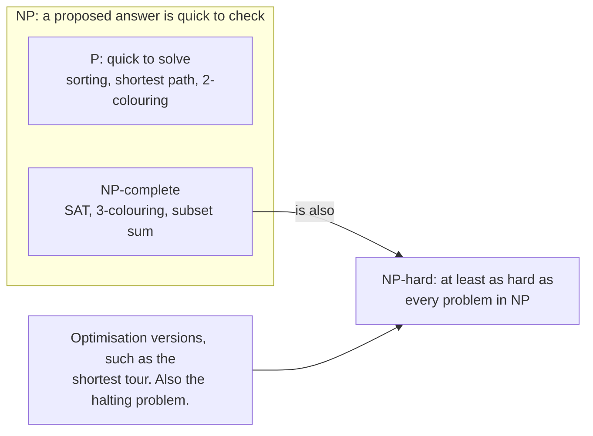
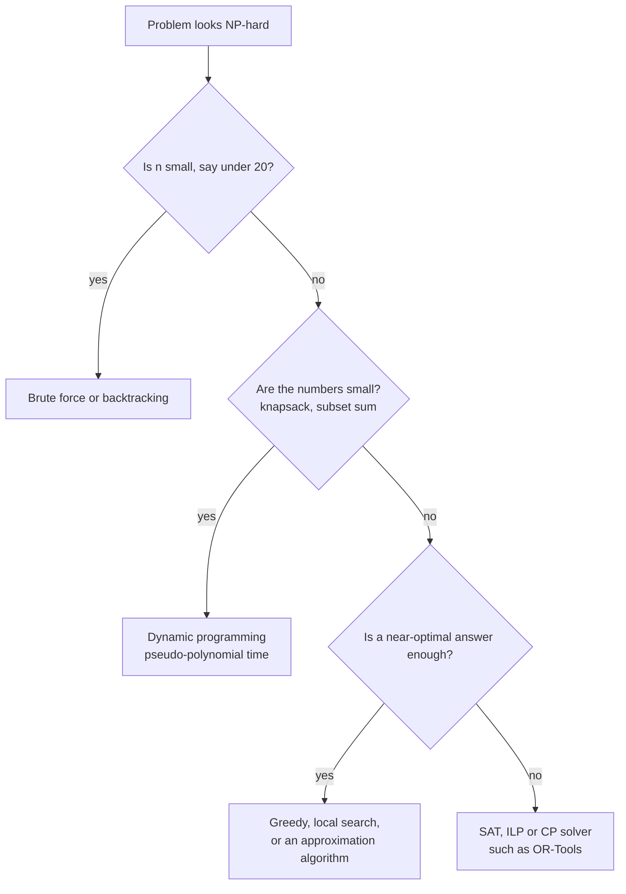
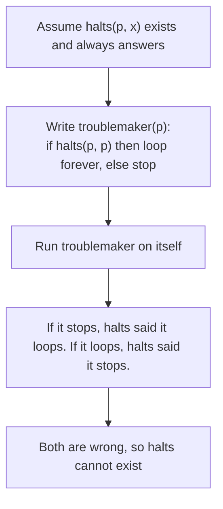

# Hard problems and NP-completeness

After this you can recognise a problem that has no known fast exact algorithm, choose a sensible way to handle it, and explain why no tool can check every property of every program.

Before this: [Big O and runtime](../01-analysis/01-big-o-and-runtime.md), [greedy algorithms](05-greedy-algorithms.md) and [dynamic programming](06-dynamic-programming.md).

## The idea

A delivery app has 12 stops to visit and wants the shortest route. Trying every order of 12 stops takes about a minute in Python, and 15 stops takes days. At 20 stops no machine finishes in your lifetime. The code is correct. The problem is hard: nobody has found an algorithm whose running time stays polynomial as the number of stops grows, and most researchers believe none exists.

Many problems at work are in this family: routing, packing, scheduling, timetables, choosing compatible package versions. Knowing the family saves you from spending a week on a fast exact algorithm that nobody knows, and from believing an AI tool or vendor that claims one.



## Key terms

A **decision problem** has a yes or no answer: "is there a route shorter than 500 km?". Optimisation problems ("find the shortest route") have a decision form, and the theory is stated for decisions.

**P** is the set of decision problems that an algorithm solves in polynomial time, $O(n^k)$ for some constant $k$. **NP** is the set of decision problems where a proposed yes-answer, called a certificate, can be checked in polynomial time. Every problem in P is also in NP. Whether P equals NP is an open question; the working assumption is that it does not.

A problem is **NP-hard** if it is at least as hard as every problem in NP, meaning a fast algorithm for it would give a fast algorithm for all of NP. It need not be in NP itself. A problem is **NP-complete** if it is both in NP and NP-hard. A **reduction** converts one problem into another, and it is how a problem is shown to be NP-hard: if you can turn SAT into your problem, your problem is at least as hard as SAT.

Hardness describes the worst case as $n$ grows. Many real instances are easy, which is why solvers work.

## How it works

Checking is easy, finding is hard. For subset sum ("do some of these numbers add up to the target?"), adding up a proposed subset takes one pass. Finding one means searching up to $2^n$ subsets.

Hard problems rarely announce themselves. The table lists common ones in their everyday form.

| Problem | Where it appears | Status |
|---|---|---|
| Travelling salesperson (TSP), vehicle routing | Delivery routes, drilling paths | NP-hard |
| Knapsack | Pick items under a budget or capacity | NP-hard, but a DP works when the numbers are small |
| Scheduling, timetabling | Exams, shifts, jobs on machines | Most variants are NP-hard |
| Graph colouring | Exam slots, compiler register allocation | NP-complete for 3 or more colours |
| SAT (satisfiability) | Package version constraints, hardware verification | NP-complete |

A small change often flips a problem from easy to hard. The shortest path is in P, but the longest path with no repeated nodes is NP-hard. Deciding whether a graph is 2-colourable is easy, and 3-colourable is NP-complete. 2-SAT is easy, 3-SAT is NP-complete. If an AI offers a clean polynomial algorithm for something on this list, assume it solves an easier variant until shown otherwise.

When you meet a hard problem, pick a response by the input size and the answer quality you need.



Brute force is fine below about 20 items. A heuristic is a rule that usually gives a good answer with no guarantee, and greedy rules are the common kind. An approximation algorithm comes with a guarantee: for TSP with distances that obey the triangle inequality, a known algorithm returns a tour at most 1.5 times the shortest. Dynamic programming on knapsack costs $O(n \cdot W)$ for capacity $W$, which is **pseudo-polynomial**: polynomial in the value of $W$ but exponential in the number of digits needed to write it. With capacity 1,000 it is fast; with a capacity of 20 digits it is not. A **solver** takes a description of constraints and searches cleverly. SAT, integer linear programming (ILP) and constraint programming solvers, such as [OR-Tools](https://developers.google.com/optimization) with its CP-SAT solver, handle instances with thousands of variables that brute force never could. You describe the problem; you do not write the search.

## Some questions have no algorithm at all

The **halting problem** asks: given a program and an input, does the program eventually stop? Turing proved no algorithm answers it correctly for every program. The argument is a contradiction: suppose `halts(p, x)` existed, then build a program that asks `halts` about itself and does the opposite.



Rice's theorem extends this: any question about what a program does, such as "does it ever divide by zero?" or "does it leak memory?", is undecidable in general. So a linter, a type checker, a static analyzer or an AI code reviewer cannot be both correct and complete on all programs. Each one misses some real bugs, reports some false ones, or limits what programs it accepts. This is why you still need tests, and why "the tool found no problems" is evidence and never proof. The formal treatment is in the math book's chapter on [theory of computation](https://faiyaz-svg.github.io/MathFromTheGroundUp/06-cs-math/06-theory-of-computation/).

## Worked examples

<div class="example" markdown>

### Example 1: checking is fast, finding is slow

We want to see the gap between verifying a subset-sum answer and finding one, and then see the dynamic programming escape for small numbers.

1. `check` verifies a proposed subset with one pass, which is $O(n)$.
2. `search` tries subsets by size, calling `check` on each. With a target no subset can reach, it tries all $2^n$ of them.
3. `reachable` keeps a bitset where bit $s$ is set when some subset sums to $s$. For each number `x`, `bits << x` adds `x` to every sum already reachable. The work is $n$ shifts of a number with about the target's worth of bits.

<details class="code" markdown>
<summary>In code</summary>

```python
import random
import time
from itertools import combinations


def check(nums, chosen, target):
    return sum(nums[i] for i in chosen) == target


def search(nums, target):
    checks = 0
    for size in range(len(nums) + 1):
        for chosen in combinations(range(len(nums)), size):
            checks += 1
            if check(nums, chosen, target):
                return chosen, checks
    return None, checks


def reachable(nums, target):
    bits = 1                          # bit 0 set: the empty subset sums to 0
    for x in nums:
        bits |= bits << x
    return bool(bits >> target & 1)


for n in (16, 18, 20, 22):
    rng = random.Random(n)
    nums = [rng.randrange(1, 100) for _ in range(n)]
    target = sum(nums) + 1            # impossible, so every subset is tried
    t = time.perf_counter()
    found, checks = search(nums, target)
    t_search = time.perf_counter() - t
    t = time.perf_counter()
    ok = reachable(nums, target)
    t_dp = time.perf_counter() - t
    print(f"n={n}  subsets={checks:>9,}  search={t_search:6.3f} s  dp={t_dp:.6f} s  dp says {ok}")
```

```text
n=16  subsets=   65,536  search= 0.042 s  dp=0.000006 s  dp says False
n=18  subsets=  262,144  search= 0.172 s  dp=0.000010 s  dp says False
n=20  subsets=1,048,576  search= 0.735 s  dp=0.000012 s  dp says False
n=22  subsets=4,194,304  search= 3.415 s  dp=0.000014 s  dp says False
```

</details>

Check: each step of 2 in $n$ multiplies the subsets by 4, and the search time grows by about 4 (three runs gave 3.1 to 3.4 s at $n = 22$; the smaller sizes varied by a few percent). The DP stays in microseconds and agrees that the target is unreachable. It is fast because the numbers are below 100. With 15-digit numbers the bitset would need about $10^{15}$ bits, and the trick stops working.

</div>

## Common mistakes

<div class="warning" markdown>

Watch out: treating "NP-hard" as "impossible". It means no known fast exact algorithm for the worst case. Solvers and heuristics handle real instances of TSP and SAT with thousands of items.

Watch out: reading "NP" as "not polynomial". It stands for nondeterministic polynomial time, and P is a subset of NP.

Watch out: shipping a heuristic as if it were exact. A greedy route 5% longer than the best may be fine; say so in a comment, and keep a small-input test against brute force.

</div>

## Working with AI

<div class="ai" markdown>

Words to use: NP-hard, NP-complete, reduction, heuristic, approximation ratio, pseudo-polynomial, constraint solver, undecidable.

Prompts to try:

- "I need to assign 40 exams to 6 time slots so no student has two at once. Which known NP-hard problem is this? Suggest an approach for 40 exams and one for 4,000, using OR-Tools CP-SAT, and say what each one guarantees."
- "You said this routing function is optimal and runs in $O(n^2)$. State what problem it solves exactly, and give a 6-stop input where its answer differs from brute force, or explain why none exists."

What to check:

- A claim of an optimal polynomial-time answer to TSP, scheduling or colouring. Compare the output with brute force on 8 to 10 items.
- A greedy rule presented as exact. Look for a counterexample, as in the greedy lesson.
- Solver code that never sets a time limit or checks whether the status is optimal or only feasible. Read the status the solver returns.
- A static analysis result treated as complete. A clean report does not mean the program has no bugs.

</div>

## Quiz

1\. What is the difference between NP-hard and NP-complete?

<details class="solution" markdown>
<summary>Answer</summary>

NP-hard means at least as hard as every problem in NP. NP-complete means NP-hard and also in NP (a yes-answer can be checked quickly). The shortest-tour optimisation problem is NP-hard but, being a "find" problem, is not itself in NP; its decision version is NP-complete.

</details>

2\. How many tours does the brute-force TSP search try for 12 cities when the start city is fixed?

```python
import math
print(math.factorial(11))
```

<details class="solution" markdown>
<summary>Answer</summary>

```text
39916800
```

After fixing the start, the other 11 cities can be in any order, which is $11!$. Adding one more city multiplies the work by 12.

</details>

3\. A teammate says their new scheduling service finds the exact best timetable for 500 classes in two seconds, for any rules. What do you ask?

<details class="solution" markdown>
<summary>Answer</summary>

Exact optimal timetabling is NP-hard in general, so a claim of exact answers "for any rules" is suspect. Ask what the service guarantees: is it a heuristic, a solver with a time limit, or exact only for a restricted rule set? Then compare its answer with brute force on an 8-class instance, and check whether it reports "optimal" or only "feasible".

</details>

4\. A vendor says their analyzer finds every bug in any program. What is your response?

<details class="solution" markdown>
<summary>Answer</summary>

By Rice's theorem, any non-trivial question about a program's behaviour is undecidable in general, so no analyzer can find every bug in every program without also reporting false ones or refusing some programs. Ask what it misses, what it falsely flags, and which language subset it supports.

</details>

## Lab

<div class="lab" markdown>

### Lab: brute force against greedy on a small TSP

Goal: time brute force as cities are added, and measure how much worse the nearest-neighbour rule is. Time: about 15 minutes. Runs in: any terminal with Python 3.10 or later.

1. Save the script below as `tsp.py` and run `python tsp.py`. It places random cities on a 100 by 100 grid, finds the best tour by brute force for 5 to 10 cities, and runs the greedy rule on the same cities.
2. Write down the time at 8, 9 and 10 cities. Predict the time at 11 cities before running anything (hint: how many tours is that, compared with 10?).
3. Read the last column. Greedy gives a tour within a few percent of the best here. Change `seed=1` to other values and find the worst ratio you can.
4. Read the extrapolation lines. Explain why a computer 1,000 times faster still does not solve 20 cities by brute force.
5. Cleanup: delete `tsp.py`.

```python
import math
import random
import time
from itertools import permutations


def make_cities(n, seed=1):
    rng = random.Random(seed)
    return [(rng.random() * 100, rng.random() * 100) for _ in range(n)]


def tour_length(cities, order):
    return sum(math.dist(cities[a], cities[b]) for a, b in zip(order, order[1:] + order[:1]))


def brute_force(cities):
    """Try every order that starts at city 0: (n - 1)! tours."""
    best = float("inf")
    for rest in permutations(range(1, len(cities))):
        best = min(best, tour_length(cities, [0, *rest]))
    return best


def nearest_neighbour(cities):
    """Greedy: always drive to the closest city not yet visited."""
    order, left = [0], set(range(1, len(cities)))
    while left:
        nxt = min(left, key=lambda c: math.dist(cities[order[-1]], cities[c]))
        order.append(nxt)
        left.remove(nxt)
    return tour_length(cities, order)


per_tour = 0.0
print("cities  tours tried  brute (s)  greedy / best")
for n in range(5, 11):
    cities = make_cities(n)
    start = time.perf_counter()
    best = brute_force(cities)
    elapsed = time.perf_counter() - start
    per_tour = elapsed / math.factorial(n - 1)
    print(f"{n:6}  {math.factorial(n - 1):11,}  {elapsed:9.3f}  {nearest_neighbour(cities) / best:13.2f}")

print()
for n, unit, size in [(12, "seconds", 1), (15, "days", 86_400), (20, "years", 31_557_600)]:
    print(f"{n} cities: about {math.factorial(n - 1) * per_tour / size:,.0f} {unit}")
```

Expected result: brute-force time multiplies by about 8 to 10 with each added city. Times are from the author's Windows 11 PC (Python 3.14); three runs gave 0.69 to 0.76 s at 10 cities and 76 to 81 seconds, 2 days and 7,400 to 7,800 years in the extrapolation. Yours will differ, but the ratio column is the same because the cities are seeded.

```text
cities  tours tried  brute (s)  greedy / best
     5           24      0.000           1.00
     6          120      0.000           1.08
     7          720      0.001           1.06
     8        5,040      0.009           1.06
     9       40,320      0.072           1.06
    10      362,880      0.694           1.04

12 cities: about 76 seconds
15 cities: about 2 days
20 cities: about 7,370 years
```

<details class="solution" markdown>
<summary>Solution</summary>

Step 2: 11 cities is $10! = 3{,}628{,}800$ tours, ten times the tours of 10 cities, so about 7 s. Each added city multiplies the count by $n - 1$.

Step 3: the ratio depends on the layout. On some layouts nearest neighbour is far worse, and it has no fixed guarantee: the gap can grow as cities are added.

Step 4: 20 cities is $19! \approx 1.2 \times 10^{17}$ tours. A machine 1,000 times faster still needs about 7 years. Each extra city multiplies the time by 20, so hardware gains buy one or two more cities, not a different class of problem.

</details>

</div>

## Where this shows up

- Dependency resolvers (pip, npm, Cargo) face a version-selection problem that can be written as SAT.
- Coding-interview problems that look like subset sum, partition, or "can you split these into groups" are knapsack variants solved with DP, as in [DP patterns](../04-leetcode-patterns/07-dp-patterns.md).
- When a hard-problem routine is slow, [profiling and benchmarking](../05-performance/01-profiling-and-benchmarking.md) shows where the time goes before you change the algorithm.
