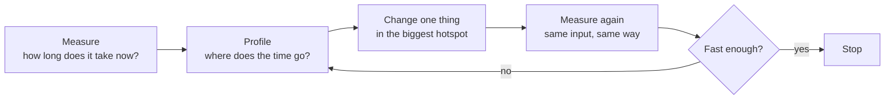

# Profiling and benchmarking

After this you can time a piece of Python code fairly, find which function a program spends its time in, and read a profiler table or a flame graph without guessing.

Before this: [Big O and runtime](../01-analysis/01-big-o-and-runtime.md) and [hash tables](../02-data-structures/04-hash-tables.md).

## The idea

A nightly report takes four minutes and someone wants it faster. Three suspects come up: the string parsing, the sorting, and the lookup of each order's customer. Each is plausible, and a guess has a good chance of being wrong. If parsing is 3% of the run, making it ten times faster saves 2.7% of the total. The same effort on a function that holds 90% of the run can remove most of the time.

The rule is to measure first. Big O tells you how cost grows with $n$. It does not tell you which line of your program costs the most at the $n$ you have. A profiler does, and a benchmark checks that your change helped.



## Key terms

A **benchmark** is a repeatable measurement of how long some code takes on a fixed input. A **profiler** is a tool that records where a running program spends its time. A **hotspot** is the function or line that holds most of that time.

A **deterministic profiler** such as `cProfile` records every function call and return. A **sampling profiler** such as py-spy looks at the program's call stack many times per second and counts what it finds. Sampling slows the program less, and can attach to a process that is already running.

A **flame graph** draws those stack samples. Each box is a function, a box sits on top of the function that called it, and its width is the share of samples it appeared in. Width is what matters, and left to right has no meaning.

## How it works

For a small expression, use `timeit`. It runs the code many times and the docs say the `min()` of the repeats is the number to trust, since slower runs come from other activity on the machine ([timeit documentation](https://docs.python.org/3/library/timeit.html)). From the command line:

```bash
python -m timeit -s "items = list(range(1000)); s = set(items)" "999 in items"
python -m timeit -s "items = list(range(1000)); s = set(items)" "999 in s"
```

```text
50000 loops, best of 5: 6.57 usec per loop
10000000 loops, best of 5: 25 nsec per loop
```

Option `-s` is setup code that runs once and is not timed. The two lines show $O(n)$ against $O(1)$: about 6 µs against 25 ns, so a factor of roughly 250 (three runs gave 6.2 to 6.6 µs and 24 to 25 ns).

For a whole program, use `cProfile`. It adds a row per function:

```bash
python -m cProfile -s cumtime report.py
```

| Column | Meaning |
|---|---|
| `ncalls` | Number of calls |
| `tottime` | Time in the function itself, not counting what it calls |
| `cumtime` | Time in the function including everything it calls |
| `percall` | The time divided by `ncalls` (shown for both times) |

Sort by `cumtime` to find which branch of the call tree is expensive, then look at `tottime` to find the function whose own code is the cost. In Python you can also save the data with `-o report.prof` and read it with `pstats.Stats("report.prof").sort_stats("cumtime").print_stats(10)`.

A flame graph shows the same data as a picture. This one is drawn by hand for the program in the lab, with real shares from `cProfile`:

```text
[find_customer  (90% of samples)                   ][]
[region_report  (93%)                                  ][mi]
[<module>  (100%)                                          ]
```

The unlabelled `[]` is `parse` (2%) and `mi` is `make_inputs` (7%). One wide box at the top is a hotspot. Many narrow boxes of equal width mean there is no single thing to fix. py-spy makes the real thing from a running Python program (`py-spy record -o profile.svg -- python myprogram.py`, from its [README](https://github.com/benfred/py-spy)); this book does not run it.

Benchmarks go wrong in a few repeatable ways:

- Timing the wrong thing. Setup, printing and file reads end up inside the timer.
- Warm-up. The first call can be slower (imports, caches, the interpreter's own adaptive tuning), so a single run is not typical.
- Noise. Other programs, clock changes and the garbage collector move a result by a few percent. Repeat and take the minimum, and look at the spread.
- Tiny inputs. At $n = 10$ the difference between algorithms is smaller than the noise. Measure at the size you will really have.
- Profiler overhead. `cProfile` taxes every function call, so it overstates code made of many tiny calls. Use it to rank functions, then time the fix without it.

Big O and constant factors are separate. Two $O(n)$ loops can differ by several times, and an $O(1)$ lookup can lose to a scan when you only use it once. Both comparisons below are from `timeit` on a list of 1,000 integers:

| Code | Time | Why |
|---|---|---|
| `-1 in items` (scan the list) | about 6 µs | $O(n)$, but one pass in C |
| `-1 in set(items)` (build a set, look up once) | about 10 µs | Building the set is $O(n)$ with a larger constant |
| `for x in items: total += x` | about 21 µs | $O(n)$, one interpreter step per item |
| `sum(items)` | about 3 µs | $O(n)$, the loop runs in C |

## Worked examples

<div class="example" markdown>

### Example 1: timing the wrong thing

We want to compare `data.sort()` with `sorted(data)` on 100,000 shuffled integers. Predict the winner first.

1. `timeit` calls the statement `number` times in a row. The setup runs once.
2. `data.sort()` sorts the list in place. After the first call the list is already sorted, so the other 199 calls sort sorted data, which Python's sort handles in one pass.
3. `sorted(data)` returns a new list and leaves `data` shuffled, so every call does the full work.

```python
import timeit

setup = "import random; data = list(range(100_000)); random.seed(1); random.shuffle(data)"
n = 200
t_sort = timeit.timeit("data.sort()", setup=setup, number=n) / n
t_sorted = timeit.timeit("sorted(data)", setup=setup, number=n) / n
print(f"data.sort() : {t_sort * 1e3:7.3f} ms per call")
print(f"sorted(data): {t_sorted * 1e3:7.3f} ms per call")
```

```text
data.sort() :   0.311 ms per call
sorted(data):  11.898 ms per call
```

Check: three runs gave 0.31 to 0.35 ms and 11.9 to 13.1 ms. The `sort()` number looks about 40 times faster, and it is a measurement of the wrong input. To compare fairly, copy inside the timed statement, so both start from shuffled data: `"list(data).sort()"` against `"sorted(data)"`. Both then took 12 to 14 ms per call, and the difference was inside the noise.

</div>

## Common mistakes

<div class="warning" markdown>

Watch out: optimising by intuition. Profile first. The expensive line is often a hidden $O(n)$ call inside a loop, such as `in` on a list, and is not the code that looks complicated.

Watch out: trusting one timing. Run it at least 3 times and report the range. A difference under the spread is not a difference.

Watch out: comparing a profiled run with an unprofiled one. Profiling slows the program, so use `cProfile` to find the hotspot and `timeit` to measure the result.

</div>

## Working with AI

<div class="ai" markdown>

Words to use: hotspot, cumtime, tottime, deterministic profiler, sampling profiler, flame graph, warm-up, benchmark.

Prompts to try:

- "Here is the `cProfile` output sorted by cumtime for my Python 3.14 script (pasted). Which function is the hotspot, what is its tottime compared with its cumtime, and what is the first change you would try?"
- "Write a `timeit` benchmark that compares these two implementations on 100,000 items, with setup outside the timed statement, and check that neither one mutates the input."

What to check:

- A speed-up claim with no measurement. Run the benchmark yourself, three times.
- An optimisation that changes the answer. Compare the outputs of old and new versions on the same input before comparing speed.
- A benchmark that mutates its input (`sort()`, `append`, `pop`) or lets the first run warm up a cache for the later ones.
- Advice to rewrite the whole program in another language before any profile exists.

</div>

## Quiz

1\. A function takes 10 seconds, and 20% of that is in `parse()`. If you make `parse()` infinitely fast, what is the shortest the program can now run?

<details class="solution" markdown>
<summary>Answer</summary>

8 seconds. The other 80% is untouched, so removing 20% of the time at best saves 2 seconds. A part's share of the time caps what optimising it can gain.

</details>

2\. In a `cProfile` table, `outer` has `tottime` 0.002 and `cumtime` 0.260, and `inner` has `tottime` 0.256 and `cumtime` 0.256. Where is the hotspot?

<details class="solution" markdown>
<summary>Answer</summary>

In `inner`. `outer` has a large `cumtime` only because it calls `inner`; its own code takes 0.002 s. The `tottime` column points at the function whose own code is slow.

</details>

3\. A teammate benchmarks two versions of a function once each, 0.0210 s and 0.0200 s, and says the second is 5% faster. What would you do?

<details class="solution" markdown>
<summary>Answer</summary>

Repeat each timing at least 5 times with `timeit.repeat` and compare the minimums and the spread. A difference of 5% from single runs is the size of normal noise. Also confirm the input is identical and that the timed code does not mutate it.

</details>

4\. A set lookup is $O(1)$ and a list lookup is $O(n)$. Name one case from this lesson where the list is still faster.

<details class="solution" markdown>
<summary>Answer</summary>

A single lookup in a list you already have. Building the set is $O(n)$ with a bigger constant, so one scan of 1,000 items took about 6 µs against about 10 µs to build the set and search it. The set wins when you build it once and look up many times.

</details>

## Lab

<div class="lab" markdown>

### Lab: find the hotspot and fix it

Goal: profile a slow report, fix the hotspot, and measure the improvement. Time: about 15 minutes. Runs in: any terminal with Python 3.10 or later.

1. Save the first script below as `report.py` and the second as `bench.py`, in the same folder. Run `python report.py` to see the output, then `python bench.py` three times. Write down the "best of 5" time.
2. Run `python -m cProfile -s cumtime report.py` and read the top rows. Which function has the largest `tottime`? Which line of its code is the slow one, and why, given the hash tables lesson?
3. Fix it by building a dictionary `by_id` from customer id to customer once, and look up with it instead of calling `find_customer`.
4. Run `python bench.py` three times. Check that the printed report is identical to step 1.
5. Profile again. What is the largest function now, and is it worth fixing?
6. Cleanup: delete `report.py`, `bench.py` and any `.prof` files.

```python
import random


def make_inputs(n_customers=3000, n_orders=6000):
    rng = random.Random(1)
    customers = [{"id": i, "region": rng.choice("NSEW")} for i in range(n_customers)]
    lines = [f"{rng.randrange(n_customers)},{rng.random() * 100:.2f}" for _ in range(n_orders)]
    return customers, lines


def parse(lines):
    rows = []
    for line in lines:
        customer_id, total = line.split(",")
        rows.append((int(customer_id), float(total)))
    return rows


def find_customer(customers, customer_id):
    for c in customers:
        if c["id"] == customer_id:
            return c


def region_report(customers, lines):
    totals = {}
    for customer_id, total in parse(lines):
        region = find_customer(customers, customer_id)["region"]
        totals[region] = totals.get(region, 0) + total
    return {r: f"{t:,.2f}" for r, t in sorted(totals.items())}


if __name__ == "__main__":
    customers, lines = make_inputs()
    print(region_report(customers, lines))
```

```python
import timeit

from report import make_inputs, region_report

customers, lines = make_inputs()
print(region_report(customers, lines))
best = min(timeit.repeat(lambda: region_report(customers, lines), number=1, repeat=5))
print(f"best of 5: {best:.4f} s")
```

Expected result: the profile shows `find_customer` called 6,000 times with almost all the time. After the fix the report is the same and the best time falls by about 100 times. Times are from the author's Windows 11 PC (Python 3.14); yours will differ.

```text
{'E': '75,107.58', 'N': '75,168.42', 'S': '70,527.88', 'W': '76,287.58'}
best of 5: 0.2568 s
```

Six runs of the slow version gave 0.25 to 0.28 s. Three runs of the fixed version gave 0.0025 to 0.0032 s.

<details class="solution" markdown>
<summary>Solution</summary>

Step 2: `find_customer` has 6,000 calls and a `tottime` of about 0.27 s, nearly all of the run. The `for` loop scans the customer list, which is $O(n)$ per order, so the report is $O(\text{orders} \times \text{customers})$.

Step 3: replace `find_customer` and its call.

```python
def region_report(customers, lines):
    by_id = {c["id"]: c for c in customers}
    totals = {}
    for customer_id, total in parse(lines):
        region = by_id[customer_id]["region"]
        totals[region] = totals.get(region, 0) + total
    return {r: f"{t:,.2f}" for r, t in sorted(totals.items())}
```

Step 5: with the lookup fixed, the largest cost in the profile is `make_inputs`, which builds the test data and is not part of the report. Inside the report, `parse` is now the biggest piece, and a 2.5 ms report is not worth more work. This is the signal to stop.

</details>

</div>

## Where this shows up

- Every "why is this endpoint slow?" investigation, including database queries and the page-load work in [web performance](../../08-front-end/03-react/05-web-performance.md).
- The next lesson explains why hardware makes the same Big O code differ by several times: [how CPUs go fast](02-how-cpus-go-fast.md).
