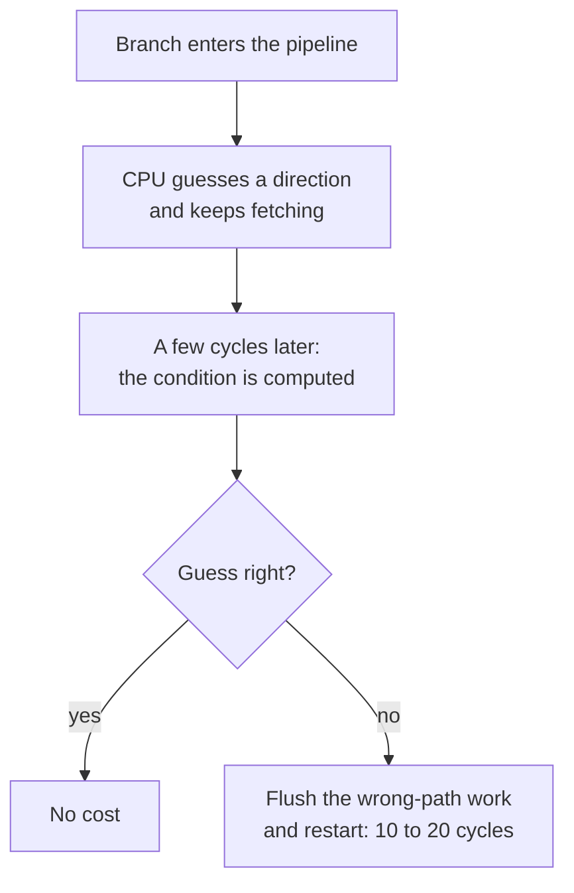
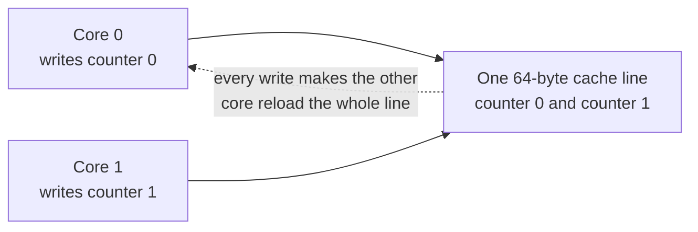

# How CPUs go fast

After this you can explain why two loops with the same Big O run at different speeds, name the four hardware tricks behind that gap, and say what each one asks of your code.

Before this: [The CPU](../../01-how-computers-work/02-hardware/03-the-cpu.md), [memory hierarchy and latency numbers](../../01-how-computers-work/02-hardware/04-memory-hierarchy-and-latency-numbers.md) and [profiling and benchmarking](01-profiling-and-benchmarking.md).

## The idea

Two functions both loop over a million numbers once, so both are $O(n)$. One runs noticeably faster because the numbers are sorted, or the grid is walked along its rows. Big O counts steps, and the hardware charges different prices for them depending on how predictable and regular the work is.

The hardware lessons described four tricks. This lesson covers what each rewards in your code, and how much of it shows up in Python.

| Hardware trick | It works best when | Slows down when | Visible in pure Python? |
|---|---|---|---|
| Pipelining | Instructions don't wait on each other | A branch or a dependency stalls the pipeline | No |
| Branch prediction | A branch goes the same way most of the time | A branch depends on random data | Slightly (about 10 to 20%) |
| Caches | The next access is near the last one | Each access lands somewhere new | Yes, once the data is big (about 1.4 times) |
| SIMD | One operation is applied to a whole array | The loop body differs per item | Only through libraries |

## Key terms

**Row-major order** stores a 2D grid one row after another in memory, so `grid[i][j]` and `grid[i][j+1]` are neighbours. Python, C and most languages use it. The **stride** of a loop is the distance in memory between one access and the next.

A **misprediction** is a branch guess that turns out wrong, and a **flush** is the CPU throwing away the work it started down the wrong path.

**Vectorisation** means rewriting a loop as one operation over a whole array, so a library or compiler can use SIMD instructions and run the loop outside the interpreter.

**False sharing** happens when two cores write different variables that sit in the same cache line, so the line bounces between the cores.

## How it works

Branches. The pipeline fetches instructions ahead of the ones it is running. At an `if`, the answer is not known for several cycles, so the CPU guesses and keeps going.



A loop's own branch is nearly always right. A branch on random data, such as `if x >= 128` over unsorted bytes, is wrong about half the time, while sorted data gives long runs of the same answer. In compiled code this gap can be large. In Python it is small, because each loop step runs dozens of interpreter instructions around the one `if`, and their cost hides the misprediction (Example 1).

Caches. A grid in row-major order lies in memory like this, and a 64-byte cache line holds 16 four-byte integers.

```text
memory:   [ row 0: a00 a01 a02 a03 ... ][ row 1: a10 a11 a12 a13 ... ][ row 2: ...
by row:   a00 -> a01 -> a02 -> a03      neighbours, usually the same cache line
by col:   a00 -> a10 -> a20 -> a30      n items apart, a different line each time
```

Walking along a row uses all 16 values from each line fetched. Walking down a column uses one value per line, and the line may be evicted before you return for its neighbours. The CPU also prefetches ahead when it sees a regular stride, which softens the cost. The work is identical in both orders, so only the memory pattern differs.

SIMD. A vector instruction adds 4 or 8 numbers at once. A compiler or library uses it when a loop applies the same operation to a contiguous array with no branches inside. Python's interpreter cannot, because each addition is a separate object operation. The standard library gets part of the way by moving the loop into C, as the snippet shows.

<details class="code" markdown>
<summary>In code</summary>

```python
import math
import random
import time
from array import array

n = 1_000_000
rng = random.Random(1)
a = array("d", (rng.random() for _ in range(n)))
b = array("d", (rng.random() for _ in range(n)))


def dot_loop(a, b):
    total = 0.0
    for i in range(len(a)):
        total += a[i] * b[i]
    return total


for name, f in [("python loop", dot_loop), ("math.sumprod", math.sumprod)]:
    best = float("inf")
    for _ in range(5):
        start = time.perf_counter()
        f(a, b)
        best = min(best, time.perf_counter() - start)
    print(f"{name:13} {best * 1e3:6.2f} ms")
```

```text
python loop    67.15 ms
math.sumprod   22.40 ms
```

</details>

Three runs gave 67 to 70 ms for the loop and about 22 ms for `math.sumprod`, so 3 times faster, mostly from removing the interpreter. NumPy's `np.dot` on the same numbers took about 0.1 ms in a scratch environment (NumPy 2.5.4, three runs), roughly 500 times faster than the loop, because it uses vectorised code on a packed array. The lab does not need NumPy.

False sharing. Each core keeps its own copy of a cache line, and a write by one core makes the other cores' copies stale. If two threads update `counter[0]` and `counter[1]`, and both 8-byte values sit in one 64-byte line, each write forces the other core to reload the line, though the threads never touch the same variable.



The usual fix is per-thread data in separate cache lines (padding to 64 bytes) or in local variables merged at the end. CPython's GIL hides the problem; it matters in C, C++, Java, Rust and Go code that runs threads on many cores.

## Worked examples

<div class="example" markdown>

### Example 1: sorted against shuffled data

We want to see branch prediction in Python. We sum the bytes that are at least 128, among 2,000,000 bytes, in random and in sorted order. Predict the gap first.

1. Both lists hold the same values, and Python shares one object per small integer, so memory layout does not change with the order.
2. The sum is identical. Only the order of the branch outcomes changes: a random mix, or a long run of false then a long run of true.
3. We take the `min` of 5 runs, as in the profiling lesson.

```python
import random
import time

rng = random.Random(1)
shuffled = [rng.randrange(256) for _ in range(2_000_000)]
ordered = sorted(shuffled)


def total_above(items, threshold):
    total = 0
    for x in items:
        if x >= threshold:
            total += x
    return total


def best_of(items, threshold, repeats=5):
    best = float("inf")
    for _ in range(repeats):
        start = time.perf_counter()
        total_above(items, threshold)
        best = min(best, time.perf_counter() - start)
    return best


for threshold in (128, 256):
    a, b = best_of(shuffled, threshold), best_of(ordered, threshold)
    print(f"threshold {threshold}: shuffled {a:.3f} s   sorted {b:.3f} s   ratio {a / b:.2f}x")
```

```text
threshold 128: shuffled 0.054 s   sorted 0.045 s   ratio 1.20x
threshold 256: shuffled 0.033 s   sorted 0.034 s   ratio 0.99x
```

Check: the ratio at threshold 128 was 1.10 to 1.20 over many runs, a small gap. At threshold 256 the `if` is never true, so the branch is predictable in both orders and the ratio is 0.98 to 1.01 (equal, within noise). The gap appears only when the branch outcome is unpredictable, so the effect is real in Python but mostly hidden by interpreter work. For comparison, a JIT-compiled Node.js loop on the same PC, over 20,000,000 bytes, took about 30 ms shuffled and 15 ms sorted: 2 times (a one-off check, not part of the lab).

</div>

<div class="example" markdown>

### Example 2: rows against columns

We sum an $n$ by $n$ grid in two loop orders.

```python
def sum_by_rows(grid, n):
    total = 0
    for i in range(n):
        for j in range(n):
            total += grid[i][j]
    return total


def sum_by_columns(grid, n):
    total = 0
    for j in range(n):
        for i in range(n):
            total += grid[i][j]
    return total
```

On the author's PC (Ryzen 5 5600G, 16 MB L3 cache, Python 3.14):

```text
n=  500: rows 0.010 s   columns 0.010 s   ratio 1.02x
n= 2000: rows 0.163 s   columns 0.223 s   ratio 1.37x
```

Check: at $n = 500$ the grid stays in cache, so the order doesn't matter (ratios 1.02 to 1.09). At $n = 2000$ there are 4 million integers, the grid no longer fits, and columns are about 1.3 to 1.4 times slower. A flat `array` of 16 million integers showed almost no gap in a separate test, because the prefetcher copes with a regular stride.

</div>

## Common mistakes

<div class="warning" markdown>

Watch out: tuning for the CPU in Python before profiling. A better algorithm or a built-in such as `sum` beats cache-friendly tricks in a Python loop.

Watch out: concluding from a Python timing that branches and caches don't matter. They matter in compiled code, databases and NumPy.

</div>

## Working with AI

<div class="ai" markdown>

Words to use: branch misprediction, cache line, locality, row-major, stride, SIMD, vectorisation, false sharing.

Prompts to try:

- "This C function sums a 4096 by 4096 matrix column by column. Explain the cache behaviour in terms of stride and cache lines, then rewrite it to be cache-friendly and say how much I should expect to gain."
- "I run 8 worker threads in Java, each incrementing its own element of a `long[]` counter array, and the program gets slower with more threads. Is this false sharing, and what are two ways to fix it?"

What to check:

- A promised speed-up factor such as "10 times faster from better cache use". Measure it on your data, three times.
- "Vectorised" code that still has a Python loop over items. A real one has no per-item Python code.
- Padding, alignment or intrinsics for a loop the profiler never flagged, or with a hard-coded 64 (cache line size varies by processor).

</div>

## Quiz

1\. Why does a wrongly predicted branch cost time, and why are sorted inputs often faster for code with an `if` on the data?

<details class="solution" markdown>
<summary>Answer</summary>

The CPU had already started work on the guessed path, so a wrong guess discards that work and restarts, about 10 to 20 cycles. Sorted data makes the branch go the same way for long runs, so the predictor is almost always right.

</details>

2\. What does this print, and what does it say about walking down a column of a 4000 by 4000 grid of 4-byte integers stored row by row?

```python
n = 4000
print(64 // 4, n * 4)
```

<details class="solution" markdown>
<summary>Answer</summary>

```text
16 16000
```

A 64-byte cache line holds 16 integers. The next item in a column is 16,000 bytes away, in a different line, so each fetched line serves one value instead of 16.

</details>

3\. A teammate wants to sort a 10-million-item list before one pass with a data-dependent `if`, "to help branch prediction". What do you say?

<details class="solution" markdown>
<summary>Answer</summary>

The sort costs $O(n \log n)$ and is far more work than the single pass it speeds up. Sorting helps only when the data is reused many times, or is already sorted for another reason. In Python the gain would be about 10 to 20% anyway.

</details>

4\. Eight threads each increment their own counter in one shared array, and adding threads makes the program slower. What is the likely cause and the fix?

<details class="solution" markdown>
<summary>Answer</summary>

False sharing: the counters are neighbours in memory, so they share cache lines and every write invalidates the other cores' copies. Give each thread a local counter and add them at the end, or pad each counter to its own 64-byte line.

</details>

## Lab

<div class="lab" markdown>

### Lab: measure two hardware effects in Python

Goal: measure how a predictable branch and a cache-friendly order change a timing, and see when they don't. Time: about 20 minutes. Runs in: any terminal with Python 3.10 or later.

1. Save the script below as `cpu_lab.py` and run it three times. Write down the ratio on each line. Expect each run to take under 10 seconds.
2. Predict, then check: set `THRESHOLD = 256` and run again. What happens to the branch ratio, and why?
3. Change the grid sizes from `(500, 2000)` to `(100, 500, 1000, 2000)`. At which size does the column order start to cost extra? Compare with your CPU's L3 cache size.
4. Explain in two sentences why the effects here are 1.1 to 1.4 times and not the 100-fold gap between an L1 hit and a RAM read in the latency table.
5. Cleanup: delete `cpu_lab.py`.

```python
import random
import time

THRESHOLD = 128


def best_of(f, *args, repeats=5):
    best = float("inf")
    for _ in range(repeats):
        start = time.perf_counter()
        f(*args)
        best = min(best, time.perf_counter() - start)
    return best


def total_above(items):
    total = 0
    for x in items:
        if x >= THRESHOLD:
            total += x
    return total


def sum_by_rows(grid, n):
    total = 0
    for i in range(n):
        for j in range(n):
            total += grid[i][j]
    return total


def sum_by_columns(grid, n):
    total = 0
    for j in range(n):
        for i in range(n):
            total += grid[i][j]
    return total


rng = random.Random(1)
shuffled = [rng.randrange(256) for _ in range(2_000_000)]
ordered = sorted(shuffled)
t_shuffled = best_of(total_above, shuffled)
t_ordered = best_of(total_above, ordered)
print(f"branch: shuffled {t_shuffled:.3f} s   sorted {t_ordered:.3f} s   ratio {t_shuffled / t_ordered:.2f}x")

for n in (500, 2000):
    grid = [[i * n + j + 1000 for j in range(n)] for i in range(n)]
    t_row = best_of(sum_by_rows, grid, n, repeats=3)
    t_col = best_of(sum_by_columns, grid, n, repeats=3)
    print(f"grid n={n:4}: rows {t_row:.3f} s   columns {t_col:.3f} s   ratio {t_col / t_row:.2f}x")
```

Expected result: the branch ratio is a little above 1, the small grid is close to 1, and the large grid is higher. Output from the author's Windows 11 PC (Python 3.14); three runs gave branch ratios of 1.11 to 1.19, small-grid ratios of 1.02 to 1.09 and large-grid ratios of 1.29 to 1.40.

```text
branch: shuffled 0.059 s   sorted 0.051 s   ratio 1.15x
grid n= 500: rows 0.010 s   columns 0.010 s   ratio 1.02x
grid n=2000: rows 0.163 s   columns 0.223 s   ratio 1.37x
```

<details class="solution" markdown>
<summary>Solution</summary>

Step 2: with `THRESHOLD = 256` the `if` is never true, so the branch is predictable in both orders. The ratio falls to about 1.0 (0.98 to 1.01 on the author's PC), and both runs get faster because the addition never happens.

Step 3: the ratio stays near 1 while the whole grid fits in cache and rises once it does not. On the author's PC the ratio was about 1.0 at $n = 100$ and $n = 500$, about 1.2 at $n = 1000$ and about 1.4 at $n = 2000$. The turning point depends on your L3 size. A Python integer object is about 32 bytes, so a list of lists uses several times the memory of the raw numbers.

Step 4: every loop step in Python costs dozens of interpreter instructions, about 25 to 40 ns, and that cost is the same in both orders. The memory wait or the flush is added on top, so it shows as a 10 to 40% change. In a compiled loop, the step is about 1 ns, so the same wait is a much bigger share.

</details>

</div>

## Where this shows up

- Database engines store tables by column or by row for the same reason a grid is walked by row, and indexes are laid out to read neighbouring bytes.
- Machine-learning libraries and image code rely on SIMD and GPUs for the speed-ups in [GPUs and parallel hardware](../../01-how-computers-work/02-hardware/06-gpus-and-parallel-hardware.md).
- Threads that update shared counters in [locks, deadlocks and thread safety](../../03-programming-fundamentals/05-concurrency/02-locks-deadlocks-and-thread-safety.md) can hit false sharing in compiled languages.
