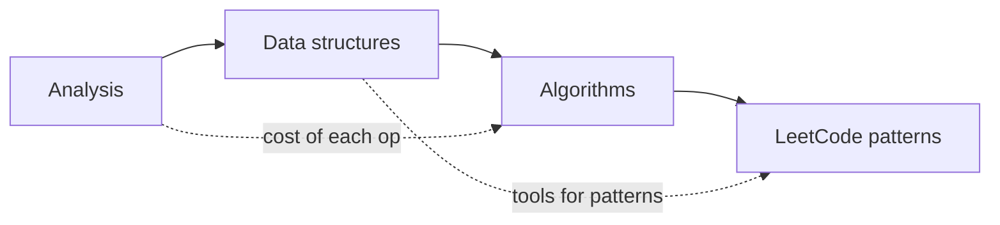

# Data structures and algorithms

Big O, the standard data structures and algorithms, and a set of problem-solving patterns for coding interviews.

Before this folder: Programming fundamentals and Discrete math for CS.

This folder starts with how to measure an algorithm (Big O, space, amortized cost, recurrences), then covers the standard data structures (arrays, linked lists, stacks, queues, hash tables, trees, heaps, graphs) and the standard algorithms (binary search, sorting, BFS and DFS, shortest paths, greedy, dynamic programming). The last chapter turns these into patterns for coding interviews.

An AI tool will pick a data structure for you, and the choice often decides whether code is fast or slow. You need to ask "why a hash map here, not a list?" and to notice when a generated solution is quadratic. The interview patterns chapter matters because interviews usually test this without AI.

It builds on [Programming fundamentals](../03-programming-fundamentals/index.md) and on [Discrete math for CS](../05-discrete-math-for-cs/index.md) for graphs, logs and recurrences. It feeds [Databases, SQL and Postgres](../10-databases-sql-and-postgres/index.md) (indexes are trees), and [Software and system design](../14-software-and-system-design/index.md), which reasons about costs the same way.

### How to use this folder

- Read Analysis first. Every later lesson quotes Big O.
- Keep the Data structures cheat sheet open while solving problems.
- Tries and union find is optional on a first read.
- Do the pattern problems yourself before asking an AI for hints.

<!-- lessons:start -->
## Lessons

### 1. [Analysis](01-analysis/index.md)

1. [Big O and runtime](01-analysis/01-big-o-and-runtime.md)
2. [Space and amortized analysis](01-analysis/02-space-and-amortized-analysis.md)
3. [Analysing recursive algorithms](01-analysis/03-analysing-recursive-algorithms.md)

### 2. [Data structures](02-data-structures/index.md)

1. [Arrays and dynamic arrays](02-data-structures/01-arrays-and-dynamic-arrays.md)
2. [Linked lists](02-data-structures/02-linked-lists.md)
3. [Stacks and queues](02-data-structures/03-stacks-and-queues.md)
4. [Hash tables](02-data-structures/04-hash-tables.md)
5. [Trees and binary search trees](02-data-structures/05-trees-and-binary-search-trees.md)
6. [Heaps and priority queues](02-data-structures/06-heaps-and-priority-queues.md)
7. [Graphs and representations](02-data-structures/07-graphs-and-representations.md)
8. [Tries and union find](02-data-structures/08-tries-and-union-find.md) (optional)

### 3. [Algorithms](03-algorithms/index.md)

1. [Binary search](03-algorithms/01-binary-search.md)
2. [Sorting](03-algorithms/02-sorting.md)
3. [BFS and DFS](03-algorithms/03-bfs-and-dfs.md)
4. [Shortest paths](03-algorithms/04-shortest-paths.md)
5. [Greedy algorithms](03-algorithms/05-greedy-algorithms.md)
6. [Dynamic programming](03-algorithms/06-dynamic-programming.md)

### 4. [LeetCode patterns](04-leetcode-patterns/index.md)

1. [How to approach a problem](04-leetcode-patterns/01-how-to-approach-a-problem.md)
2. [Two pointers and sliding window](04-leetcode-patterns/02-two-pointers-and-sliding-window.md)
3. [Hashing and prefix sums](04-leetcode-patterns/03-hashing-and-prefix-sums.md)
4. [Stacks and monotonic stacks](04-leetcode-patterns/04-stacks-and-monotonic-stacks.md)
5. [Tree and graph problems](04-leetcode-patterns/05-tree-and-graph-problems.md)
6. [Backtracking](04-leetcode-patterns/06-backtracking.md)
7. [DP patterns](04-leetcode-patterns/07-dp-patterns.md)
8. [Heaps, intervals and top-k](04-leetcode-patterns/08-heaps-intervals-and-top-k.md)

<!-- lessons:end -->
