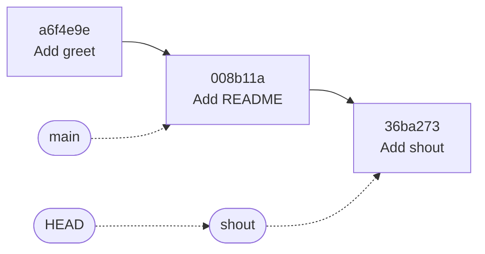
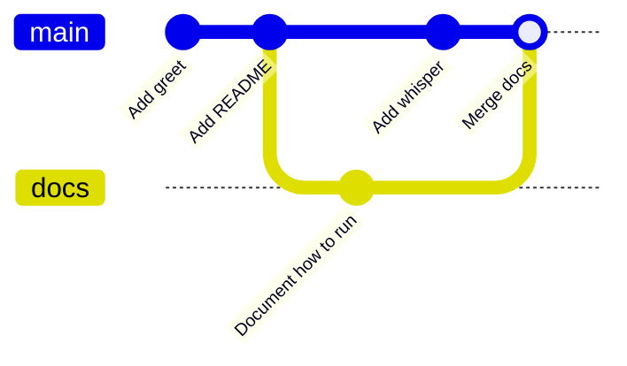
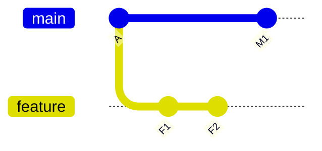

# Branches, merging and conflicts

After this you can create and merge branches, tell a fast-forward from a merge commit, resolve a merge conflict step by step, set work aside with `stash`, and choose between `restore`, `revert` and `reset` to undo something safely.

Before this: [Git basics](02-git-basics.md).

## The idea

You are halfway through a new feature when a bug report arrives. You do not want to commit half-finished code to the working version, and you do not want to lose it. A **branch** lets you keep two lines of work apart and combine them later.

A branch is not a copy of the project. It is a small named pointer to one commit. When you commit, the pointer for the branch you are on moves forward to the new commit. **HEAD** points to the current branch.



In the diagram, arrows between commits point to the parent. The rounded boxes are pointers: `main` is still at `Add README`, and `shout` and HEAD are one commit ahead.

## Key terms

To **merge** is to combine another branch's history into the current branch. A **fast-forward** happens when the current branch has no new commits of its own, so Git just moves the pointer forward. A **merge commit** is a commit with two parents that joins two lines of history.

A **conflict** happens when both branches changed the same lines (or one deleted what the other edited), so Git cannot choose.

To **rebase** is to replay your commits on top of another commit, producing new commits with new hashes. A **stash** is a shelf where Git keeps uncommitted changes temporarily.

## How it works

Create a branch and switch to it with `git switch -c name`; go back with `git switch main` ([git-switch](https://git-scm.com/docs/git-switch)). List branches with `git branch`. To combine, switch to the branch that should receive the work and run `git merge other`.

If `main` has not moved, the merge is a fast-forward and no new commit is made. If both branches have new commits, Git builds a merge commit.



When the changes touch different lines, Git merges them on its own. When they touch the same lines, it stops and marks the file. To resolve a conflict:

1. Run `git status`. Files marked `UU` (or "both modified") are conflicted.
2. Open each file and find the markers. Between `<<<<<<<` and `=======` is your side (the current branch); between `=======` and `>>>>>>>` is the other branch.
3. Edit the file to the text you want and delete all three marker lines.
4. Run the tests or the program. A file with no markers can still be wrong.
5. `git add file`, then `git commit` to finish the merge. To give up instead, run `git merge --abort`.

Rebase moves a branch's commits to start from the tip of another branch, which gives a straight line of history instead of a merge commit. The rule: rebase only commits that nobody else has. It rewrites history, so rebasing a branch that others have pulled forces them to untangle duplicates.



After `git rebase main` on `feature`, F1 and F2 are replayed after M1 (as new commits, shown in Example 2).

Undoing depends on what has happened to the change:

| Situation | Command | Safe after pushing? |
|---|---|---|
| Edit not committed | `git restore file` | not applicable, but the edit is gone for good |
| Staged by mistake | `git restore --staged file` | not applicable |
| Bad commit, already shared | `git revert <hash>` makes a new commit that undoes it | yes |
| Bad commit, local only | `git reset --soft HEAD~1` keeps the changes staged; `--hard` discards them | no, it rewrites history |
| Lost a commit after a reset | `git reflog`, then `git reset --hard <hash>` | local rescue only |

## Worked examples

<div class="example" markdown>

### Example 1: a conflict, start to finish

We have `main` and a branch `polite` made from the same commit. On `main` the greeting becomes `"Hi, "`; on `polite` it becomes `"Good day, "`. Your hashes will differ.

1. Merge `polite` into `main`.

   ```bash
   git merge polite
   ```

   ```text
   Auto-merging app.py
   CONFLICT (content): Merge conflict in app.py
   Automatic merge failed; fix conflicts and then commit the result.
   ```

2. `git status -s` shows `UU app.py`. The file now contains the markers.

   ```text
   def greet(name):
   <<<<<<< HEAD
       return "Hi, " + name
   =======
       return "Good day, " + name
   >>>>>>> polite

   print(greet("Ada"))
   ```

3. Choose `"Good day, "`, delete the three marker lines, and run the program.

   ```text
   Good day, Ada
   ```

4. Finish the merge.

   ```bash
   git add app.py
   git commit -m "Merge branch 'polite'"
   git log --oneline --graph --decorate -4
   ```

   ```text
   *   a3d813f (HEAD -> main) Merge branch 'polite'
   |\
   | * 7c6af7d (polite) Use a polite greeting
   * | 9087323 Use a casual greeting
   |/
   *   d7bab95 Merge branch 'docs'
   ```

Check: `grep -c '<<<<' app.py` prints 0, and the log shows the merge commit with two parents.

</div>

<div class="example" markdown>

### Example 2: rebase, and undoing with revert and stash

Rebasing `feature` (F1, F2) onto `main` (which gained M1):

```bash
git switch feature
git rebase main
git log --oneline --graph --all --decorate
```

```text
* ffa5ee9 (HEAD -> feature) F2
* 622d721 F1
* 75b21ca (main) M1
* 67127b0 A
```

F1 was `0d515a9` before and is `622d721` now: a rebase makes new commits. The history is a straight line, so `git merge feature` on `main` is a fast-forward.

Undoing a shared commit with `revert`, then using `stash` to park an edit:

```bash
git revert --no-edit HEAD
echo "# TODO" >> app.py
git stash
git stash pop
```

```text
[main 242f1c6] Revert "Add debug print"
 1 file changed, 1 deletion(-)
Saved working directory and index state WIP on main: a3d813f Merge branch 'polite'
Dropped refs/stash@{0} (ab983d1fa6d67fadeb825fe5b9f32806ccd7425a)
```

`revert` added a commit and kept the bad one in history. `stash` removed the edit from the working tree (so you could switch branches), and `stash pop` brought it back.

</div>

## Common mistakes

<div class="warning" markdown>

Watch out: committing a file that still contains `<<<<<<<` markers. Search for them (`grep -rn '<<<<<<<' .`) before `git add`.

Watch out: `git reset --hard` and `git push --force` on a shared branch. They discard or overwrite other people's work. Use `git revert`, or `--force-with-lease` on your own feature branch only.

Watch out: switching branches with uncommitted edits. Git refuses if they would be overwritten; commit or stash first.

</div>

## Working with AI

<div class="ai" markdown>

Words to use: fast-forward, merge commit, conflict markers, rebase, HEAD, stash, revert, reflog.

Prompts to try:

- "Here is `git status` and the conflicted section of `app.py` (paste both). Explain which side is mine and which is theirs, then show the merged result that keeps both changes."
- "I ran `git reset --hard HEAD~2` by mistake and lost two commits that were never pushed. Give me the commands to find and restore them, with what each prints."

What to check:

- A resolution that keeps only one side without saying so. Compare it with both versions and run the tests.
- Advice to `push --force` or `reset --hard` for a shared branch. Ask whether the commits are pushed and who else has them.
- Rebase advice for a branch other people have pulled.
- Leftover marker lines in a pasted "resolved" file. Search for `<<<<<<<`.

</div>

## Quiz

1\. What is a branch in Git?

<details class="solution" markdown>
<summary>Answer</summary>

A movable pointer to a commit. The commits are shared; creating a branch copies nothing.

</details>

2\. `main` has two commits that `docs` does not, and `docs` has one that `main` does not. You run `git merge docs` on `main`. Fast-forward or merge commit?

<details class="solution" markdown>
<summary>Answer</summary>

A merge commit. The histories have diverged, so there is no straight line to move the pointer along.

</details>

3\. A teammate already pulled your bad commit `9f3a1c2`. How do you undo its effect?

<details class="solution" markdown>
<summary>Answer</summary>

`git revert 9f3a1c2` and push the new commit. `reset` would rewrite history their copy depends on.

</details>

4\. After `git merge other` you see `UU app.py`. List the steps to finish.

<details class="solution" markdown>
<summary>Answer</summary>

Open the file, edit it to the intended text and remove the markers, test, `git add app.py`, `git commit`. Or `git merge --abort` to start over.

</details>

## Lab

<div class="lab" markdown>

### Lab: cause and resolve a conflict

Goal: create a conflict on purpose and resolve it. Time: about 20 minutes. Runs in: WSL (Ubuntu) or Git Bash.

1. Make a repo with one commit of `app.py` (see the previous lesson).

   ```bash
   mkdir -p ~/lab/branches && cd ~/lab/branches
   git init -b main
   printf 'def greet(name):\n    return "Hello, " + name\n\nprint(greet("Ada"))\n' > app.py
   git add app.py && git commit -m "Add greet function"
   ```

2. Make `polite` from here, change the greeting to `"Good day, "` and commit.

   ```bash
   git switch -c polite
   sed -i 's/Hello, /Good day, /' app.py && git commit -am "Use a polite greeting"
   ```

3. Return to `main`, change the same line to `"Hi, "` and commit. Run `git merge polite`.
4. Resolve as in Example 1. Run `python3 app.py` to check.
5. Run `git log --oneline --graph --all` and find the merge commit.
6. Cleanup: `cd ~ && rm -r ~/lab/branches`.

Expected result: the output `Good day, Ada` and a log graph with two lines joining at the merge commit.

<details class="solution" markdown>
<summary>Solution</summary>

Step 3: `git switch main`, `sed -i 's/Hello, /Hi, /' app.py`, `git commit -am "Use a casual greeting"`, `git merge polite`. Then edit `app.py` to keep one line, `git add app.py` and `git commit -m "Merge branch 'polite'"`.

</details>

</div>

## Where this shows up

- Teams merge branches through pull requests, covered in [GitHub, pull requests and code review](04-github-pull-requests-and-code-review.md).
- CI pipelines run on every branch, in CI/CD concepts<!-- link: ../../13-devops-and-cloud/02-ci-cd/01-ci-cd-concepts.md -->.
