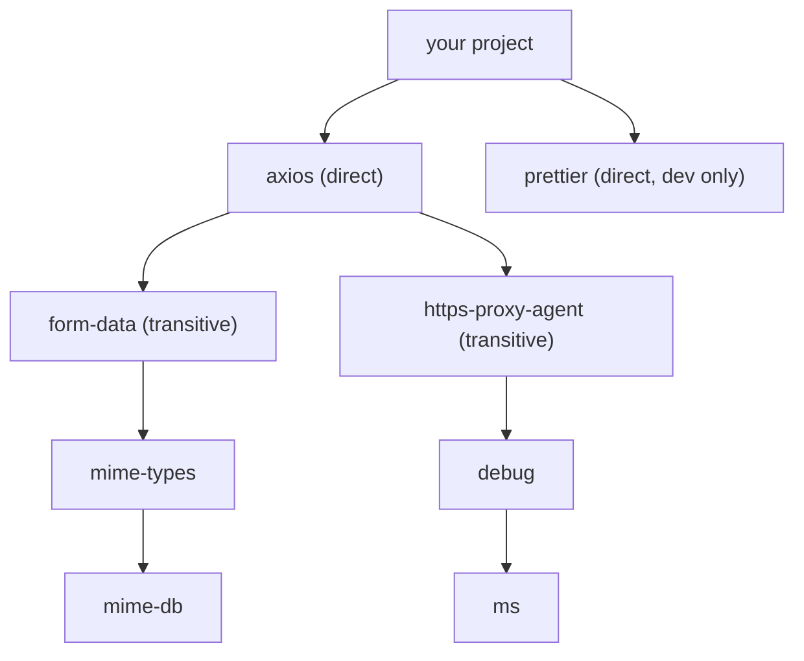
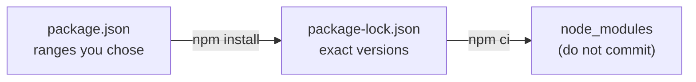

# Package managers and dependencies

After this you can read a `package.json` and a lockfile, explain what `^1.2.3` allows, rebuild a project exactly with `npm ci`, and say which of your dependencies are direct, transitive, dev or production.

Before this: [Modules, packages, pip and venv](../../03-programming-fundamentals/01-python-basics/08-modules-packages-pip-and-venv.md).

## The idea

You clone a teammate's project, run it, and get `Cannot find module 'axios'`. The code imports a library that was never copied into the repository. The repository holds a list of what it needs, and a **package manager** reads that list and downloads the code.

That list has two levels. You name a few libraries yourself, and each of them needs others, which need others. You asked for one package and received a couple of dozen. The diagram shows a small slice of that tree.



## Key terms

A **dependency** is a package your code needs in order to run. A **direct dependency** is one you listed; a **transitive dependency** is one pulled in by another dependency.

A **registry** is the server that stores published packages (npm for JavaScript, PyPI for Python). A **version range** is a rule such as `^1.2.3` that says which versions you accept.

A **lockfile** records the exact version of every package in the tree, so every machine installs the same code. **Semantic versioning** (semver) writes versions as `MAJOR.MINOR.PATCH`: a patch fixes bugs, a minor adds features without breaking users, and a major may break them.

## How it works

The npm side has two files. `package.json` holds your intent: names and version ranges. `package-lock.json` holds the result: the exact version and download hash of everything in `node_modules`, the folder where npm puts the code ([package-lock.json docs](https://docs.npmjs.com/cli/v11/configuring-npm/package-lock-json)).



Commit both files and never `node_modules`. `npm install` may update the lockfile when ranges allow newer versions. `npm ci` ("clean install") deletes `node_modules`, installs exactly what the lockfile says, and fails if the two files disagree ([npm ci docs](https://docs.npmjs.com/cli/v11/commands/npm-ci)). Use it in automated builds.

The ranges follow semver. Here is what the `semver` package says about two of them:

```javascript
const semver = require("semver");
const versions = ["1.2.3", "1.2.9", "1.3.0", "1.9.0", "2.0.0"];
for (const range of ["^1.2.3", "~1.2.3"]) {
  console.log(range, "allows", versions.filter((v) => semver.satisfies(v, range)).join(", "));
}
```

```text
^1.2.3 allows 1.2.3, 1.2.9, 1.3.0, 1.9.0
~1.2.3 allows 1.2.3, 1.2.9
```

The caret `^` accepts any version that keeps the leftmost non-zero number, so `^1.2.3` allows `1.x.y` from `1.2.3` up and `^0.2.3` allows only `0.2.x`. The tilde `~` accepts patch updates only. An exact version such as `1.2.3` accepts nothing else.

Dependencies sit in two groups. `dependencies` are needed at run time; `devDependencies` are tools for building and testing, such as a formatter. `npm install --omit=dev` (or `npm ci --omit=dev`) skips the second group, which keeps production images small. To run a package's command-line tool without installing it globally, use `npx`: `npx prettier --check .` runs the copy in your project, and downloads one after asking if there is none.

Python has the same two levels. A `requirements.txt` lists packages, usually pinned with `==`, and `python -m pip freeze` writes out every installed package, transitive ones included. The newer layout puts ranges in `pyproject.toml` ([packaging guide](https://packaging.python.org/en/latest/guides/writing-pyproject-toml/)). The tool `uv` adds the lockfile step: `uv add requests` edits `pyproject.toml` and writes `uv.lock`, `uv sync` installs from the lock, and `uv run` runs a command in the project environment ([uv docs](https://docs.astral.sh/uv/concepts/projects/sync/)). Whichever tool you use, you want one file of intent and one file of exact results.

Every dependency is code you did not read, running with your program's permissions. A package can be hijacked, or can be a typo-squatted copy of a popular name. The security chapter covers this under secrets and dependency security<!-- link: ../../12-security/01-web-security/06-secrets-and-dependency-security.md -->.

## Worked examples

<div class="example" markdown>

### Example 1: find where a package came from

In a fresh folder we run `npm init -y`, then `npm install axios` and `npm install --save-dev prettier` (npm printed `axios@1.20.0` and `prettier@3.9.10` as of 25 October 2026).

1. Open `package.json`. Only the two direct dependencies appear, each with a caret range:

   ```json
   "dependencies": { "axios": "^1.20.0" },
   "devDependencies": { "prettier": "^3.9.10" }
   ```

2. `npm ls ms` asks why the small package `ms` is installed. The path in the output shows the chain of dependents:

   ```text
   npmdemo@1.0.0
   `-- axios@1.20.0
     `-- https-proxy-agent@5.0.1
       `-- debug@4.4.3
         `-- ms@2.1.3
   ```

3. `package-lock.json` has an entry for `node_modules/ms` with `version`, `resolved` and an `integrity` hash. It has an entry for `prettier` marked `"dev": true`.
4. Delete `node_modules` and run `npm ci`. All 28 folders in `node_modules` return, with the same versions. Running `npm ci --omit=dev` leaves 27, because `prettier` is skipped.

Check: `npm ls --depth=0` lists only your two direct dependencies; without the depth flag it lists the whole tree.

</div>

## Common mistakes

<div class="warning" markdown>

Watch out: deleting the lockfile to "fix" an install problem. The next install resolves the ranges again and may pick different versions, so a build that worked yesterday can break. Fix the actual conflict and keep the lockfile.

Watch out: committing `node_modules` or `.venv`. They are large, machine-specific and rebuilt from the lockfile. Put them in `.gitignore`.

Watch out: running `npm install` in a build pipeline. It can rewrite the lockfile and install something you did not review. Use `npm ci`.

</div>

## Working with AI

<div class="ai" markdown>

Words to use: direct vs transitive dependency, lockfile, semver range, `devDependencies`, `npm ci`, peer dependency, `uv.lock`.

Prompts to try:

- "Here is my `package.json` and the error from `npm install` (paste both). Explain the peer dependency conflict: which package wants which version, and what is the least risky fix?"
- "Convert this `requirements.txt` to a `pyproject.toml` for `uv`, keep the same version constraints, and tell me which lines you changed."

What to check:

- Package names that do not exist or are near-copies of real ones. Look the name up on npmjs.com or pypi.org and check downloads and the repository link before installing.
- A suggested `--force` or `--legacy-peer-deps` that silences a conflict without resolving it.
- Version numbers or flags from an older release. Compare with `npm --help` or the current docs.
- Advice to delete the lockfile or run `npm audit fix --force`, which can upgrade across major versions.

</div>

## Quiz

1\. What is the difference between `package.json` and `package-lock.json`?

<details class="solution" markdown>
<summary>Answer</summary>

`package.json` states which packages you want and which version ranges you accept. The lockfile records the exact versions (and hashes) of the whole tree that were installed, so other machines get the same code.

</details>

2\. A project has `"left-pad": "~2.4.1"`. Which of `2.4.9`, `2.5.0` and `3.0.0` can `npm install` choose?

<details class="solution" markdown>
<summary>Answer</summary>

Only `2.4.9`. The tilde allows patch updates and nothing above `2.4.x`.

</details>

3\. Your CI build passes locally but installs a newer library version on the server and breaks. What is the likely cause and fix?

<details class="solution" markdown>
<summary>Answer</summary>

The server ran `npm install` (or the lockfile is not committed), so ranges were resolved again. Commit the lockfile and use `npm ci` in CI.

</details>

4\. `npm ci` prints "lock file's debug@4.4.3 does not satisfy debug@3.2.7". What happened?

<details class="solution" markdown>
<summary>Answer</summary>

Someone edited the range in `package.json` without updating the lockfile. Run `npm install` to regenerate the lockfile, review the change, and commit both files.

</details>

## Lab

<div class="lab" markdown>

### Lab: trace and rebuild a dependency tree

Goal: install one package, find its transitive dependency, rebuild from the lockfile and break the sync on purpose. Time: about 10 minutes. Runs in: any terminal with Node.

1. Make a project: `mkdir deps-lab`, `cd deps-lab`, `npm init -y`.
2. Run `npm install debug`. Note how many packages were added.
3. Run `npm ls --all` and find the transitive dependency.
4. Delete `node_modules` (`rm -rf node_modules`, or `Remove-Item -Recurse node_modules` in PowerShell) and run `npm ci`.
5. Change `"debug"` in `package.json` to `"^3.0.0"` and run `npm ci` again. Read the error.
6. Cleanup: delete the `deps-lab` folder.

Expected result: step 2 adds 2 packages, step 3 shows `ms` under `debug`, step 4 restores both, step 5 fails with `EUSAGE`.

<details class="solution" markdown>
<summary>Solution</summary>

```text
lab1@1.0.0
`-- debug@4.4.3
  `-- ms@2.1.3
```

Step 5 prints `npm error code EUSAGE` and `Invalid: lock file's debug@4.4.3 does not satisfy debug@3.2.7`. Restore `"^4.4.3"` and `npm ci` works again. The versions you see will be newer.

</details>

</div>

## Where this shows up

- Every CI run starts with an install step, covered in CI/CD concepts<!-- link: ../../13-devops-and-cloud/02-ci-cd/01-ci-cd-concepts.md -->.
- Front-end builds on the same files in [npm, bundlers and Vite](../../08-front-end/02-javascript-and-typescript/05-npm-bundlers-and-vite.md).
