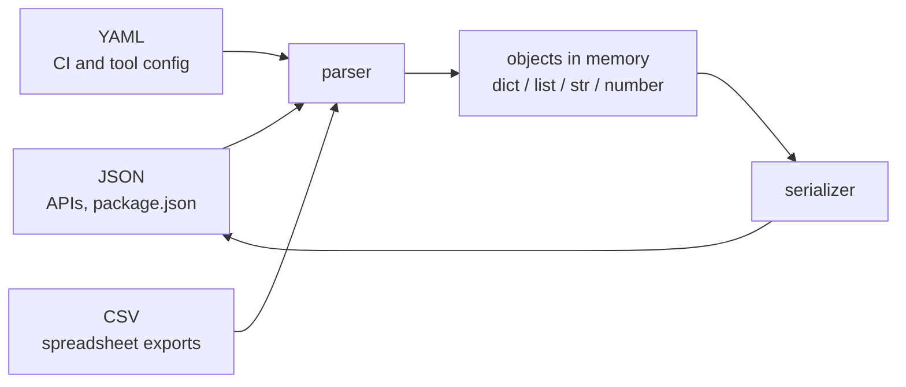

# Data formats: JSON, YAML and CSV

After this you can choose between JSON, YAML and CSV, parse each in Python and JavaScript, and spot the gotchas that corrupt data without raising an error.

Before this: [Files and I/O](../../03-programming-fundamentals/01-python-basics/07-files-and-io.md) and [Config, environment variables and secrets](02-config-env-vars-and-secrets.md).

## The idea

An API returns your order as text. A deploy tool reads its settings from a file. Finance sends you a spreadsheet export. In each case two programs that share nothing but a stream of characters need to agree on what the characters mean. A **data format** is that agreement.

Each format has a parser that turns text into objects in memory (a dictionary, a list, numbers) and a serializer that turns objects back into text. The diagram shows where the formats usually sit.



## Key terms

**JSON** (JavaScript Object Notation) is a text format for objects, arrays, strings, numbers, `true`, `false` and `null`, defined in [RFC 8259](https://www.rfc-editor.org/rfc/rfc8259). **YAML** is a format that uses indentation instead of braces and allows comments, anchors and many implicit types ([YAML 1.2.2 spec](https://yaml.org/spec/1.2.2/)). **CSV** (comma-separated values) is rows of text fields separated by commas, one record per line, described informally in [RFC 4180](https://www.rfc-editor.org/rfc/rfc4180).

A **schema** is a description of the shape and types the data must have. None of these three formats enforces one.

## How it works

| | JSON | YAML | CSV |
|---|---|---|---|
| Structure | nested objects and arrays | nested mappings and lists | flat table |
| Types | string, number, boolean, null | those, plus guessed dates and more | none, everything is text |
| Comments | no | yes (`#`) | no |
| Typical use | APIs, config read by programs | config read by people | exports, data loads |

JSON is strict. Strings use double quotes, keys must be quoted, and a trailing comma is an error. It has no comment syntax and no date type, so dates travel as strings (usually ISO 8601 such as `2026-10-25`) and you convert them. Its number type has no size limit in the text, but JavaScript reads every number as a 64-bit float, so very large integers lose digits.

```python
import json
data = json.loads('{"name": "Ada", "age": 36, "active": true, "boss": null}')
print(data["age"] + 1, type(data["active"]).__name__, data["boss"])
try:
    json.loads('{"a": 1,}')
except json.JSONDecodeError as e:
    print("error:", e)
```

```text
37 bool None
error: Illegal trailing comma before end of object: line 1 column 8 (char 7)
```

In JavaScript the same calls are `JSON.parse(text)` and `JSON.stringify(value)`. Python has `json.dumps(obj, indent=2)`. Both raise on a date object unless you convert it; `JSON.stringify` turns a `Date` into an ISO string, and silently drops `undefined` values and functions.

YAML is friendlier to write and riskier to read, because the parser guesses types. In YAML 1.1, the version PyYAML implements, `no`, `yes`, `on` and `off` are booleans, so the country code for Norway becomes `False`. YAML 1.2 narrowed booleans to `true` and `false` ([core schema](https://yaml.org/spec/1.2.2/#103-core-schema)), and the JavaScript `yaml` package follows it. Indentation is structure, and it must use spaces, never tabs.

```python
import yaml  # pip install pyyaml
print(yaml.safe_load("country: NO\nversion: 1.10\nzip: 01234\nport: \"8080\""))
```

```text
{'country': False, 'version': 1.1, 'zip': 668, 'port': '8080'}
```

Three values were changed silently: `NO` became `False`, `1.10` became the float `1.1`, and `01234` was read as octal and became 668. Quoting a value makes it a string, as with `port`. Use `yaml.safe_load`, never `yaml.load` on untrusted text. Node has no built-in YAML parser; the `yaml` package gives `YAML.parse(text)`.

CSV looks simplest and has the most variants. A field that contains a comma, a double quote or a line break must be wrapped in double quotes, and a quote inside it is doubled. Splitting on commas breaks as soon as one field does that. Every value comes back as a string, so `"91" + 1` is a bug. The delimiter is sometimes a semicolon or a tab, and the encoding is rarely announced: Excel can save UTF-8 with a byte order mark (BOM), which shows up as `` glued to the first column name unless you open the file with `encoding="utf-8-sig"`. Open with `newline=""` in Python so line breaks inside quoted fields survive.

```python
import csv, io
text = 'name,note,score\nAda,"likes ""math"", code",91\n'
print(text.split("\n")[1].split(","))
print(list(csv.DictReader(io.StringIO(text))))
```

```text
['Ada', '"likes ""math""', ' code"', '91']
[{'name': 'Ada', 'note': 'likes "math", code', 'score': '91'}]
```

JavaScript has no built-in CSV parser either; use a library such as PapaParse (`Papa.parse(text, { header: true })`), which returned the same record in a test.

## Worked examples

<div class="example" markdown>

### Example 1: the same record in three formats

```json
{"name": "Ada", "tags": ["math", "code"], "active": true}
```

```yaml
name: Ada
tags: [math, code]
active: true
```

```text
name,tags,active
Ada,math;code,true
```

1. JSON and YAML keep `tags` as a list. CSV cannot nest, so we invented a convention: join the tags with `;`.
2. After parsing, `active` is a boolean in JSON and YAML and the string `"true"` in CSV.
3. The CSV round trip needs a decision (split `tags` on `;` and convert `active`) that lives in your code, not in the file.

Check: parse the CSV with `csv.DictReader` and print `type(row["active"])`. You should see `<class 'str'>`.

</div>

## Common mistakes

<div class="warning" markdown>

Watch out: building CSV or JSON by string concatenation. A name such as `O"Brien, Jr.` breaks the CSV, and a quote in a JSON string breaks the JSON. Use the `csv` and `json` libraries to write as well as read.

Watch out: assuming a YAML value is the type it looks like. Quote anything ambiguous (`"NO"`, `"01234"`, `"1.10"`), and print the parsed result once.

Watch out: opening a CSV with the default encoding. Pass `encoding="utf-8"` (or `utf-8-sig` for Excel files) explicitly, as the Python files lesson advises.

</div>

## Working with AI

<div class="ai" markdown>

Words to use: JSON, YAML 1.1 vs 1.2, schema, quoting and escaping, delimiter, encoding, BOM, ISO 8601.

Prompts to try:

- "This CSV (paste the first 5 lines, with fake data) comes from Excel. Write Python with the `csv` module that reads it into dicts, handles the BOM, and converts `amount` to `Decimal` and `date` to `datetime.date`."
- "My GitHub Actions YAML fails with 'mapping values are not allowed here' (paste the file and error). Point to the exact line and explain the indentation rule I broke."

What to check:

- Hand-written parsing with `split(",")` or regular expressions where a library exists.
- JSON with comments or trailing commas in examples, which `JSON.parse` rejects.
- Floats used for money. Money should be integer cents or `Decimal`.
- A YAML answer that uses `yaml.load` without a safe loader.

</div>

## Quiz

1\. Why can't a JSON file contain a comment, and what do people do instead?

<details class="solution" markdown>
<summary>Answer</summary>

The JSON grammar has no comment syntax, so a parser rejects one. People use a separate documentation file, a field such as `"_note"` that the program ignores, or switch to YAML, which allows `#` comments.

</details>

2\. What does `yaml.safe_load("answer: no")` return in PyYAML?

<details class="solution" markdown>
<summary>Answer</summary>

`{'answer': False}`. PyYAML follows YAML 1.1, where `no` is a boolean. Writing `answer: "no"` keeps the string.

</details>

3\. A CSV row reads `Smith, John,42` and your code splits it on commas into three columns, but the header has two. What is the file likely missing, and what should the parser do?

<details class="solution" markdown>
<summary>Answer</summary>

The name field should be quoted: `"Smith, John",42`. With the quotes, a CSV parser keeps the comma inside the field. Ask the source to fix the export, and parse with a real CSV library.

</details>

4\. `df.columns` shows `['id', 'name']` after loading a file exported from Excel. What happened?

<details class="solution" markdown>
<summary>Answer</summary>

The file starts with a UTF-8 byte order mark, and it was read as plain `utf-8`, so the mark stayed in the first column name. Read with `encoding="utf-8-sig"`.

</details>

## Lab

<div class="lab" markdown>

### Lab: catch the silent changes

Goal: parse one YAML and one CSV file and find what each parser changed. Time: about 15 minutes. Runs in: any terminal with Python 3.

1. Run `python -m pip install pyyaml` in a virtual environment.
2. Create `s.yaml` with the lines `country: NO`, `version: 1.10`, `zip: 01234` and `name: "Ada"`.
3. Write a script that loads it with `yaml.safe_load` and prints each value with its type.
4. Create `p.csv` with a header `name,note` and the row `Bob,"said ""hi"", left"`. Read it with `csv.DictReader` and print the row.
5. Write `s.yaml` data back with `json.dumps(data, indent=2)` and compare.
6. Cleanup: delete the files.

Expected result: `country` is `False`, `version` is `1.1`, `zip` is `668`, and the CSV note is `said "hi", left`.

<details class="solution" markdown>
<summary>Solution</summary>

```python
import csv, json, yaml
data = yaml.safe_load(open("s.yaml", encoding="utf-8"))
for k, v in data.items():
    print(k, repr(v), type(v).__name__)
print(list(csv.DictReader(open("p.csv", encoding="utf-8", newline=""))))
print(json.dumps(data, indent=2))
```

The fix for the YAML is quoting: `country: "NO"`, `version: "1.10"`, `zip: "01234"`.

</details>

</div>

## Where this shows up

- Reading config in GitHub Actions workflows<!-- link: ../../13-devops-and-cloud/02-ci-cd/02-github-actions.md --> and REST API design<!-- link: ../../09-back-end/01-servers-and-apis/04-rest-api-design.md -->.
- Storing JSON inside a database in JSONB and full-text search<!-- link: ../../10-databases-sql-and-postgres/04-postgres-in-depth/07-jsonb-and-full-text-search.md -->, and opening CSV in a spreadsheet<!-- link: ../04-spreadsheets/03-spreadsheets-csv-and-sql.md -->.
