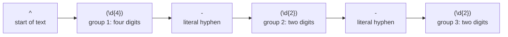

# Regular expressions

After this you can read and write short regular expressions, pull fields out of text with groups, choose greedy or lazy matching, and use regexes in Python, JavaScript, VS Code and `grep`.

Before this: [Strings and formatting](../../03-programming-fundamentals/01-python-basics/05-strings-and-formatting.md) and [Data formats: JSON, YAML and CSV](03-data-formats-json-yaml-csv.md).

## The idea

You have a log with thousands of lines and want every line where the level is `ERROR` and the code is a three-digit number. `str.find` cannot say "three digits". A **regular expression** (regex) is a pattern that describes a set of strings, and a regex engine finds the places in a text that fit it.

A regex is a small program written in a dense notation. The engine tries the pattern at each position in the text, from left to right, and reports the first position where all parts match. The diagram shows one pattern split into its parts.



In the diagram, the pattern `^(\d{4})-(\d{2})-(\d{2})` matches a date at the start of the text and captures its three numbers.

## Key terms

A **literal** matches itself. A **character class** such as `[a-z]` or `\d` (a digit) matches one character from a set. A **quantifier** says how many times the previous item repeats: `*` (zero or more), `+` (one or more), `?` (zero or one), `{n,m}` (between $n$ and $m$ times).

An **anchor** matches a position instead of a character: `^` is the start, `$` the end, `\b` a word boundary. A **group** `( ... )` bundles part of a pattern and **captures** the text it matched so you can reuse it. **Alternation** `a|b` matches either side.

A quantifier is **greedy** when it takes as much text as it can, and **lazy** (written `*?` or `+?`) when it takes as little as it can.

## How it works

| Syntax | Meaning |
|---|---|
| `.` | any character except a newline |
| `\d` `\w` `\s` | digit, word character (letter, digit, underscore), whitespace |
| `[abc]` `[^abc]` | one of a, b, c; any character except those |
| `a*` `a+` `a?` | zero or more, one or more, zero or one |
| `a{3}` `a{2,4}` | exactly 3; 2 to 4 |
| `^` `$` `\b` | start, end, word boundary |
| `(x)` `(?:x)` `(?P<n>x)` | capturing, non-capturing, named group (Python spelling; JavaScript writes `(?<n>x)`) |
| `x\|y` | x or y |
| `\.` `\(` `\\` | a literal dot, parenthesis, backslash |

The characters `. * + ? ( ) [ ] { } ^ $ | \` are special. To match one literally, put a backslash before it: `\.` matches a dot, while `.` matches anything.

Greedy and lazy differ when a pattern can end at several places. Greedy `.*` runs to the last `</b>`, lazy `.*?` stops at the first:

```python
import re
html = "<b>one</b> and <b>two</b>"
print(re.search(r"<b>.*</b>", html).group())
print(re.search(r"<b>.*?</b>", html).group())
```

```text
<b>one</b> and <b>two</b>
<b>one</b>
```

Python's `re` module ([docs](https://docs.python.org/3/library/re.html)) has `search` (first match anywhere), `match` (only at the start), `fullmatch` (the whole string), `findall`, `sub` and `compile`. Write patterns as raw strings, `r"\d+"`, so Python does not treat the backslash as an escape. JavaScript has regex literals between slashes, `/\d+/`, with the methods `test`, `match`, `matchAll` and `replace` ([MDN guide](https://developer.mozilla.org/en-US/docs/Web/JavaScript/Guide/Regular_expressions)). A JavaScript regex without the `g` flag stops at the first match; with `g` it finds all. In a replacement, Python writes `\1` and JavaScript writes `$1`.

Outside code, regexes run in two other places. In VS Code, turn on the regular expression option in Find or Search; replacement text refers to groups as `$1`, `$2` ([VS Code docs](https://code.visualstudio.com/docs/editor/codebasics)). On the command line, `grep -E` uses extended syntax with `+`, `|` and `{}` unescaped, and `grep -o` prints only the matched part. Regex dialects differ in small ways (named groups, lookbehind), so test in the tool you will use.

Last, know when to stop. Regexes handle flat patterns such as dates, IDs and log lines. They cannot parse nested structure: use an HTML parser for HTML and a JSON parser for JSON. For email addresses, a full regex for the standard is enormous, so check for a basic shape like `@` and send a confirmation email, because the only real test is whether the mailbox exists. Some patterns also run extremely slowly: `^(a+)+$` on 28 letters `a` followed by `b` took 11 seconds in Node 24 on the author's machine, because the engine retries every way of splitting the string. This is called catastrophic backtracking. Avoid nested quantifiers and never run a user-supplied pattern on a server.

## Worked examples

<div class="example" markdown>

### Example 1: pull fields out of a log line

The line is `2026-10-25 09:14:09 ERROR user=bob action=upload ip=10.0.0.7 code=500`.

```python
import re
line = "2026-10-25 09:14:09 ERROR user=bob action=upload ip=10.0.0.7 code=500"
m = re.search(r"^(?P<date>\d{4}-\d{2}-\d{2}) (?P<time>[\d:]+) (?P<level>[A-Z]+)", line)
print(m.group("date"), m.group("level"), m.span())
print(re.findall(r"(\w+)=(\S+)", line))
```

```text
2026-10-25 ERROR (0, 25)
[('user', 'bob'), ('action', 'upload'), ('ip', '10.0.0.7'), ('code', '500')]
```

1. `^` anchors the match at the start. `\d{4}-\d{2}-\d{2}` is the date, in a named group.
2. `[\d:]+` is a class of digits and colons, one or more times. It matches the time.
3. `[A-Z]+` matches the level. The span `(0, 25)` is the matched slice.
4. `(\w+)=(\S+)` finds every `key=value` pair: word characters, an equals sign, then non-whitespace. With two groups, `findall` returns tuples.

The JavaScript equivalent uses `(?<date>...)` and `matchAll` with the `g` flag, and printed the same values.

Check: print `m.group("time")` and confirm it is `09:14:09`.

</div>

<div class="example" markdown>

### Example 2: the same search in grep

On a four-line `app.log` with the same format:

```bash
grep -E "ERROR.*code=[0-9]{3}" app.log
grep -oE "ip=[0-9.]+" app.log
grep -cE "user=(alice|bob)" app.log
```

The first prints the two `ERROR` lines, the second prints four `ip=...` values, and the third prints `3`.

</div>

## Common mistakes

<div class="warning" markdown>

Watch out: an unescaped dot. `1.5` as a pattern also matches `105`. Write `1\.5`.

Watch out: using `match` or `test` when you need the whole string to fit. In Python, `re.search(r"\d+", "123abc")` succeeds; `re.fullmatch` returns `None`. Anchor with `^...$` (JavaScript) or use `fullmatch`.

Watch out: using greedy `.*` between two markers, which swallows everything up to the last marker. Use `.*?` or a negated class such as `[^<]*`.

</div>

## Working with AI

<div class="ai" markdown>

Words to use: capture group, named group, anchor, greedy vs lazy, lookahead, character class, catastrophic backtracking.

Prompts to try:

- "Write a Python regex that matches an ISO date like 2026-10-25 and captures year, month and day as named groups. Show five strings it should match and five it should reject."
- "Explain this regex piece by piece and give one input where it fails (paste it): `^(\d+)\.(\d+)\.(\d+)(-[\w.]+)?$`."

What to check:

- Run the pattern on strings that should not match as well as those that should. A regex that accepts `2026-13-45` as a date is valid syntax and wrong.
- Syntax from another dialect: a pattern with `(?<name>...)` in Python, or lookbehind that your tool does not support.
- Nested quantifiers such as `(a+)+` or `(.*)*`, which can hang.
- A regex offered for HTML or full email validation. Ask for a parser or a library.

</div>

## Quiz

1\. What does `^\d{3}-\d{4}$` match?

<details class="solution" markdown>
<summary>Answer</summary>

A whole string of three digits, a hyphen and four digits, such as `555-0199`. The anchors mean nothing else may come before or after.

</details>

2\. What does this print?

```python
import re
print(re.findall(r"\d+", "a1b22c333"))
```

<details class="solution" markdown>
<summary>Answer</summary>

`['1', '22', '333']`. Each run of digits is one match.

</details>

3\. You want the text inside the first pair of quotes in `say "a" and "b"`. The pattern `".*"` returns `"a" and "b"`. Fix it.

<details class="solution" markdown>
<summary>Answer</summary>

Greedy `.*` runs to the last quote. Use `".*?"` or `"[^"]*"`, which both return `"a"`.

</details>

4\. A teammate validates emails with a long regex and users with valid addresses are rejected. What do you suggest?

<details class="solution" markdown>
<summary>Answer</summary>

Check only the basic shape (one `@`, something on each side) and confirm ownership by sending a message with a link. A regex cannot tell whether the mailbox exists, and strict patterns reject legal addresses.

</details>

## Lab

<div class="lab" markdown>

### Lab: mine a log with regexes

Goal: extract errors from a log in VS Code, grep and Python. Time: about 15 minutes. Runs in: VS Code and any terminal with Python 3 and `grep` (WSL or Git Bash).

1. Save the four sample lines from Example 2's `app.log` (any log with `user=` and `ip=` fields works).
2. In VS Code, open Search, turn on regular expression mode and search `ERROR.*code=\d{3}`. Confirm it finds only the error lines.
3. In Search, use `user=(\w+)` with replace `name:$1` and preview the change. Do not apply it.
4. In a terminal, run `grep -oE "ip=[0-9.]+" app.log | sort -u`.
5. In Python, count how many lines have `ERROR` and print the set of users on those lines.
6. Cleanup: delete the file.

Expected result: 2 error lines, 3 unique IPs, users `bob` and `carol`.

<details class="solution" markdown>
<summary>Solution</summary>

```python
import re
users = set()
for line in open("app.log", encoding="utf-8"):
    if " ERROR " in line:
        users.add(re.search(r"user=(\w+)", line).group(1))
print(len(users), sorted(users))
```

```text
2 ['bob', 'carol']
```

The `grep` command prints `ip=10.0.0.5`, `ip=10.0.0.7` and `ip=192.168.1.20`.

</details>

</div>

## Where this shows up

- Log searching with the Linux text tools<!-- link: ../../02-operating-systems-and-linux/02-linux-command-line/04-pipes-redirection-and-text-tools.md --> and route patterns in Express routing<!-- link: ../../09-back-end/01-servers-and-apis/03-express-routing-and-middleware.md -->.
- Input checks in injection and input validation<!-- link: ../../12-security/01-web-security/03-injection-and-input-validation.md -->, where a slow regex can become a denial-of-service bug.
